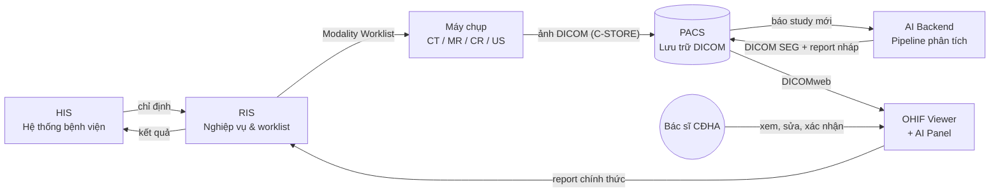
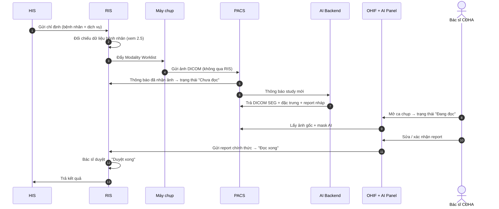
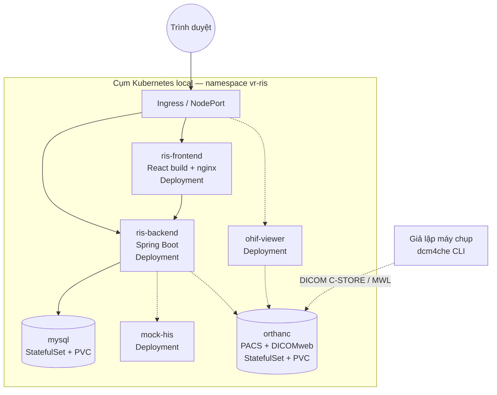
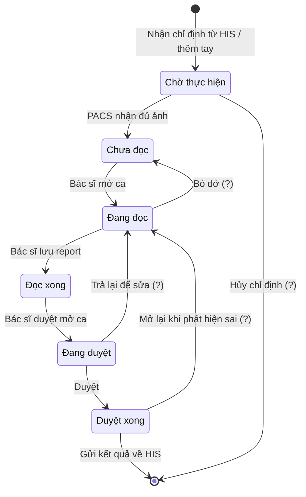

# VR-RIS PACS — Tài liệu kế hoạch dự án
 
> **Đọc file này trước khi làm bất cứ việc gì.**
> Đây là tài liệu gốc (single source of truth) mô tả bối cảnh, kiến trúc, phạm vi và kế hoạch của dự án.
> Mọi agent/thành viên mới tham gia đều bắt đầu từ đây.
 
| | |
|---|---|
| **Tên hệ thống** | VR-RIS PACS |
| **Loại** | Hệ thống RIS tích hợp PACS + AI hỗ trợ đọc phim cho bệnh viện |
| **Bối cảnh** | **Đồ án môn học** — không triển khai lâm sàng thật |
| **Stack** | React · Java Spring Boot · MySQL · Docker + Kubernetes (local) |
| **Trạng thái** | Giai đoạn thiết kế — **chưa bắt đầu coding** |
| **Thời gian** | **8 tuần** (xem lịch chi tiết ở Phần 7) |
| **Mục tiêu hết 8 tuần** | RIS core chạy được với dữ liệu nhập tay + thiết kế xong (chưa code) phần tích hợp PACS |
| **Ngôn ngữ tài liệu** | Tiếng Việt |
| **Cập nhật lần cuối** | 2026-10-17 |
 
### Cấu trúc repo

```text
.
├── README.md              # file này — tài liệu gốc của dự án
├── Frontend/              # React 19 + Vite (prototype chạy bằng dữ liệu giả); xem Frontend/README.md
├── doc/                   # tài liệu thiết kế
│   ├── 01-scope.md        #   scope doc
│   ├── 02-erd.md          #   ERD rút gọn
│   ├── diagrams/          #   nguồn Mermaid (.mmd) + ảnh xuất từ draw.io (.png) cùng tên
│   └── archive/           #   bản .docx cũ của 01-scope và 02-erd (giữ để đối chiếu)
├── backend/               # (dự kiến) Spring Boot — chưa có
└── deploy/                # (dự kiến) Dockerfile, Docker Compose, manifest k8s — chưa có
```

---
 
## 0. Hướng dẫn cho agent
 
Khi bạn được giao việc trong dự án này:
 
1. Đọc hết file này để nắm bối cảnh.
2. Xác định việc được giao nằm ở hạng mục nào của **Phần 6** và tuần nào của **Phần 7**. Hạng mục gắn nhãn **[HOÃN]** thì không làm, trừ khi người dùng yêu cầu rõ.
3. Nếu thông tin cần thiết nằm trong **Phần 9 (Câu hỏi còn mở)** mà chưa có câu trả lời → **hỏi lại người dùng, không tự giả định**. Dù là đồ án, nghiệp vụ y tế vẫn cần mô phỏng đúng.
4. Khi hoàn thành một hạng mục, cập nhật lại checkbox trong file này.
5. Thuật ngữ viết tắt xem **Phần 10 (Glossary)**.
**Nguyên tắc bất biến của dự án (không được phá vỡ nếu không có quyết định rõ ràng):**
 
- RIS **không** lưu trữ hoặc xử lý ảnh DICOM. PACS là nguồn ảnh duy nhất.
- Máy chụp gửi ảnh **thẳng vào PACS**, không đi qua RIS.
- AI **không** tự động trả kết quả chính thức. Luôn phải có bác sĩ CĐHA xác nhận (human-in-the-loop).
- Mọi hành vi đọc/sửa/duyệt dữ liệu bệnh nhân đều phải ghi audit log.
- Tích hợp dùng chuẩn mở (DICOM / HL7 / FHIR), không tự chế protocol riêng.
- **Không dùng dữ liệu bệnh nhân thật** ở bất kỳ đâu (seed data, test, ảnh demo, slide). Chỉ dùng dữ liệu giả hoặc bộ DICOM công khai đã ẩn danh. Tên bệnh nhân xuất hiện trong ảnh chụp màn hình tham chiếu **không được** đưa vào seed data.
- Stack đã chốt (Phần 8) không thay đổi nếu không có yêu cầu từ người dùng.
---
 
## 1. Bối cảnh
 
Hệ thống đã có một bản web đang chạy (các màn hình worklist, bộ lọc, modal thông tin lâm sàng, form thêm/sửa ca chụp, màn hình cấu hình). Dự án hiện tại là **thiết kế lại / xây dựng hoàn chỉnh** hệ thống theo kiến trúc 4 module có tích hợp AI.
 
Nguồn tham chiếu hiện có: bộ ảnh chụp màn hình giao diện đang vận hành (worklist, filter, clinical info modal, settings, add/update study dialog).
 
### 1.1. Đây là đồ án môn học — hệ quả với thiết kế
 
| Thực tế bệnh viện | Cách xử lý trong đồ án |
|---|---|
| Có HIS thật của vendor | **Mock HIS** — service giả lập API chỉ định / nhận kết quả, chạy trong cụm k8s |
| Có máy chụp thật | **Giả lập modality** bằng công cụ DICOM dòng lệnh (ví dụ bộ dcm4che: `findscu` để lấy worklist, `storescu` để gửi ảnh) |
| Ảnh bệnh nhân thật | Bộ DICOM công khai đã ẩn danh (ví dụ The Cancer Imaging Archive) |
| Kiểm định thiết bị y tế, pháp lý | **Ngoài phạm vi** — chỉ ghi chú trong báo cáo |
| Triển khai on-premise bệnh viện | **Local bằng Docker + Kubernetes**; host lên web tính sau |
 
Mục tiêu ưu tiên: **demo chạy được end-to-end** + **tài liệu thiết kế rõ ràng** để trình bày/chấm điểm.
 
---
 
## 2. Kiến trúc tổng thể
 
### 2.1. Bốn module chính
 
| Module | Vai trò | Không làm gì |
|---|---|---|
| **RIS** | Quản lý toàn bộ luồng nghiệp vụ: bệnh nhân, chỉ định, lịch hẹn, worklist, trạng thái ca chụp, báo cáo | Không lưu trữ/xử lý ảnh DICOM |
| **PACS** | Lưu trữ và truyền tải ảnh DICOM gốc + ảnh kết quả AI (DICOM SEG). Nguồn dữ liệu ảnh duy nhất của hệ thống | Không chứa logic nghiệp vụ |
| **OHIF Viewer + AI Panel** | Giao diện xem ảnh cho bác sĩ CĐHA; hiển thị overlay mask AI và panel kết quả phân tích | Không tự sinh kết quả |
| **AI Backend** | Chạy pipeline AI: segmentation → trích đặc trưng → phân loại → sinh báo cáo nháp. Độc lập với giao diện | Không ghi trực tiếp vào RIS |
 
### 2.2. Sơ đồ kiến trúc thành phần
 

 
### 2.3. Luồng dữ liệu theo thời gian (một ca chụp)
 

 
> **Lưu ý:** bước 5 (PACS báo về RIS) và cách AI chen vào trạng thái là **giả định**, chưa chốt — xem Phần 4.
 
### 2.4. Ranh giới tích hợp cần chốt
 
| Kết nối | Chuẩn dự kiến | Trạng thái |
|---|---|---|
| HIS → RIS (chỉ định) | HL7 v2 ORM / FHIR ServiceRequest / API riêng của HIS | ❓ chưa chốt |
| RIS → HIS (kết quả) | HL7 v2 ORU / FHIR DiagnosticReport | ❓ chưa chốt |
| RIS → Máy chụp | DICOM Modality Worklist (C-FIND) | dự kiến |
| Máy chụp → PACS | DICOM C-STORE | dự kiến |
| PACS ↔ OHIF | DICOMweb (QIDO-RS / WADO-RS / STOW-RS) | dự kiến |
| PACS ↔ AI Backend | DICOMweb + webhook/queue thông báo study mới | dự kiến |
| OHIF → RIS | REST API nội bộ | dự kiến |
 
### 2.5. ⚠️ Known issue: lệch dữ liệu bệnh nhân giữa HIS và RIS
 
**Hiện tượng đã quan sát:** một bệnh nhân (tên và mã thật đã được ẩn khỏi tài liệu này, theo nguyên tắc không dùng dữ liệu bệnh nhân thật) có năm sinh **1958** trong RIS nhưng màn hình "Cập nhật chỉ định từ HIS" hiển thị **1952**, tuổi **0**. Đã xác nhận là lỗi.
 
**Vì sao nghiêm trọng:** đây là lỗi đối chiếu danh tính, không phải lỗi hiển thị. Nếu không có quy tắc rõ, hậu quả có thể là ảnh/kết quả gán nhầm bệnh nhân.
 
**Quy tắc bắt buộc phải chốt trong thiết kế (không để tùy người code):**
 
- [ ] Khóa đối chiếu chính là trường nào (mã bệnh nhân / mã BHXH / tổ hợp họ tên + ngày sinh)
- [ ] Khi HIS và RIS lệch nhau: bên nào thắng, hay chặn lại và bắt người dùng xác nhận
- [ ] Có cho sửa tay thông tin đã đồng bộ từ HIS không; nếu có thì lần đồng bộ sau có ghi đè không
- [ ] Mọi lần phát hiện lệch phải ghi log riêng để rà soát định kỳ
- [ ] Tuổi phải được **tính từ ngày sinh**, không lưu cứng (tránh lỗi "Tuổi 0")
**Yêu cầu kiểm thử:** có test case riêng cho các trường hợp lệch họ tên, lệch ngày sinh, thiếu ngày sinh, trùng mã bệnh nhân.
 
### 2.6. Triển khai local (Docker + Kubernetes)
 

 
- **Nét liền** = có trong 8 tuần (RIS core). **Nét đứt** = thêm dần ở tuần 7 hoặc giai đoạn sau.
- Cấu hình (DB URL, mật khẩu) qua **ConfigMap + Secret**, không hard-code trong image.
- MySQL và PACS dùng **PersistentVolumeClaim** để không mất dữ liệu khi pod khởi động lại.
- **Gợi ý (chưa chốt):** dùng **Docker Compose** cho vòng dev hằng ngày (nhanh, ít cấu hình), Kubernetes cho bản tích hợp/demo. Hai bộ cấu hình dùng chung image.
---
 
## 3. Chức năng đã quan sát được từ hệ thống hiện tại
 
Dùng làm baseline — bản mới **tối thiểu phải có đủ** các chức năng này.
 
### 3.1. Worklist
- Hai tab: **Chờ** / **Đã thực hiện**
- Cột: STT, trạng thái, mã bệnh nhân, họ tên, ngày sinh, tuổi, giới tính, chỉ định, thời gian chụp, thời gian bắt đầu/kết thúc, bác sĩ chỉ định, chẩn đoán, máy chụp
- Panel chi tiết bệnh nhân bên phải (thông tin hành chính, chỉ định, kỹ thuật, mô tả, chẩn đoán, kết luận, khuyến nghị, người thực hiện)
- Bảng phụ phía dưới: danh sách phiếu của cùng bệnh nhân
- Đếm số lượng theo nhóm trên tiêu đề (`DANH SÁCH MÁY - (66|3.397)`)
### 3.2. Bộ lọc
- Cây máy theo khoa → nhóm → máy (Truyền nhiễm, Cấp cứu, CĐHA, Test, Trung tâm, KYC, TDCN, Phòng khám, KSK-B9, N3…)
- Lọc theo Modality
- Tìm theo mã bệnh nhân / họ tên / mã LSVV / mã phiếu
- Khoảng thời gian: Hôm nay, Hôm qua, -3 ngày, -7 ngày, -30 ngày, Tất cả, hoặc chọn ngày tùy ý
- Loại thời gian lọc: "Thời gian thực hiện" (có dropdown — cần liệt kê đủ các lựa chọn)
- **Trạng thái ca chụp**: Chờ thực hiện, Chưa đọc, Đang đọc, Đọc xong, Đang duyệt, Duyệt xong, Tất cả (kèm số đếm từng nhóm)
- **Trạng thái đồng bộ HIS**: Tất cả / Đồng bộ HIS / Chưa đồng bộ HIS / Đã gửi kết quả / Chưa gửi kết quả
- **Trạng thái BHYT**: Vi phạm BHYT / Không vi phạm BHYT
- Loại bệnh nhân: Nội trú / Ngoại trú
- Lọc theo Bác sĩ chỉ định, Chỉ định, Bộ phận chụp, Kết luận
- Nút "Danh sách ca chụp quá hạn" (có badge số lượng)
- Tùy chỉnh cột hiển thị: Bác sĩ chỉ định, Chỉ định, Bộ phận chụp, Kết luận, Mã đoàn khám, Tên đoàn khám, Mã hồ sơ, Mã bệnh phẩm, Mã lưu trữ
### 3.3. Thông tin lâm sàng (modal 5 tab)
1. **Kết quả tổng quan khám** — chẩn đoán phiếu khám, tiền sử bản thân/gia đình, sinh hiệu (nhịp tim, nhiệt độ, huyết áp, nhịp thở, chiều cao, cân nặng), quá trình bệnh lý, quá trình khám bệnh (A-B-C-D-E-G), khoa khám, phòng khám, kết luận
2. **Kết quả xét nghiệm** — bảng: STT, số phiếu, tên xét nghiệm, trạng thái, người tạo, ngày tạo, ngày thực hiện
3. **Kết quả chẩn đoán chức năng chính** — theo từng phiếu: số phiếu, ngày chỉ định, ngày trả kết quả, mã nhóm dịch vụ, ghi chú, tên dịch vụ, kết quả, mã CĐHA
4. **Đơn thuốc/vật tư trong phiếu khám** — bảng: số hồ sơ, số phiếu, số dòng, mã thuốc/vật tư, tên, thành phần chung, đơn vị tính, số lượng order
5. **Dữ liệu phẫu thuật thủ thuật**
### 3.4. Quản lý ca chụp
- **Thêm ca chụp**: mã, họ tên, tuổi, giới tính, BHXH, địa chỉ, điện thoại, bộ phận chụp, chẩn đoán ban đầu, khoa chỉ định, bác sĩ chỉ định, buồng, giường, tên chỉ định, máy chụp
- **Cập nhật ca chụp**: so sánh "Thông tin hiện tại" vs "Thông tin cập nhật" theo từng trường
- **Cập nhật chỉ định từ HIS**: tra theo mã chỉ định hoặc mã bệnh nhân → chọn chỉ định trong danh sách → cập nhật
- **Thêm chỉ định**, **Lâm sàng**, **In**
### 3.5. Cấu hình hệ thống
- Loại màn: Ngang / (dọc)
- Số màn hình: Một / nhiều
- Hành vi Double Click: mở Viewer
- Tổng hợp: Đơn / …
- Giải mã tải về: Có / Không
- Ẩn bộ lọc, Ẩn danh sách máy
- Giao diện tối: Bật / Tắt
- Thao tác hàng loạt: In toàn bộ danh sách, Duyệt toàn bộ danh sách, Thêm bệnh nhân, Tải toàn bộ danh sách, Chọn Modality
---
 
## 4. Trạng thái ca chụp (state machine)
 

 
> Các mũi tên có dấu **(?)** là **giả định**, chưa được xác nhận. Luồng chính (thẳng hàng) khớp với các trạng thái thấy trên giao diện hiện tại.
> Trạng thái "Đang duyệt" có thể chỉ tồn tại ở một số khoa — cần hỏi lại.
 
Cần đặc tả rõ (**chưa có — xem Phần 9**):
- Ai (vai trò nào) được chuyển trạng thái nào
- Có được quay lui không (ví dụ Duyệt xong → Đang đọc khi phát hiện sai)
- Điều kiện bắt buộc để chuyển (ví dụ: phải có report mới được Đọc xong)
- Trạng thái "quá hạn" tính theo quy tắc nào
- AI chen vào ở đâu trong chuỗi này
---
 
## 5. Vai trò người dùng
 
| Vai trò | Mô tả | Quyền chính (dự kiến — cần chốt) |
|---|---|---|
| Bác sĩ lâm sàng | Nơi phát sinh chỉ định (phía HIS) | Xem kết quả của bệnh nhân mình chỉ định |
| KTV chụp | Thực hiện chụp | Xem worklist, cập nhật thông tin ca chụp, đánh dấu đã chụp |
| Bác sĩ CĐHA (đọc) | Đọc phim, viết report | Đọc ảnh, sửa report nháp AI, chuyển Đọc xong |
| Bác sĩ duyệt | Duyệt kết quả cuối | Duyệt/trả lại report, chuyển Duyệt xong |
| Admin | Quản trị | Cấu hình máy, người dùng, phân quyền, xem audit log |
 
---
 
## 6. Danh mục tài liệu & thiết kế
 
Mỗi hạng mục được gắn nhãn thời điểm làm:
 
- **[T1]**, **[T2]**… = làm trong tuần đó, **chặn** các việc phía sau
- **[//]** = làm song song khi đang code, không chặn
- **[HOÃN]** = để ngoài phạm vi 8 tuần, không làm lúc này
- **[NGOÀI PHẠM VI]** = không làm trong đồ án
### A. Nghiệp vụ
- [ ] **[T1] Scope doc** — trả lời các câu hỏi ở Phần 9 nhóm "Phạm vi" và "Tích hợp". **Không có file này thì mọi quyết định sau đều có thể sai.**
- [ ] **[T1] Đặc tả state machine** trạng thái ca chụp (Phần 4) — xác nhận hoặc gạch bỏ các mũi tên (?)
- [ ] **[T1] Quy tắc đối chiếu dữ liệu HIS ↔ RIS** (Phần 2.5)
- [ ] **[//] Ma trận phân quyền RBAC** (vai trò × chức năng × dữ liệu) — viết lúc code phần auth
- [ ] **[//] Use case / User story** theo vai trò — chỉ cho các chức năng đang code
- [ ] **[HOÃN] SRS đầy đủ** — trong 8 tuần, README + scope doc + user story thay thế SRS
### B. Kiến trúc & tích hợp
- [ ] **[T2] Quyết định stack + sơ đồ kiến trúc** (Phần 8) — chốt nhanh, không để mở quá tuần 2
- [ ] **[T2] API contract (OpenAPI)** cho RIS core: bệnh nhân, chỉ định, worklist, trạng thái — sinh từ springdoc-openapi hoặc viết tay trước rồi đối chiếu
- [ ] **[T2] Sơ đồ triển khai local** (Phần 2.6) + quy ước đặt tên image, namespace, biến môi trường
- [ ] **[T3] Dockerfile cho frontend/backend + manifest k8s** (Deployment, Service, StatefulSet MySQL, ConfigMap, Secret)
- [ ] **[T4–T5] Đặc tả tích hợp DICOM** — MWL, C-STORE, DICOMweb, AE Title
- [ ] **[HOÃN] Đặc tả tích hợp HIS chi tiết** — chỉ cần biết HIS nào + có API không (đã nằm trong scope doc)
- [ ] **[HOÃN] API contract PACS ↔ AI, đặc tả output AI** (mask format, feature schema)
- [ ] **[HOÃN] Host lên web / cloud** — tính sau khi chạy ổn trên local
### C. Dữ liệu
- [ ] **[T1] ERD rút gọn** — chỉ: Bệnh nhân, Chỉ định, Ca chụp, Lịch sử trạng thái, Máy/Modality, Khoa, User/Role, Audit log
- [ ] **[//] Data dictionary** — viết dần theo từng bảng khi code
- [ ] **[T4–T5] Mapping DICOM tag ↔ trường RIS**
- [ ] **[HOÃN] Bảng phụ**: đoàn khám, mã lưu trữ, mã bệnh phẩm, BHYT chi tiết
- [ ] **[HOÃN] Chiến lược lưu trữ ảnh dài hạn**
### D. Bảo mật & tuân thủ
- [ ] **[//] Audit log** — có ngay từ đầu trong ERD, không làm sau
- [ ] **[//] Xác thực** — Spring Security + JWT (gợi ý, xem Phần 8)
- [ ] **[//] Dữ liệu mẫu (seed data)** — sinh dữ liệu giả, tuyệt đối không dùng tên/mã bệnh nhân thật
- [ ] **[NGOÀI PHẠM VI] Pháp lý VN về hồ sơ bệnh án điện tử, kiểm định phần mềm thiết bị y tế** — đồ án không triển khai lâm sàng; chỉ nêu trong báo cáo như hướng phát triển
### E. Thiết kế trực quan (sơ đồ, Figma)
- [x] **[T1] Sơ đồ Mermaid**: kiến trúc (2.2), luồng một ca chụp (2.3), state machine (4) — **đã có bản nháp trong file này**, cần xác nhận
- [ ] **[T1] Sơ đồ luồng ngoại lệ** (Mermaid): chụp lại, hủy chỉ định, sai thông tin bệnh nhân, mất kết nối HIS
- [ ] **[T2] Design system trong Figma** — trích từ UI hiện tại: màu, typography, spacing, component bảng / bộ lọc / modal / badge trạng thái. **Không vẽ lại màn hình đã có**, chỉ chuẩn hóa.
- [ ] **[T2–T3] Wireframe AI Panel trong OHIF** — màn hình duy nhất chưa có tiền lệ: overlay mask, panel kết quả, report nháp, nút xác nhận/sửa của bác sĩ. Đáng đầu tư kỹ.
- [ ] **[T3] Review wireframe AI Panel với bác sĩ CĐHA** (nếu sắp xếp được)
- [ ] **[//] Chỉnh sửa nhỏ các màn hình cũ** trong Figma khi logic mới khác UI cũ
- [ ] **[HOÃN] Layout đa màn hình đọc phim**
> **Công cụ:** sơ đồ dùng **Mermaid** nhúng trong README (agent và dev đọc được trực tiếp, version cùng code). Chỉ dùng draw.io khi cần trình bày cho người không kỹ thuật duyệt. UI dùng **Figma**.
 
### F. Kiểm thử & vận hành
- [ ] **[//] Test case** cho state machine và đối chiếu dữ liệu HIS/RIS — viết cùng lúc code
- [ ] **[T8] Kịch bản demo / nghiệm thu nội bộ**
- [ ] **[HOÃN] Test plan đầy đủ, kế hoạch UAT với bác sĩ/KTV**
- [ ] **[HOÃN] Backup & disaster recovery cho DICOM, SLA hiệu năng**
---
 
## 7. Lịch 8 tuần
 
**Nguyên tắc:** thiết kế và code chạy song song từ tuần 3, không tách pha cứng. Tuần 1–2 là tuần duy nhất chỉ thiết kế.
 
### 7.1. Tổng quan

```mermaid
gantt
    title VR-RIS PACS — 8 tuần
    dateFormat  YYYY-MM-DD
    axisFormat  %d/%m
 
    section Thiết kế nền tảng
    Scope doc + câu hỏi mở           :a1, 2026-10-19, 5d
    ERD rút gọn                      :a2, 2026-10-19, 5d
    State machine + quy tắc HIS/RIS  :a3, 2026-10-19, 5d
    Sơ đồ luồng ngoại lệ             :a4, 2026-10-21, 3d
    Stack + kiến trúc                :b1, after a1, 5d
    API contract RIS core            :b2, after a2, 5d
 
    section Figma
    Design system từ UI cũ           :f1, after a3, 5d
    Wireframe AI Panel               :f2, after a3, 10d
    Review với bác sĩ                :f3, after f2, 2d
 
    section Code RIS core
    Setup Spring Boot/React/MySQL, Docker, k8s, auth :c1, after b2, 5d
    Bệnh nhân + chỉ định + worklist  :c2, after c1, 10d
    State machine + bộ lọc           :c3, after c1, 10d
    Giao diện worklist + lâm sàng    :c4, after c1, 15d
 
    section Chuẩn bị Phase PACS
    Đặc tả DICOM + mapping tag       :d1, 2026-11-09, 10d
    POC Orthanc/dcm4chee + OHIF      :d2, after d1, 5d
 
    section Chốt
    Deploy toàn bộ lên k8s local     :e0, 2026-12-03, 4d
    Kiểm thử + demo nội bộ           :e1, 2026-12-07, 5d
```
 

 
> Ngày bắt đầu giả định là thứ Hai 19/10/2026 — chỉnh lại theo thực tế.
 
### 7.2. Chi tiết từng tuần
 
| Tuần | Tài liệu kỹ thuật | Thiết kế trực quan | Code | Điều kiện hoàn thành |
|---|---|---|---|---|
| **1** | Scope doc, ERD rút gọn, state machine, quy tắc HIS/RIS | Xác nhận 3 sơ đồ Mermaid có sẵn; vẽ thêm sơ đồ luồng ngoại lệ | — | Phần 9 nhóm "Phạm vi" + "Tích hợp" đã có câu trả lời |
| **2** | API contract RIS core, chốt các ô ❓ còn lại ở Phần 8, sơ đồ triển khai local | Design system trong Figma; bắt đầu wireframe AI Panel | — | OpenAPI spec review xong, không còn ô ❓ ở Phần 8 |
| **3** | RBAC matrix (//) | Hoàn thiện wireframe AI Panel, review với bác sĩ | Khởi tạo Spring Boot + React + MySQL (Flyway migration), Dockerfile, manifest k8s, auth, audit log | `kubectl apply` chạy được cả 3 thành phần; đăng nhập được; thao tác ghi audit log |
| **4** | Đặc tả DICOM (bắt đầu) | — | Bệnh nhân, chỉ định, thêm/sửa ca chụp | CRUD chạy được, có quy tắc đối chiếu dữ liệu |
| **5** | Đặc tả DICOM + mapping tag | — | Worklist 2 tab, state machine | Chuyển trạng thái đúng theo Phần 4, có test |
| **6** | — | — | Bộ lọc (thời gian, trạng thái, máy, khoa), modal thông tin lâm sàng | Bộ lọc chính chạy được trên dữ liệu mẫu |
| **7** | — | — | Thêm Orthanc + OHIF vào cụm k8s; gửi ảnh mẫu bằng dcm4che; hoàn thiện UI | Mở được ảnh DICOM mẫu từ worklist |
| **8** | Cập nhật README, báo cáo đồ án, ghi lại nợ kỹ thuật | — | Deploy toàn bộ lên k8s local, sửa lỗi, kiểm thử | Demo end-to-end từ một lệnh deploy, dữ liệu giả |
 
### 7.3. Ngoài phạm vi 8 tuần (giai đoạn sau)
 
Theo thứ tự phụ thuộc:
 
1. **Tích hợp PACS đầy đủ** — RIS đẩy MWL, nhận thông báo study mới, cập nhật trạng thái tự động
2. **Tích hợp Mock HIS** — nhận chỉ định, trả kết quả, retry, trạng thái đồng bộ
3. **AI Backend + AI Panel** — chỉ bắt đầu sau khi pipeline ảnh ổn định và đã đánh giá pháp lý
4. Các chức năng phụ: đoàn khám, BHYT chi tiết, in/duyệt hàng loạt, đa màn hình
5. Host lên web
### 7.4. Rủi ro lịch trình
 
| Rủi ro | Ảnh hưởng | Cách giảm |
|---|---|---|
| Không có tài liệu/API của HIS | Không thiết kế được tích hợp | Đã đẩy HIS ra ngoài 8 tuần; tuần 1 chỉ cần xác nhận HIS nào |
| Phiên bản/thư viện chưa chốt sau tuần 2 | Trễ toàn bộ phần code | Stack chính đã chốt; các ô ❓ còn lại ở Phần 8 có hạn cứng cuối tuần 2 |
| Kubernetes tốn thời gian cấu hình | Mất thời gian code tính năng | Dev hằng ngày bằng Docker Compose; k8s chỉ cần chạy được ở tuần 3 và tuần 8 |
| Ảnh DICOM mẫu không tương thích Orthanc/OHIF | Tuần 7 không demo được ảnh | Thử tải và mở 1 study mẫu ngay từ tuần 4–5 |
| Không gặp được bác sĩ để review | Wireframe AI Panel sai nghiệp vụ | Không chặn code vì AI nằm ngoài 8 tuần |
| Scope phình ra (thêm chức năng phụ) | Không kịp demo tuần 8 | Mọi thứ không có trong 7.2 mặc định là [HOÃN] |
 
---
 
## 8. Quyết định kỹ thuật
 
✅ = đã chốt · 💡 = gợi ý, cần xác nhận · ❓ = chưa có hướng · ⏸ = hoãn
 
### 8.1. Đã chốt
 
| Hạng mục | Quyết định |
|---|---|
| Frontend | ✅ **React** |
| Backend | ✅ **Java Spring Boot** |
| Database | ✅ **MySQL** |
| Hạ tầng | ✅ **Local: Docker + Kubernetes**. Host lên web tính sau |
| Viewer | ✅ **OHIF** (theo kiến trúc ban đầu) |
 
### 8.2. Cần chốt trước cuối tuần 2
 
| Hạng mục | Gợi ý | Lý do | Trạng thái |
|---|---|---|---|
| PACS server | Orthanc | Có image Docker chính thức, nhẹ, có plugin DICOMweb và Modality Worklist, OHIF kết nối được | 💡 |
| Phiên bản | Java 21, Spring Boot 3.x, MySQL 8, React 18 | Bản LTS / ổn định hiện hành | 💡 |
| Build tool backend | Maven | Phổ biến trong môn học, tài liệu nhiều | 💡 |
| Build tool frontend | Vite | Nhanh, cấu hình ít | 💡 |
| UI library | Ant Design | Bảng dữ liệu, bộ lọc, tree, modal sẵn có — sát với UI tham chiếu | 💡 |
| Gọi API / state server | TanStack Query + Axios | Cache, refetch worklist tiện | 💡 |
| Migration DB | Flyway | Schema được version cùng code, chạy tự động khi backend khởi động | 💡 |
| Xác thực | Spring Security + JWT | Đủ cho đồ án, không cần SSO/LDAP | 💡 |
| Tài liệu API | springdoc-openapi (Swagger UI) | Sinh OpenAPI từ code, khớp Phần 6 mục B | 💡 |
| K8s local | Docker Desktop Kubernetes / minikube / kind | Tùy máy của nhóm | ❓ |
| Dev loop | Docker Compose song song với k8s | Xem 2.6 | 💡 |
| Mock HIS | Một module Spring Boot nhỏ hoặc JSON server | Giả lập API chỉ định | ❓ |
| Message queue | — | Chỉ cần khi có AI pipeline / retry HIS | ⏸ |
 
---
 
## 9. Câu hỏi còn mở
 
> Agent gặp câu hỏi ở đây mà chưa có câu trả lời: **hỏi người dùng, không tự quyết**.
 
**Nghiệp vụ**
1. Ai được phép chuyển từng trạng thái ca chụp? Có cho quay lui không?
2. "Ca chụp quá hạn" định nghĩa thế nào (quá hạn so với mốc nào, bao lâu)?
3. "Vi phạm BHYT" được xác định bằng quy tắc gì? Do RIS tính hay HIS trả về?
4. Dropdown "Thời gian thực hiện" có những lựa chọn nào khác?
5. ~~Lệch năm sinh HIS/RIS là lỗi hay đúng?~~ → **Đã xác nhận là lỗi.** Quy tắc xử lý cần chốt: xem Phần 2.5.
6. Mã đoàn khám / khám sức khỏe theo đoàn là luồng riêng hay dùng chung worklist?
 
**Tích hợp**
7. ~~HIS là sản phẩm nào?~~ → **Đồ án: không có HIS thật, dùng Mock HIS.** Còn mở: Mock HIS mô phỏng theo HL7 v2, FHIR hay REST đơn giản?
8. Một bệnh viện hay nhiều bệnh viện? → **Mặc định một bệnh viện** (đồ án), cần xác nhận.
9. ~~Máy chụp thật?~~ → **Giả lập bằng dcm4che CLI.** Còn mở: demo những modality nào (CT, CR, US…)?
10. ~~PACS có sẵn?~~ → **Dùng PACS mã nguồn mở** (gợi ý Orthanc, xem 8.2).
 
**AI**
11. AI làm trên loại ảnh nào (CT sọ não? X-quang ngực? tất cả)?
12. Model đã có sẵn hay cần huấn luyện? Nguồn dữ liệu huấn luyện?
13. AI có được phép hiển thị gợi ý chẩn đoán cho bác sĩ không, hay chỉ highlight vùng bất thường?
 
**Phạm vi**
14. Viết lại hay nâng cấp? → **Xây mới**, hệ thống hiện tại chỉ là tham chiếu giao diện (cần xác nhận).
15. ~~Migrate dữ liệu cũ?~~ → **Không**, dùng dữ liệu giả.
16. ~~Deadline?~~ → **8 tuần.**
 
**Đồ án**
17. Nhóm có bao nhiêu người, chia vai trò thế nào (FE / BE / DevOps / tài liệu)?
18. Tiêu chí chấm điểm của môn ưu tiên gì (tài liệu thiết kế, demo, độ hoàn thiện code, kiến trúc, DevOps)?
19. Phần AI có **bắt buộc** trong phạm vi môn không, hay chỉ cần thiết kế/trình bày?
 
---
 
## 10. Glossary
 
| Viết tắt | Nghĩa |
|---|---|
| **RIS** | Radiology Information System — hệ thống quản lý thông tin chẩn đoán hình ảnh (lịch hẹn, worklist, báo cáo) |
| **PACS** | Picture Archiving and Communication System — hệ thống lưu trữ và truyền tải ảnh y tế |
| **HIS** | Hospital Information System — hệ thống thông tin bệnh viện, nơi phát sinh chỉ định |
| **DICOM** | Chuẩn định dạng và truyền ảnh y tế |
| **DICOM SEG** | DICOM Segmentation object — lưu mask phân vùng (dùng cho kết quả AI) |
| **MWL** | Modality Worklist — danh sách ca chụp RIS đẩy cho máy chụp |
| **DICOMweb** | Bộ API web cho DICOM: QIDO-RS (truy vấn), WADO-RS (lấy ảnh), STOW-RS (gửi ảnh) |
| **OHIF** | Open Health Imaging Foundation Viewer — viewer ảnh y tế mã nguồn mở |
| **CĐHA** | Chẩn đoán hình ảnh |
| **LSVV** | Lịch sử vào viện |
| **BHYT** | Bảo hiểm y tế |
| **KTV** | Kỹ thuật viên |
| **CLVT** | Cắt lớp vi tính (CT) |
| **Modality** | Loại thiết bị chụp (CT, MR, CR, US…) |
| **Orthanc** | PACS server mã nguồn mở, nhẹ, có image Docker |
| **dcm4che** | Bộ công cụ DICOM mã nguồn mở; dùng CLI để giả lập máy chụp |
| **Mock HIS** | Service giả lập HIS trong đồ án |
| **K8s** | Kubernetes |
| **PVC** | PersistentVolumeClaim — ổ lưu trữ bền vững cho pod trong k8s |
| **Flyway** | Công cụ quản lý migration schema database |
 
---
 
## 11. Lịch sử thay đổi
 
| Ngày | Nội dung | Người/Agent |
|---|---|---|
| 2026-10-17 | Khởi tạo tài liệu từ phân tích ảnh chụp màn hình hệ thống hiện tại | Claude |
| 2026-10-17 | Thêm lịch 8 tuần, sơ đồ Mermaid (kiến trúc, sequence, state machine, gantt), known issue lệch dữ liệu HIS/RIS, nhánh thiết kế Figma | Claude |
| 2026-10-17 | Chốt stack (React, Spring Boot, MySQL, Docker + K8s local); bối cảnh đồ án môn học; sơ đồ triển khai local; cập nhật câu hỏi mở và lịch tuần | Claude |
