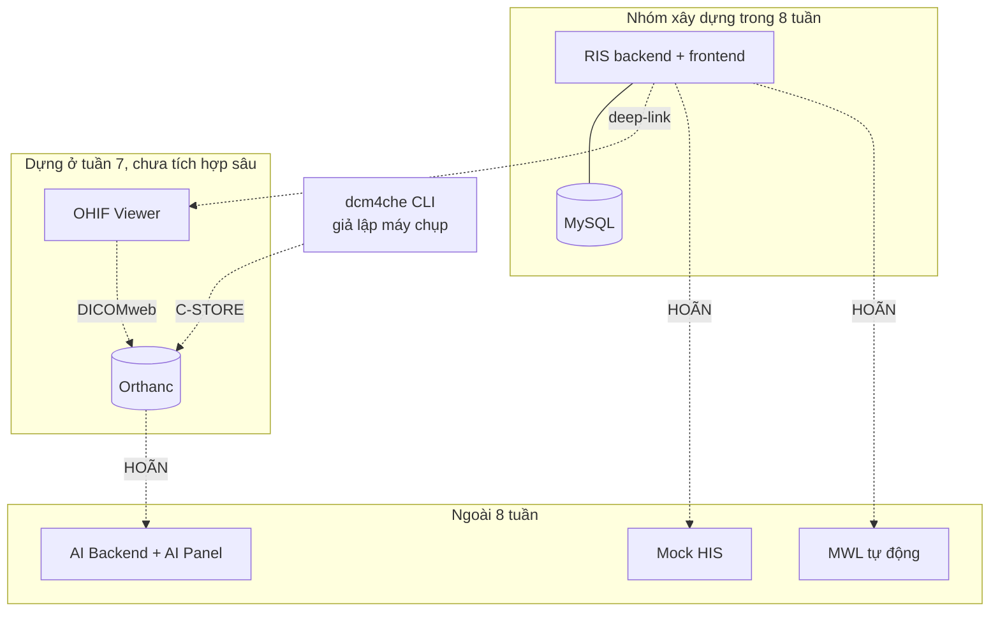

# VR-RIS PACS Scope doc

## 1. Định nghĩa thành công

Hết tuần 8, dự án được coi là **đạt** khi cả ba điều sau đúng:

- **Một lệnh deploy** dựng được toàn bộ hệ thống trên cụm Kubernetes local (RIS frontend + RIS backend + MySQL + Orthanc + OHIF).
- **Chạy được kịch bản demo end-to-end** ở mục 6 bằng dữ liệu giả, không cần thao tác ngoài giao diện (trừ bước giả lập máy chụp bằng `storescu`).
- **Bộ tài liệu thiết kế** đủ để người ngoài nhóm hiểu kiến trúc và đọc được phần chưa code: README, scope doc, ERD, state machine, quy tắc đối chiếu HIS/RIS, API contract, đặc tả DICOM.
- **Phần AI được trình bày ở mức thiết kế**: kiến trúc pipeline, ranh giới human-in-the-loop, wireframe AI Panel trong OHIF. Không có code AI.

Điều **không** nằm trong định nghĩa thành công: độ hoàn thiện UI bằng hệ thống tham chiếu, hiệu năng, số lượng chức năng phụ, và bất kỳ dòng code AI nào.

**Hệ quả của câu 19 (AI chỉ cần thiết kế + trình bày):** phần AI chuyển từ *rủi ro phải cắt scope* thành *deliverable tài liệu có trọng số chấm điểm*. Không phải cắt IN-07…IN-12 để lấy chỗ. Đổi lại, wireframe AI Panel (README 6E, tuần 2–3) không còn là việc “làm nếu kịp” — nó là sản phẩm được chấm, phải hoàn thiện đúng hạn.

## 2. Ranh giới hệ thống

Sơ đồ nguồn: `diagrams/01-ranh-gioi-he-thong.mmd` — mở draw.io, **Arrange → Insert → Mermaid**, dán nội dung file để có sơ đồ chỉnh sửa được.

**Đường biên quan trọng nhất:** trong 8 tuần, RIS và PACS **không nói chuyện với nhau bằng giao thức**. Liên kết duy nhất là `study_instance_uid` nhập/seed sẵn trong DB, dùng để mở OHIF bằng deep-link. Mọi thứ tự động (MWL, webhook báo study mới, tự chuyển trạng thái khi PACS nhận đủ ảnh) đều là **[HOÃN]**.

## 3. Trong phạm vi (IN)

### 3.1. Nghiệp vụ

| # | Hạng mục | Mức độ | Tuần |
|---|---|---|---|
| IN-01 | Quản lý bệnh nhân: tạo, sửa, tìm theo mã/tên, chặn trùng mã | Đầy đủ | 4 |
| IN-02 | Quản lý chỉ định: tạo tay, sửa, gắn bệnh nhân, nhiều ca chụp trên một chỉ định | Đầy đủ | 4 |
| IN-03 | Quản lý ca chụp: thêm/sửa theo form mục 3.4 README, gán máy, gán dịch vụ | Đầy đủ | 4 |
| IN-04 | Màn hình “Cập nhật ca chụp” so sánh hiện tại ↔ cập nhật theo từng trường | Đầy đủ | 4 |
| IN-05 | Quy tắc đối chiếu dữ liệu + bảng log lệch (README 2.5) | Đầy đủ, kể cả khi chưa có HIS | 4 |
| IN-06 | State machine 6 trạng thái + bảng lịch sử trạng thái + kiểm tra điều kiện chuyển | Đầy đủ | 5 |
| IN-07 | Worklist 2 tab Chờ / Đã thực hiện, cột theo README 3.1, phân trang, sắp xếp | Đầy đủ | 5–6 |
| IN-08 | Panel chi tiết bệnh nhân bên phải + bảng phiếu cùng bệnh nhân phía dưới | Đầy đủ | 6 |
| IN-09 | Đếm số lượng theo nhóm trạng thái trên tiêu đề và trong bộ lọc | Đầy đủ | 6 |
| IN-10 | Báo cáo kết quả: kỹ thuật, mô tả, chẩn đoán, kết luận, khuyến nghị; nháp → chính thức → duyệt | Đầy đủ | 5–6 |
| IN-11 | Modal thông tin lâm sàng | **Rút gọn** — xem 3.3 | 6 |

### 3.2. Bộ lọc — cắt gọn có chủ ý

README mục 3.2 liệt kê ~15 nhóm lọc. Trong 8 tuần chỉ làm nhóm có dữ liệu thật để lọc:

**Làm (IN-12):**

- Cây máy: khoa → nhóm → máy
- Modality (CT / MR / CR / US / DX)
- Tìm theo mã bệnh nhân, họ tên, mã LSVV, mã phiếu
- Khoảng thời gian: Hôm nay, Hôm qua, −3, −7, −30 ngày, Tất cả, chọn ngày tùy ý
- Trạng thái ca chụp (6 trạng thái + Tất cả, kèm số đếm)
- Loại bệnh nhân: Nội trú / Ngoại trú
- Tùy chỉnh cột hiển thị (tập cột cơ bản)

**Hoãn (lý do kèm theo):**

| Bộ lọc | Lý do hoãn |
|---|---|
| Trạng thái đồng bộ HIS, Đã/Chưa gửi kết quả | Không có HIS trong 8 tuần → lọc luôn rỗng |
| Vi phạm BHYT | Quy tắc chưa xác định (Phần 9 câu 3) |
| Danh sách ca chụp quá hạn | Định nghĩa “quá hạn” chưa chốt (Phần 9 câu 2) |
| Mã/tên đoàn khám, mã hồ sơ, mã bệnh phẩm, mã lưu trữ | Bảng phụ, README 6C đã đánh [HOÃN] |
| Lọc theo Bác sĩ chỉ định / Chỉ định / Bộ phận chụp / Kết luận | Làm nếu tuần 6 còn thời gian; không chặn nghiệm thu |

### 3.3. Thông tin lâm sàng — làm khung, không làm dữ liệu

5 tab trong README 3.3 là **dữ liệu HIS đẩy sang**, không phải dữ liệu RIS tự sinh. Trong 8 tuần:

- Làm **khung modal 5 tab** đúng bố cục.
- Dữ liệu đọc từ một bản snapshot JSON lưu trong RIS (`clinical_snapshot`), nội dung là seed data giả.
- Tab 1 (tổng quan khám) và tab 2 (xét nghiệm): hiển thị đầy đủ từ snapshot.
- Tab 3, 4, 5: hiển thị bảng rỗng + ghi chú “chờ tích hợp HIS”.
- **Không** thiết kế bảng quan hệ cho từng tab — xem lý do ở `02-erd.md` mục 5.

### 3.4. Nền tảng

| # | Hạng mục | Tuần |
|---|---|---|
| IN-13 | Xác thực Spring Security + JWT, đăng nhập/đăng xuất | 3 |
| IN-14 | RBAC 5 vai trò (README mục 5), chặn ở tầng API chứ không chỉ ẩn nút | 3 |
| IN-15 | Audit log ghi mọi hành vi đọc/sửa/duyệt dữ liệu bệnh nhân | 3 |
| IN-16 | Flyway migration, seed data giả | 3 |
| IN-17 | Dockerfile FE/BE, manifest k8s, ConfigMap/Secret, PVC cho MySQL | 3 |
| IN-18 | Docker Compose cho vòng dev hằng ngày | 3 |
| IN-19 | Orthanc + OHIF trong cụm; nạp 1–2 study mẫu bằng `storescu`; mở từ worklist bằng deep-link | 7 |
| IN-20 | springdoc-openapi (Swagger UI) | 2–3 |

### 3.5. Deliverable AI (tài liệu, không code)

| # | Hạng mục | Tuần |
|---|---|---|
| IN-21 | Wireframe AI Panel trong OHIF (Figma): overlay mask, panel kết quả, report nháp, nút xác nhận/sửa của bác sĩ | 2–3 |
| IN-22 | Chương AI trong báo cáo: sơ đồ pipeline, vị trí AI trong state machine, quy tắc human-in-the-loop, đánh giá pháp lý ở mức nêu vấn đề | 8 |

Không làm: model, dataset huấn luyện, DICOM SEG, API contract PACS ↔ AI. Các câu hỏi 11–13 Phần 9 README vì vậy **không cần trả lời trong 8 tuần** — chỉ cần nêu chúng như câu hỏi mở trong báo cáo.

## 4. Ngoài phạm vi 8 tuần (HOÃN — làm ở giai đoạn sau)

Thứ tự phụ thuộc giữ nguyên README 7.3.

| # | Hạng mục | Điều kiện kích hoạt |
|---|---|---|
| H-01 | RIS đẩy Modality Worklist (C-FIND) cho máy chụp | Sau khi Orthanc chạy ổn định và AE Title đã chốt |
| H-02 | PACS báo study mới → RIS tự chuyển “Chờ thực hiện” → “Chưa đọc” | Sau H-01 |
| H-03 | Mock HIS theo **HL7 v2**: nhận `ORM^O01`, trả `ORU^R01`, MLLP, ACK/NACK, retry, trạng thái đồng bộ | Sau khi RIS core ổn định. Đặc tả message viết trong 8 tuần (xem 4.1) |
| H-04 | **Code** AI Backend, DICOM SEG, AI Panel chạy thật | Ngoài yêu cầu môn học; chỉ làm nếu dự án đi tiếp sau đồ án |
| H-05 | Chức năng phụ: đoàn khám, BHYT chi tiết, in/duyệt hàng loạt, đa màn hình, giải mã tải về | Khi toàn bộ IN đã xong |
| H-06 | Host lên web/cloud | Sau cùng |
| H-07 | SRS đầy đủ, test plan, UAT, backup/DR, SLA | Nếu môn học yêu cầu |

**Lưu ý thiết kế:** những hạng mục này không được làm bây giờ nhưng **phải không bị chặn** bởi thiết kế hiện tại. Cụ thể ERD đã chừa sẵn `study_instance_uid`, `accession_number`, `his_order_id`, `sync_status` (xem `02-erd.md`).

### 4.1. Hệ quả của việc chọn HL7 v2 cho Mock HIS

Code Mock HIS vẫn là [HOÃN], nhưng quyết định này **kéo một phần việc vào trong 8 tuần** vì nó ràng buộc schema và tên trường:

| Việc | Khi nào | Thuộc |
|---|---|---|
| Đặc tả message `ORM^O01` (chỉ định) và `ORU^R01` (kết quả): liệt kê segment MSH, PID, PV1, ORC, OBR, OBX và trường bắt buộc | Tuần 4–5, viết cùng đặc tả DICOM | **IN** (tài liệu) |
| Bảng mapping HL7 field ↔ cột RIS, nhất là PID-3/5/7/8 ↔ `patient`, ORC-2/3 ↔ `imaging_order` | Tuần 4–5 | **IN** (tài liệu) |
| Interface `HisGateway` trong backend + một implementation giả lập đọc file JSON | Tuần 4 | **IN** (code, nhỏ) |
| Parser HAPI HL7v2, transport MLLP, hàng đợi retry, bảng `his_message_log` | Sau 8 tuần | H-03 |

**Vì sao vẫn làm đặc tả trong 8 tuần:** HL7 v2 định nghĩa sẵn khóa đối chiếu bệnh nhân (PID-3 identifier list) và cặp Placer/Filler Order Number. Quy tắc đối chiếu HIS ↔ RIS ở README 2.5 — việc bắt buộc của tuần 1 — phải bám vào đúng các trường này, nếu không sẽ phải viết lại khi tích hợp. Chọn REST tự do thì không có ràng buộc đó; chọn HL7 v2 thì có, và đó là lợi ích chính.

**Đổi lại:** MLLP là socket thuần, không phải HTTP, nên Mock HIS sau này cần một Service/port riêng trong k8s chứ không đi qua Ingress. Ghi vào sơ đồ triển khai ở tuần 2.

## 5. Ngoài phạm vi hoàn toàn (OUT)

| Hạng mục | Ghi chú |
|---|---|
| Dữ liệu bệnh nhân thật | Nguyên tắc bất biến của dự án. Kể cả tên trong ảnh chụp màn hình tham chiếu |
| Triển khai lâm sàng, kiểm định phần mềm thiết bị y tế | Chỉ nêu trong báo cáo như hướng phát triển |
| Tuân thủ pháp lý VN về hồ sơ bệnh án điện tử | Như trên |
| Migrate dữ liệu từ hệ thống cũ | Câu hỏi 15 — đã chốt là không |
| Nhiều bệnh viện / multi-tenant | Xem câu hỏi 8, mục 8 bên dưới |
| Tự chế protocol tích hợp riêng | Nguyên tắc bất biến: chỉ dùng DICOM / HL7 / FHIR |
| AI tự trả kết quả chính thức không qua bác sĩ | Nguyên tắc bất biến: human-in-the-loop |

## 6. Kịch bản nghiệm thu tuần 8

Demo được tính là đạt khi chạy trọn vẹn, một lượt, không sửa DB bằng tay:

1. `kubectl apply -k ...` → toàn bộ pod Ready.
2. Đăng nhập vai trò **KTV**.
3. Tạo bệnh nhân giả + chỉ định + ca chụp → ca xuất hiện ở tab **Chờ**, trạng thái *Chờ thực hiện*.
4. Chạy `storescu` đẩy study DICOM công khai vào Orthanc; cập nhật ca chụp sang *Chưa đọc* (thao tác tay — tự động là H-02).
5. Đăng nhập vai trò **Bác sĩ CĐHA** → mở ca → trạng thái *Đang đọc*; OHIF mở đúng study.
6. Nhập báo cáo → lưu → *Đọc xong*.
7. Đăng nhập vai trò **Bác sĩ duyệt** → *Đang duyệt* → duyệt → *Duyệt xong*; ca chuyển sang tab **Đã thực hiện**.
8. Đăng nhập **Admin** → mở audit log → thấy đủ 6 bước trên kèm người thực hiện và thời điểm.
9. Thử một ca lệch dữ liệu (ngày sinh khác giữa snapshot HIS giả và RIS) → hệ thống chặn/cảnh báo đúng quy tắc và ghi vào bảng log lệch.
10. Kiểm tra cột **Tuổi** hiển thị đúng với mọi bệnh nhân, kể cả bệnh nhân chỉ có năm sinh — không có ca nào ra “Tuổi 0”.

Bước 9 và 10 là bắt buộc: đó là known issue duy nhất đã quan sát được trên hệ thống tham chiếu.

## 7. Giả định & ràng buộc

**Giả định** (nếu sai thì phạm vi phải đàm phán lại):

- G-01 — Nhóm bắt đầu code từ tuần 3, không trễ hơn.
- G-02 — Máy của mọi thành viên chạy được Docker và một bản Kubernetes local.
- G-03 — Tải được bộ DICOM công khai đã ẩn danh (TCIA hoặc tương đương) trong tuần 4–5.
- G-04 — Không có bác sĩ CĐHA duyệt nghiệp vụ; mọi quy tắc nghiệp vụ là suy luận từ UI tham chiếu và phải ghi rõ là suy luận.
- G-05 — Nhóm 3–4 người, làm song song theo phân công dưới đây. Nếu rút xuống 2 người làm thật thì lịch 7.2 README không còn khả thi và phải cắt IN-11, IN-12.

**Phân công đề xuất (3–4 người):**

| Vai | Trách nhiệm chính | Tuần nặng nhất |
|---|---|---|
| Backend | Spring Boot, ERD/Flyway, state machine, API contract, quy tắc đối chiếu | 4–6 |
| Frontend | React, worklist, bộ lọc, modal lâm sàng, form ca chụp | 5–7 |
| DevOps + tài liệu | Docker, k8s, Orthanc/OHIF, đặc tả DICOM + HL7, báo cáo | 3 và 7–8 |
| Người thứ 4 (nếu có) | Figma design system + wireframe AI Panel, sau đó hỗ trợ frontend | 2–3 |

Nếu chỉ có 3 người: việc Figma ghép vào vai Frontend, và tuần 2–3 frontend chưa code nên không xung đột.

**Ràng buộc:**

- R-01 — Stack mục 8.1 README không đổi.
- R-02 — RIS không lưu ảnh DICOM, kể cả thumbnail.
- R-03 — Không dữ liệu thật ở bất kỳ đâu.
- R-04 — Mọi sơ đồ bằng Mermaid trong repo; Figma chỉ cho UI.

## 8. Trả lời Phần 9 README (nhóm Phạm vi & Tích hợp)

✅ = chốt · ❓ = **cần người dùng quyết định**, kèm đề xuất

| Câu | Nội dung | Kết luận |
|---|---|---|
| 14 | Viết lại hay nâng cấp? | ✅ **Xây mới.** Hệ thống hiện tại chỉ là tham chiếu giao diện và nghiệp vụ, không tái sử dụng code/DB |
| 15 | Migrate dữ liệu cũ? | ✅ Không |
| 16 | Deadline | ✅ 8 tuần |
| 10 | PACS | ✅ Orthanc (image chính thức, có DICOMweb + MWL plugin) |
| 7 | Mock HIS theo chuẩn nào? | ✅ **HL7 v2** — `ORM^O01` cho chỉ định, `ORU^R01` cho kết quả, truyền qua MLLP. RIS vẫn bọc sau interface `HisGateway`. Hệ quả: xem 4.1 |
| 19 | Phần AI có bắt buộc không? | ✅ **Chỉ cần thiết kế + trình bày.** Không code AI trong và sau 8 tuần (phạm vi đồ án). Deliverable: IN-21, IN-22 |
| 17 | Nhóm mấy người? | ✅ **3–4 người**, phân công ở mục 7 |
| 8 | Một hay nhiều bệnh viện? | ❓ **Mặc định áp dụng: một bệnh viện, nhiều khoa.** Không thêm `facility_id` vào schema. Nói nếu sai |
| 9 | Demo modality nào? | ❓ **Mặc định áp dụng: CR (X-quang ngực) + CT.** CR nhẹ, mở nhanh trong OHIF; CT chứng minh viewer xử lý được series nhiều lát. Chốt muộn nhất tuần 4 khi tải bộ DICOM mẫu |

**Các câu còn lại (1–6, 11–13, 18) không thuộc scope doc** — xem README Phần 9, giải quyết ở đặc tả state machine và giai đoạn AI.

## 9. Quy trình thay đổi phạm vi

- Mọi hạng mục **không có trong mục 3** mặc định là **[HOÃN]**, kể cả khi hệ thống tham chiếu có.
- Muốn thêm một hạng mục vào IN → phải chỉ ra hạng mục IN khác bị đẩy sang HOÃN để bù thời gian.
- Thay đổi được ghi vào bảng dưới và cập nhật checkbox Phần 6 README.

| Ngày | Thay đổi | Đổi lấy gì | Người quyết |
|---|---|---|---|
|  |  |  |  |

## 10. Việc tiếp theo

- [ ] Xác nhận 2 mặc định còn lại ở mục 8 (câu 8, 9) → nâng scope doc lên v1.0
- [ ] Xác nhận `02-erd.md`
- [ ] Cập nhật README: mục 8.2 dòng “Mock HIS” từ ❓ sang ✅ HL7 v2; Phần 9 câu 7, 17, 19 đánh dấu đã chốt
- [ ] Đặc tả state machine (README 6A) — phụ thuộc câu hỏi 1, 2 Phần 9
- [ ] Quy tắc đối chiếu HIS ↔ RIS (README 2.5) — 5 checkbox chưa tick
- [ ] Sơ đồ luồng ngoại lệ (README 6E)
