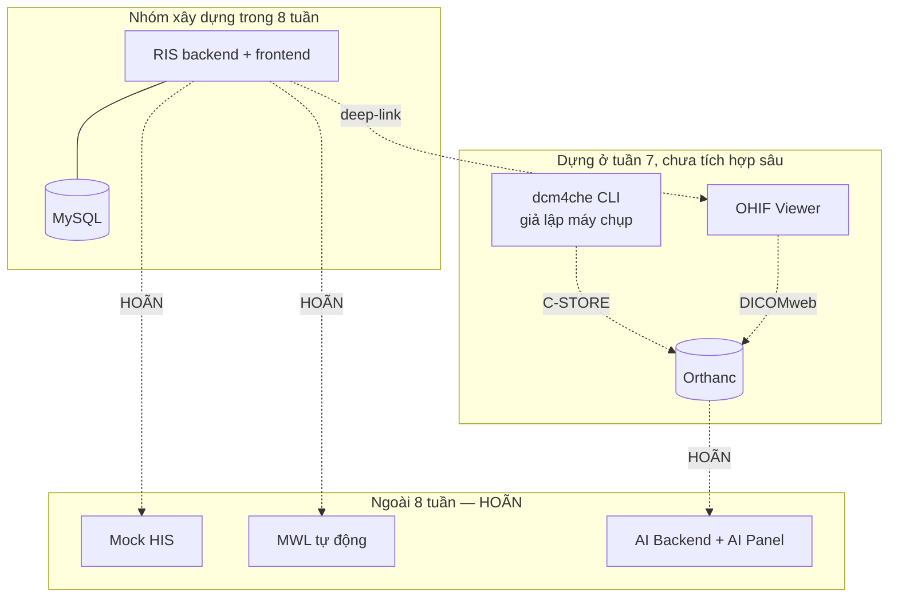

# VR-RIS PACS Scope doc

| Phiên bản | 0.9 (nháp — đối chiếu lại ngày 2026-10-31, chưa nâng lên v1.0) |
|---|---|
| Điều kiện lên v1.0 | (1) Nhóm xác nhận câu 8 và câu 9 ở mục 8; (2) nhóm quyết định các dòng ❓ ở bảng thay đổi phạm vi (mục 9); (3) điền tên người vào bảng phân công (mục 7) |
| Tài liệu liên quan | `02-erd.md` (ERD v0.9), `03-state-machine.md`, **`07-pacs-dicom.md` (đặc tả PACS/DICOM, nháp v0.1)**, `04-his-ris-reconciliation.md`, `05-luong-ngoai-le.md`, `06-rbac-matrix.md`, **`09-bao-mat-toan-ven-du-lieu.md` (nháp v0.1)**, `api/openapi.yaml` — tất cả là bản nháp chờ nhóm xác nhận. Mục lục đầy đủ và thứ tự đọc: **README mục 6.0** |

## 1. Định nghĩa thành công

Hết tuần 8, dự án được coi là **đạt** khi cả bốn điều sau đúng:

- **Một lệnh deploy** dựng được toàn bộ hệ thống trên cụm Kubernetes local (RIS frontend + RIS backend + MySQL + Orthanc + OHIF).
- **Chạy được kịch bản demo end-to-end** ở mục 6 bằng dữ liệu giả, không cần thao tác ngoài giao diện (trừ bước giả lập máy chụp bằng `storescu`).
- **Bộ tài liệu thiết kế** đủ để người ngoài nhóm hiểu kiến trúc và đọc được phần chưa code: README, scope doc (`01-scope.md`), ERD (`02-erd.md`), state machine (`03-state-machine.md`), **đặc tả tích hợp PACS/DICOM (`07-pacs-dicom.md`)**, quy tắc đối chiếu HIS/RIS (`04-his-ris-reconciliation.md`), sơ đồ luồng ngoại lệ (`05-luong-ngoai-le.md`), RBAC (`06-rbac-matrix.md`), bảo mật & toàn vẹn dữ liệu (`09-bao-mat-toan-ven-du-lieu.md`), API contract (`api/openapi.yaml`).
- **Phần AI được trình bày ở mức thiết kế**: kiến trúc pipeline, ranh giới human-in-the-loop, wireframe AI Panel trong OHIF. Không có code AI.

Điều **không** nằm trong định nghĩa thành công: độ hoàn thiện UI bằng hệ thống tham chiếu, hiệu năng, số lượng chức năng phụ, và bất kỳ dòng code AI nào.

**Hệ quả của câu 19 (AI chỉ cần thiết kế + trình bày):** phần AI chuyển từ *rủi ro phải cắt scope* thành *deliverable tài liệu có trọng số chấm điểm*. Không phải cắt IN-07…IN-12 để lấy chỗ. Đổi lại, wireframe AI Panel (README 6E, tuần 2–3) không còn là việc “làm nếu kịp” — nó là sản phẩm được chấm, phải hoàn thiện đúng hạn.

## 2. Ranh giới hệ thống

Sơ đồ nguồn: `diagrams/01-ranh-gioi-he-thong.mmd` — mở draw.io, **Arrange → Insert → Mermaid**, dán nội dung file để có sơ đồ chỉnh sửa được.

> ⚠️ **2026-11-05 — `diagrams/01-ranh-gioi-he-thong.png` đã lỗi thời, cần xuất lại.** Bản `.mmd` vừa được sửa lỗi hiển thị: nhãn cạnh không đặt trong dấu ngoặc kép nên Mermaid đọc dấu `-` trong `C-STORE` và `deep-link` như cú pháp cạnh, tách thành các node rời (`C`, `STORE`) và làm node `deep-link` chồng lên `AI Backend + AI Panel`. Đã bọc mọi nhãn cạnh bằng `"…"` và đưa `CLI` vào đúng subgraph. **PNG trong repo vẫn là ảnh cũ bị lỗi** — xem ghi chú ở mục 10.

**Đường biên quan trọng nhất:** trong 8 tuần, RIS và PACS **không nói chuyện với nhau bằng giao thức**. Liên kết duy nhất là `study_instance_uid` nhập/seed sẵn trong DB, dùng để mở OHIF bằng deep-link. Mọi thứ tự động (MWL, webhook báo study mới, tự chuyển trạng thái khi PACS nhận đủ ảnh) đều là **[HOÃN]**.

## 3. Trong phạm vi (IN)

### 3.1. Nghiệp vụ

| # | Hạng mục | Mức độ | Tuần |
|---|---|---|---|
| IN-01 | Quản lý bệnh nhân: tạo, sửa, tìm theo mã/tên, chặn trùng mã | Đầy đủ | 4 |
| IN-02 | Quản lý chỉ định: tạo tay, sửa, gắn bệnh nhân, nhiều ca chụp trên một chỉ định | Đầy đủ | 4 |
| IN-03 | Quản lý ca chụp: thêm/sửa theo form mục 3.4 README, gán máy, gán dịch vụ | Đầy đủ | 4 |
| IN-04 | Màn hình “Cập nhật ca chụp” so sánh hiện tại ↔ cập nhật theo từng trường | Đầy đủ | 4 |
| IN-05 | Quy tắc đối chiếu dữ liệu + bảng log lệch (README 2.5) | Đầy đủ, kể cả khi chưa có HIS | 4 |
| IN-06 | State machine 6 trạng thái + bảng lịch sử trạng thái + kiểm tra điều kiện chuyển | Đầy đủ | 5 |
| IN-07 | Worklist 2 tab Chờ / Đã thực hiện, cột theo README 3.1, phân trang, sắp xếp | Đầy đủ | 5–6 |
| IN-08 | Panel chi tiết bệnh nhân bên phải + bảng phiếu cùng bệnh nhân phía dưới | Đầy đủ | 6 |
| IN-09 | Đếm số lượng theo nhóm trạng thái trên tiêu đề và trong bộ lọc | Đầy đủ | 6 |
| IN-10 | Báo cáo kết quả: kỹ thuật, mô tả, chẩn đoán, kết luận, khuyến nghị; nháp → chính thức → duyệt | Đầy đủ | 5–6 |
| IN-11 | Modal thông tin lâm sàng | **Rút gọn** — xem 3.3 | 6 |
| IN-24 | Kiến trúc phân tầng backend + ArchUnit + Testcontainers + test theo tầng (R-05, `03-architecture.md` → `15-kien-truc-backend.md`) | Áp dụng xuyên suốt, không phải một màn hình riêng | 2–3 |

### 3.2. Bộ lọc — cắt gọn có chủ ý

README mục 3.2 liệt kê ~15 nhóm lọc. Trong 8 tuần chỉ làm nhóm có dữ liệu thật để lọc:

**Làm (IN-12):**

- Cây máy: khoa → nhóm → máy
- Modality (CT / MR / CR / US / DX)
- Tìm theo mã bệnh nhân, họ tên, mã LSVV, mã phiếu
- Khoảng thời gian: Hôm nay, Hôm qua, −3, −7, −30 ngày, Tất cả, chọn ngày tùy ý
- Trạng thái ca chụp (6 trạng thái + Tất cả, kèm số đếm)
- Loại bệnh nhân: Nội trú / Ngoại trú

**Hoãn (lý do kèm theo):**

| Bộ lọc | Lý do hoãn |
|---|---|
| Tùy chỉnh cột hiển thị | **HOÃN** (2026-11-05). Trước đây nằm trong IN-12 ("Làm"); đẩy sang đây để đổi lấy IN-24 (kiến trúc phân tầng backend) — xem bảng thay đổi phạm vi (mục 9) |
| Trạng thái đồng bộ HIS, Đã/Chưa gửi kết quả | Không có HIS trong 8 tuần → lọc luôn rỗng |
| Vi phạm BHYT | Quy tắc chưa xác định (Phần 9 câu 3) |
| Danh sách ca chụp quá hạn | Định nghĩa “quá hạn” chưa chốt (Phần 9 câu 2) |
| Mã/tên đoàn khám, mã hồ sơ, mã bệnh phẩm, mã lưu trữ | Bảng phụ, README 6C đã đánh [HOÃN] |
| Lọc theo Bác sĩ chỉ định / Chỉ định / Bộ phận chụp / Kết luận | **HOÃN hẳn** (2026-11-05). Trước đây là “làm nếu tuần 6 còn thời gian”; đổi để lấy chỗ cho IN-23 — xem bảng thay đổi phạm vi (mục 9) |

### 3.3. Thông tin lâm sàng — làm khung, không làm dữ liệu

5 tab trong README 3.3 là **dữ liệu HIS đẩy sang**, không phải dữ liệu RIS tự sinh. Trong 8 tuần:

- Làm **khung modal 5 tab** đúng bố cục.
- Dữ liệu đọc từ một bản snapshot JSON lưu trong RIS (`clinical_snapshot`), nội dung là seed data giả.
- Tab 1 (tổng quan khám) và tab 2 (xét nghiệm): hiển thị đầy đủ từ snapshot.
- **Tab 3 (kết quả chẩn đoán chức năng) — đổi so với bản trước:** không để bảng rỗng nữa. Tab này hiển thị **tên dịch vụ** và **kết luận**, lấy từ **dữ liệu RIS tự có** (`service_item.name` và `report.conclusion` của bản hiện hành — `02-erd.md` mục 4.10), **không** lấy từ `clinical_snapshot`. Mỗi dòng dịch vụ CĐHA có thêm nút **"Xem ảnh"** (IN-23). Lý do đổi: RIS **là** hệ thống sinh ra kết quả CĐHA, nên đây là tab duy nhất trong 5 tab không phụ thuộc HIS. Đây cũng là cửa vào viewer (b) ở README 2.7.
- Tab 4, 5 (đơn thuốc/vật tư, phẫu thuật thủ thuật): **vẫn là bảng rỗng** + ghi chú “chờ tích hợp HIS”.
- **Không** thiết kế bảng quan hệ cho từng tab — xem lý do ở `02-erd.md` mục 5.

### 3.4. Nền tảng

| # | Hạng mục | Tuần |
|---|---|---|
| IN-13 | Xác thực Spring Security + JWT, đăng nhập/đăng xuất — đặc tả token, băm mật khẩu, khóa tài khoản ở `09-bao-mat-toan-ven-du-lieu.md` mục 1 | 3 |
| IN-14 | RBAC 5 vai trò (README mục 5), chặn ở tầng API chứ không chỉ ẩn nút — ma trận quyền ở `06-rbac-matrix.md`, cơ chế chặn ở `09-…` mục 4 | 3 |
| IN-15 | Audit log ghi mọi hành vi đọc/sửa/duyệt dữ liệu bệnh nhân — đặc tả sự kiện, trường bắt buộc, append-only ở `09-…` mục 2 | 3 |
| IN-16 | Flyway migration, seed data giả | 3 |
| IN-17 | Dockerfile FE/BE, manifest k8s, ConfigMap/Secret, PVC cho MySQL | 3 |
| IN-18 | Docker Compose cho vòng dev hằng ngày | 3 |
| IN-19 | Orthanc + OHIF trong cụm; nạp 1–2 study mẫu bằng `storescu`; mở từ worklist bằng deep-link | 7 |
| IN-20 | springdoc-openapi (Swagger UI) | 2–3 |
| IN-23 | Nút **"Xem ảnh"** mở OHIF bằng `study_instance_uid` — ở **hai chỗ**: (a) hàng worklist, (b) tab 3 modal lâm sàng (xem 3.3). Ẩn hoặc disable khi study chưa có `study_instance_uid` | 6–7 |

> IN-23 là **nửa giao diện** của IN-19: IN-19 dựng Orthanc + OHIF và nạp study mẫu (tuần 7), IN-23 làm hai nút gọi vào đó (tuần 6–7). Hai cửa vào mô tả ở **README mục 2.7**. Đề xuất: viết UI tuần 6 (cùng modal lâm sàng IN-11), nối thật vào OHIF tuần 7 khi đã có Orthanc. Số IN-23 đứng sau IN-20 vì đánh số **theo thứ tự được thêm vào scope**, không theo vị trí trong tài liệu.

**Chi tiết IN-19 — deep-link OHIF:**

1. **Hai cửa vào viewer.** Một study mở được từ (a) **worklist RIS** — bác sĩ CĐHA / bác sĩ duyệt, và (b) **màn hình kết quả / hồ sơ** — bác sĩ lâm sàng, qua tab 3 modal lâm sàng. Cả hai chỉ cần `study_instance_uid` và mở **cùng một OHIF**; PACS không biết ai gọi, nên kiểm soát truy cập nằm ở RIS. Mô tả đầy đủ: **README mục 2.7**.
2. **Base URL OHIF đặt trong ConfigMap**, không hard-code trong image và **không lưu URL trong DB**. DB chỉ giữ `study.study_instance_uid`; URL đủ được **ghép theo mẫu cấu hình** tại thời điểm render (xem `02-erd.md` mục 4.4). Lý do: đổi host/port OHIF thì sửa ConfigMap, không phải chạy migration sửa dữ liệu.
3. **OHIF không mở công khai** — chỉ truy cập được trong cụm Kubernetes local, hoặc qua RIS đã đăng nhập. Đây là **nguyên tắc bất biến** (README mục 0) và phải được **ghi rõ trong báo cáo như một điểm bảo mật**: một deep-link chứa `StudyInstanceUID` là đủ để xem ảnh nếu viewer mở ra Internet — đúng kiểu lỗ hổng mà PACS bệnh viện thật hay gặp. Cách làm cụ thể (chặn ở Ingress, token ngắn hạn, hay chỉ dựa vào mạng nội bộ) ❓ **chưa chốt** — xem `07-pacs-dicom.md` mục 6.

### 3.5. Deliverable AI (tài liệu, không code)

| # | Hạng mục | Tuần |
|---|---|---|
| IN-21 | Wireframe AI Panel trong OHIF (Figma): overlay mask, panel kết quả, report nháp, nút xác nhận/sửa của bác sĩ | 2–3 |
| IN-22 | Chương AI trong báo cáo: sơ đồ pipeline, vị trí AI trong state machine, quy tắc human-in-the-loop, đánh giá pháp lý ở mức nêu vấn đề | 8 |

Không làm: model, dataset huấn luyện, DICOM SEG, API contract PACS ↔ AI. Các câu hỏi 11–13 Phần 9 README vì vậy **không cần trả lời trong 8 tuần** — chỉ cần nêu chúng như câu hỏi mở trong báo cáo.

## 4. Ngoài phạm vi 8 tuần (HOÃN — làm ở giai đoạn sau)

Thứ tự phụ thuộc giữ nguyên README 7.3.

| # | Hạng mục | Điều kiện kích hoạt |
|---|---|---|
| H-01 | RIS đẩy Modality Worklist (C-FIND) cho máy chụp | Sau khi Orthanc chạy ổn định và AE Title đã chốt |
| H-02 | PACS báo study mới → RIS tự chuyển “Chờ thực hiện” → “Chưa đọc” | Sau H-01 |
| H-03 | Mock HIS theo **HL7 v2**: nhận `ORM^O01`, trả `ORU^R01`, MLLP, ACK/NACK, retry, trạng thái đồng bộ | Sau khi RIS core ổn định. Đặc tả message viết trong 8 tuần (xem 4.1) |
| H-04 | **Code** AI Backend, DICOM SEG, AI Panel chạy thật | Ngoài yêu cầu môn học; chỉ làm nếu dự án đi tiếp sau đồ án |
| H-05 | Chức năng phụ: đoàn khám, BHYT chi tiết, in/duyệt hàng loạt, đa màn hình, giải mã tải về | Khi toàn bộ IN đã xong |
| H-06 | Host lên web/cloud | Sau cùng |
| H-07 | SRS đầy đủ, test plan, UAT, backup/DR, SLA | Nếu môn học yêu cầu |

**Lưu ý thiết kế:** những hạng mục này không được làm bây giờ nhưng **phải không bị chặn** bởi thiết kế hiện tại. Cụ thể ERD đã chừa sẵn `study_instance_uid`, `accession_number`, `his_order_id`, `sync_status` (xem `02-erd.md`).

### 4.1. Hệ quả của việc chọn HL7 v2 cho Mock HIS

Code Mock HIS vẫn là [HOÃN], nhưng quyết định này **kéo một phần việc vào trong 8 tuần** vì nó ràng buộc schema và tên trường:

| Việc | Khi nào | Thuộc |
|---|---|---|
| Đặc tả message `ORM^O01` (chỉ định) và `ORU^R01` (kết quả): liệt kê segment MSH, PID, PV1, ORC, OBR, OBX và trường bắt buộc | Tuần 4–5, viết cùng đặc tả DICOM | **IN** (tài liệu) |
| **Đặc tả tích hợp PACS/DICOM — `07-pacs-dicom.md`**: vai trò từng thành phần, bảng AE Title, MWL (C-FIND), C-STORE, deep-link OHIF, mapping DICOM tag ↔ cột RIS | Tuần 4–5, **cùng lúc với đặc tả HL7 ở bảng này** | **IN** (tài liệu) |
| Bảng mapping HL7 field ↔ cột RIS, nhất là PID-3/5/7/8 ↔ `patient`, ORC-2/3 ↔ `imaging_order` | Tuần 4–5 | **IN** (tài liệu) |
| Interface `HisGateway` trong backend + một implementation giả lập đọc file JSON | Tuần 4 | **IN** (code, nhỏ) |
| Quy tắc **idempotency** khi HIS gửi lại message (`MSH-10`, `UNIQUE(his_order_id)`) — thiết kế trước vì ràng buộc schema | Tuần 3, ở `09-bao-mat-toan-ven-du-lieu.md` mục 3.4 | **IN** (tài liệu) |
| Parser HAPI HL7v2, transport MLLP, hàng đợi retry, bảng `his_message_log` | Sau 8 tuần | H-03 |

**Vì sao vẫn làm đặc tả trong 8 tuần:** HL7 v2 định nghĩa sẵn khóa đối chiếu bệnh nhân (PID-3 identifier list) và cặp Placer/Filler Order Number. Quy tắc đối chiếu HIS ↔ RIS ở README 2.5 — việc bắt buộc của tuần 1 — phải bám vào đúng các trường này, nếu không sẽ phải viết lại khi tích hợp. Chọn REST tự do thì không có ràng buộc đó; chọn HL7 v2 thì có, và đó là lợi ích chính.

**Đổi lại:** MLLP là socket thuần, không phải HTTP, nên Mock HIS sau này cần một Service/port riêng trong k8s chứ không đi qua Ingress. Ghi vào sơ đồ triển khai ở tuần 2.

## 5. Ngoài phạm vi hoàn toàn (OUT)

| Hạng mục | Ghi chú |
|---|---|
| Dữ liệu bệnh nhân thật | Nguyên tắc bất biến của dự án. Kể cả tên trong ảnh chụp màn hình tham chiếu |
| Triển khai lâm sàng, kiểm định phần mềm thiết bị y tế | Chỉ nêu trong báo cáo như hướng phát triển |
| Tuân thủ pháp lý VN về hồ sơ bệnh án điện tử | Như trên |
| Migrate dữ liệu từ hệ thống cũ | Câu hỏi 15 — đã chốt là không |
| Nhiều bệnh viện / multi-tenant | Xem câu hỏi 8, mục 8 bên dưới |
| Tự chế protocol tích hợp riêng | Nguyên tắc bất biến: chỉ dùng DICOM / HL7 / FHIR |
| AI tự trả kết quả chính thức không qua bác sĩ | Nguyên tắc bất biến: human-in-the-loop |

## 6. Kịch bản nghiệm thu tuần 8

Demo được tính là đạt khi chạy trọn vẹn, một lượt, không sửa DB bằng tay:

1. `kubectl apply -k ...` → toàn bộ pod Ready.
2. Đăng nhập vai trò **KTV**.
3. Tạo bệnh nhân giả + chỉ định + ca chụp → ca xuất hiện ở tab **Chờ**, trạng thái *Chờ thực hiện*.
4. Chạy `storescu` đẩy study DICOM công khai vào Orthanc; cập nhật ca chụp sang *Chưa đọc* (thao tác tay — tự động là H-02).
5. Đăng nhập vai trò **Bác sĩ CĐHA** → mở ca → trạng thái *Đang đọc*; OHIF mở đúng study.
6. Nhập báo cáo → lưu → *Đọc xong*.
7. Đăng nhập vai trò **Bác sĩ duyệt** → *Đang duyệt* → duyệt → *Duyệt xong*; ca chuyển sang tab **Đã thực hiện**.
8. Đăng nhập **Admin** → mở audit log → thấy đủ 6 bước trên kèm người thực hiện và thời điểm.
9. Thử một ca lệch dữ liệu (ngày sinh khác giữa snapshot HIS giả và RIS) → hệ thống chặn/cảnh báo đúng quy tắc và ghi vào bảng log lệch.
10. Kiểm tra cột **Tuổi** hiển thị đúng với mọi bệnh nhân, kể cả bệnh nhân chỉ có năm sinh — không có ca nào ra “Tuổi 0”.

Bước 9 và 10 là bắt buộc: đó là known issue duy nhất đã quan sát được trên hệ thống tham chiếu.

## 7. Giả định & ràng buộc

**Giả định** (nếu sai thì phạm vi phải đàm phán lại):

- G-01 — Nhóm bắt đầu code từ tuần 3, không trễ hơn.
- G-02 — Máy của mọi thành viên chạy được Docker và một bản Kubernetes local.
- G-03 — Tải được bộ DICOM công khai đã ẩn danh (TCIA hoặc tương đương) trong tuần 4–5.
- G-04 — Không có bác sĩ CĐHA duyệt nghiệp vụ; mọi quy tắc nghiệp vụ là suy luận từ UI tham chiếu và phải ghi rõ là suy luận.
- G-05 — Nhóm 3–4 người, làm song song theo phân công dưới đây. Nếu rút xuống 2 người làm thật thì lịch 7.2 README không còn khả thi và phải cắt IN-11, IN-12. **IN-24 (kiến trúc phân tầng, R-05) không nằm trong danh sách có thể cắt** — đây là cách viết mọi tính năng backend, không phải một tính năng riêng, nên cắt nó nghĩa là bỏ luôn ràng buộc R-05 (❓ cần nhóm xác nhận nếu muốn cắt khi chỉ còn 2 người).

**Phân công đề xuất (4 người, vai A–D).** Tên người để trống vì **chưa được nhóm xác nhận** (❓).

| Vai | Trách nhiệm chính | Người | Tuần nặng nhất |
|---|---|---|---|
| **A — Backend lõi** | Bệnh nhân, chỉ định, ca chụp, quy tắc đối chiếu HIS ↔ RIS, ERD/Flyway | (chưa điền) | 4–6 |
| **B — Backend luồng việc** | Spring Security + JWT, RBAC, audit log, state machine, báo cáo, API worklist | (chưa điền) | 3–6 |
| **C — Frontend** | Nối API, form thật, bộ lọc, modal lâm sàng, kiểm thử | (chưa điền) | 5–7 |
| **D — DevOps + tài liệu + AI** | Docker/k8s, Orthanc/OHIF, đặc tả DICOM + HL7, báo cáo, wireframe AI Panel (Figma) | (chưa điền) | 2–3 (Figma) và 7–8 |

Phân công khi nhóm chỉ có 3 người chưa chốt ❓. Bản cũ (ghép Figma vào Frontend) giữ ở phần lịch sử bên dưới.

Lịch sử: bảng phân công cũ (trước 2026-10-31)

**Phân công đề xuất (3–4 người):**

| Vai | Trách nhiệm chính | Tuần nặng nhất |
|---|---|---|
| Backend | Spring Boot, ERD/Flyway, state machine, API contract, quy tắc đối chiếu | 4–6 |
| Frontend | React, worklist, bộ lọc, modal lâm sàng, form ca chụp | 5–7 |
| DevOps + tài liệu | Docker, k8s, Orthanc/OHIF, đặc tả DICOM + HL7, báo cáo | 3 và 7–8 |
| Người thứ 4 (nếu có) | Figma design system + wireframe AI Panel, sau đó hỗ trợ frontend | 2–3 |

Nếu chỉ có 3 người: việc Figma ghép vào vai Frontend, và tuần 2–3 frontend chưa code nên không xung đột.

**Ràng buộc:**

- R-01 — Stack mục 8.1 README không đổi.
- R-02 — RIS không lưu ảnh DICOM, kể cả thumbnail.
- R-03 — Không dữ liệu thật ở bất kỳ đâu.
- R-04 — Mọi sơ đồ bằng Mermaid trong repo; Figma chỉ cho UI.
- R-05 — Backend theo kiến trúc phân tầng (package-by-layer), hướng phụ thuộc một chiều, kiểm tra tự động bằng ArchUnit; vi phạm làm build đỏ. Mỗi tính năng làm theo lát dọc (rest → service → dao → model → DB). Chi tiết: `15-kien-truc-backend.md`.

## 8. Trả lời Phần 9 README (nhóm Phạm vi & Tích hợp)

✅ = chốt · ❓ = **cần người dùng quyết định**, kèm đề xuất

| Câu | Nội dung | Kết luận |
|---|---|---|
| 14 | Viết lại hay nâng cấp? | ✅ **Xây mới.** Hệ thống hiện tại chỉ là tham chiếu giao diện và nghiệp vụ, không tái sử dụng code/DB |
| 15 | Migrate dữ liệu cũ? | ✅ Không |
| 16 | Deadline | ✅ 8 tuần |
| 10 | PACS | ✅ Orthanc (image chính thức, có DICOMweb + MWL plugin) |
| 7 | Mock HIS theo chuẩn nào? | ✅ **HL7 v2** — `ORM^O01` cho chỉ định, `ORU^R01` cho kết quả, truyền qua MLLP. RIS vẫn bọc sau interface `HisGateway`. Hệ quả: xem 4.1 |
| 19 | Phần AI có bắt buộc không? | ✅ **Chỉ cần thiết kế + trình bày.** Không code AI trong và sau 8 tuần (phạm vi đồ án). Deliverable: IN-21, IN-22 |
| 17 | Nhóm mấy người? | ✅ **3–4 người**, phân công ở mục 7 |
| 8 | Một hay nhiều bệnh viện? | ❓ **Mặc định áp dụng: một bệnh viện, nhiều khoa.** Không thêm `facility_id` vào schema. Nói nếu sai |
| 9 | Demo modality nào? | ❓ **Mặc định áp dụng: CR (X-quang ngực) + CT.** CR nhẹ, mở nhanh trong OHIF; CT chứng minh viewer xử lý được series nhiều lát. Chốt muộn nhất tuần 4 khi tải bộ DICOM mẫu |

Ngày 2026-10-31: **câu 8 và câu 9 chưa được nhóm xác nhận**, nên giữ nguyên là mặc định (❓).

**Các câu còn lại (1–6, 11–13, 18) không thuộc scope doc** — xem README Phần 9, giải quyết ở đặc tả state machine và giai đoạn AI.

## 9. Quy trình thay đổi phạm vi

- Mọi hạng mục **không có trong mục 3** mặc định là **[HOÃN]**, kể cả khi hệ thống tham chiếu có.
- Muốn thêm một hạng mục vào IN → phải chỉ ra hạng mục IN khác bị đẩy sang HOÃN để bù thời gian.
- Thay đổi được ghi vào bảng dưới và cập nhật checkbox Phần 6 README.

Cột "Quyết định" lấy từ nhóm; **trống hoặc ❓ nghĩa là nhóm chưa quyết định**. Cột "Đổi lấy gì" để trống cho nhóm điền (theo nguyên tắc: thêm một mục vào IN thì phải chỉ ra mục IN khác bị đẩy sang HOÃN). Các dòng dưới đây ghi lại chỗ Frontend hiện có **lệch** scope (đối chiếu code ngày 2026-10-31).

| Ngày | Thay đổi | Đổi lấy gì | Quyết định | Người quyết |
|---|---|---|---|---|
| 2026-10-31 | **Frontend làm thừa so với scope.** Bộ lọc “Trạng thái đồng bộ HIS” và “Vi phạm BHYT” (mục 3.2 để HOÃN) | | ❓ giữ hay cắt | |
| 2026-10-31 | **Thừa.** Nút “Danh sách ca chụp quá hạn” (mục 3.2 HOÃN, chưa định nghĩa “quá hạn”) | | ❓ giữ hay cắt | |
| 2026-10-31 | **Thừa.** Nút “Duyệt toàn bộ danh sách” (H-05); ngoài ra có nút “In danh sách”, “Tải danh sách” chưa có chức năng | | ❓ giữ hay cắt | |
| 2026-10-31 | **Thừa.** Tab lâm sàng 3 và 4 hiển thị dữ liệu giả; mục 3.3 yêu cầu bảng rỗng + ghi chú “chờ tích hợp HIS” | | ❓ giữ hay cắt | |
| 2026-10-31 | **Thừa.** Cột mã đoàn khám, tên đoàn khám, mã hồ sơ, mã bệnh phẩm, mã lưu trữ nằm trong tập cột mặc định (mục 3.2 HOÃN) | | ❓ giữ hay cắt | |
| 2026-10-31 | **Thừa.** Popover “Cấu hình hệ thống” (README 3.5) không thuộc danh mục IN | | ❓ giữ hay cắt | |
| 2026-10-31 | **Thiếu so với IN-12.** Khoảng thời gian chưa có “−30 ngày” (có Hôm nay, Hôm qua, −3, −7, Tất cả); ô tìm kiếm chưa có “mã phiếu” (chỉ lọc theo cột) | | — không phải đổi phạm vi, là việc còn thiếu | |
| 2026-10-31 | **Thiếu so với IN-12.** Khoảng thời gian, loại thời gian lọc và cây máy có trên giao diện nhưng trang worklist chưa áp dụng vào lọc dữ liệu | | — không phải đổi phạm vi, là việc còn thiếu | |
| 2026-11-05 | **Thêm vào IN: IN-24** — kiến trúc phân tầng backend (R-05): package-by-layer, ArchUnit, Testcontainers, test theo tầng. Áp dụng xuyên suốt từ tuần 2 | **Đẩy sang HOÃN:** bộ lọc "Tùy chỉnh cột hiển thị" (mục 3.2, trước đây nằm trong IN-12) | ❓ chờ nhóm xác nhận | |
| 2026-11-05 | **Thêm vào IN: IN-23** — nút “Xem ảnh” mở OHIF bằng `study_instance_uid` ở hàng worklist và ở tab 3 modal lâm sàng; ẩn/disable khi study chưa có `study_instance_uid` (tuần 6–7). Kéo theo: mục 3.3 tab 3 đổi từ “bảng rỗng” sang hiển thị tên dịch vụ + kết luận từ dữ liệu RIS | **Chuyển hẳn sang HOÃN:** bộ lọc “Lọc theo Bác sĩ chỉ định / Chỉ định / Bộ phận chụp / Kết luận” (mục 3.2) — trước đây là “làm nếu tuần 6 còn thời gian”, giờ **không làm trong 8 tuần** | ❓ chờ nhóm xác nhận | |

## 10. Việc tiếp theo

Trạng thái ngày 2026-11-05: scope doc vẫn ở **v0.9**. Các bản nháp mới đã có trong repo nhưng **chưa được nhóm xác nhận**, nên các ô dưới đây vẫn để trống.

- [ ] Xác nhận 2 mặc định còn lại ở mục 8 (câu 8, 9) → nâng scope doc lên v1.0 — **danh sách đầy đủ điều kiện và file phụ thuộc ở mục 10.1**
- [ ] Xác nhận `02-erd.md` (hiện v0.9, còn 7 ô ❓ ở mục 9 của file đó — thêm 2 ô ngày 2026-11-05)
- [ ] **Xác nhận `15-kien-truc-backend.md`** (R-05, nháp v0.1, thêm 2026-11-05) — gồm cả **kế hoạch refactor `Backend/` hiện có** (chưa commit, đang package-by-feature + Spring Data JPA) sang kiến trúc phân tầng, trước khi động vào code ở Pha 2
- [x] Cập nhật README: mục 8.2 dòng “Mock HIS” từ ❓ sang ✅ HL7 v2; Phần 9 câu 7, 17, 19 đánh dấu đã chốt — **đã làm** (bản nháp 2026-10-31, đối chiếu lại 2026-11-05). Việc *nhóm xác nhận nội dung đã chốt* là dòng “Xác nhận …” riêng bên dưới
- [ ] Nhóm xác nhận các kết luận ở README Phần 9 câu 7, 17, 19 và mục 8.2 (đã viết là ✅ nhưng là ✅ do tài liệu đề xuất, chưa có biên bản nhóm)
- [ ] **Viết `07-pacs-dicom.md`** (README 6B, tuần 4–5) — *(khung v0.1 đã có trong repo ngày 2026-11-05: 10 mục, phần lớn còn ❓; cần điền AE Title, port, quy tắc khi header DICOM lệch dữ liệu RIS)*
- [x] Đổi tên file đặc tả PACS/DICOM từ `03-pacs-dicom.md` sang **`07-pacs-dicom.md`** để hết trùng số với `03-state-machine.md` — **đã làm 2026-11-05**
- [ ] Đặc tả state machine (README 6A) — phụ thuộc câu hỏi 1, 2 Phần 9 — *(bản nháp `03-state-machine.md`, chờ nhóm xác nhận)*
- [ ] Quy tắc đối chiếu HIS ↔ RIS (README 2.5) — 5 checkbox chưa tick — *(bản nháp `04-his-ris-reconciliation.md` trả lời cả 5, chờ nhóm xác nhận)*
- [ ] Sơ đồ luồng ngoại lệ (README 6E) — *(bản nháp `05-luong-ngoai-le.md`, chờ nhóm xác nhận)*
- [ ] Quyết định các dòng ❓ ở bảng thay đổi phạm vi (mục 9) — **gồm dòng IN-23 thêm ngày 2026-11-05** — và điền tên phân công (mục 7)
- [ ] Chốt cách chặn truy cập OHIF (Ingress / token / chỉ mạng nội bộ) — IN-19 điểm 3, `07-pacs-dicom.md` mục 6
- [ ] **Chốt 15 câu hỏi mở ở `09-bao-mat-toan-ven-du-lieu.md` mục 9** — ba câu gấp nhất: **S-05** (cách ghi `READ` cho worklist, chặn IN-15 tuần 3), **S-14** (kiểm tra git history còn giữ tên/mã bệnh nhân thật ở bản README cũ không — **nguyên tắc bất biến**), **S-11** (`UNIQUE(his_order_id)`, thêm muộn thì không thêm được)
- [ ] **Xử lý 4 nguyên tắc bất biến chưa được bảo đảm đầy đủ** — liệt kê ở `09-bao-mat-toan-ven-du-lieu.md` mục 8
- [ ] **Xuất lại 2 ảnh `.png`** cho khớp nguồn `.mmd`: `diagrams/02-erd.png` và `diagrams/01-ranh-gioi-he-thong.png` — lệnh và lý do ở `02-erd.md` **mục 0**. Phiên 2026-11-05 không xuất được (môi trường không có `mermaid-cli`)

### 10.1. Cần xác nhận trước khi nâng lên v1.0

Scope doc **không lên v1.0** cho tới khi 3 nhóm dưới đây được nhóm quyết định. Hai câu 8 và 9 ở mục 8 **vẫn là ❓** ngày 2026-11-05 — tài liệu **không tự chốt** (nguyên tắc README mục 0 điểm 3).

**Nhóm 1 — hai câu còn ❓ ở mục 8:**

| Câu | Mặc định đang áp dụng | Ai phải quyết | Hạn |
|---|---|---|---|
| **8** — Một hay nhiều bệnh viện? | **Một bệnh viện, nhiều khoa.** Không thêm `facility_id` vào schema | Nhóm | Trước khi viết migration V8 |
| **9** — Demo modality nào? | **CR (X-quang ngực) + CT** | Nhóm | **Muộn nhất tuần 4**, khi tải bộ DICOM mẫu |

**Các file phụ thuộc trực tiếp vào hai câu này** — đổi câu trả lời thì phải sửa cả những chỗ sau:

| File | Phụ thuộc câu 8 (số bệnh viện) | Phụ thuộc câu 9 (modality) |
|---|---|---|
| `02-erd.md` | Mục 9 ô `facility_id` ("**Không thêm**" — ô này ghi rõ là **chưa chốt** vì phụ thuộc câu 8). Nếu đổi sang nhiều bệnh viện: thêm `facility_id` vào `patient`, `imaging_order`, `study`, `device`, `department`, `app_user` + sửa mọi UK thành UK tổ hợp với `facility_id` → **migration mới, không sửa V1–V7** | Giá trị `service_item.modality`, `device.modality` trong seed |
| `07-pacs-dicom.md` | Mục 3.1 bảng AE Title (nhiều bệnh viện → nhiều cụm PACS, nhiều AE Title) | Mục 3.1 (`SIM_CR01`, `SIM_CT01`), mục 9 (bộ DICOM mẫu), P-01, P-16 |
| `12-seed-data-va-kich-ban-demo.md` *(chưa viết)* | Toàn bộ dữ liệu tham chiếu giả (khoa, máy, user) | Danh sách máy, dịch vụ, và 2 study mẫu (1 CR + 1 CT) |
| `06-rbac-matrix.md` | Mục 5 giới hạn row-level (nhiều bệnh viện → thêm một chiều lọc theo `facility_id`) | — |
| `database/migrations/` | Nếu đổi → cần V8+ | `V1__ref_data.sql`, `V7__seed_demo_data.sql` |

> **Vì sao câu 9 phải chốt trước câu 8:** câu 9 có hạn cứng tuần 4 (phải tải bộ DICOM mẫu, README 7.4 ghi rủi ro "ảnh DICOM mẫu không tương thích Orthanc/OHIF"). Câu 8 chỉ chặn khi bắt đầu viết migration mới — muộn hơn. Nhưng **câu 8 đắt hơn nhiều nếu đổi muộn**: thêm `facility_id` sau khi đã có dữ liệu nghĩa là sửa khóa duy nhất của 6 bảng.

**Nhóm 2 — các ô ❓ trong bảng thay đổi phạm vi (mục 9):** 9 dòng, gồm 6 dòng "Frontend làm thừa so với scope" (giữ hay cắt), 2 dòng "thiếu so với IN-12", và dòng **IN-23** thêm ngày 2026-11-05.

**Nhóm 3 — điền tên người vào bảng phân công (mục 7):** 4 vai A–D còn trống, và chưa có phương án khi nhóm chỉ có 3 người.

**Ngoài ra, scope doc còn phụ thuộc các file khác được xác nhận** (không chặn v1.0 của riêng scope doc, nhưng chặn việc code): `02-erd.md` (7 ô ❓), `03-state-machine.md`, `04-his-ris-reconciliation.md`, `06-rbac-matrix.md`, `07-pacs-dicom.md` (17 câu hỏi mở), `09-bao-mat-toan-ven-du-lieu.md`.

## 11. Ghi chú về Frontend hiện có

- Frontend (`Frontend/`) là **prototype dùng dữ liệu giả** (`src/data/mock.ts`), chưa nối API. Mọi dữ liệu bệnh nhân là dữ liệu giả (R-03).
- **Mã trạng thái trong Frontend sẽ được đồng bộ theo ERD** (`SCHEDULED / UNREAD / READING / READ / APPROVING / APPROVED`, xem `02-erd.md` 4.5), không đổi ERD cho khớp Frontend. Các chỗ lệch khác giữa Frontend và ERD ở `02-erd.md` mục 10.
- Frontend chưa có: nối API, deep-link OHIF (IN-19) và **nút “Xem ảnh” ở cả hai cửa vào (IN-23)**, màn xem audit log, màn danh sách lệch dữ liệu HIS ↔ RIS (`04-his-ris-reconciliation.md` mục 8), `Dockerfile`/`nginx.conf`.
- Frontend **không phải lớp bảo vệ** quyền và điều kiện chuyển trạng thái (IN-14): backend phải kiểm tra lại (`03-state-machine.md` mục 2.4).
