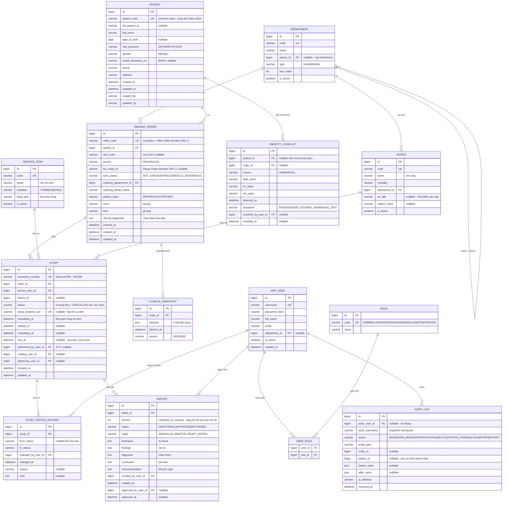

# VR-RIS PACS — ERD rút gọn

Tài liệu con của README.md, mục 6C: [T1] ERD rút gọn. Phạm vi bảng bám đúng README: Bệnh nhân, Chỉ định, Ca chụp, Lịch sử trạng thái, Máy/Modality, Khoa, User/Role, Audit log — cộng thêm 4 bảng bắt buộc vì nguyên tắc dự án (xem mục 3).

| Phiên bản | 0.9 (nháp — còn ❓ ở mục 9, chưa nâng lên v1.0) |
|---|---|
| Ngày | 2026-11-05 (v0.9: 2026-10-31; v0.2: 2026-10-17) |
| DB | MySQL 8, InnoDB, utf8mb4_0900_ai_ci |
| Migration | Flyway, V{n}__{mo_ta}.sql |
| Điều kiện lên v1.0 | Nhóm xác nhận **7** ô ở mục 9 (gồm `facility_id`, phụ thuộc câu 8 ở `01-scope.md`) |

> Thay đổi so với v0.2: thêm trạng thái `CANCELLED` (❓), bảng ánh xạ mã trạng thái DB/API/UI/Frontend (4.5), quy tắc version báo cáo (4.10), tuổi xấp xỉ khi chỉ biết năm sinh (4.2), mục 10 "Cần Frontend sửa". Mọi điểm gắn ❓ là **đề xuất, chờ nhóm xác nhận**, chưa phải quyết định.
>
> Thay đổi ngày 2026-11-05: `audit_log.action` thêm `VIEW_IMAGE` + mục 4.11 giải thích (ghi khi có người mở viewer); mục 4.4 thêm quy tắc **không lưu URL viewer thành cột**; mục 4.9 trỏ sang `07-pacs-dicom.md` cho mapping DICOM tag và cảnh báo `PatientBirthDate` (0010,0030) là kiểu DA đủ ngày; mục 9 thêm 2 ô cần xác nhận (`study` ↔ `service_item`, `patient_code` ↔ `visit_code`). Sơ đồ nguồn `diagrams/02-erd.mmd` đã cập nhật theo — **ảnh `.png` đã xuất lại ngày 2026-11-05, xem mục 0.**


## 0. Ảnh `.png` trong `diagrams/` — đã xuất lại, khớp nguồn (2026-11-05)

**Nguồn `.mmd` là chuẩn; `.png` chỉ để trình bày.** Ba ảnh từng lệch nguồn (`02-erd.png`, `01-ranh-gioi-he-thong.png`, `05-state-machine.png`) đã được **xuất lại bằng `mermaid-cli` qua `npx`** trong phiên làm việc ngày 2026-11-05 — môi trường lần này có Node và mạng, không còn bị chặn như lần trước. Cả ba đã đối chiếu lại và khớp đúng nguồn `.mmd` hiện hành:

| Ảnh | Đối chiếu |
|---|---|
| `diagrams/02-erd.png` | Khớp `02-erd.mmd` (có `VIEW_IMAGE` trong `audit_log.action`, mục 4.11) và khớp mục 1 của file này |
| `diagrams/01-ranh-gioi-he-thong.png` | Lỗi nhãn cạnh `C-STORE` / `deep-link` tách thành node rời (do thiếu ngoặc kép) đã được sửa từ trước trong `.mmd`; ảnh xuất lại hiển thị đúng hai nhãn này nằm trên cạnh, không còn node rời |
| `diagrams/05-state-machine.png` | Khớp 7 trạng thái (`SCHEDULED/UNREAD/READING/READ/APPROVING/APPROVED/CANCELLED`), mã tiếng Anh, đúng `03-state-machine.md` mục 2.8 |

Lệnh đã dùng (giữ lại để tái sử dụng khi sửa `.mmd` sau này):

```bash
npx -y @mermaid-js/mermaid-cli -i "doc/diagrams/<ten>.mmd" -o "doc/diagrams/<ten>.png" -b white -s 2
```

> **Quy ước:** sửa `.mmd` thì phải xuất lại `.png` cùng tên bằng lệnh trên (hoặc draw.io: Arrange → Insert → Mermaid → File → Export as → PNG). Nếu môi trường sau này lại không chạy được `npx`, ghi lại ở đây cho người sau, **không** xóa ảnh cũ.

---

## 1. Sơ đồ

Sơ đồ nguồn: `diagrams/02-erd.mmd` — mở draw.io, Arrange → Insert → Mermaid, dán nội dung file để có sơ đồ chỉnh sửa được.



## 2. Giải thích từng bảng

| Bảng | Vai trò | Ghi chú thiết kế |
|---|---|---|
| patient | Danh tính bệnh nhân | Không có cột age |
| imaging_order | Phiếu chỉ định — tương ứng “Chỉ định” trên UI | Một phiếu có thể gồm nhiều ca chụp |
| study | Một ca chụp cụ thể — đơn vị của worklist và của state machine | Hàng trong worklist = một study, không phải một order |
| study_status_history | Lịch sử chuyển trạng thái | Append-only. Trạng thái hiện tại vẫn giữ ở study.status để lọc/đếm nhanh |
| report | Báo cáo kết quả | Có version; sửa sau khi duyệt tạo bản mới, không ghi đè |
| service_item | Danh mục dịch vụ CĐHA | Nguồn cho “Tên chỉ định”, “Bộ phận chụp” |
| device | Máy chụp | ae_title để trống trong 8 tuần, dùng khi làm MWL |
| department | Khoa / nhóm, tự tham chiếu | Dựng cây lọc khoa → nhóm → máy ở README 3.2 |
| identity_conflict | Log lệch dữ liệu HIS ↔ RIS | Bắt buộc theo README 2.5 |
| clinical_snapshot | Dữ liệu lâm sàng từ HIS, lưu nguyên khối JSON | Xem mục 5 |
| app_user / role / user_role | Người dùng & vai trò | 5 vai trò theo README mục 5 |
| audit_log | Nhật ký truy vết | Append-only, không UPDATE/DELETE |

## 3. Bốn bảng thêm ngoài danh sách README — lý do

| Bảng | Vì sao không bỏ được |
|---|---|
| report | README 3.1 liệt kê kỹ thuật / mô tả / chẩn đoán / kết luận / khuyến nghị, và state machine có “Đọc xong”, “Duyệt xong”. Nhét vào study thì không lưu được lịch sử sửa và ai duyệt |
| identity_conflict | README 2.5 yêu cầu rõ: “Mọi lần phát hiện lệch phải ghi log riêng để rà soát định kỳ”. audit_log không thay được vì cần trạng thái xử lý (resolution) |
| service_item | Nếu để “tên chỉ định” là chuỗi tự do thì không lọc được theo Chỉ định/Bộ phận chụp, và mapping DICOM tag ở tuần 4–5 không có chỗ bám |
| clinical_snapshot | Tách dữ liệu HIS ra khỏi dữ liệu RIS tự quản. Trộn chung sẽ hỏng khi tích hợp HIS thật |

## 4. Quyết định thiết kế cần biết trước khi code

4.1. Không lưu cột tuổi. age luôn tính từ date_of_birth tại thời điểm hiển thị. Đây là nguyên nhân trực tiếp của lỗi “Tuổi 0” ở README 2.5.

4.2. Ngày sinh thiếu chính xác. HIS tuyến dưới thường chỉ có năm sinh. date_of_birth lưu 1958-01-01 + dob_precision = 'YEAR'; UI hiển thị “1958”, tuổi hiển thị dạng xấp xỉ (ví dụ “~68”, vì không biết đã qua sinh nhật hay chưa; API trả thêm cờ `age_approximate`). Frontend hiện hiển thị như tuổi chính xác — xem mục 10. Nếu chỉ lưu DATE thì năm sau không phân biệt được “sinh 01/01” với “chỉ biết năm”.

4.3. accession_number là khóa nối RIS ↔ DICOM. Sinh ngay khi tạo study, kể cả khi chưa có ảnh, vì MWL (H-01) sẽ cần. Quy ước đề xuất: YYYYMMDD + số tăng dần 5 chữ số.

4.4. study_instance_uid nullable và UNIQUE. Trong 8 tuần điền bằng tay hoặc seed để deep-link sang OHIF. Sau này do máy chụp sinh. MySQL cho phép nhiều NULL trong cột UNIQUE nên không vướng.

**Không có cột nào lưu URL viewer.** URL mở OHIF được **ghép tại thời điểm hiển thị** từ (a) base URL OHIF lấy ở **ConfigMap** và (b) `study_instance_uid` của hàng đang xem — xem `01-scope.md` IN-19 điểm 2. Lưu URL đủ thành một cột sẽ nhân bản cấu hình hạ tầng vào dữ liệu nghiệp vụ: đổi host/port OHIF là phải chạy migration `UPDATE` toàn bảng. `study_instance_uid = NULL` nghĩa là **chưa có ảnh** → nút “Xem ảnh” ẩn/disable (IN-23), không phải “có ảnh nhưng thiếu URL”.

4.5. Trạng thái lưu bằng VARCHAR(20), không dùng ENUM của MySQL. ENUM khó thêm giá trị bằng migration. Giá trị trong DB và trong API theo cột **DB / API** dưới đây là chuẩn; **Frontend phải đổi mã theo ERD**, không đổi ERD cho khớp Frontend.

| DB / API (chuẩn) | UI (tiếng Việt) | Mã trong Frontend hiện tại (`Frontend/src/lib/types.ts`) |
|---|---|---|
| SCHEDULED | Chờ thực hiện | CHO_THUC_HIEN |
| UNREAD | Chưa đọc | CHUA_DOC |
| READING | Đang đọc | DANG_DOC |
| READ | Đọc xong | DOC_XONG |
| APPROVING | Đang duyệt | DANG_DUYET |
| APPROVED | Duyệt xong | DUYET_XONG |
| CANCELLED ❓ | Đã hủy | *(chưa có)* — đề xuất giữ, chờ xác nhận, README Phần 4 đang đánh dấu (?) |

4.6. Không xóa cứng dữ liệu nghiệp vụ. patient, imaging_order, study dùng is_deleted + deleted_at khi có nhu cầu; hiện chỉ cho phép hủy bằng trạng thái.

4.7. Thời gian. Lưu DATETIME theo giờ UTC, quy đổi Asia/Ho_Chi_Minh ở tầng hiển thị. Container MySQL và backend phải đặt cùng timezone trong ConfigMap.

4.8. Audit log lưu actor_username dạng snapshot bên cạnh FK. Nếu sau này đổi tên hoặc xóa user, bản ghi cũ vẫn đọc được — audit mất ý nghĩa nếu phụ thuộc join.

4.9. Schema bám sẵn HL7 v2 (hệ quả của quyết định ở 01-scope.md mục 4.1). Mapping dự kiến, hoàn thiện ở tuần 4–5:

| Cột RIS | HL7 v2 | Ghi chú |
|---|---|---|
| patient.patient_code | PID-3 (identifier list) | Khóa đối chiếu chính. HL7 cho phép nhiều identifier — RIS chỉ lấy loại PI |
| patient.social_insurance_no | PID-3 với type code BHXH | Identifier thứ hai, không phải khóa chính |
| patient.full_name | PID-5 | HL7 tách họ/tên; RIS lưu một chuỗi → cần quy tắc ghép, dễ sinh lệch |
| patient.date_of_birth + dob_precision | PID-7 | PID-7 có độ dài thay đổi (1958, 195803, 19580315) → đúng là lý do cần dob_precision ở 4.2 |
| patient.gender | PID-8 |  |
| imaging_order.his_order_id | ORC-2 Placer Order Number | Bên HIS đặt |
| imaging_order.order_code | ORC-3 Filler Order Number | Bên RIS đặt |
| imaging_order.patient_class | PV1-2 | I / O |
| imaging_order.room / bed | PV1-3 |  |
| study.accession_number | OBR-18 | Đồng thời là DICOM tag (0008,0050) — khóa nối ba chiều HIS ↔ RIS ↔ PACS |
| report.* | OBX lặp lại trong ORU^R01 | Mỗi mục (kỹ thuật, mô tả, kết luận…) là một OBX |

Hai điều này không làm bây giờ nhưng đã biết trước: his_message_log (lưu MSH-10, raw message, ACK, số lần retry) sẽ thêm ở H-03; và PID-5 ghép họ tên là nguồn lệch dữ liệu được dự đoán trước, phải có test case riêng theo yêu cầu README 2.5.

**Bảng field đầy đủ, ví dụ message, và mapping mở rộng (kể cả hai cột chưa có ở bảng trên — `visit_code`, `clinical_diagnosis`): xem `08-hl7-message-spec.md` mục 3, 6, 7** (nháp v0.1, 2026-11-05) — bảng trên chỉ giữ các cột đã chốt từ trước, không lặp lại nội dung của `08`.

**Mapping DICOM tag ↔ cột RIS: xem `07-pacs-dicom.md` mục 7.** Bảng trên là cạnh HL7 (HIS ↔ RIS); cạnh DICOM (RIS ↔ PACS) nằm ở file đó. Hai bảng gặp nhau ở `study.accession_number` — HL7 OBR-18 và DICOM (0008,0050) là **cùng một giá trị**, đó là khóa nối ba chiều HIS ↔ RIS ↔ PACS.

**Cảnh báo một chỗ dễ sinh lỗi “Tuổi 0”:** DICOM `PatientBirthDate` (0010,0030) là **kiểu DA — ngày đầy đủ `YYYYMMDD`**, không có dạng ngắn. HL7 PID-7 thì **cho phép độ dài thay đổi** (`1958`, `195803`, `19580315`) — đúng lý do cần `dob_precision` ở mục 4.2. Nên khi RIS ghi ngày sinh vào header DICOM (qua MWL, H-01):

- Ca `dob_precision = 'YEAR'` **không biểu diễn được trung thực** trong tag DA. Phải quy ước: ghi `19580101` (mất thông tin “chỉ biết năm”), hoặc để **trống** tag đó.
- ❓ **Chưa chốt** chọn cách nào — xem `07-pacs-dicom.md` mục 4 và mục 8.
- Vì sao quan trọng: `01-scope.md` mục 6 bước 10 yêu cầu **không ca nào ra “Tuổi 0”**. Nếu ghi `19580101` rồi hệ thống khác đọc header và coi là ngày sinh chính xác, hoặc nếu để trống rồi viewer tự tính tuổi từ tag rỗng, thì lỗi “Tuổi 0” ở README 2.5 **xuất hiện lại ở phía ảnh** — nơi RIS không sửa được nữa, vì header đã nằm trong PACS.

4.10. Version báo cáo (❓ đề xuất, chờ nhóm xác nhận).

- `DRAFT → FINAL → APPROVED` của một lượt đọc dùng **cùng một bản ghi** `report`, cùng `version`.
- Báo cáo bị trả lại (`APPROVING → READING`): bản hiện tại đổi sang `RETURNED` và **giữ nguyên làm lịch sử**. Khi bác sĩ chốt lại (`READING → READ`), tạo bản ghi **mới** với `version + 1`, trạng thái `FINAL`.
- Mở lại ca đã duyệt (`APPROVED → READING`): tạo bản ghi `report` **mới** (`version + 1`, trạng thái `DRAFT`). Bản `APPROVED` cũ **giữ nguyên, không sửa, không ghi đè**. Bản mới **không kế thừa** `approved_by_user_id` / `approved_at` — phải được duyệt lại. Nội dung bản mới có thể sao chép từ bản `APPROVED` làm điểm xuất phát.
- Bản hiện hành của một `study` là bản có `version` lớn nhất; chỉ bản `APPROVED` mới được gửi về HIS (ORU^R01).
- Ràng buộc: `UK(study_id, version)`.

4.11. `audit_log.action` có giá trị `VIEW_IMAGE`. Ghi **mỗi lần có người mở viewer cho một study** — từ worklist hoặc từ màn hình kết quả lâm sàng, tức cả hai cửa vào ở README mục 2.7.

- **Vì sao phải có riêng, không dùng `READ`:** nguyên tắc bất biến của dự án là *mọi hành vi đọc dữ liệu bệnh nhân đều phải ghi audit log*. Mở viewer **là** một hành vi đọc dữ liệu bệnh nhân — ảnh y tế là dữ liệu nhạy cảm nhất trong hệ thống. Nhưng **PACS không biết ai gọi** nó (README 2.7): nó chỉ thấy một yêu cầu DICOMweb cho một study. Nếu RIS không ghi lại lúc sinh deep-link thì **không chỗ nào trong hệ thống biết ai đã xem ảnh của ai**. `READ` dùng cho việc đọc bản ghi RIS; `VIEW_IMAGE` tách riêng để truy vết được theo đúng câu hỏi “ai đã xem ảnh bệnh nhân này”.
- **Ghi ở đâu:** ở RIS, tại endpoint sinh deep-link, **trước** khi trả URL cho trình duyệt. Không ghi ở phía OHIF (OHIF là sản phẩm có sẵn, không sửa) và không ghi được ở Orthanc.
- **Giá trị cột:** `entity_type = 'STUDY'`, `entity_id = study.id`, `patient_id` = bệnh nhân của study. `before_value` / `after_value` để NULL (không phải hành vi sửa). ❓ Có ghi thêm `study_instance_uid` vào `after_value` để tiện đối chiếu với log Orthanc hay không — **chưa chốt**.
- **Hệ quả:** nếu viewer mở trực tiếp bằng URL dán tay (không qua RIS) thì **không có dòng audit nào** — đây chính là lý do OHIF không được mở công khai (nguyên tắc bất biến ở README mục 0; `01-scope.md` IN-19 điểm 3).
- Migration: thêm vào `V5__audit_and_conflict.sql` chỉ là **sửa COMMENT** của cột (cột đang là `VARCHAR(20)`, không có `CHECK`/`ENUM`). Theo mục 7, **không sửa V1–V7 đã vào `main`** → cần file mới (V8) chỉ để đổi comment, hoặc để comment lệch và coi tài liệu này là chuẩn ❓ chưa chốt.

## 5. Vì sao thông tin lâm sàng là JSON chứ không phải 15 bảng

5 tab ở README 3.3 (sinh hiệu, xét nghiệm, chẩn đoán chức năng, đơn thuốc/vật tư, phẫu thuật thủ thuật) là dữ liệu của HIS, RIS chỉ đọc và hiển thị. Mô hình hóa đầy đủ sẽ tốn khoảng 15 bảng, không bảng nào RIS được quyền ghi, và gần như chắc chắn sai so với cấu trúc HIS thật.

Trong 8 tuần: lưu nguyên payload JSON theo order_id, render theo từng tab. Khi tích hợp HIS thật, nếu cần lọc/thống kê theo chỉ số lâm sàng thì mới bóc tách ra bảng riêng. Ghi vào nợ kỹ thuật ở tuần 8.

## 6. Chỉ mục đề xuất

| Bảng | Index |
|---|---|
| patient | UK(patient_code), IDX(full_name), IDX(social_insurance_no) |
| imaging_order | UK(order_code), IDX(patient_id), IDX(visit_code), IDX(ordered_at) |
| study | UK(accession_number), UK(study_instance_uid), IDX(status, scheduled_at), IDX(device_id, scheduled_at), IDX(order_id) |
| study_status_history | IDX(study_id, changed_at) |
| report | UK(study_id, version) |
| audit_log | IDX(patient_id, occurred_at), IDX(actor_user_id, occurred_at), IDX(entity_type, entity_id) |
| identity_conflict | IDX(resolution, detected_at) |

Index (status, scheduled_at) trên study là quan trọng nhất: worklist, bộ đếm theo nhóm trạng thái và lọc theo khoảng thời gian đều đi qua nó.

## 7. Thứ tự migration

Các file này đã được viết thật ở `database/migrations/` (chạy bằng `database/docker-compose.yml`, xem `database/README.md`). Nếu ERD đổi, thêm file migration mới (V8, V9, …), **không sửa** file V1–V7 đã vào `main`.

| File | Nội dung |
|---|---|
| V1__ref_data.sql | department, service_item, device |
| V2__security.sql | app_user, role, user_role |
| V3__patient_order_study.sql | patient, imaging_order, study |
| V4__workflow.sql | study_status_history, report |
| V5__audit_and_conflict.sql | audit_log, identity_conflict |
| V6__clinical_snapshot.sql | clinical_snapshot |
| V7__seed_demo_data.sql | Dữ liệu giả — không có tên/mã bệnh nhân thật |

## 8. Ngoài phạm vi ERD này

Theo README 6C mục [HOÃN]: đoàn khám, mã lưu trữ, mã bệnh phẩm, BHYT chi tiết, chiến lược lưu trữ ảnh dài hạn, bảng cấu hình hiển thị theo người dùng (README 3.5), và toàn bộ bảng cho AI (mask, feature, report nháp).

## 9. Cần xác nhận

Cột "Đề xuất" là trả lời của tài liệu; cột "Trạng thái" cho biết nhóm đã xác nhận hay chưa. **Chưa ô nào được nhóm xác nhận**, nên ERD giữ ở v0.9.

| Câu hỏi | Đề xuất | Trạng thái |
|---|---|---|
| Có trạng thái `CANCELLED` không, ai được hủy | **Có.** Chỉ hủy khi ca đang `SCHEDULED` (chưa có ảnh). Vai trò hủy: `ADMIN`, `TECHNICIAN`. Bắt buộc ghi lý do vào `study_status_history.reason`. `CANCELLED` là trạng thái cuối (liên quan README Phần 4, Phần 9 câu 1) | ❓ đề xuất, chờ nhóm xác nhận |
| `due_at` tính theo quy tắc nào | **Để NULL, chưa dùng**, cho đến khi định nghĩa "quá hạn" được chốt (README Phần 9 câu 2) | ❓ đề xuất, chờ nhóm xác nhận |
| Một `imaging_order` có nhiều `study` | **Giữ quan hệ 1–n** (khớp IN-02 trong scope doc). Cần đối chiếu với nghiệp vụ thật ở UI tham chiếu | ❓ đề xuất, chờ nhóm xác nhận |
| "Bác sĩ chỉ định" lưu tên tự do hay là `app_user` | **Tên tự do** (`ordering_doctor_name`) trong 8 tuần; ghi vào nợ kỹ thuật tuần 8. Vai trò Bác sĩ lâm sàng (README mục 5) là người dùng đăng nhập nhưng chưa gắn khóa ngoại vào chỉ định | ❓ đề xuất, chờ nhóm xác nhận |
| Có cần `facility_id` không | **Không thêm** (một bệnh viện, nhiều khoa). Phụ thuộc câu 8 ở `01-scope.md`, câu này **chưa được xác nhận** nên ô này cũng chưa chốt | ❓ đề xuất, chờ nhóm xác nhận |
| Một `study` có luôn đúng **một** `service_item`, hay một `study` gồm **nhiều dịch vụ** | **Giữ đúng một** (`study.service_item_id` là FK đơn, không nullable về nghiệp vụ). Hệ quả: chụp 2 dịch vụ trên cùng một lần vào máy = **2 study**, 2 `accession_number`, nhưng có thể **chung một `study_instance_uid`** nếu máy gộp vào một study DICOM — khi đó cột `UK(study_instance_uid)` sẽ **vỡ**. Cần đối chiếu nghiệp vụ thật ở UI tham chiếu, và kiểm tra lại ràng buộc UNIQUE | ❓ đề xuất, chờ nhóm xác nhận — **ảnh hưởng ràng buộc DB, nên chốt trước tuần 7** |
| `patient_code` (mã bệnh nhân) và `visit_code` (mã hồ sơ / LSVV) là **hai mã tách biệt** | **Có, hai mã khác nhau, không suy ra được từ nhau.** `patient_code` gắn với **một người** và sống qua mọi lần đến viện (khóa đối chiếu chính, mục 4.9 → PID-3). `visit_code` gắn với **một lần vào viện**, nằm ở `imaging_order.visit_code`, một bệnh nhân có nhiều `visit_code`. Đã khớp với hệ thống tham chiếu: bộ lọc README 3.2 cho tìm **riêng** theo “mã bệnh nhân” và theo “mã LSVV”, và cột hiển thị có “Mã hồ sơ” riêng | ❓ đề xuất, chờ nhóm xác nhận (suy luận từ UI tham chiếu, chưa có người xác nhận nghiệp vụ) |

## 10. Cần Frontend sửa

Đối chiếu `Frontend/src/lib/types.ts`, `status.ts`, `format.ts` và `data/mock.ts` (đọc ngày 2026-10-31) với ERD. Khi nối API thật, các điểm sau lệch. **Ghi nhận ở đây, chưa sửa code Frontend.**

- **Mã trạng thái**: Frontend dùng `CHO_THUC_HIEN / CHUA_DOC / DANG_DOC / DOC_XONG / DANG_DUYET / DUYET_XONG`; phải đổi theo bảng ở 4.5. Chưa có `CANCELLED`.
- **`Study.technique`, `Study.conclusion`** không có trong ERD; nguồn duy nhất của hai nội dung này là bảng `report` (bản hiện hành, xem 4.10). Worklist lấy qua join, không nhân bản lên `study`.
- **`Study.bhytViolation`, `Patient.healthCheckCode`** chưa có trong ERD vì thuộc nhóm [HOÃN] (BHYT chi tiết, đoàn khám). **Không thêm vào ERD.** Frontend nên bỏ hoặc coi là dữ liệu tạm cho tới khi có quy tắc.
- **Người thực hiện bằng tên, không bằng id**: Frontend lưu `performedByName`, `readingUserName`, `approvingUserName`, `createdByName`, `approvedByName`, `changedByName`. ERD lưu khóa ngoại (`performed_by_user_id`, `reading_user_id`, `approving_user_id`, `created_by_user_id`, `approved_by_user_id`, `changed_by_user_id`). API trả id kèm tên hiển thị.
- **Thiếu `ImagingOrder.hisOrderId`** (`his_order_id`, ORC-2) trong kiểu dữ liệu Frontend.
- **Seed `accession_number`**: mock dùng `90000001…` (số tăng dần), ERD 4.3 quy ước `YYYYMMDD` + 5 chữ số (ví dụ `2026103100001`).
- **Tuổi xấp xỉ**: `calcAge` trong `format.ts` trả tuổi như số chính xác kể cả khi `dob_precision = 'YEAR'`; theo 4.2 phải hiển thị xấp xỉ (ví dụ "~68").
- **Version báo cáo**: `useWorklistStore.ts` tăng `version` ngay trên cùng một đối tượng khi báo cáo bị trả lại rồi chốt lại, và mock lấy `report.id = studyId`. ERD 4.10 yêu cầu bản ghi mới cho mỗi version.
- **Snapshot lâm sàng**: `CLINICAL_SNAPSHOT` có dữ liệu ở tab 3 và 4; scope 3.3 yêu cầu bảng rỗng + ghi chú "chờ tích hợp HIS" (xem bảng thay đổi phạm vi ở `01-scope.md`).
