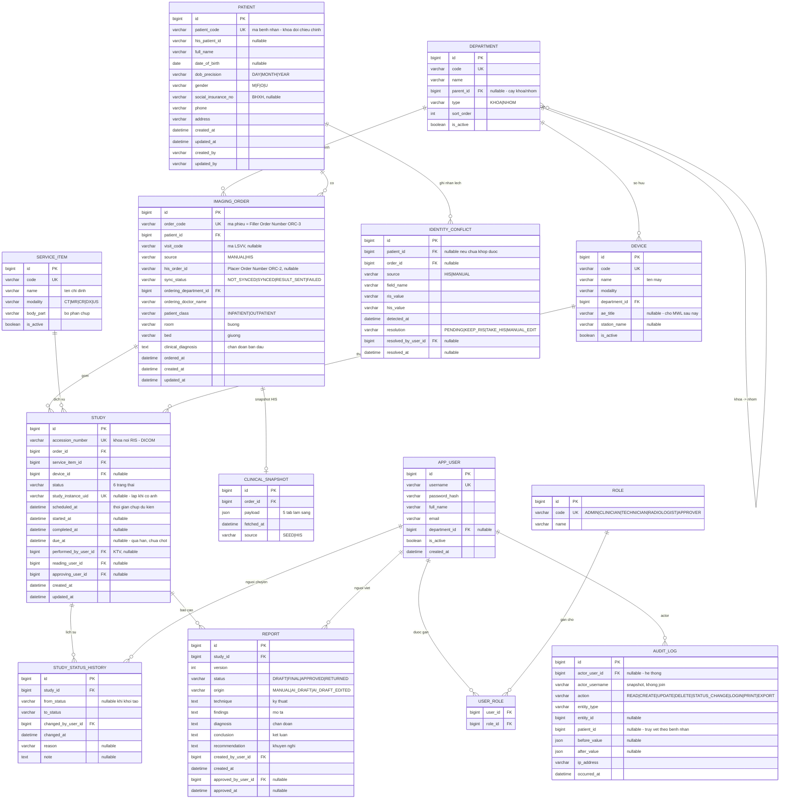

# VR-RIS PACS — ERD rút gọn

Tài liệu con của README.md, mục 6C: [T1] ERD rút gọn. Phạm vi bảng bám đúng README: Bệnh nhân, Chỉ định, Ca chụp, Lịch sử trạng thái, Máy/Modality, Khoa, User/Role, Audit log — cộng thêm 4 bảng bắt buộc vì nguyên tắc dự án (xem mục 3).

| Phiên bản | 0.2 (nháp) |
|---|---|
| Ngày | 2026-10-17 |
| DB | MySQL 8, InnoDB, utf8mb4_0900_ai_ci |
| Migration | Flyway, V{n}__{mo_ta}.sql |

## 1. Sơ đồ

Sơ đồ nguồn: `diagrams/02-erd.mmd` — mở draw.io, Arrange → Insert → Mermaid, dán nội dung file để có sơ đồ chỉnh sửa được.

## 2. Giải thích từng bảng

| Bảng | Vai trò | Ghi chú thiết kế |
|---|---|---|
| patient | Danh tính bệnh nhân | Không có cột age |
| imaging_order | Phiếu chỉ định — tương ứng “Chỉ định” trên UI | Một phiếu có thể gồm nhiều ca chụp |
| study | Một ca chụp cụ thể — đơn vị của worklist và của state machine | Hàng trong worklist = một study, không phải một order |
| study_status_history | Lịch sử chuyển trạng thái | Append-only. Trạng thái hiện tại vẫn giữ ở study.status để lọc/đếm nhanh |
| report | Báo cáo kết quả | Có version; sửa sau khi duyệt tạo bản mới, không ghi đè |
| service_item | Danh mục dịch vụ CĐHA | Nguồn cho “Tên chỉ định”, “Bộ phận chụp” |
| device | Máy chụp | ae_title để trống trong 8 tuần, dùng khi làm MWL |
| department | Khoa / nhóm, tự tham chiếu | Dựng cây lọc khoa → nhóm → máy ở README 3.2 |
| identity_conflict | Log lệch dữ liệu HIS ↔ RIS | Bắt buộc theo README 2.5 |
| clinical_snapshot | Dữ liệu lâm sàng từ HIS, lưu nguyên khối JSON | Xem mục 5 |
| app_user / role / user_role | Người dùng & vai trò | 5 vai trò theo README mục 5 |
| audit_log | Nhật ký truy vết | Append-only, không UPDATE/DELETE |

## 3. Bốn bảng thêm ngoài danh sách README — lý do

| Bảng | Vì sao không bỏ được |
|---|---|
| report | README 3.1 liệt kê kỹ thuật / mô tả / chẩn đoán / kết luận / khuyến nghị, và state machine có “Đọc xong”, “Duyệt xong”. Nhét vào study thì không lưu được lịch sử sửa và ai duyệt |
| identity_conflict | README 2.5 yêu cầu rõ: “Mọi lần phát hiện lệch phải ghi log riêng để rà soát định kỳ”. audit_log không thay được vì cần trạng thái xử lý (resolution) |
| service_item | Nếu để “tên chỉ định” là chuỗi tự do thì không lọc được theo Chỉ định/Bộ phận chụp, và mapping DICOM tag ở tuần 4–5 không có chỗ bám |
| clinical_snapshot | Tách dữ liệu HIS ra khỏi dữ liệu RIS tự quản. Trộn chung sẽ hỏng khi tích hợp HIS thật |

## 4. Quyết định thiết kế cần biết trước khi code

4.1. Không lưu cột tuổi. age luôn tính từ date_of_birth tại thời điểm hiển thị. Đây là nguyên nhân trực tiếp của lỗi “Tuổi 0” ở README 2.5.

4.2. Ngày sinh thiếu chính xác. HIS tuyến dưới thường chỉ có năm sinh. date_of_birth lưu 1958-01-01 + dob_precision = 'YEAR'; UI hiển thị “1958”, tuổi hiển thị dạng xấp xỉ. Nếu chỉ lưu DATE thì năm sau không phân biệt được “sinh 01/01” với “chỉ biết năm”.

4.3. accession_number là khóa nối RIS ↔ DICOM. Sinh ngay khi tạo study, kể cả khi chưa có ảnh, vì MWL (H-01) sẽ cần. Quy ước đề xuất: YYYYMMDD + số tăng dần 5 chữ số.

4.4. study_instance_uid nullable và UNIQUE. Trong 8 tuần điền bằng tay hoặc seed để deep-link sang OHIF. Sau này do máy chụp sinh. MySQL cho phép nhiều NULL trong cột UNIQUE nên không vướng.

4.5. Trạng thái lưu bằng VARCHAR(20), không dùng ENUM của MySQL. ENUM khó thêm giá trị bằng migration. Hằng số:

| DB | UI |
|---|---|
| SCHEDULED | Chờ thực hiện |
| UNREAD | Chưa đọc |
| READING | Đang đọc |
| READ | Đọc xong |
| APPROVING | Đang duyệt |
| APPROVED | Duyệt xong |
| CANCELLED ❓ | Đã hủy — chờ xác nhận, README Phần 4 đang đánh dấu (?) |

4.6. Không xóa cứng dữ liệu nghiệp vụ. patient, imaging_order, study dùng is_deleted + deleted_at khi có nhu cầu; hiện chỉ cho phép hủy bằng trạng thái.

4.7. Thời gian. Lưu DATETIME theo giờ UTC, quy đổi Asia/Ho_Chi_Minh ở tầng hiển thị. Container MySQL và backend phải đặt cùng timezone trong ConfigMap.

4.8. Audit log lưu actor_username dạng snapshot bên cạnh FK. Nếu sau này đổi tên hoặc xóa user, bản ghi cũ vẫn đọc được — audit mất ý nghĩa nếu phụ thuộc join.

4.9. Schema bám sẵn HL7 v2 (hệ quả của quyết định ở 01-scope.md mục 4.1). Mapping dự kiến, hoàn thiện ở tuần 4–5:

| Cột RIS | HL7 v2 | Ghi chú |
|---|---|---|
| patient.patient_code | PID-3 (identifier list) | Khóa đối chiếu chính. HL7 cho phép nhiều identifier — RIS chỉ lấy loại PI |
| patient.social_insurance_no | PID-3 với type code BHXH | Identifier thứ hai, không phải khóa chính |
| patient.full_name | PID-5 | HL7 tách họ/tên; RIS lưu một chuỗi → cần quy tắc ghép, dễ sinh lệch |
| patient.date_of_birth + dob_precision | PID-7 | PID-7 có độ dài thay đổi (1958, 195803, 19580315) → đúng là lý do cần dob_precision ở 4.2 |
| patient.gender | PID-8 |  |
| imaging_order.his_order_id | ORC-2 Placer Order Number | Bên HIS đặt |
| imaging_order.order_code | ORC-3 Filler Order Number | Bên RIS đặt |
| imaging_order.patient_class | PV1-2 | I / O |
| imaging_order.room / bed | PV1-3 |  |
| study.accession_number | OBR-18 | Đồng thời là DICOM tag (0008,0050) — khóa nối ba chiều HIS ↔ RIS ↔ PACS |
| report.* | OBX lặp lại trong ORU^R01 | Mỗi mục (kỹ thuật, mô tả, kết luận…) là một OBX |

Hai điều này không làm bây giờ nhưng đã biết trước: his_message_log (lưu MSH-10, raw message, ACK, số lần retry) sẽ thêm ở H-03; và PID-5 ghép họ tên là nguồn lệch dữ liệu được dự đoán trước, phải có test case riêng theo yêu cầu README 2.5.

## 5. Vì sao thông tin lâm sàng là JSON chứ không phải 15 bảng

5 tab ở README 3.3 (sinh hiệu, xét nghiệm, chẩn đoán chức năng, đơn thuốc/vật tư, phẫu thuật thủ thuật) là dữ liệu của HIS, RIS chỉ đọc và hiển thị. Mô hình hóa đầy đủ sẽ tốn khoảng 15 bảng, không bảng nào RIS được quyền ghi, và gần như chắc chắn sai so với cấu trúc HIS thật.

Trong 8 tuần: lưu nguyên payload JSON theo order_id, render theo từng tab. Khi tích hợp HIS thật, nếu cần lọc/thống kê theo chỉ số lâm sàng thì mới bóc tách ra bảng riêng. Ghi vào nợ kỹ thuật ở tuần 8.

## 6. Chỉ mục đề xuất

| Bảng | Index |
|---|---|
| patient | UK(patient_code), IDX(full_name), IDX(social_insurance_no) |
| imaging_order | UK(order_code), IDX(patient_id), IDX(visit_code), IDX(ordered_at) |
| study | UK(accession_number), UK(study_instance_uid), IDX(status, scheduled_at), IDX(device_id, scheduled_at), IDX(order_id) |
| study_status_history | IDX(study_id, changed_at) |
| report | IDX(study_id, version) |
| audit_log | IDX(patient_id, occurred_at), IDX(actor_user_id, occurred_at), IDX(entity_type, entity_id) |
| identity_conflict | IDX(resolution, detected_at) |

Index (status, scheduled_at) trên study là quan trọng nhất: worklist, bộ đếm theo nhóm trạng thái và lọc theo khoảng thời gian đều đi qua nó.

## 7. Thứ tự migration

| File | Nội dung |
|---|---|
| V1__ref_data.sql | department, service_item, device |
| V2__security.sql | app_user, role, user_role |
| V3__patient_order_study.sql | patient, imaging_order, study |
| V4__workflow.sql | study_status_history, report |
| V5__audit_and_conflict.sql | audit_log, identity_conflict |
| V6__clinical_snapshot.sql | clinical_snapshot |
| V7__seed_demo_data.sql | Dữ liệu giả — không có tên/mã bệnh nhân thật |

## 8. Ngoài phạm vi ERD này

Theo README 6C mục [HOÃN]: đoàn khám, mã lưu trữ, mã bệnh phẩm, BHYT chi tiết, chiến lược lưu trữ ảnh dài hạn, bảng cấu hình hiển thị theo người dùng (README 3.5), và toàn bộ bảng cho AI (mask, feature, report nháp).

## 9. Cần xác nhận

- [ ] Có trạng thái CANCELLED không, và ai được hủy (liên quan README Phần 4 câu hỏi 1)
- [ ] due_at tính theo quy tắc nào (Phần 9 câu 2) — chưa có thì để NULL, chưa dùng
- [ ] Một imaging_order có nhiều study — đúng với nghiệp vụ không, hay UI tham chiếu là 1–1
- [ ] “Bác sĩ chỉ định” lưu tên tự do hay phải là app_user (ảnh hưởng vai trò Bác sĩ lâm sàng ở README mục 5)
- [ ] Có cần cột facility_id không — phụ thuộc câu hỏi 8 ở 01-scope.md
