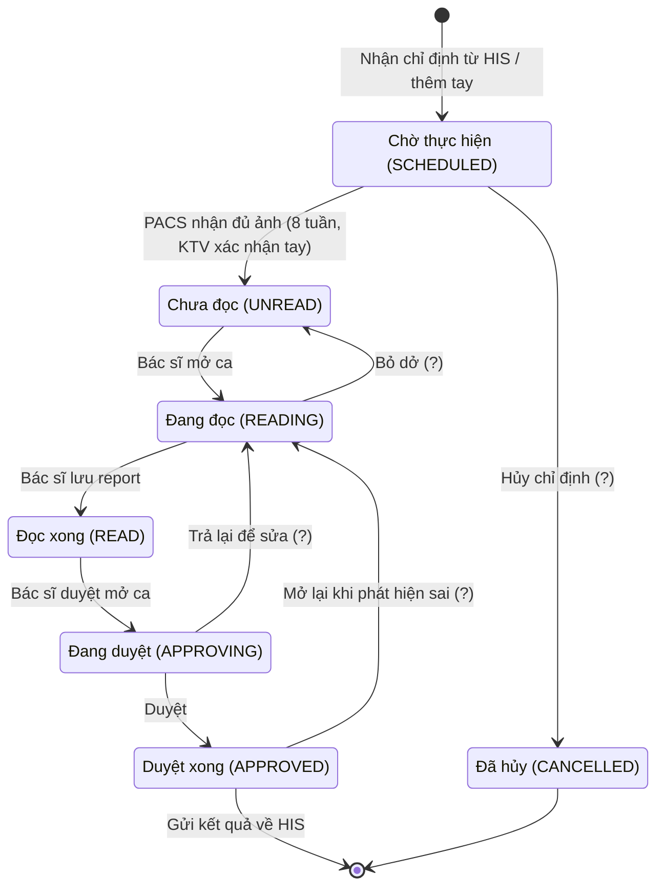

# VR-RIS PACS — Đặc tả state machine ca chụp

Tài liệu con của `README.md`, mục 6A: [T1] Đặc tả state machine. Căn cứ: README Phần 4 và Phần 5, `02-erd.md` (mục 4.5, 4.10), `01-scope.md` (IN-06, IN-14), và — chỉ để đối chiếu, không phải nguồn quyết định — `Frontend/src/lib/stateMachine.ts`, `auth.ts`.

| Phiên bản | 0.9 (nháp — chưa được nhóm xác nhận) |
|---|---|
| Ngày | 2026-11-05 (v0.9 gốc: 2026-10-31) |
| Trạng thái tài liệu | Mọi điểm gắn ❓ là **đề xuất, chờ nhóm xác nhận**. Chưa có điểm nào được xác nhận |
| Liên quan README Phần 9 | Câu 1 (ai chuyển trạng thái, có quay lui không), câu 2 ("quá hạn"), câu 11–13 (AI) |
| Thay đổi 2026-11-05 | Viết lại mục 2.6 (vị trí AI) — sửa mâu thuẫn với quy tắc "AI không ghi trực tiếp vào RIS", thêm đề xuất trường phụ `study.ai_status` (❓ chưa chốt, H-04). Chi tiết đầy đủ ở `doc/11-ai-design.md` |

Quy ước: mã trạng thái trong DB và API là cột **DB / API** của bảng 2.1 (theo `02-erd.md` mục 4.5). Nhãn tiếng Việt chỉ dùng cho UI.

## 1. Phạm vi

- Áp dụng cho **một `study`** (một ca chụp), không phải một `imaging_order`. Mỗi `study` có state machine riêng.
- Việc kiểm tra điều kiện chuyển là trách nhiệm của **backend** (IN-14: chặn ở tầng API, không chỉ ẩn nút). Frontend chỉ phản chiếu.
- Trong 8 tuần, các bước tự động (PACS báo study mới, gửi kết quả về HIS) là [HOÃN] (H-02, H-03). Chúng được thực hiện bằng thao tác tay hoặc chỉ ghi cờ.

## 2. Đặc tả

### 2.1. Bảng trạng thái

| DB / API | UI | Loại | Ghi chú |
|---|---|---|---|
| `SCHEDULED` | Chờ thực hiện | Đầu | Có ở tab **Chờ** |
| `UNREAD` | Chưa đọc | Trung gian | Đã có ảnh; từ đây ca ở tab **Đã thực hiện** |
| `READING` | Đang đọc | Trung gian | Có khóa mềm (2.4) |
| `READ` | Đọc xong | Trung gian | Báo cáo đã chốt `FINAL`, chờ duyệt |
| `APPROVING` | Đang duyệt | Trung gian | README Phần 4: có thể chỉ tồn tại ở một số khoa — ❓ chưa hỏi |
| `APPROVED` | Duyệt xong | Cuối thuận lợi | Gửi kết quả về HIS (H-03); vẫn có thể mở lại (nhánh ❓) |
| `CANCELLED` ❓ | Đã hủy | Cuối | Đề xuất trong `02-erd.md` mục 9, chờ xác nhận |

### 2.2. Bảng chuyển trạng thái

Mỗi lần chuyển **luôn** ghi một dòng `study_status_history` (`from_status`, `to_status`, `changed_by_user_id`, `changed_at`, `reason`, `note`) và một dòng `audit_log` (`action = STATUS_CHANGE`). Cột "Lý do" cho biết `reason` có bắt buộc không.

Các dòng có nhãn ❓ ở cột "Nguồn" là nhánh có dấu (?) trong README Phần 4, hoặc nhánh mới đề xuất.

| # | Từ → Sang | Vai trò được phép | Điều kiện bắt buộc | Ghi `study_status_history` / tác dụng phụ | Lý do | Nguồn |
|---|---|---|---|---|---|---|
| T1 | (khởi tạo) → `SCHEDULED` | `CLINICIAN`, `TECHNICIAN`, `ADMIN`; hoặc hệ thống khi nhận chỉ định từ HIS | Có `patient`, `imaging_order`, `service_item`. Sinh `accession_number` ngay (`02-erd.md` 4.3) | `from_status = NULL`. Người chuyển: người tạo, hoặc tài khoản `system` (xem 2.7, câu hỏi 3) | Không | README Phần 4 |
| T2 | `SCHEDULED` → `UNREAD` | `TECHNICIAN`, `ADMIN` | `study_instance_uid` đã điền (để deep-link OHIF); `device_id` đã gán ❓ | Đặt `completed_at` (kết thúc chụp). Trong 8 tuần là thao tác tay (H-02 tự động là [HOÃN]) | Không | README Phần 4 |
| T3 | `UNREAD` → `READING` | `RADIOLOGIST` | Ca chưa bị người khác khóa (2.4) | Đặt `reading_user_id` = người mở ca; tạo khóa mềm | Không | README Phần 4 |
| T4 | `READING` → `UNREAD` | Người đang đọc (`reading_user_id`); `ADMIN` để giải phóng khóa khi bác sĩ vắng ❓ | — | Xóa `reading_user_id`, nhả khóa mềm. Bản nháp báo cáo được giữ | **Bắt buộc** | README Phần 4 — nhánh (?) ❓ |
| T5 | `READING` → `READ` | Người đang đọc (`reading_user_id`) | Báo cáo hiện hành có `technique` **và** `conclusion` không rỗng ❓ | Báo cáo: `DRAFT` → `FINAL` (cùng version). Nhả khóa | Không | README Phần 4 |
| T6 | `READ` → `APPROVING` | `APPROVER` | `approving_user_id` ≠ `reading_user_id` ❓ | Đặt `approving_user_id`; tạo khóa mềm duyệt | Không | README Phần 4 |
| T7 | `APPROVING` → `APPROVED` | `APPROVER` (chính người đã mở duyệt) | Như T6: người duyệt ≠ người đọc ❓ | Báo cáo: `FINAL` → `APPROVED`; đặt `approved_by_user_id`, `approved_at`. `imaging_order.sync_status` giữ `NOT_SYNCED` (gửi HIS là H-03) | Không | README Phần 4 |
| T8 | `APPROVING` → `READING` | `APPROVER` | — | Báo cáo hiện hành → `RETURNED` (giữ làm lịch sử). Khi chốt lại ở T5: tạo bản ghi mới `version + 1` (`02-erd.md` 4.10). `reading_user_id` về người đọc cũ ❓ | **Bắt buộc** | README Phần 4 — nhánh (?) ❓ |
| T9 | `APPROVED` → `READING` | `ADMIN`, `APPROVER` ❓ | Ca chưa `CANCELLED` | Tạo bản ghi báo cáo **mới** (`version + 1`, `DRAFT`). Bản `APPROVED` cũ giữ nguyên; bản mới **không** kế thừa `approved_by_user_id` / `approved_at`. Nếu đã gửi HIS thì cần gửi lại kết quả (H-03) | **Bắt buộc** | README Phần 4 — nhánh (?) ❓ |
| T10 | `SCHEDULED` → `CANCELLED` | `ADMIN`, `TECHNICIAN` ❓ | `study_instance_uid` còn `NULL` (chưa có ảnh) | `CANCELLED` là trạng thái cuối, không có chuyển đi tiếp. Không xóa cứng (`02-erd.md` 4.6) | **Bắt buộc** | README Phần 4 — nhánh (?) ❓ |

Mọi cặp (từ, sang) **không** có trong bảng trên là **không hợp lệ**: backend trả lỗi, không ghi gì.

### 2.3. Các nhánh có dấu (?) ở README Phần 4

| Nhánh | Đề xuất | Lý do | Trạng thái |
|---|---|---|---|
| `READING → UNREAD` (Bỏ dở) | **Giữ** | Nếu thiếu, ca kẹt ở `READING` khi bác sĩ không đọc tiếp được, và khóa mềm không có cách nhả. Bản nháp vẫn được giữ | ❓ đề xuất, chờ nhóm xác nhận |
| `APPROVING → READING` (Trả lại để sửa) | **Giữ** | Nếu thiếu, người duyệt chỉ có thể duyệt hoặc để ca treo; không có đường từ chối báo cáo sai | ❓ đề xuất, chờ nhóm xác nhận |
| `APPROVED → READING` (Mở lại khi phát hiện sai) | **Giữ nhưng hạn chế**: chỉ `ADMIN`/`APPROVER`, bắt buộc lý do, tạo version báo cáo mới, bản cũ không bị sửa | Báo cáo y tế sai sau khi duyệt cần có đường đính chính có truy vết. Phương án thay thế (phiếu bổ sung — addendum, không mở lại ca) chưa được chọn | ❓ đề xuất, chờ nhóm xác nhận |
| `SCHEDULED → CANCELLED` (Hủy chỉ định) | **Giữ**, chỉ khi chưa có ảnh | Hủy sau khi có ảnh sẽ để lại ảnh mồ côi trong PACS; cần quy trình xóa/ẩn ảnh mà RIS không có quyền làm (RIS không xử lý ảnh) | ❓ đề xuất, chờ nhóm xác nhận |

### 2.4. Điều kiện chuyển (đề xuất ❓)

1. **`READING → READ` yêu cầu `technique` và `conclusion` không rỗng.** Hai trường này là tối thiểu để một báo cáo có nghĩa. Các trường còn lại (mô tả, chẩn đoán, khuyến nghị) không bắt buộc ❓.
2. **Người duyệt khác người đọc**: `approving_user_id` ≠ `reading_user_id`, **kể cả `ADMIN`**. Một người không tự đọc rồi tự duyệt chính báo cáo của mình.
3. **Mở lại ca (`APPROVED → READING`)**: chỉ `ADMIN` hoặc `APPROVER`, bắt buộc lý do, tạo version báo cáo mới.
4. **`SCHEDULED → CANCELLED`** chỉ khi chưa có ảnh (`study_instance_uid IS NULL`); `CANCELLED` là trạng thái cuối.
5. **Khóa mềm khi `READING` và `APPROVING`**: khi một người đã mở ca, người khác không mở cùng ca. Gợi ý cài đặt: `reading_user_id` / `approving_user_id` kèm thời điểm khóa; hết hạn hoặc bị `ADMIN` giải phóng thì mở lại được ❓ (thời hạn khóa chưa chốt). Chuyển trạng thái dùng khóa lạc quan (kiểm tra trạng thái hiện tại) để hai yêu cầu đồng thời không cùng thành công.
6. **`reason` bắt buộc** ở các nhánh T4, T8, T9, T10, kiểm ở backend: chuỗi rỗng hoặc chỉ có khoảng trắng bị từ chối.

**Ghi chú về Frontend (đối chiếu ngày 2026-10-31):** Frontend hiện **không kiểm tra** các điều kiện này. Cụ thể: `ReportModal` cho phép chuyển `READING → READ` với báo cáo trống; ô lý do được dán nhãn "bắt buộc" nhưng nút vẫn chạy khi ô trống (`run()` chuyển `reason.trim() || null`); không có khóa mềm; không có `CANCELLED`. `canEditReport` còn cho sửa báo cáo khi ca đang `CHUA_DOC` (chưa mở ca). **Backend phải là nơi kiểm tra**; Frontend không được coi là lớp bảo vệ.

### 2.5. Vai trò × chuyển trạng thái

Dấu ✔ = được phép theo đề xuất. Quyền của 5 vai trò lấy từ README Phần 5, **đang ghi "dự kiến — cần chốt"**.

| Chuyển | `ADMIN` | `CLINICIAN` | `TECHNICIAN` | `RADIOLOGIST` | `APPROVER` |
|---|---|---|---|---|---|
| T1 Tạo ca | ✔ | ✔ | ✔ | — | — |
| T2 `SCHEDULED → UNREAD` | ✔ | — | ✔ | — | — |
| T3 Mở ca để đọc | — | — | — | ✔ | — |
| T4 Bỏ dở | ✔ (giải phóng khóa) | — | — | ✔ (người đang đọc) | — |
| T5 `READING → READ` | — | — | — | ✔ (người đang đọc) | — |
| T6 Mở ca để duyệt | — | — | — | — | ✔ |
| T7 Duyệt | — | — | — | — | ✔ (≠ người đọc) |
| T8 Trả lại để sửa | — | — | — | — | ✔ |
| T9 Mở lại ca đã duyệt | ✔ | — | — | — | ✔ |
| T10 Hủy | ✔ | — | ✔ | — | — |

Đề xuất này **loại `ADMIN` khỏi việc đọc và duyệt báo cáo** (T3, T5, T6, T7, T8): README Phần 5 chỉ gán cho Admin việc cấu hình, người dùng, phân quyền, xem audit log. `ADMIN` chỉ giữ các thao tác ngoại lệ (T4, T9, T10) vì lý do vận hành.

**Chỗ lệch với `Frontend/src/lib/auth.ts` (`PERMISSIONS`):**

| Điểm | Đề xuất ở đây | Frontend hiện tại |
|---|---|---|
| `ADMIN` đọc và duyệt | Không | Có `report.write` **và** `report.approve` → một `ADMIN` vừa viết vừa duyệt được cùng một báo cáo |
| Mở lại ca đã duyệt (T9) | `ADMIN` hoặc `APPROVER` | Chỉ `study.reopen`, mà `study.reopen` chỉ có ở `ADMIN`; `APPROVER` không có |
| Hủy ca (T10) | `ADMIN`, `TECHNICIAN` | Không có quyền hủy |
| Người đọc phải là người đang giữ ca | Có (khóa mềm) | Không kiểm; bất kỳ ai có `report.write` đều thao tác được |
| Người duyệt ≠ người đọc | Có | Không kiểm |

### 2.6. Vị trí của AI (mức thiết kế, không code) — **sửa 2026-11-05, xem điểm 6**

> Mục này mô tả ở mức tóm tắt; đặc tả đầy đủ (pipeline, định dạng kết quả, AI Panel, audit, rủi ro automation bias, pháp lý) nằm ở **`doc/11-ai-design.md`** — đây chỉ là phần phải khớp với state machine.

1. **7 trạng thái chính của `study.status` (bảng 2.1–2.2) không đổi vì AI.** AI không tạo, không tự chuyển trạng thái nào của `study`. Phù hợp nguyên tắc bất biến: AI không tự trả kết quả chính thức, luôn có bác sĩ CĐHA xác nhận (human-in-the-loop).
2. **Bản ghi `report` trong RIS không do AI ghi.** AI chuẩn bị nội dung nháp (nhãn, điểm tin cậy, văn bản nháp) **ở ngoài RIS** (PACS cho mask DICOM SEG; một kho riêng của AI Backend cho phần phi ảnh — `11-ai-design.md` mục 3). Bản ghi `report` **chỉ xuất hiện trong RIS khi bác sĩ đang đọc (`reading_user_id`) lưu nó** qua `PUT /studies/{studyId}/reports/current` (endpoint đã có, không cần endpoint riêng cho AI) — đúng như AI Backend "không ghi trực tiếp vào RIS" (README mục 2.1). `report.origin` (`MANUAL | AI_DRAFT | AI_DRAFT_EDITED`, `02-erd.md`) do **backend tự tính tại thời điểm lưu**, dựa trên việc nội dung gửi lên có khớp nguyên văn gợi ý AI đang tham chiếu hay không — **không** phải do AI hay client tự khai báo giá trị `origin`. Chi tiết: `11-ai-design.md` mục 4.2 và mục 11 (điểm mâu thuẫn đã sửa).
3. Bác sĩ chuyển `READING → READ` (T5) vẫn là hành động xác nhận duy nhất, có tên người và có audit, dù báo cáo có gốc từ AI hay không — **không thêm bước xác nhận AI riêng**.
4. **Trường phụ mới, đề xuất (❓ chưa chốt, thuộc H-04): `study.ai_status`.** Độc lập hoàn toàn với `study.status` — không phải một trạng thái thứ 8 của state machine chính, mà là một **state machine phụ, song song**, theo dõi riêng việc AI đã xử lý ảnh của study này tới đâu:

   | `ai_status` | Ý nghĩa |
   |---|---|
   | `NOT_TRIGGERED` | Mặc định. Chưa có gì kích hoạt AI (modality không thuộc danh sách AI hỗ trợ, hoặc AI Backend chưa nhận được thông báo) |
   | `PENDING` | AI đang xử lý |
   | `READY` | AI đã có kết quả, sẵn sàng hiển thị ở AI Panel |
   | `FAILED` | AI xử lý lỗi |
   | `TIMEOUT` | AI quá thời gian chờ quy định, hoặc RIS không nhận được event nào sau một ngưỡng (xem `11-ai-design.md` mục 2 bước 5) |

   **Ai/cái gì kích hoạt:** PACS, tự động, khi nhận đủ ảnh cho một study có modality AI hỗ trợ — **không phải RIS, không phải bác sĩ**. RIS chỉ **nhận lại** một event trạng thái qua endpoint tích hợp hệ thống (cùng kiểu với `POST /integration/pacs/study-notifications` đã có trong `api/openapi.yaml`), rồi cập nhật `study.ai_status`. **Không có chuyển T1–T10 nào thay đổi vì trường này** — `ai_status` thay đổi độc lập, có thể xảy ra ở bất kỳ lúc nào study đang ở trạng thái `SCHEDULED` hoặc `UNREAD` trở đi (ảnh đã vào PACS).
   **Khi AI lỗi hoặc chậm (`FAILED`/`TIMEOUT`):** `study.status` **không bị ảnh hưởng** — bác sĩ đọc ca hoàn toàn như không có AI. Đây là yêu cầu an toàn bắt buộc: AI là lớp phụ trợ, không phải đường găng của nghiệp vụ.
   Sơ đồ: `doc/diagrams/11-ai-state-machine.mmd` — vẽ `study.status` (không đổi) và `study.ai_status` (đề xuất mới) là hai khối tách biệt, có ghi chú rõ phần nào đã có / phần nào AI thêm vào.
5. **Chưa đưa `study.ai_status` vào `02-erd.md`.** Đây là đề xuất schema (cần migration V8+ nếu được chấp nhận) — cần nhóm xác nhận trước, không tự thêm cột trong lần sửa này.
6. **Đây là thay đổi lớn so với bản nháp trước (trước 2026-11-05):** bản trước viết "AI chỉ tạo báo cáo nháp (`report.origin = AI_DRAFT`, `status = DRAFT`)" — đọc như AI tự ghi vào bảng `report` của RIS, mâu thuẫn với câu ngay sau đó ("AI Backend không ghi trực tiếp vào RIS"). Đã sửa theo điểm 2 ở trên. Toàn bộ phần AI vẫn là **[HOÃN] ở mức code (H-04)**; wireframe AI Panel và chương AI trong báo cáo là deliverable tài liệu (IN-21, IN-22) — xem đầy đủ ở `doc/11-ai-design.md`.

### 2.7. Câu hỏi mở của tài liệu này

1. README Phần 9 **câu 1** (ai chuyển trạng thái nào, có quay lui không) — các đề xuất ở 2.2–2.5 là trả lời đề xuất, **chưa được xác nhận**.
2. README Phần 9 **câu 2** ("quá hạn"): chưa định nghĩa; `study.due_at` để `NULL`. Không có trạng thái hay chuyển nào phụ thuộc "quá hạn".
3. **Người chuyển khi hệ thống tự chuyển** (nhận chỉ định từ HIS, PACS báo ảnh): `study_status_history.changed_by_user_id` là khóa ngoại không cho `NULL`, còn `audit_log.actor_user_id` thì cho `NULL`. Đề xuất: seed một tài khoản `system` (không đăng nhập được) ❓.
4. Không có đường từ `READ` quay về `READING`: bác sĩ đọc đã chốt báo cáo nhưng phát hiện lỗi trước khi người duyệt mở ca phải chờ người duyệt trả lại. Có thêm mũi tên thu hồi không? ❓ (không đề xuất thêm khi chưa hỏi nghiệp vụ).
5. `APPROVING` có thể chỉ tồn tại ở một số khoa (README Phần 4). Nếu đúng thì khoa không dùng bước này đi thẳng `READ → APPROVED`? ❓ chưa hỏi.
6. Thời hạn của khóa mềm và ai được giải phóng khóa ❓.
7. `started_at` / `completed_at` trong ERD là thời gian chụp. Frontend đặt `startedAt` lúc mở đọc (`UNREAD → READING`) và `readingUserName` lúc chốt đọc (`READING → READ`); theo đặc tả này, `reading_user_id` được đặt lúc mở ca (T3) và `started_at` do KTV nhập khi chụp. Ghi để Frontend sửa khi nối API.

### 2.8. Sơ đồ

Nguồn: `diagrams/05-state-machine.mmd`. Mũi tên **không** có dấu (?) là luồng chính, khớp giao diện hiện tại. Mũi tên có (?) là nhánh chưa được nhóm xác nhận. `CANCELLED` là trạng thái đề xuất ❓. Ảnh `diagrams/05-state-machine.png` xuất từ phiên bản cũ (6 trạng thái, mã tiếng Việt) và **chưa được vẽ lại**.

## 3. Test case bắt buộc

Chỉ liệt kê; chưa viết code kiểm thử. Dữ liệu dùng bệnh nhân giả. Mã lỗi: `409` chuyển không hợp lệ hoặc ca đang bị khóa, `403` sai vai trò, `422` thiếu điều kiện (khớp `api/openapi.yaml`).

| ID | Nhóm | Mô tả | Kết quả mong đợi |
|---|---|---|---|
| SM-01 | Hợp lệ | Đi hết luồng chính: T1 → T2 → T3 → T5 → T6 → T7 với đúng vai trò và đủ điều kiện | Mỗi bước thành công; có đủ 6 dòng `study_status_history` và 6 dòng `audit_log`; `worklist` đếm đúng |
| SM-02 | Hợp lệ | T4 bỏ dở rồi T3 mở lại bởi người khác | Thành công; khóa được nhả; nháp báo cáo còn nguyên |
| SM-03 | Hợp lệ | T8 trả lại rồi T5 chốt lại | Bản `RETURNED` giữ nguyên; bản mới `version + 1`, `FINAL` |
| SM-04 | Hợp lệ | T9 mở lại ca đã duyệt | Bản `APPROVED` cũ không đổi; bản mới `version + 1`, `DRAFT`, `approved_by_user_id` và `approved_at` rỗng |
| SM-05 | Hợp lệ | T10 hủy ca chưa có ảnh | `CANCELLED`; ghi lý do |
| SM-06 | Không hợp lệ | `SCHEDULED → READING`; `UNREAD → READ`; `READ → APPROVED` (nhảy bước); `APPROVED → UNREAD` | `409`, không ghi gì |
| SM-07 | Không hợp lệ | Mọi chuyển đi từ `CANCELLED` | `409` |
| SM-08 | Sai vai trò | Từng chuyển T1–T10 do vai trò không có trong bảng 2.5 gọi trực tiếp API (không qua UI) | `403`, không ghi gì |
| SM-09 | Sai vai trò | `ADMIN` gọi T5, T6, T7, T8 | `403` |
| SM-10 | Thiếu điều kiện | T5 khi `technique` rỗng; T5 khi `conclusion` rỗng; T5 khi cả hai chỉ có khoảng trắng | `422` |
| SM-11 | Thiếu điều kiện | T4, T8, T9, T10 không có `reason` hoặc `reason` chỉ khoảng trắng | `422` |
| SM-12 | Thiếu điều kiện | T2 khi `study_instance_uid` chưa điền ❓ | `422` |
| SM-13 | Thiếu điều kiện | T10 khi ca đã có `study_instance_uid` | `422` |
| SM-14 | Người đọc = người duyệt | Cùng một người (`reading_user_id`) gọi T6 hoặc T7, kể cả khi người đó có cả hai vai trò | Bị từ chối (`403`/`422` theo quyết định cuối) |
| SM-15 | Mở lại ca đã duyệt | T9 do `RADIOLOGIST` gọi; T9 không có lý do | `403`; `422` |
| SM-16 | Khóa mềm | Hai bác sĩ cùng gọi T3 gần như đồng thời | Một thành công, một `409`; `reading_user_id` là người thắng |
| SM-17 | Khóa mềm | Người khác gọi T5 trên ca do bác sĩ A đang đọc | `403` hoặc `409` |
| SM-18 | Đồng thời | Gọi cùng một chuyển hai lần liên tiếp (bấm đúp) | Lần hai `409`; chỉ một dòng lịch sử |
| SM-19 | Audit | Mỗi chuyển thành công ghi `audit_log` (`action = STATUS_CHANGE`, `before_value`/`after_value`, `patient_id`) | Đủ trường, người thực hiện đúng |
| SM-20 | Lịch sử | `study_status_history` là append-only | Không có API sửa/xóa; thử `UPDATE`/`DELETE` bị từ chối |
