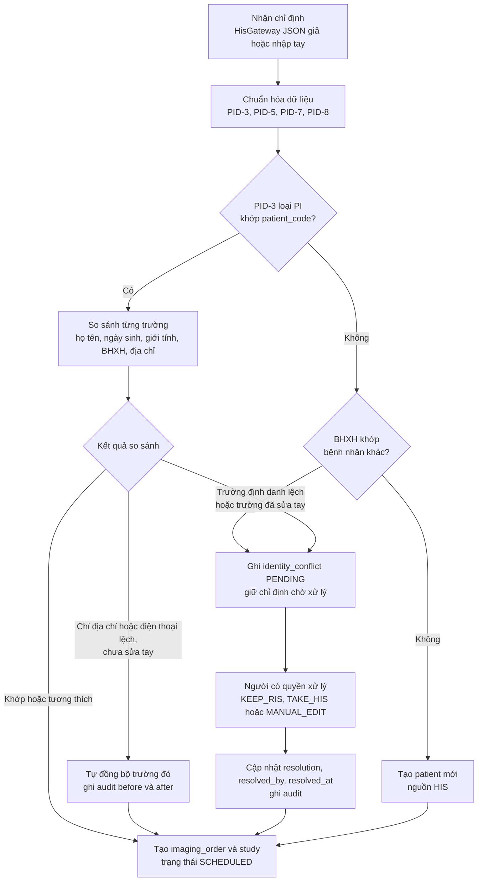

# VR-RIS PACS — Quy tắc đối chiếu dữ liệu HIS ↔ RIS

Tài liệu con của `README.md`, mục 2.5 (known issue lệch dữ liệu bệnh nhân) và mục 6A. Căn cứ: README 2.5; `02-erd.md` (4.1, 4.2, 4.9, bảng `identity_conflict`); `01-scope.md` (IN-05, mục 4.1, bước 9–10 của kịch bản nghiệm thu).

| Phiên bản | 0.9 (nháp — chưa được nhóm xác nhận) |
|---|---|
| Ngày | 2026-10-31 |
| Trạng thái tài liệu | Mọi điểm gắn ❓ là **đề xuất, chờ nhóm xác nhận**. Chưa có điểm nào được xác nhận |
| Phạm vi 8 tuần | Quy tắc áp dụng **đầy đủ kể cả khi chưa có HIS** (IN-05): nguồn "HIS" là `HisGateway` đọc file JSON giả, và nguồn "MANUAL" là nhập tay. Parser HL7 thật, MLLP, `his_message_log` là [HOÃN] (H-03) |

**Dữ liệu trong tài liệu này đều là dữ liệu giả.** Mã `TEST0001…`, tên có hậu tố "Giả". Không dùng tên hay mã bệnh nhân thật ở bất kỳ đâu (nguyên tắc bất biến của dự án).

## Tóm tắt

Known issue ở README 2.5: cùng một bệnh nhân có năm sinh **1958** trong RIS nhưng màn hình "Cập nhật chỉ định từ HIS" hiển thị **1952** và tuổi **0**. Đã xác nhận là lỗi, và là lỗi **đối chiếu danh tính**: nếu không có quy tắc, ảnh và kết quả có thể bị gán nhầm bệnh nhân. Tài liệu này trả lời 5 checkbox của README 2.5:

| Checkbox README 2.5 | Đề xuất | Mục |
|---|---|---|
| Khóa đối chiếu chính | `patient_code` ↔ PID-3 (loại PI). BHXH là khóa phụ. Họ tên + ngày sinh **không** làm khóa | 1 |
| Khi HIS và RIS lệch | **Chặn** trường lệch, ghi `identity_conflict`, người có quyền chọn `KEEP_RIS` / `TAKE_HIS` / `MANUAL_EDIT`. Không bên nào tự thắng với trường định danh | 2 |
| Sửa tay thông tin đã đồng bộ | Cho phép với vai trò xác định, có audit; lần đồng bộ sau **không ghi đè** trường đã sửa tay mà tạo conflict mới | 3 |
| Log lệch riêng để rà soát | Mỗi lần phát hiện một dòng `identity_conflict`; có quy trình rà soát định kỳ | 4 |
| Tuổi tính từ ngày sinh | Không lưu, không nhận từ HIS; HIS gửi tuổi thay ngày sinh → từ chối trường đó, ghi conflict | 5 |

Tất cả: ❓ đề xuất, chờ nhóm xác nhận.

## 1. Khóa đối chiếu

- **Khóa chính**: `patient.patient_code` ↔ **PID-3** (identifier list), chỉ lấy identifier có type code **`PI`**. HL7 cho phép nhiều identifier trong PID-3; các loại khác không được dùng làm khóa chính. (`02-erd.md` 4.9)
- **Khóa phụ**: `patient.social_insurance_no` ↔ PID-3 với type code `BHXH`. Chỉ dùng để **phát hiện nghi vấn** (mục 1.1), không dùng để tự ghép hai bản ghi.
- **Không làm khóa**: họ tên, ngày sinh. Hai người khác nhau có thể trùng cả hai; ngược lại một người có thể có nhiều cách viết tên (bỏ dấu, thứ tự họ–đệm–tên, hoa/thường). Hai trường này chỉ dùng để **so sánh sau khi đã khớp khóa** (mục 2).
- Khóa nối chỉ định: `imaging_order.his_order_id` ↔ **ORC-2** (Placer Order Number, HIS đặt); `imaging_order.order_code` ↔ **ORC-3** (Filler Order Number, RIS đặt). Khóa nối ba chiều với ảnh: `study.accession_number` ↔ OBR-18 ↔ DICOM (0008,0050).

Trạng thái: ❓ đề xuất, chờ nhóm xác nhận.

### 1.1. Các trường hợp khớp khóa

| Trường hợp | Điều kiện | Xử lý |
|---|---|---|
| A. Khớp `patient_code` | PID-3 (PI) khớp đúng một `patient` | So sánh từng trường (mục 2) |
| B. Bệnh nhân mới | Không khớp `patient_code`, và BHXH (nếu có) không khớp bệnh nhân nào | Tạo `patient` mới (nguồn HIS) rồi tạo chỉ định |
| C. Nghi trùng người | Không khớp `patient_code` nhưng **BHXH khớp một bệnh nhân khác** | **Chặn**: không tạo `patient` mới, không gắn chỉ định. Ghi `identity_conflict` (`field_name = patient_code`, `patient_id` = bệnh nhân khớp BHXH) |
| D. Trùng mã khác người | Khớp `patient_code` nhưng `his_patient_id` khác bản ghi RIS đã có | **Chặn** như C |
| E. Nhập tay trùng mã | Người dùng tạo bệnh nhân với `patient_code` đã tồn tại | Từ chối ngay (`UK(patient_code)`, IN-01 "chặn trùng mã"); không ghi conflict, vì chưa phải dữ liệu HIS |

## 2. Khi HIS và RIS lệch

Nguyên tắc: **với trường định danh, không bên nào tự thắng**. Hệ thống chặn việc ghi đè, ghi một dòng `identity_conflict` với `resolution = PENDING`, và chờ người có quyền chọn:

| `resolution` | Ý nghĩa | Tác dụng |
|---|---|---|
| `KEEP_RIS` | Giữ giá trị RIS, bỏ qua giá trị HIS | `patient` không đổi; ghi người xử lý, thời điểm |
| `TAKE_HIS` | Lấy giá trị HIS | Ghi giá trị HIS vào `patient`; ghi `audit_log` (`before_value`, `after_value`) |
| `MANUAL_EDIT` | Người xử lý nhập giá trị khác | Ghi giá trị đã nhập vào `patient`; ghi `audit_log` |

Người có quyền xử lý: `ADMIN`, `TECHNICIAN` ❓ (README mục 5 chưa phân quyền loại thao tác này).

### 2.1. Xử lý theo từng trường

| Trường (RIS ↔ HIS) | Mức độ nghiêm trọng | Khi lệch | Ghi chú |
|---|---|---|---|
| `patient_code` ↔ PID-3 (PI) | Rất cao | **Chặn** toàn bộ chỉ định | Mục 1.1 (trường hợp C, D) |
| `date_of_birth` + `dob_precision` ↔ PID-7 | Cao | **Luôn chặn** | Xem 2.2 |
| `full_name` ↔ PID-5 | Cao | **Luôn chặn** | Chuẩn hóa trước khi so sánh (mục 6.2) |
| `social_insurance_no` ↔ PID-3 (BHXH) | Cao | **Chặn** | Khóa phụ |
| `gender` ↔ PID-8 | Trung bình–cao | **Chặn** | Ảnh hưởng tới nghiệp vụ chụp và đọc |
| `address`, `phone` | Thấp | **Tự đồng bộ** (giá trị HIS thắng), ghi `audit_log` | **Trừ khi** trường đã được sửa tay (mục 3) → chặn, ghi conflict |

Quy tắc kèm theo:

- **Giá trị HIS rỗng không ghi đè giá trị RIS đang có.** Chỉ ghi log mức thấp; không chặn ❓.
- Khi có conflict `PENDING` cho một bệnh nhân, **chỉ định mới của bệnh nhân đó không tạo `study` trong worklist** cho tới khi conflict được xử lý. Lý do: tránh chụp và đọc nhầm bệnh nhân. Chỉ định được giữ ở trạng thái chờ (xem mục 10, điểm 1 — ERD chưa có chỗ giữ) ❓.
- Nếu danh tính bệnh nhân bị đổi (qua `TAKE_HIS` / `MANUAL_EDIT`) **sau khi** đã có báo cáo `APPROVED`: cần cảnh báo và ghi audit; xử lý chi tiết ❓ chưa chốt.

### 2.2. Ngày sinh, độ chính xác và ca 1958 vs 1952

PID-7 có độ dài thay đổi (`YYYY`, `YYYYMM`, `YYYYMMDD`), ánh xạ sang `dob_precision` (mục 6.2). Hai ngày sinh được coi là **tương thích** (không phải lệch) khi cùng phần mà cả hai cùng biết:

| RIS | HIS | Kết quả |
|---|---|---|
| `1958-03-15` (DAY) | `1958` (YEAR) | Tương thích. **Giữ RIS** (chính xác hơn). Không ghi đè, không conflict |
| `1958` (YEAR) | `19580315` (DAY), cùng năm | Tương thích. **Nâng độ chính xác** lên DAY, ghi `audit_log` ❓ |
| `1958-03-15` (DAY) | `19590315` | **Lệch** → `identity_conflict`, chặn |
| `1958` (YEAR) | `1952` (YEAR) | **Lệch** → `identity_conflict`, chặn |

Với ca năm sinh **1958 (RIS) vs 1952 (HIS)** ở README 2.5: hệ thống **không bao giờ** âm thầm ghi 1952 vào RIS. Nó tạo `identity_conflict` (`field_name = date_of_birth`, `ris_value = 1958`, `his_value = 1952`, `resolution = PENDING`), giữ nguyên `patient.date_of_birth = 1958-01-01` với `dob_precision = YEAR`, và tuổi luôn được tính từ giá trị RIS (xấp xỉ vì chỉ biết năm). Không bao giờ ra "Tuổi 0".

## 3. Sửa tay thông tin đã đồng bộ từ HIS

- **Cho phép** với vai trò `TECHNICIAN`, `ADMIN` ❓ (Frontend hiện cho `patient.update` cả `CLINICIAN`).
- **Mỗi lần sửa ghi `audit_log`**: `action = UPDATE`, `entity_type = patient`, `before_value`, `after_value`, người sửa, `patient_id`.
- **Lần đồng bộ sau không ghi đè trường đã sửa tay.** Nếu giá trị HIS khác giá trị đã sửa tay → tạo `identity_conflict` mới (`source = HIS`, `ris_value` = giá trị đã sửa tay) và chờ xử lý theo mục 2. Nếu giá trị HIS trùng giá trị đã sửa tay thì không làm gì.
- **Chưa có chỗ lưu "trường này đã sửa tay" trong ERD v0.9.** Hai lựa chọn ❓: (a) suy ra từ `audit_log` (không đổi schema, truy vấn chậm hơn); (b) thêm cột `patient.manual_fields` (JSON) hoặc bảng riêng. Nhóm chọn.

## 4. Log lệch và quy trình rà soát

- **Mỗi lần phát hiện lệch ghi một dòng `identity_conflict`** (theo từng trường): `patient_id` (có thể `NULL` nếu chưa khớp), `order_id`, `source` (`HIS`/`MANUAL`), `field_name`, `ris_value`, `his_value`, `detected_at`, `resolution`, `resolved_by_user_id`, `resolved_at`. Đây là yêu cầu của README 2.5; `audit_log` không thay được vì cần trạng thái xử lý.
- **Không ghi trùng**: nếu đã có một dòng `PENDING` với cùng (`patient_id`, `field_name`, `ris_value`, `his_value`) thì không tạo thêm; ghi `audit_log` cho lần phát hiện lại ❓.
- `ris_value` và `his_value` là **dữ liệu bệnh nhân**: bảo vệ như bảng `patient`, và việc xem danh sách conflict cũng ghi `audit_log` (`action = READ`).
- **Rà soát định kỳ** (❓ đề xuất): ai — `ADMIN`; bao lâu — mỗi tuần một lần, và ngay khi có conflict `PENDING` quá 3 ngày làm việc; màn hình nào — "Danh sách lệch dữ liệu" (mục 8), lọc `resolution = PENDING`, sắp theo `detected_at` (đã có index `IDX(resolution, detected_at)`).

## 5. Tuổi

- Tuổi **luôn tính từ `date_of_birth` + `dob_precision`** tại thời điểm hiển thị. **Không lưu** cột tuổi (`02-erd.md` 4.1) và **không nhận tuổi từ HIS**.
- `dob_precision = YEAR` hoặc `MONTH` → tuổi hiển thị **xấp xỉ** (`02-erd.md` 4.2).
- Khi `date_of_birth` rỗng: ngày sinh và tuổi hiển thị "—", **không bao giờ hiển thị 0**.
- **HIS gửi tuổi thay cho ngày sinh** (không có PID-7, có tuổi ở trường khác): **từ chối trường tuổi**, không suy ngày sinh từ tuổi (sẽ tạo thông tin sai). Ghi `identity_conflict` (`field_name = date_of_birth`, `his_value` = giá trị tuổi nhận được) để rà soát; `date_of_birth` giữ nguyên (nếu đã có) hoặc để `NULL` (bệnh nhân mới) ❓.

## 6. Ánh xạ HL7 v2 → RIS

### 6.1. Bảng ánh xạ

Chi tiết hơn bảng ở `02-erd.md` 4.9. Cột cuối nói điều gì xảy ra khi giá trị không hợp lệ.

| Trường HL7 | Cột RIS | Quy tắc chuẩn hóa | Khi sai / lệch |
|---|---|---|---|
| **PID-3** (CX, lặp) | `patient.patient_code` | Lấy repetition có type code `PI`; bỏ khoảng trắng đầu/cuối; so sánh phân biệt chữ hoa/thường ❓ | Không có `PI` → từ chối cả bản tin (không xác định được bệnh nhân) |
| PID-3, type `BHXH` | `patient.social_insurance_no` | Bỏ khoảng trắng | Xem trường hợp C ở 1.1 |
| **PID-5** (XPN) | `patient.full_name` | Ghép họ–đệm–tên (6.2) | Lệch sau chuẩn hóa → conflict |
| **PID-7** (DTM) | `patient.date_of_birth` + `dob_precision` | 4 ký tự → YEAR, 6 → MONTH, 8 → DAY (6.2) | Độ dài khác hoặc ngày không tồn tại → từ chối trường, conflict |
| **PID-8** (IS) | `patient.gender` | `M`→`M`, `F`→`F`, `O`→`O`, `U`/rỗng→`U`; `A`→`O`; `N`→`U` | Giá trị khác → từ chối trường, conflict |
| **ORC-2** | `imaging_order.his_order_id` | Giữ nguyên, bỏ khoảng trắng | Bản tin lặp cùng ORC-2 → **cập nhật**, không tạo phiếu mới (idempotent). Cùng ORC-2 nhưng PID-3 khác → conflict mức cao |
| **ORC-3** | `imaging_order.order_code` | Do RIS sinh. HIS không gửi ORC-3 trong ORM^O01; RIS điền khi trả ORU^R01 | Nếu HIS gửi giá trị khác `order_code` đã có → từ chối |
| **PV1-2** | `imaging_order.patient_class` | `I`→`INPATIENT`, `O`→`OUTPATIENT`; `E` (cấp cứu)→`OUTPATIENT` ❓ | Giá trị khác → từ chối trường |
| **PV1-3** (PL) | `imaging_order.room`, `imaging_order.bed` | Thành phần 2 (phòng) → `room`, thành phần 3 (giường) → `bed`; thành phần 1 (point of care) → ánh xạ `ordering_department_id` theo `department.code` ❓ | Không ánh xạ được khoa → ghi cảnh báo, để `ordering_department_id` do người dùng chọn |

### 6.2. Chuẩn hóa

**Họ tên (PID-5, XPN).** HL7 tách họ / tên đệm / tên; RIS lưu một chuỗi.

1. Ghép theo thứ tự **Họ – Đệm – Tên**: XPN.1 (family) + XPN.3 (middle) + XPN.2 (given). Bỏ thành phần rỗng.
2. Chuẩn hóa Unicode NFC, `trim`, nén nhiều khoảng trắng thành một.
3. **So sánh không phân biệt hoa/thường nhưng phân biệt dấu tiếng Việt.** "NGUYỄN THỊ HOA" và "Nguyễn  Thị Hoa" là **cùng tên**; "Nguyen Thi Hoa" (bỏ dấu) và "Nguyễn Thị Hoa" là **lệch** (bỏ dấu có thể làm hai tên khác nhau coi như trùng).
4. Đây là nguồn lệch được dự đoán trước (`02-erd.md` 4.9) và có test riêng (RC-10).

**Ngày sinh (PID-7).**

| Độ dài PID-7 | `dob_precision` | `date_of_birth` lưu |
|---|---|---|
| 4 (`1958`) | `YEAR` | `1958-01-01` |
| 6 (`195803`) | `MONTH` | `1958-03-01` |
| 8 hoặc dài hơn (`19580315`, `195803150830`) | `DAY` | `1958-03-15` (lấy 8 ký tự đầu, bỏ phần giờ) |
| Khác | — | Từ chối trường |

Khi `date_of_birth` rỗng, `dob_precision` giữ mặc định `DAY` và không có ý nghĩa ❓.

## 7. Test case bắt buộc

Dữ liệu hoàn toàn giả. Chia theo yêu cầu README 2.5: lệch họ tên, lệch ngày sinh, thiếu ngày sinh, trùng mã bệnh nhân — cộng các trường hợp phát sinh từ quy tắc ở trên. "RIS" là bản ghi đã có; "Đến" là dữ liệu mới (HIS giả hoặc nhập tay).

| ID | Trường hợp | Đầu vào | Kết quả mong đợi |
|---|---|---|---|
| RC-01 | Lệch họ tên | RIS: `TEST0001`, "Nguyễn Văn Giả A". Đến (HIS): `TEST0001`, "Nguyễn Văn Giả B" | 1 dòng `identity_conflict` (`full_name`, `PENDING`). `patient.full_name` **không đổi**. Chỉ định không vào worklist. Có `audit_log` |
| RC-02 | Lệch ngày sinh (cùng ca README 2.5) | RIS: `TEST0002`, `1958-03-15`, DAY. HIS: `TEST0002`, PID-7 = `1952` | Conflict (`date_of_birth`, `ris_value = 1958-03-15`, `his_value = 1952`). `date_of_birth` **không** thành 1952. Tuổi tính từ 1958-03-15. **Không có "Tuổi 0"** |
| RC-03 | Thiếu ngày sinh — bệnh nhân mới | HIS: `TEST0003`, "Lê Thị Giả B", PID-7 rỗng | Tạo `patient` với `date_of_birth = NULL`. UI hiển thị "—" cho ngày sinh và tuổi, **không "0"**. Ghi log để rà soát ❓ |
| RC-04 | Thiếu ngày sinh phía HIS — RIS đã có | RIS: `TEST0002`, `1958-03-15`. HIS: `TEST0002`, PID-7 rỗng | `date_of_birth` **giữ** `1958-03-15` (không ghi đè bằng rỗng). Không chặn. Log mức thấp |
| RC-05 | Trùng mã bệnh nhân — nhập tay | RIS đã có `TEST0001`. Nhập tay bệnh nhân mới `TEST0001` | Từ chối (trùng `patient_code`). Không tạo bản ghi, không ghi conflict |
| RC-06 | Trùng mã khác người | RIS: `TEST0001`, `his_patient_id = H-1`. HIS: `TEST0001`, `his_patient_id = H-9` | Chặn. Conflict mức cao (trường hợp D). Không gắn chỉ định |
| RC-07 | BHXH khớp bệnh nhân khác | RIS: `TEST0004`, BHXH `GIA0000000001`. HIS: `TEST0005` (chưa có), cùng BHXH `GIA0000000001` | Không tạo `patient` mới. Conflict (trường hợp C), `patient_id` = `TEST0004`, `resolution = PENDING` |
| RC-08 | HIS gửi tuổi, không có ngày sinh | HIS: `TEST0006`, PID-7 rỗng, kèm tuổi "67" ở trường khác | Từ chối trường tuổi. `date_of_birth = NULL`. Có conflict ghi nhận giá trị tuổi nhận được. Ngày sinh **không** được suy ra từ tuổi |
| RC-09 | Độ chính xác ngày sinh | PID-7 = `1960`, `196004`, `19600415` cho ba bệnh nhân mới | `dob_precision` = YEAR / MONTH / DAY; `date_of_birth` = `1960-01-01` / `1960-04-01` / `1960-04-15`; UI hiển thị `1960` / `04/1960` / `15/04/1960`; tuổi xấp xỉ cho hai trường hợp đầu |
| RC-10 | Ghép PID-5 | XPN: family "Nguyễn", given "Hoa", middle "Thị". RIS: "NGUYỄN  THỊ HOA" | Ghép "Nguyễn Thị Hoa", **không** lệch. Đổi RIS thành "Nguyen Thi Hoa" → **lệch** |
| RC-11 | Tương thích độ chính xác | RIS: `1958-03-15` (DAY). HIS: `1958` (YEAR) | Không conflict; giữ RIS |
| RC-12 | Lệch giới tính | RIS: `TEST0007`, `F`. HIS: `M` | Conflict (`gender`), chặn |
| RC-13 | Sửa tay rồi đồng bộ lại | Tay sửa `address` của `TEST0002` thành "Địa chỉ A (giả)". HIS gửi "Địa chỉ B (giả)" | **Không** ghi đè. Conflict mới (`source = HIS`, `ris_value` = giá trị sửa tay). Có `audit_log` cho lần sửa tay |
| RC-14 | Địa chỉ lệch, chưa sửa tay | RIS: `address` do lần đồng bộ trước ghi. HIS gửi địa chỉ khác | Tự đồng bộ; ghi `audit_log` (`before_value`, `after_value`); không conflict |
| RC-15 | Xử lý conflict | Với mỗi conflict ở RC-01, RC-02, RC-12: lần lượt chọn `KEEP_RIS`, `TAKE_HIS`, `MANUAL_EDIT` | Cập nhật `resolution`, `resolved_by_user_id`, `resolved_at`. `TAKE_HIS`/`MANUAL_EDIT` đổi `patient` và ghi `audit_log` trước/sau. Chỉ định đang giữ được tạo `study` |
| RC-16 | Chỉ định lặp | Hai bản tin cùng ORC-2 và cùng PID-3 | Chỉ một `imaging_order`; lần hai cập nhật, không nhân đôi |
| RC-17 | ORC-2 trùng, PID-3 khác | ORC-2 đã gắn `TEST0001`; bản tin mới cùng ORC-2 nhưng PID-3 = `TEST0008` | Conflict mức cao; không đổi bệnh nhân của chỉ định |
| RC-18 | Quyền xử lý | `RADIOLOGIST` thử xử lý một conflict | Bị từ chối (`403`) ❓ theo mục 2 |
| RC-19 | Quan sát danh sách | Xem danh sách `identity_conflict` | Ghi `audit_log` (`READ`) |

## 8. Giao diện cần có

- **Màn "Danh sách lệch dữ liệu"** cho `ADMIN` (và `TECHNICIAN` ❓): bảng `identity_conflict`, lọc theo `resolution` (mặc định `PENDING`), `source`, `field_name`, khoảng `detected_at`; sắp theo `detected_at`.
- **Hộp thoại xử lý** một conflict: hiển thị `ris_value` và `his_value` cạnh nhau, ba lựa chọn `KEEP_RIS` / `TAKE_HIS` / `MANUAL_EDIT` (kèm ô nhập giá trị cho `MANUAL_EDIT`), ô ghi chú, xác nhận.
- **"Cập nhật chỉ định từ HIS"** phải đánh dấu trường nào lệch và không cho cập nhật trường đang bị chặn.

**Frontend hiện CHƯA có các thứ trên** (đọc code ngày 2026-10-31):

- `UpdateFromHisModal` và `UpdateStudyModal` chỉ là giao diện tĩnh: nút xác nhận ("Cập nhật", "Lưu") chỉ gọi `onClose`, không gửi hay đổi dữ liệu gì. `AddStudyModal` ("Tạo mới") tương tự.
- Không có kiểu `IdentityConflict` trong `Frontend/src/lib/types.ts`, không có màn danh sách và hộp thoại xử lý.
- Hiển thị tuổi: `calcAge` trả `—` khi không có ngày sinh (đúng), nhưng chưa hiển thị tuổi xấp xỉ khi chỉ biết năm sinh (xem `02-erd.md` mục 10).

## 9. Sơ đồ luồng đối chiếu

## 10. Điểm ERD v0.9 chưa đủ và câu hỏi mở

Các điểm này phát sinh từ quy tắc ở trên; **chưa sửa ERD**, chờ nhóm xác nhận quy tắc trước.

1. **Chỉ định đang chờ xử lý conflict nằm ở đâu?** ERD chưa có `his_message_log` (H-03). Trong 8 tuần cần một chỗ giữ: ví dụ lưu payload JSON giả trong `identity_conflict` hoặc bảng riêng ❓.
2. **Cờ "đã sửa tay"** theo trường (mục 3): suy từ `audit_log` hay thêm cột/bảng ❓.
3. **`imaging_order.his_order_id` chưa có ràng buộc duy nhất**; test RC-16, RC-17 cần `UK(his_order_id)` (khi khác `NULL`) ❓.
4. `identity_conflict` chưa có cột ghi chú/lý do xử lý.
5. Có chặn tạo chỉ định khi conflict `PENDING` (mục 2.1) hay chỉ cảnh báo — ❓.
6. Ai được xử lý conflict (`ADMIN`, `TECHNICIAN`) và ai được sửa tay (`TECHNICIAN`, `ADMIN`) ❓ — liên quan README Phần 9 câu 1 và mục 5.
7. Thời hạn rà soát (hàng tuần, 3 ngày làm việc) ❓.
