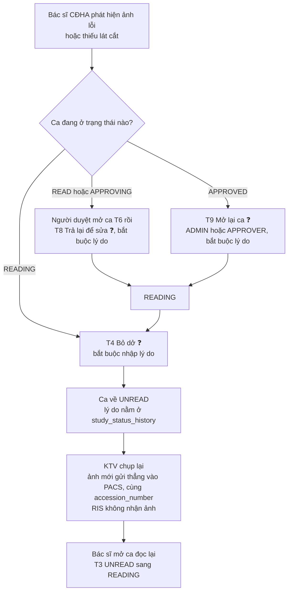
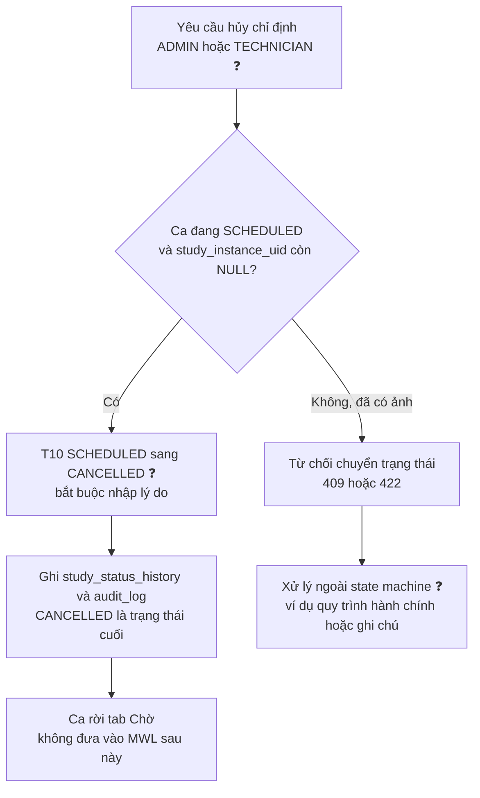
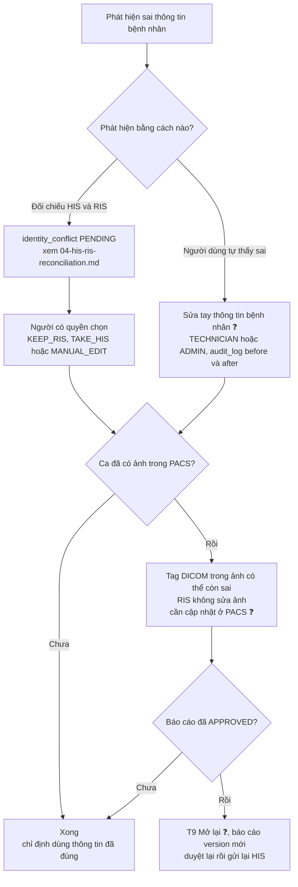
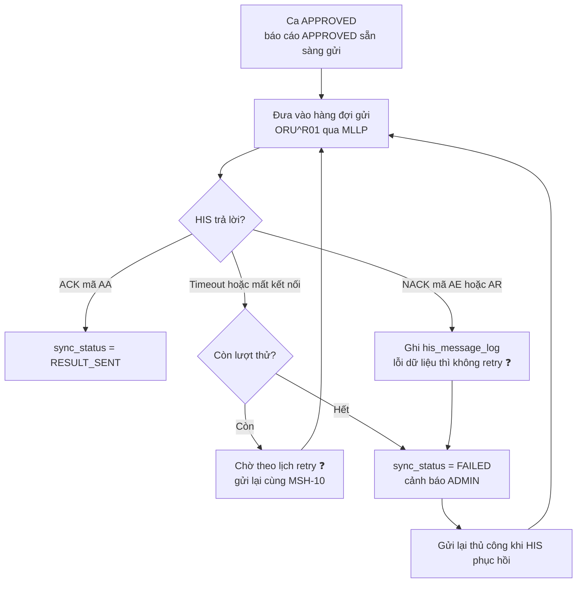

# VR-RIS PACS — Sơ đồ luồng ngoại lệ

Tài liệu con của `README.md`, mục 6E: [T1] Sơ đồ luồng ngoại lệ (chụp lại, hủy chỉ định, sai thông tin bệnh nhân, mất kết nối HIS). Phụ thuộc `03-state-machine.md` (trạng thái, mã chuyển T1–T10, vai trò) và `04-his-ris-reconciliation.md` (đối chiếu, `identity_conflict`).

| Phiên bản | 0.9 (nháp — chưa được nhóm xác nhận) |
|---|---|
| Ngày | 2026-10-31 |
| Trạng thái tài liệu | Mọi điểm gắn ❓ là **đề xuất, chờ nhóm xác nhận**. Vì `03` và `04` còn ❓ nên tài liệu này cũng chưa thể chốt |

Quy ước: mã trạng thái là `SCHEDULED / UNREAD / READING / READ / APPROVING / APPROVED / CANCELLED`; vai trò là `ADMIN / CLINICIAN / TECHNICIAN / RADIOLOGIST / APPROVER`; T1–T10 là các chuyển ở `03-state-machine.md` mục 2.2. Dữ liệu ví dụ nếu có đều là dữ liệu giả.

## 1. Chụp lại (ảnh lỗi hoặc thiếu lát cắt)

- **Trạng thái quay về `UNREAD`** (qua T4 Bỏ dở). Không thêm chuyển `UNREAD → SCHEDULED` vì README Phần 4 không có; ca đã có ảnh nên không coi là "chờ thực hiện" lại ❓.
- **Ai làm gì:** bác sĩ `RADIOLOGIST` bỏ dở (T4); `TECHNICIAN` chụp lại. Việc chụp lại **không phải chuyển trạng thái**: ảnh mới đi từ máy chụp vào PACS (RIS không nhận hay xử lý ảnh). Ảnh cũ cần loại bỏ (nếu có) là thao tác ở PACS, ngoài RIS.
- **Ghi lý do ở đâu:** `study_status_history.reason` của dòng chuyển (T4, T8, T9 đều bắt buộc lý do), kèm `audit_log` (`STATUS_CHANGE`). Bản nháp báo cáo đang viết được giữ nguyên.
- **Làm sao KTV biết ca cần chụp lại?** Trong 8 tuần chưa có cơ chế thông báo; KTV xem lịch sử trạng thái của ca ở tab Đã thực hiện. Cần thêm cờ/ghi chú "cần chụp lại" hay không ❓ (không đề xuất thêm cột khi chưa hỏi nghiệp vụ).
- Khi ca đã `READ`, chỉ người duyệt trả lại được (README Phần 4 không có đường `READ → READING`); xem câu hỏi 4 ở `03-state-machine.md` mục 2.7.

## 2. Hủy chỉ định

- **Điều kiện:** chỉ hủy khi ca còn `SCHEDULED` và chưa có ảnh (`03-state-machine.md` T10). Vai trò hủy: `ADMIN`, `TECHNICIAN` ❓. Lý do bắt buộc.
- **Không xóa cứng** (`02-erd.md` 4.6): ca hủy vẫn nằm trong DB với trạng thái `CANCELLED`, có lịch sử đầy đủ.
- **Ca đã có ảnh (từ `UNREAD` trở đi) không hủy được** bằng luồng này, vì hủy sẽ để ảnh mồ côi trong PACS mà RIS không có quyền xử lý. Cách xử lý (ví dụ ghi chú không đủ điều kiện đọc) chưa chốt ❓.
- **Một `imaging_order` có nhiều `study`:** hủy theo từng `study`. Khi mọi `study` của phiếu đều `CANCELLED` thì coi phiếu đã hủy — có cần cột trạng thái ở `imaging_order` hay suy ra khi hiển thị ❓ (ERD v0.9 không có cột này).
- **Hủy từ phía HIS** (nếu HIS gửi bản tin hủy chỉ định) thuộc H-03, chưa thiết kế ở đây.

## 3. Sai thông tin bệnh nhân (lệch dữ liệu)

Bám đúng `04-his-ris-reconciliation.md`.

- **Hai nguồn phát hiện:** (1) tự động khi đối chiếu HIS ↔ RIS, ghi `identity_conflict` (`04` mục 2, 4); (2) người dùng tự thấy sai và sửa tay (`04` mục 3, có `audit_log`).
- **Chỉ định mới của bệnh nhân có conflict `PENDING` không tạo `study` trong worklist** cho tới khi xử lý (`04` mục 2.1) ❓.
- **Nếu ảnh đã nằm trong PACS:** thông tin bệnh nhân nằm trong tag DICOM của ảnh. RIS **không xử lý ảnh**, nên việc sửa tag là thao tác ở PACS, ngoài RIS; quy trình cụ thể chưa thiết kế ❓. Sai lệch danh tính phải được xử lý **trước** khi báo cáo được duyệt nếu có thể.
- **Nếu báo cáo đã `APPROVED` mang thông tin sai:** mở lại (T9) → version báo cáo mới → duyệt lại → gửi lại HIS (H-03). Không sửa trực tiếp bản `APPROVED`.
- **Ai làm gì:** xử lý conflict `ADMIN`/`TECHNICIAN`; mở lại ca `ADMIN`/`APPROVER` (đều ❓).

## 4. Mất kết nối HIS khi trả kết quả

**Thiết kế cho giai đoạn sau (H-03). Không code trong 8 tuần.** Trong 8 tuần, `HisGateway` chỉ có bản giả lập đọc file JSON (`01-scope.md` mục 4.1); luồng dưới đây mô tả hành vi mong muốn khi có Mock HIS dùng HL7 v2 qua MLLP.

- **Không mất dữ liệu:** báo cáo `APPROVED` nằm trong RIS; việc gửi lỗi **không làm đổi trạng thái ca** (vẫn `APPROVED`) và không chặn công việc của bác sĩ.
- **Trạng thái đồng bộ:** `imaging_order.sync_status` — `RESULT_SENT` khi thành công, `FAILED` khi hết lượt thử hoặc bị NACK. ERD v0.9 không có trạng thái "đang thử lại"; trong lúc retry giữ giá trị hiện tại. Một phiếu có nhiều `study` thì kết quả gửi theo từng báo cáo — `sync_status` ở mức phiếu có đủ không ❓.
- **Retry:** số lần và khoảng cách chưa chốt ❓ (gợi ý: 5 lần, cách 1, 5, 15, 60, 240 phút). Mỗi lần thử ghi vào `his_message_log` (MSH-10, bản tin thô, ACK, số lần thử — H-03).
- **Gửi lặp an toàn:** dùng cùng `MSH-10` (message control id) khi gửi lại để HIS loại trùng.
- **Báo cáo sửa sau khi đã gửi** (mở lại T9 rồi duyệt lại): gửi bản tin kết quả hiệu chỉnh (OBR-25 = `C`) ❓.
- Mock HIS dùng socket MLLP, cần Service/port riêng trong k8s, không đi qua Ingress (`01-scope.md` 4.1).
