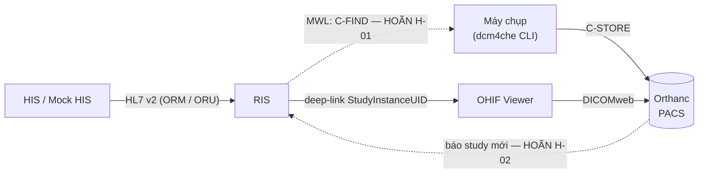
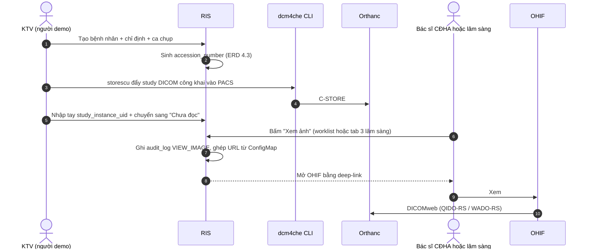
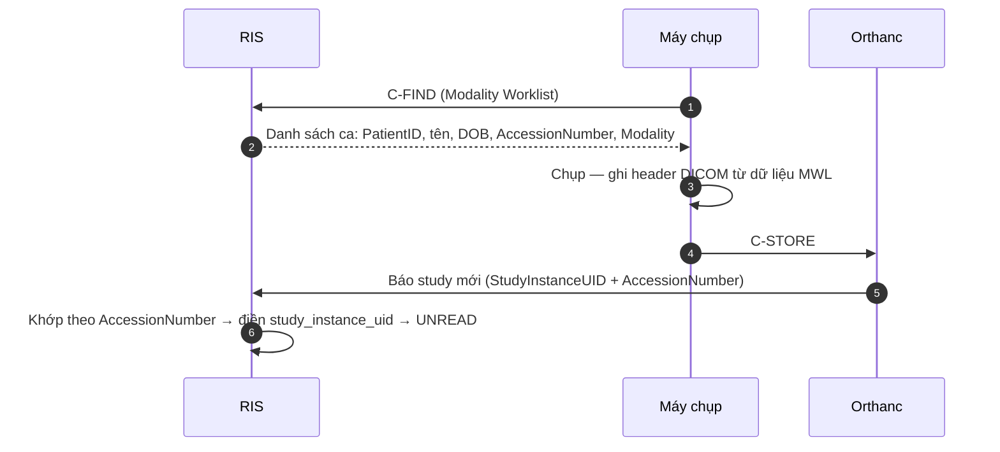
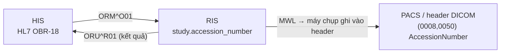

# VR-RIS PACS — Đặc tả tích hợp PACS / DICOM

Tài liệu con của `README.md`, mục 6B ([T4–T5] Đặc tả tích hợp DICOM) và mục 6C ([T4–T5] Mapping DICOM tag ↔ trường RIS). Gom mọi thứ liên quan đến đường ảnh về một chỗ: ai nói chuyện với ai, bằng lệnh DICOM nào, và trường nào của RIS đi vào tag nào.

| Phiên bản | **0.1 — NHÁP, chưa điền hết** |
|---|---|
| Ngày | 2026-11-05 |
| Trạng thái | Bản khung. Nhiều ô còn **❓** vì phụ thuộc quyết định chưa có (AE Title, port, modality demo, quy tắc khi header lệch dữ liệu RIS). **Không dùng file này làm căn cứ để code** cho tới khi các ô ❓ được chốt |
| Tài liệu liên quan | `README.md` mục 2.2, 2.3, **2.7**, 2.5 · `01-scope.md` mục 2, IN-19, IN-23, H-01, H-02 · `02-erd.md` mục 4.3, 4.4, **4.9**, **4.11** |

> **Phạm vi trong 8 tuần:** chỉ mục 2 (nửa “thủ công/seed”), mục 3 (một phần), mục 6 và mục 9 là việc thật phải làm. Mục 4 (MWL), mục 5 (C-STORE từ máy thật) và mục 8 là **đặc tả cho giai đoạn sau** (H-01, H-02) — viết trong 8 tuần vì chúng ràng buộc schema, không vì sẽ code ngay. Lý do giống hệt lý do viết đặc tả HL7 sớm (`01-scope.md` mục 4.1).

---

## 1. Vai trò từng thành phần

| Thành phần | Là gì | Làm gì trong đường ảnh | **Không** làm gì |
|---|---|---|---|
| **Máy chụp** (modality: CT / CR / MR / US) | Thiết bị tạo ảnh. Trong đồ án: giả lập bằng **dcm4che CLI** | Lấy danh sách ca cần chụp (**C-FIND** vào MWL), chụp, **ghi header DICOM**, gửi ảnh (**C-STORE**) vào PACS | Không gọi RIS qua REST, không gửi ảnh qua RIS |
| **Orthanc** (PACS server) | Nơi lưu ảnh DICOM. Nguồn ảnh duy nhất của hệ thống | Nhận ảnh qua C-STORE, lưu, phục vụ ảnh ra qua **DICOMweb** (QIDO-RS / WADO-RS / STOW-RS) | **Không chứa logic nghiệp vụ.** Không biết trạng thái ca chụp, không biết ai được xem study nào |
| **OHIF** (viewer) | Giao diện xem ảnh, chạy trong trình duyệt | Nhận `StudyInstanceUID` qua deep-link → gọi DICOMweb vào Orthanc → hiển thị | **Không đọc file từ đĩa.** Không tự sinh kết quả. Không phải nơi ghi audit log |
| **RIS** | Hệ thống nghiệp vụ | Sinh `accession_number`, giữ `study_instance_uid`, **sinh deep-link** mở OHIF, **ghi `audit_log` `VIEW_IMAGE`**, (sau này) phục vụ MWL cho máy chụp | Không lưu, không xử lý, không proxy ảnh DICOM — kể cả thumbnail (`01-scope.md` R-02) |

**Hai đường biên phải nhớ:**

1. **PACS không nói chuyện trực tiếp với HIS.** Không có đường nào giữa hai hệ thống này. HIS ↔ RIS đi bằng **HL7 v2**; RIS ↔ PACS/máy chụp đi bằng **DICOM**. RIS là chỗ duy nhất biết cả hai. Giá trị bắc cầu là `accession_number` (mục 7).
2. **PACS không biết ai gọi nó** (README 2.7). Nó chỉ thấy một yêu cầu DICOMweb cho một study. Mọi phân quyền và mọi audit về việc *xem ảnh* phải làm ở RIS (`02-erd.md` mục 4.11).



> Nét đứt = **[HOÃN]** (chưa có trong 8 tuần). Chú ý sơ đồ **không có** đường nào giữa `HIS` và `PACS` — đó không phải thiếu sót mà là đường biên: hai hệ thống này không bao giờ nói chuyện trực tiếp.

---

## 2. Luồng ảnh: trong 8 tuần vs. luồng đích

### 2.1. Trong 8 tuần — thủ công / seed

Không có MWL, không có webhook. `study_instance_uid` vào DB **bằng tay hoặc bằng seed** (`01-scope.md` mục 2).



**Bước 5 là bước làm tay quan trọng nhất của bản demo.** Hai việc trong một bước: nhập `study_instance_uid` và chuyển trạng thái. Tự động hoá bước này là **H-02**, không làm trong 8 tuần (README mục 2.3, `01-scope.md` mục 6 bước 4).

❓ **Chưa chốt:** nhập `study_instance_uid` ở đâu trên giao diện — thêm ô vào form “Cập nhật ca chụp” (README 3.4), hay chỉ sửa trực tiếp trong seed data. Ảnh hưởng IN-03/IN-04.

### 2.2. Luồng đích (sau 8 tuần)

Hai thứ đổi so với trên, đúng hai hạng mục [HOÃN]:

| # | Việc | Thay cho | Hạng mục |
|---|---|---|---|
| 1 | Máy chụp **C-FIND** vào MWL của RIS để lấy ca cần chụp; RIS trả về danh sách → máy chụp **tự ghi** đúng `AccessionNumber`, `PatientID`, tên, ngày sinh vào header | Người dùng nhập tay thông tin vào máy (nguồn sai chính tả / sai danh tính) | **H-01** |
| 2 | Orthanc **báo RIS có study mới** → RIS đối chiếu `AccessionNumber` → điền `study_instance_uid` và tự chuyển `SCHEDULED → UNREAD` | Bước 5 làm tay ở 2.1 | **H-02** |



> **Vì sao H-01 làm trước H-02:** nếu máy chụp không lấy `AccessionNumber` từ MWL thì bước “khớp theo `AccessionNumber`” ở H-02 không có gì để khớp. Thứ tự phụ thuộc này đã ghi ở `01-scope.md` mục 4 (điều kiện kích hoạt H-02 là “sau H-01”).

❓ **Chưa chốt:** Orthanc báo RIS bằng cách nào — plugin Lua `OnStoredInstance` gọi webhook REST, hay RIS poll QIDO-RS theo chu kỳ. Quyết định ở H-02, không chặn 8 tuần.

---

## 3. AE Title và port

**AE Title** = tên định danh của một đầu mối DICOM trên mạng. Hai bên phải khai AE Title **và** địa chỉ của nhau trước khi nói chuyện được — đây là phần cấu hình hay sai nhất khi dựng PACS.

### 3.1. Bảng AE Title — ❓ TOÀN BỘ LÀ ĐỀ XUẤT, CHƯA CHỐT

| Thành phần | AE Title đề xuất | Vai trò DICOM | Port DICOM | Port DICOMweb / HTTP |
|---|---|---|---|---|
| **Orthanc** (PACS) | `VRRIS_PACS` | SCP (nhận C-STORE), SCP (QIDO/WADO) | `4242` (mặc định Orthanc) | `8042` (mặc định Orthanc) |
| **RIS** (MWL provider) | `VRRIS_RIS` | SCP cho C-FIND Modality Worklist | ❓ chưa chọn (`11112` thường dùng) | — (REST của RIS đi qua Ingress) |
| **Máy giả lập CR** | `SIM_CR01` | SCU (gửi C-STORE), SCU (C-FIND) | — (chỉ là client) | — |
| **Máy giả lập CT** | `SIM_CT01` | SCU (gửi C-STORE), SCU (C-FIND) | — (chỉ là client) | — |

**Ghi chú:**

- `4242` và `8042` là **mặc định của image Orthanc**, không phải lựa chọn của nhóm — giữ mặc định để đỡ cấu hình. Cổng DICOM “chuẩn” là `104` (cần quyền root) hoặc `11112` (IANA, không cần root).
- Trong cụm k8s, các cổng này là **Service port trong namespace `vr-ris`**, không expose ra ngoài (nguyên tắc bất biến ở README mục 0). DICOM là **socket thuần, không phải HTTP** → cần Service riêng, **không đi qua Ingress** — cùng vấn đề đã ghi cho MLLP ở `01-scope.md` mục 4.1.
- AE Title theo chuẩn DICOM: tối đa **16 ký tự**, nên tránh tên dài. Thực tế hay dùng chữ in hoa + gạch dưới.
- `device.ae_title` và `device.station_name` trong ERD (`02-erd.md`) là chỗ lưu các giá trị này. Trong 8 tuần **để trống** — điền khi làm H-01.
- CR và CT là modality demo **đề xuất** (`01-scope.md` mục 8 câu 9) — ❓ **chưa được nhóm xác nhận**. Nếu đổi modality thì bảng này đổi theo.

❓ **Chưa chốt:** có bật xác thực của Orthanc (`RegisteredUsers`) và whitelist AE Title (`DicomModalities`, `DicomAlwaysAllowStore`) hay để mở trong mạng nội bộ cụm. Liên quan mục 6.

---

## 4. Modality Worklist (C-FIND) — mapping RIS → DICOM tag

> **[HOÃN] H-01.** Đặc tả viết trong 8 tuần vì nó quyết định trường nào của RIS phải có **trước** khi chụp — nếu thiếu thì sau này phải sửa schema.

Máy chụp gửi C-FIND; RIS trả về mỗi ca cần chụp thành một bản ghi. Các tag tối thiểu:

| Tag DICOM | Tên tag | VR | Nguồn trong RIS | Ghi chú |
|---|---|---|---|---|
| (0010,0020) | `PatientID` | LO | `patient.patient_code` | Khóa đối chiếu chính, giống PID-3 (`02-erd.md` 4.9) |
| (0010,0010) | `PatientName` | **PN** | `patient.full_name` | ⚠️ **PN có 5 thành phần** `Họ^Tên^Đệm^Tiền tố^Hậu tố`. RIS lưu **một chuỗi** → cần quy tắc tách. ❓ **chưa chốt** — xem 4.1 |
| (0010,0030) | `PatientBirthDate` | **DA** | `patient.date_of_birth` | ⚠️ DA = **`YYYYMMDD` đủ ngày**, không có dạng ngắn. Ca `dob_precision = 'YEAR'` không biểu diễn trung thực được. ❓ **chưa chốt** — xem 4.2 |
| (0010,0040) | `PatientSex` | CS | `patient.gender` | DICOM chỉ nhận `M` / `F` / `O` (hoặc rỗng). RIS có thêm `U` → ❓ map `U` thành `O` hay để rỗng |
| (0008,0050) | `AccessionNumber` | SH | `study.accession_number` | **Khóa nối ba chiều** (mục 7). SH ≤ 16 ký tự — quy ước `YYYYMMDD`+5 số ở `02-erd.md` 4.3 là **13 ký tự**, vừa |
| (0032,1060) | `RequestedProcedureDescription` | LO | `service_item.name` | Tên dịch vụ CĐHA |
| (0040,0001) | `ScheduledStationAETitle` | AE | `device.ae_title` | Máy nào được chụp ca này. Máy chụp thường **lọc C-FIND theo tag này** để chỉ lấy ca của mình |
| (0008,0060) | `Modality` | CS | `service_item.modality` | `CT` / `MR` / `CR` / `DX` / `US` |

**Các tag nhóm MWL cần xem thêm (chưa liệt kê đủ ở bản v0.1 này)** ❓: `ScheduledProcedureStepStartDate` (0040,0002) và `…StartTime` (0040,0003) — nguồn là `study.scheduled_at`; `ScheduledPerformingPhysicianName` (0040,0006); `RequestedProcedureID` (0040,1001); `ScheduledProcedureStepID` (0040,0009). Cần đối chiếu với đúng cấu trúc sequence `ScheduledProcedureStepSequence` (0040,0100) của chuẩn trước khi chốt.

### 4.1. ❓ Quy tắc ghép / tách `PatientName` (PN)

RIS lưu họ tên là một chuỗi (`patient.full_name`); DICOM PN và HL7 PID-5 đều **tách thành phần**. Cần một quy tắc duy nhất dùng cho cả hai, nếu không sẽ có hai cách tách khác nhau và sinh lệch dữ liệu.

- Với tên tiếng Việt, “họ” là từ đầu, “tên” là từ cuối, phần giữa là tên đệm — nhưng họ ghép (ví dụ họ hai âm) và tên đệm nhiều từ làm quy tắc này không chắc đúng.
- Lựa chọn an toàn: đưa **toàn bộ chuỗi vào thành phần đầu** (`Nguyen Van A^^^^`) và chấp nhận viewer hiển thị trong ô “họ”.
- ❓ **Chưa chốt.** `02-erd.md` 4.9 đã ghi “PID-5 ghép họ tên là nguồn lệch dữ liệu được dự đoán trước, phải có test case riêng”. Quy tắc chốt ở đây phải dùng cho **cả HL7 và DICOM**.

### 4.2. ❓ Ngày sinh khi chỉ biết năm (liên hệ `02-erd.md` 4.2)

| Cách | Hệ quả |
|---|---|
| Ghi `19580101` | Header DICOM **nói sai**: trông như biết ngày chính xác. Hệ thống khác đọc header sẽ tính tuổi như tuổi chính xác |
| Để **trống** tag (0010,0030) | Trung thực, nhưng viewer có thể hiển thị tuổi rỗng hoặc **“0”** → đúng lỗi “Tuổi 0” ở README 2.5, lần này ở phía ảnh |
| Ghi `19580101` **và** ghi `PatientAge` (0010,1010) dạng `068Y` | Thêm một nguồn dữ liệu nữa phải giữ đồng bộ; `PatientAge` là tuổi **lúc chụp**, không tự cập nhật |

❓ **Chưa chốt.** Đây là chỗ sinh lỗi được dự đoán trước, phải có test case riêng — `01-scope.md` mục 6 bước 10 yêu cầu **không ca nào ra “Tuổi 0”**.

⚠️ **Lưu ý không sửa được về sau:** header DICOM đã nằm trong PACS thì **sửa dữ liệu trong RIS không làm đổi ảnh** (README 2.7). Quy tắc này phải chốt **trước** khi bật MWL, không phải sau.

---

## 5. C-STORE — đẩy ảnh vào PACS

Trong 8 tuần đây là bước duy nhất của đường ảnh chạy thật, và chạy bằng tay (`01-scope.md` mục 6 bước 4).

### 5.1. Lệnh mẫu (dcm4che)

```bash
# Gửi cả một thư mục study vào Orthanc
storescu \
  -c VRRIS_PACS@localhost:4242 \
  --bind SIM_CR01 \
  /duong/dan/toi/study-tcia-da-an-danh/
```

- `-c <AE Title bên nhận>@<host>:<port>` — đầu mối nhận (Orthanc, mục 3.1).
- `--bind <AE Title bên gửi>` — AE Title của máy giả lập; Orthanc có thể từ chối nếu chưa whitelist (mục 3.1).
- Kiểm tra kết nối trước khi gửi: `echoscu -c VRRIS_PACS@localhost:4242` (C-ECHO — “ping” của DICOM).

❓ **Chưa kiểm chứng:** lệnh trên là dạng chuẩn của `storescu`, **chưa chạy thử** trong dự án này (Orthanc chưa được dựng — tuần 7). Cú pháp cờ cần đối chiếu lại với bản dcm4che thực dùng. Rủi ro “ảnh DICOM mẫu không tương thích Orthanc/OHIF” đã ghi ở README 7.4, cách giảm là **thử mở 1 study mẫu ngay tuần 4–5**.

### 5.2. Tag Orthanc dùng để nhận diện

Orthanc xếp ảnh vào cây **Patient → Study → Series → Instance** dựa trên các UID trong header:

| Mức | Tag quyết định | VR | Ai sinh ra |
|---|---|---|---|
| Patient | (0010,0020) `PatientID` | LO | RIS (qua MWL) |
| **Study** | **(0020,000D) `StudyInstanceUID`** | UI | **Máy chụp** |
| Series | (0020,000E) `SeriesInstanceUID` | UI | Máy chụp |
| Instance | (0008,0018) `SOPInstanceUID` | UI | Máy chụp |

**Điểm quan trọng:** `StudyInstanceUID` do **máy chụp** sinh, không phải RIS. Đó là lý do `study.study_instance_uid` **nullable** trong ERD (`02-erd.md` 4.4) — RIS chỉ biết giá trị này **sau** khi ảnh đã tồn tại. Chiều ngược lại, `AccessionNumber` do **RIS** sinh và máy chụp ghi vào — nên nó là khóa để RIS tìm lại study của mình trong PACS (mục 7).

Orthanc còn gán **ID nội bộ riêng** (chuỗi hash) cho mỗi mức. ❓ Nhóm có lưu Orthanc ID vào RIS không — **đề xuất: không**, chỉ dùng `StudyInstanceUID` (chuẩn DICOM, không phụ thuộc vendor), để đổi PACS server không phải sửa dữ liệu.

---

## 6. Deep-link mở OHIF + kiểm soát truy cập

### 6.1. Hình thức URL

OHIF mở trực tiếp một study bằng `StudyInstanceUID` trên query string:

```text
<OHIF_BASE_URL>/viewer?StudyInstanceUIDs=<study_instance_uid>
```

- `OHIF_BASE_URL` lấy từ **ConfigMap**, không hard-code và **không lưu trong DB** (`01-scope.md` IN-19 điểm 2, `02-erd.md` 4.4). DB chỉ giữ `study.study_instance_uid`.
- Tham số là `StudyInstanceUID**s**` (số nhiều) — OHIF cho mở nhiều study một lần, ngăn cách bằng dấu phẩy. Trong đồ án chỉ truyền một giá trị.
- ❓ **Chưa kiểm chứng** trên bản OHIF thực dùng: đường dẫn `/viewer` và tên tham số đổi theo phiên bản và cấu hình data source. Phải thử ở tuần 7 (IN-19) rồi cập nhật mục này.

### 6.2. Hai cửa vào

| Cửa vào | Ai | Từ đâu | Hạng mục |
|---|---|---|---|
| (a) | Bác sĩ CĐHA, bác sĩ duyệt | Nút “Xem ảnh” ở **hàng worklist** | IN-23 |
| (b) | Bác sĩ lâm sàng | Nút “Xem ảnh” theo từng dịch vụ CĐHA ở **tab 3 modal lâm sàng** | IN-23 |

Cả hai sinh **cùng một dạng URL** và mở **cùng một OHIF**. Mô tả đầy đủ: **README mục 2.7**.

Ca chưa có `study_instance_uid` → nút **ẩn hoặc disable** (❓ chọn ẩn hay disable: `README` mục 6E, việc Figma). Không mở viewer rỗng.

### 6.3. Kiểm soát truy cập

| Nguyên tắc | Vì sao |
|---|---|
| **RIS là nơi phân quyền**, không phải PACS | PACS không biết ai gọi (mục 1). Deep-link được sinh ở RIS → kiểm tra vai trò ở đó |
| **Ghi `audit_log` `VIEW_IMAGE`** trước khi trả URL | Nguyên tắc bất biến: mọi hành vi đọc dữ liệu bệnh nhân phải có audit. Chi tiết: `02-erd.md` mục 4.11 |
| **OHIF và Orthanc không mở công khai** | Nguyên tắc bất biến (README mục 0). Chỉ trong cụm local hoặc sau đăng nhập RIS |

⚠️ **Điểm bảo mật phải nêu trong báo cáo** (`01-scope.md` IN-19 điểm 3): URL ở 6.1 **không chứa thông tin xác thực**. Ai có `StudyInstanceUID` và tới được OHIF là xem được ảnh. Nên:

- Nếu OHIF mở ra Internet → `StudyInstanceUID` trở thành mật khẩu duy nhất bảo vệ ảnh bệnh nhân. Đây là kiểu lỗ hổng PACS thật hay gặp.
- Và người dùng mở URL dán tay (không qua RIS) sẽ **không để lại dòng audit nào** — RIS không biết việc đó xảy ra.

❓ **Chưa chốt cách chặn.** Ba hướng:

| Hướng | Ưu | Nhược |
|---|---|---|
| Chỉ dựa vào mạng nội bộ cụm (không expose Service OHIF) | Đơn giản nhất, đủ cho đồ án | Ai vào được cụm là xem được mọi ảnh |
| Chặn ở Ingress bằng session RIS (auth subrequest) | Đúng nguyên tắc “sau đăng nhập RIS” | Phải cấu hình Ingress, OHIF phải cùng domain hoặc chịu CORS |
| RIS sinh **token ngắn hạn** gắn vào URL | Vá được chỗ URL bị dán lại | Phải có thành phần kiểm token trước Orthanc; OHIF không sửa được nên token phải đặt ở tầng proxy |

---

## 7. Mapping DICOM tag ↔ cột RIS — và khóa nối ba chiều

Bảng này là **cạnh DICOM**. Cạnh HL7 (HIS ↔ RIS) ở `02-erd.md` mục 4.9. Hai bảng gặp nhau ở **`accession_number`**.

### 7.1. `patient`

| Cột RIS | DICOM tag | VR | Chiều | Ghi chú |
|---|---|---|---|---|
| `patient.patient_code` | (0010,0020) `PatientID` | LO | RIS → DICOM (qua MWL) | Khóa đối chiếu chính |
| `patient.full_name` | (0010,0010) `PatientName` | PN | RIS → DICOM | ❓ quy tắc tách, xem 4.1 |
| `patient.date_of_birth` + `dob_precision` | (0010,0030) `PatientBirthDate` | DA | RIS → DICOM | ❓ xem 4.2 — **chỗ sinh lỗi “Tuổi 0”** |
| `patient.gender` | (0010,0040) `PatientSex` | CS | RIS → DICOM | ❓ map `U` |
| `patient.social_insurance_no` | ❓ không có tag chuẩn tương ứng | — | — | DICOM có `OtherPatientIDsSequence` (0010,1002) nhưng ❓ chưa chốt có dùng |

### 7.2. `imaging_order`

| Cột RIS | DICOM tag | VR | Ghi chú |
|---|---|---|---|
| `imaging_order.visit_code` (mã LSVV) | (0038,0010) `AdmissionID` | LO | ❓ chưa chốt. Là **mã lần vào viện**, khác `patient_code` — xem `02-erd.md` mục 9 |
| `imaging_order.ordering_doctor_name` | (0008,0090) `ReferringPhysicianName` | PN | Cùng vấn đề PN như 4.1 |
| `imaging_order.clinical_diagnosis` | ❓ (0008,1080) `AdmittingDiagnosesDescription` | LO | Chưa chốt có đẩy chẩn đoán ban đầu vào header hay không |
| `imaging_order.patient_class` | ❓ không có tag chuẩn rõ ràng | — | Nội trú / ngoại trú là khái niệm HIS, không phải DICOM |

### 7.3. `study`

| Cột RIS | DICOM tag | VR | Chiều | Ghi chú |
|---|---|---|---|---|
| **`study.accession_number`** | **(0008,0050) `AccessionNumber`** | SH | **RIS → DICOM** | **Khóa nối ba chiều** — xem 7.4 |
| **`study.study_instance_uid`** | **(0020,000D) `StudyInstanceUID`** | UI | **DICOM → RIS** | Máy chụp sinh; RIS nhận về (tay trong 8 tuần, H-02 sau này) |
| `study.scheduled_at` | (0040,0002) + (0040,0003) `ScheduledProcedureStepStartDate/Time` | DA + TM | RIS → DICOM | Tách ngày và giờ thành hai tag |
| `study.started_at` | (0008,0020) + (0008,0030) `StudyDate` / `StudyTime` | DA + TM | DICOM → RIS | ❓ Thời điểm máy ghi, có thể lệch `started_at` do KTV bấm trong RIS |
| `service_item.modality` | (0008,0060) `Modality` | CS | RIS → DICOM | |
| `service_item.name` | (0032,1060) `RequestedProcedureDescription` | LO | RIS → DICOM | |
| `device.ae_title` | (0040,0001) `ScheduledStationAETitle` | AE | RIS → DICOM | |
| `device.station_name` | (0008,1010) `StationName` | SH | DICOM → RIS | Máy nào **đã** chụp thật, có thể khác máy được xếp |

### 7.4. Khóa nối ba chiều HIS ↔ RIS ↔ PACS



**Cùng một giá trị, ba tên gọi.** Đó là lý do `02-erd.md` 4.3 bắt sinh `accession_number` **ngay khi tạo study**, kể cả khi chưa có ảnh và chưa có HIS: nó là chỗ duy nhất ba hệ thống gặp nhau.

- Chiều HIS → RIS: `accession_number` ↔ HL7 **OBR-18** (`02-erd.md` 4.9).
- Chiều RIS → PACS: `accession_number` ↔ DICOM **(0008,0050)**, qua MWL (mục 4).
- Nhờ đó H-02 khớp được study mới trong PACS về đúng ca chụp trong RIS **mà không cần** `StudyInstanceUID` biết trước.

⚠️ **Ràng buộc độ dài:** VR của (0008,0050) là **SH — tối đa 16 ký tự**. Quy ước `YYYYMMDD` + 5 chữ số (`02-erd.md` 4.3) ra 13 ký tự → vừa. Nếu đổi quy ước dài hơn 16 ký tự thì **vỡ** ở tầng DICOM.

---

## 8. ❓ Khi header DICOM lệch dữ liệu RIS — bên nào thắng

> Liên hệ **README mục 2.5** (known issue lệch dữ liệu) và `04-his-ris-reconciliation.md`. Mục 2.5 đã chốt phải có quy tắc cho cạnh **HIS ↔ RIS**; cạnh **RIS ↔ header DICOM** là **cạnh thứ ba, chưa có quy tắc nào**.

### 8.1. Vì sao lệch được

1. Trước H-01 (tức **trong 8 tuần**), KTV **nhập tay** thông tin vào máy chụp. Sai chính tả, sai ngày sinh, chọn sai bệnh nhân → header sai, RIS đúng.
2. Dữ liệu RIS được sửa **sau** khi đã chụp → RIS đúng, header giữ giá trị cũ.
3. Dùng bộ DICOM công khai đã ẩn danh (TCIA) cho dữ liệu demo: header mang tên/ID của bộ ẩn danh, **gần như chắc chắn không khớp** bệnh nhân giả trong RIS. **Đây là tình huống của chính bản demo tuần 8** (mục 9).

### 8.2. ❓ Chưa chốt — ba câu phải trả lời

| Câu | Các hướng | Ghi chú |
|---|---|---|
| **Bên nào thắng?** | (a) **RIS thắng** — RIS là nguồn danh tính, header chỉ là bản sao lúc chụp. (b) **Chặn lại** — không cho mở viewer, bắt người dùng xử lý trước | Đề xuất nghiêng về **(a) RIS thắng + cảnh báo**, cùng hướng với `04-his-ris-reconciliation.md`, nhưng **chưa xác nhận** |
| **Có sửa header trong PACS không?** | (a) Không sửa — PACS là bản ghi gốc, chỉ đọc. (b) Sửa bằng tính năng *modify* của Orthanc | Sửa header làm đổi `SOPInstanceUID` và phá tính bất biến của bản ghi ảnh. Đề xuất **không sửa**, ❓ chưa chốt |
| **Ghi `identity_conflict` thế nào?** | `source` hiện là `HIS|MANUAL` (`02-erd.md`) → cần thêm giá trị **`DICOM`**; `field_name` = tên tag; `ris_value` / `his_value` → cột thứ hai đang tên `his_value` nhưng giá trị là của header DICOM | ❓ **Thêm `DICOM` vào `source` là thay đổi schema** → cần migration mới (V8+) và xác nhận của nhóm. Chưa làm trong bản v0.1 này |

**Việc so sánh tự động chỉ thực hiện được khi có H-02** (lúc RIS đọc được header qua QIDO-RS). Trong 8 tuần: không có cơ chế nào tự phát hiện lệch ở cạnh này — **ghi vào nợ kỹ thuật tuần 8**.

---

## 9. Dữ liệu mẫu

| Quy tắc | Chi tiết |
|---|---|
| **Chỉ dùng bộ DICOM công khai đã ẩn danh** | **TCIA** (The Cancer Imaging Archive) hoặc tương đương. Nguyên tắc bất biến README mục 0; `01-scope.md` R-03, G-03 |
| Modality | **CR + CT** (đề xuất `01-scope.md` mục 8 câu 9 — ❓ chưa được nhóm xác nhận) |
| Vì sao hai loại này | **CR** (X-quang ngực): một ảnh, nhẹ, mở nhanh trong OHIF → dùng để kiểm chứng đường ảnh chạy được. **CT**: series nhiều lát → chứng minh viewer xử lý được study lớn, cuộn lát, và PACS chịu được dung lượng |
| Số lượng | 1–2 study (IN-19) |
| Khi nào tải | **Tuần 4–5**, không để đến tuần 7 — README 7.4 ghi rõ rủi ro “ảnh DICOM mẫu không tương thích Orthanc/OHIF”, cách giảm là thử mở 1 study ngay tuần 4–5 |

⚠️ **Header của bộ TCIA không khớp bệnh nhân giả trong RIS.** `PatientID` và `PatientName` trong ảnh là của bộ ẩn danh (ví dụ dạng `LIDC-IDRI-0001`), còn RIS có bệnh nhân giả riêng. Hệ quả trực tiếp: **khi demo, tên hiển thị trên ảnh trong OHIF sẽ khác tên trong worklist RIS.**

❓ **Chưa chốt cách xử lý khi demo:**

| Hướng | Đánh giá |
|---|---|
| (a) Để lệch và **giải thích trong báo cáo** là hệ quả của việc không có MWL | Trung thực nhất, không sửa gì. Nhưng người chấm điểm thấy hai tên khác nhau trên màn hình |
| (b) Đặt tên bệnh nhân giả trong seed data **trùng với header** TCIA | Khớp màn hình, nhưng biến ID của bộ ẩn danh thành “mã bệnh nhân” trong RIS — cần kiểm tra lại có vi phạm nguyên tắc dữ liệu hay không (TCIA đã ẩn danh nên **không** phải dữ liệu thật, nhưng vẫn là mã của bộ dữ liệu người khác) |
| (c) Sửa header ảnh mẫu cho khớp RIS | Vướng câu “có sửa header không” ở mục 8.2 |

Dù chọn hướng nào, đây là **minh hoạ sống của README 2.7**: tên trên ảnh đến từ header DICOM, không đến từ bản ghi RIS mà viewer đang mở.

---

## 10. Câu hỏi còn mở

Tổng hợp mọi ❓ ở trên. Không có ô nào được nhóm xác nhận.

| # | Câu hỏi | Mục | Chặn việc gì |
|---|---|---|---|
| P-01 | AE Title và port cho Orthanc, RIS, hai máy giả lập | 3.1 | Dựng Orthanc (IN-19, tuần 7) |
| P-02 | Có bật xác thực Orthanc + whitelist AE Title, hay để mở trong cụm | 3.1, 6.3 | Cấu hình Orthanc |
| P-03 | Quy tắc tách `PatientName` (PN) — dùng chung cho cả HL7 PID-5 | 4.1 | Đặc tả HL7 + MWL; test case lệch họ tên (README 2.5) |
| P-04 | Ghi ngày sinh vào (0010,0030) thế nào khi `dob_precision = 'YEAR'` | 4.2, 7.1 | **Nghiệm thu bước 10** (`01-scope.md` mục 6): không ca nào ra “Tuổi 0” |
| P-05 | Map `gender = 'U'` sang `PatientSex` thành `O` hay rỗng | 4.1, 7.1 | MWL |
| P-06 | Danh sách đầy đủ tag trong `ScheduledProcedureStepSequence` | 4 | H-01 |
| P-07 | Nhập `study_instance_uid` ở đâu trên giao diện trong 8 tuần | 2.1 | IN-03 / IN-04 (tuần 4) |
| P-08 | Đường dẫn và tên tham số deep-link của bản OHIF thực dùng | 6.1 | IN-23 (tuần 6–7) |
| P-09 | Cách chặn truy cập OHIF: mạng nội bộ / Ingress auth / token ngắn hạn | 6.3 | IN-19 điểm 3; điểm bảo mật trong báo cáo |
| P-10 | Nút “Xem ảnh” khi chưa có ảnh: ẩn hay disable | 6.2 | Figma (README 6E), IN-23 |
| P-11 | Khi header DICOM lệch RIS: bên nào thắng, có sửa header không | 8.2 | Quy tắc đối chiếu (README 2.5) ở cạnh thứ ba |
| P-12 | Thêm `DICOM` vào `identity_conflict.source` — **cần migration V8+** | 8.2 | Schema; phải xác nhận trước khi viết migration |
| P-13 | Có lưu Orthanc ID nội bộ vào RIS không | 5.2 | ERD (đề xuất: không) |
| P-14 | Demo xử lý thế nào khi tên trong header TCIA khác tên trong RIS | 9 | Kịch bản demo tuần 8 |
| P-15 | Có đẩy `visit_code` vào `AdmissionID` (0038,0010) và chẩn đoán ban đầu vào header không | 7.2 | MWL |
| P-16 | Modality demo cuối cùng (đề xuất CR + CT) | 3.1, 9 | Tải bộ DICOM mẫu, tuần 4–5 |
| P-17 | Orthanc báo study mới bằng webhook (Lua) hay RIS poll QIDO-RS | 2.2 | H-02 (ngoài 8 tuần) |

**Hai câu phải chốt sớm nhất:** **P-04** (chặn nghiệm thu, và sai thì không sửa được sau khi header vào PACS) và **P-01** (chặn tuần 7).
