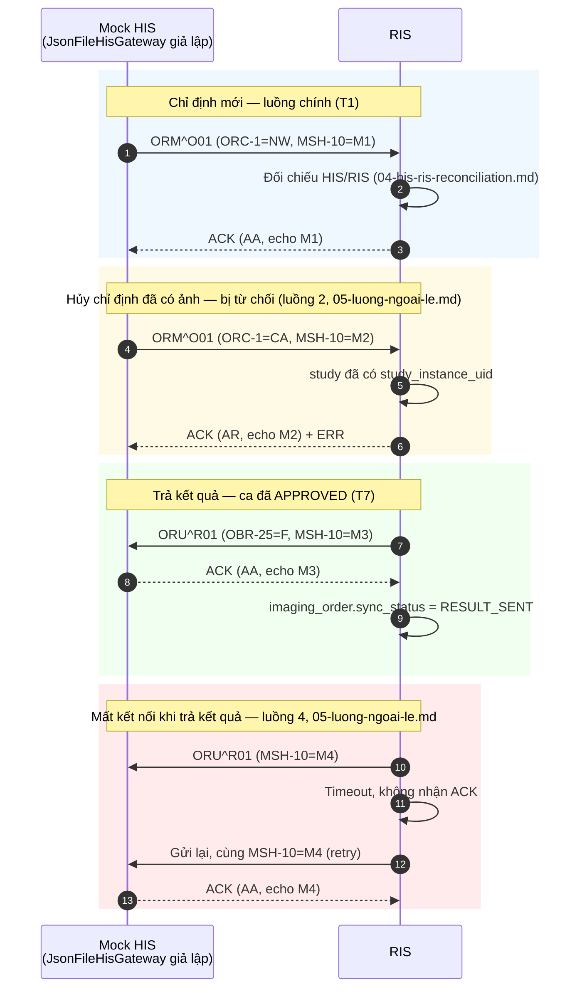

# VR-RIS PACS — Đặc tả message HL7 v2 (HIS ↔ RIS)

Tài liệu con của `README.md`, mục 6B ([T4–T5] Đặc tả message `ORM^O01` / `ORU^R01`, mapping HL7 ↔ RIS, `HisGateway`). Đặc tả cạnh **HIS ↔ RIS**; cạnh RIS ↔ PACS (DICOM) nằm ở `07-pacs-dicom.md`. Hai cạnh gặp nhau ở `accession_number` (mục 6).

| Phiên bản | **0.1 — NHÁP, đề xuất chờ nhóm xác nhận** |
|---|---|
| Ngày | 2026-11-05 |
| Trạng thái | Bản khung đầy đủ cấu trúc và ví dụ, nhưng **mọi lựa chọn kỹ thuật (phiên bản HL7, bảng field, ORC-1, schema JSON) là đề xuất của tài liệu, chưa được nhóm xác nhận.** Không dùng làm căn cứ để code cho tới khi các ô ❓ được chốt — cùng quy ước với `07-pacs-dicom.md` |
| Tài liệu liên quan | `01-scope.md` mục 2, 4, **4.1** (quyết định chọn HL7 v2 và hệ quả) · `02-erd.md` mục 4.3, **4.9**, 4.10, 7 · `03-state-machine.md` mục 2.2 (mã chuyển T1–T10) · `04-his-ris-reconciliation.md` (nguồn duy nhất của quy tắc đối chiếu — không chép lại ở đây) · `05-luong-ngoai-le.md` (4 luồng ngoại lệ) · `07-pacs-dicom.md` (file anh em — cạnh DICOM) · `09-bao-mat-toan-ven-du-lieu.md` mục 3.4 (idempotency) · `15-kien-truc-backend.md` mục 3, 5 (vị trí `integration/` trong kiến trúc tầng) · `Backend/src/main/java/com/vrris/pacs/integration/` (code hiện có) |

> **Phạm vi trong 8 tuần:** chỉ mục 8 (interface `HisGateway`) và mục 9 (schema JSON cho bản giả lập) là việc thật phải code (`01-scope.md` mục 4.1). Toàn bộ phần còn lại — cấu trúc message, bảng field, ví dụ message, MLLP, `his_message_log` — là **đặc tả viết trước** vì nó ràng buộc schema (`patient`, `imaging_order`, `study`) và quy tắc đối chiếu (`04-his-ris-reconciliation.md`) phải bám đúng các trường này ngay từ đầu, giống hệt lý do nêu ở `01-scope.md` mục 4.1 và cách `07-pacs-dicom.md` đã làm với MWL/C-STORE.

---

## 0. Phiên bản HL7 đã chọn

**Đề xuất: HL7 v2.5.1.** ❓ Chờ nhóm xác nhận.

Lý do (một dòng): v2.5.1 là bản ổn định, được `HAPI HL7v2` (thư viện Java sẽ dùng để parse khi code hoá ở H-03) hỗ trợ đầy đủ bằng các lớp cấu trúc sinh sẵn (`ca.uhn.hl7v2.model.v251.message.ORM_O01`, `ORU_R01`, `ACK`), và vẫn giữ nguyên hai loại message `ORM^O01` / `ORU^R01` đã chốt ở `01-scope.md` mục 8 câu 7 — không cần đổi quyết định đó. (Ghi chú kỹ thuật: bản HL7 v2.4 trở về sau đã "nghỉ hưu" `ORM`/`ORR` trên giấy tờ để thay bằng `OML^O21`/`ORL^O22`, nhưng `ORM^O01`/`ORU^R01` vẫn được HAPI giữ cấu trúc và vẫn là cặp message phổ biến nhất trong thực tế tích hợp HIS–RIS tại Việt Nam; đổi sang `OML^O21` là một lựa chọn khác, ❓ chưa cân nhắc, không nằm trong phạm vi tài liệu này vì `01-scope.md` đã chốt tên message.)

Mọi field/segment liệt kê ở mục 3 bám theo định nghĩa HL7 v2.5.1 **ở mức phục vụ tích hợp CĐHA** (không phải bản sao 100% chuẩn HL7 International) — xem cảnh báo ở đầu mục 3.

---

## 1. Phạm vi message

| Message | Chiều | Khi nào | Hệ quả state machine / ghi chú |
|---|---|---|---|
| `ORM^O01` (`ORC-1 = NW`) | HIS → RIS | HIS tạo chỉ định mới | Tạo `patient` (nếu chưa có) + `imaging_order` + một hoặc nhiều `study` → **T1** (`03-state-machine.md`). Phải qua đối chiếu HIS/RIS (`04-his-ris-reconciliation.md`) trước khi tạo `study` |
| `ORM^O01` (`ORC-1 = XO`) | HIS → RIS | HIS sửa chỉ định đã gửi (ví dụ đổi khoa chỉ định, đổi bác sĩ, đổi chẩn đoán ban đầu) | Cập nhật `imaging_order` đang có (khớp theo ORC-2); **không** đổi trạng thái `study`. Nếu trường định danh bệnh nhân khác → áp quy tắc `04-his-ris-reconciliation.md` mục 2 (chặn, ghi `identity_conflict`), không tự ghi đè |
| `ORM^O01` (`ORC-1 = CA`) | HIS → RIS | HIS hủy chỉ định | Nếu `study` tương ứng còn `SCHEDULED` và chưa có ảnh → **T10** (hủy). Nếu đã có ảnh → **từ chối**, giống luồng 2 ở `05-luong-ngoai-le.md` ("Ca đã có ảnh… không hủy được bằng luồng này") — trả `NACK` (mã `AE`), không tự động hủy |
| `ORM^O01` (`ORC-1 = DC`) | HIS → RIS | HIS yêu cầu ngừng thực hiện (khác hủy: ngụ ý "đừng làm tiếp", không nhất thiết do sai chỉ định) | Nếu `study` còn `SCHEDULED` → xử lý như `CA` (T10, bắt buộc lý do). Nếu đã `UNREAD` trở đi → **không có chuyển trạng thái tương ứng** trong `03-state-machine.md`; chỉ ghi chú vào `study_status_history.note` qua nghiệp vụ ngoài state machine (giống nhánh "Xử lý ngoài state machine ❓" ở `05-luong-ngoai-le.md` mục 2) — **chưa thiết kế đủ, ❓** |
| `ORU^R01` (`OBR-25 = F`) | RIS → HIS | `study` chuyển **T7** (`APPROVING → APPROVED`) — chỉ bản báo cáo `APPROVED` mới gửi (`02-erd.md` mục 4.10) | Thành công → `imaging_order.sync_status = RESULT_SENT`. Lỗi/mất kết nối → luồng 4 ở `05-luong-ngoai-le.md` |
| `ORU^R01` (`OBR-25 = C`) | RIS → HIS | Báo cáo được mở lại sau khi đã gửi (**T9** rồi duyệt lại) — bản tin **hiệu chỉnh** | Cùng luồng 4 ở `05-luong-ngoai-le.md` ("Báo cáo sửa sau khi đã gửi… OBR-25 = C ❓"). Chưa chốt có cần đánh dấu gì khác ngoài `OBR-25 = C` — ❓ |
| `ACK` (mã `AA`) | Bên nhận → bên gửi | Nhận đúng, xử lý thành công | Với `ORM`: tương đương "đã nhận chỉ định". Với `ORU`: tương đương `sync_status = RESULT_SENT` |
| `ACK`/`NACK` (mã `AE`, `AR`) | Bên nhận → bên gửi | Lỗi dữ liệu (`AE`) hoặc từ chối hẳn (`AR`) | Xem mục 1 bảng trên (ví dụ `CA` trên ca đã có ảnh) và mục 10 (retry khi gửi `ORU`) |

**`ORC-1` chỉ áp dụng cho `ORM^O01`.** `ORU^R01` không có khái niệm order-control tương tự; trạng thái kết quả nằm ở `OBR-25` (mục 4).

---

## 2. Cấu trúc message

Ký hiệu: **R** = bắt buộc có trong message, **O** = tùy chọn, **C** = có điều kiện, `{ }` = lặp lại 0 hoặc nhiều lần, `[ ]` = tùy chọn (0 hoặc 1 lần).

### 2.1. `ORM^O01`

| Segment | R/O/C | Lặp | Ghi chú |
|---|---|---|---|
| `MSH` | R | 1 | Luôn là segment đầu tiên |
| `PID` | R | 1 | Một message chỉ chứa **một** bệnh nhân |
| `PV1` | O | 1 | Thông tin lần khám (nội trú/ngoại trú, buồng giường, bác sĩ chỉ định). Trong 8 tuần: dùng được vì `JsonFileHisGateway` luôn có dữ liệu giả đầy đủ; HIS thật có thể không gửi |
| `{ ORC` | R | 1+ | Một hoặc nhiều nhóm order — một `imaging_order` có thể sinh nhiều `study` (`02-erd.md`: một `imaging_order` có nhiều `study`), mỗi `study` là một cặp `ORC`/`OBR` |
| `OBR` | R | 1 | Đi kèm mỗi `ORC`, mô tả dịch vụ CĐHA được yêu cầu |
| `{ NTE }` | O | 0+ | Ghi chú tự do cho dịch vụ đó — **chưa dùng trong 8 tuần** (mục 3.7) |
| `}` | | | Đóng nhóm `ORC`/`OBR` |

### 2.2. `ORU^R01`

| Segment | R/O/C | Lặp | Ghi chú |
|---|---|---|---|
| `MSH` | R | 1 | |
| `PID` | R | 1 | |
| `PV1` | O | 1 | Lặp lại cho nhất quán với `ORM`, RIS không đổi khi trả kết quả |
| `ORC` | R | 1 | Tham chiếu lại chỉ định gốc (`ORC-2`/`ORC-3`) — khớp đúng chỉ định đã nhận ở `ORM` |
| `OBR` | R | 1 | Mô tả dịch vụ đã thực hiện; mang `OBR-25` (trạng thái kết quả) |
| `{ OBX` | R | 1+ | Mỗi dòng là **một trường của báo cáo** (`technique`/`findings`/`diagnosis`/`conclusion`/`recommendation` — `02-erd.md` mục 4.9: "report.* ↔ OBX lặp lại") |
| `{ NTE } }` | O | 0+ | Ghi chú thêm cho từng `OBX` — chưa dùng |

Một `ORU^R01` chỉ mang kết quả của **một `study`** (một cặp `ORC`/`OBR`), khác với `ORM` có thể gửi nhiều `study` cùng lúc. Lý do: báo cáo được duyệt (T7) từng `study` một, không có "duyệt hàng loạt" trong state machine (`03-state-machine.md`).

### 2.3. `ACK` / `NACK`

| Segment | R/O/C | Lặp | Ghi chú |
|---|---|---|---|
| `MSH` | R | 1 | `MSH-9` luôn là `ACK` (không phải `ACK^O01` — HL7 v2.5.1 cho phép `ACK` trần cho mọi loại message gốc) |
| `MSA` | R | 1 | Mã kết quả (`AA`/`AE`/`AR`) + echo `MSH-10` của message gốc |
| `{ ERR }` | C | 0+ | **Bắt buộc có ít nhất một `ERR`** khi `MSA-1 = AE` hoặc `AR`; không có khi `AA` |

---

## 3. Bảng field theo segment

⚠️ **Phạm vi và độ tin cậy của bảng dưới đây:** liệt kê các field **thường dùng trong tích hợp CĐHA** (không phải bản sao nguyên văn 100% chuẩn HL7 v2.5.1 — một số segment như `PID` có hơn 30 field theo chuẩn gốc, phần lớn không liên quan tới RIS). Cột **"RIS dùng 8 tuần?"**: ✅ = `JsonFileHisGateway`/đối chiếu cần đọc field này ngay; — = chỉ giữ chỗ cho H-03 hoặc không dùng. Khi code hoá bằng HAPI (H-03), đối chiếu lại với cấu trúc Java thật (`ca.uhn.hl7v2.model.v251.segment.*`) — ❓ chưa kiểm chứng bằng thư viện thật.

### 3.1. `MSH` — Message Header (dùng chung cho mọi message)

| # | Tên field | Kiểu | R/O | Ví dụ (giả) | Cột RIS | RIS dùng 8 tuần? | Ghi chú |
|---|---|---|---|---|---|---|---|
| 1 | Field Separator | ST | R | `\|` | — | ✅ | Luôn là `\|`, nằm ngay sau `MSH` |
| 2 | Encoding Characters | ST | R | `^~\&` | — | ✅ | Component/repeat/escape/subcomponent |
| 3 | Sending Application | HD | O | `MOCK_HIS` | — | — | |
| 4 | Sending Facility | HD | O | `BV_GIA_DINH_FAKE` | — | — | Tên bệnh viện giả |
| 5 | Receiving Application | HD | O | `VRRIS` | — | — | |
| 6 | Receiving Facility | HD | O | `VRRIS_RIS` | — | — | |
| 7 | Date/Time of Message | TS | R | `20261105103000` | — | ✅ | Giờ tạo message (không phải giờ chỉ định) |
| 9 | Message Type | MSG | R | `ORM^O01` | — | ✅ | `<message code>^<trigger event>` |
| 10 | **Message Control ID** | ST | R | `HISMSG00001234` | — | ✅ | **Khóa chống trùng (idempotency)** — xem mục 10, `09-bao-mat-toan-ven-du-lieu.md` mục 3.4 |
| 11 | Processing ID | PT | R | `T` | — | ✅ | `T` (test) trong 8 tuần — không có HIS thật; `P` (production) là H-03 |
| 12 | Version ID | VID | R | `2.5.1` | — | ✅ | Phải khớp mục 0 |
| 15 | Accept Acknowledgment Type | ID | O | `AL` | — | — | `AL` = luôn trả ACK |
| 17 | Country Code | ID | O | `VN` | — | — | |
| 18 | Character Set | ID | O | `UNICODE UTF-8` | — | ✅ | **Bắt buộc dùng thực tế** — tên tiếng Việt có dấu (PID-5), thiếu khai báo này dễ sinh lỗi mã hóa |

Field không liệt kê (8, 13, 14, 16, 19, 20, 21): không dùng trong 8 tuần, giữ nguyên theo chuẩn khi H-03 code hoá.

### 3.2. `PID` — Patient Identification

| # | Tên field | Kiểu | R/O | Ví dụ (giả) | Cột RIS | RIS dùng 8 tuần? | Ghi chú |
|---|---|---|---|---|---|---|---|
| 1 | Set ID | SI | O | `1` | — | — | |
| 3 | **Patient Identifier List** | CX (lặp) | R | `TEST0001^^^VRRIS^PI~GIA0000000001^^^BHXH^BHXH` | `patient.patient_code`, `patient.social_insurance_no` | ✅ | **Khóa đối chiếu chính** — chỉ lấy repetition có type code `PI`; `BHXH` là khóa phụ. Chi tiết: `04-his-ris-reconciliation.md` mục 1 |
| 5 | **Patient Name** | XPN (lặp) | R | `Nguyễn^Văn^Giả A` | `patient.full_name` | ✅ | Family^Given^Middle. Quy tắc ghép: mục 7 |
| 7 | **Date/Time of Birth** | TS | R (RIS yêu cầu, HL7 chuẩn là O) | `19580315` | `patient.date_of_birth` + `dob_precision` | ✅ | Độ dài biến đổi (4/6/8 ký tự) → `dob_precision` (mục 7) |
| 8 | **Administrative Sex** | IS | R (RIS yêu cầu) | `M` | `patient.gender` | ✅ | `M`/`F`/`O`/`U` — chuẩn hóa ở mục 7 |
| 10 | Race | CE (lặp) | O | — | — | — | RIS không có cột tương ứng, bỏ qua |
| 11 | Patient Address | XAD (lặp) | O | `Địa chỉ giả 1^^^^` | `patient.address` | ✅ (mức thấp) | Tự đồng bộ, không chặn (`04-…` mục 2.1) |
| 13 | Phone Number – Home | XTN (lặp) | O | `0900000001` | `patient.phone` | ✅ (mức thấp) | Như trên |
| 16 | Marital Status | CE | O | — | — | — | Không dùng |
| 18 | Patient Account Number | CX | O | — | — | — | Không dùng — RIS không có khái niệm "account number" riêng ngoài `patient_code` |
| 22 | Ethnic Group | CE (lặp) | O | — | — | — | Không dùng |

Field không liệt kê (2, 4, 6, 9, 12, 14, 15, 17, 19, 20, 21, 23+): deprecated hoặc không áp dụng cho RIS, không dùng.

### 3.3. `PV1` — Patient Visit

| # | Tên field | Kiểu | R/O | Ví dụ (giả) | Cột RIS | RIS dùng 8 tuần? | Ghi chú |
|---|---|---|---|---|---|---|---|
| 1 | Set ID | SI | O | `1` | — | — | |
| 2 | **Patient Class** | IS | R | `O` | `imaging_order.patient_class` | ✅ | `I`→`INPATIENT`, `O`→`OUTPATIENT` (mục 7) |
| 3 | Assigned Patient Location | PL | O | `^A305^12^BV_FAKE` | `imaging_order.room`, `imaging_order.bed` | ✅ | Component 2 = phòng (`room`), component 3 = giường (`bed`). Component 1 (point of care) → `ordering_department_id` ❓ chưa chốt cách ánh xạ về `department.code` |
| 4 | Admission Type | IS | O | — | — | — | Không dùng |
| 7 | Attending Doctor | XCN (lặp) | O | — | — | — | RIS chỉ có một "bác sĩ chỉ định", không phân biệt attending/referring — dùng field 8 |
| 8 | **Referring Doctor** | XCN (lặp) | O (RIS coi là nên có) | `BS^Chỉ Định A (giả)` | `imaging_order.ordering_doctor_name` | ✅ | Tên tự do trong 8 tuần (`02-erd.md` mục 9) — RIS chỉ lấy phần tên hiển thị, không tách thành `app_user` |
| 10 | Hospital Service | IS | O | — | — | — | Không dùng |
| **19** | **Visit Number** | CX | O | `VV0001` | `imaging_order.visit_code` | ✅ | **Đề xuất mới của tài liệu này** — `02-erd.md` mục 4.9 chưa ánh xạ `visit_code` sang field HL7 nào; đây là chỗ hợp lý nhất (mã LSVV = một lần vào viện). ❓ Chưa xác nhận |
| 44 | Admit Date/Time | TS | O | — | — | — | Không dùng |

### 3.4. `ORC` — Common Order

| # | Tên field | Kiểu | R/O | Ví dụ (giả) | Cột RIS | RIS dùng 8 tuần? | Ghi chú |
|---|---|---|---|---|---|---|---|
| 1 | **Order Control** | ID | R | `NW` | — | ✅ | `NW`/`XO`/`CA`/`DC` — xem mục 1 và mục 4 |
| 2 | **Placer Order Number** | EI | R (ở `ORM`) | `HISO2026110500007` | `imaging_order.his_order_id` | ✅ | Do **HIS** đặt. Khóa chống trùng chỉ định (mục 10) |
| 3 | **Filler Order Number** | EI | R (ở `ORU`, do RIS điền) | `PH20261105001` | `imaging_order.order_code` | ✅ | Do **RIS** đặt. HIS không gửi ở `ORM`; RIS điền khi tạo `imaging_order` và gửi lại đúng giá trị này trong `ORU` — đây là cách HIS khớp `ORU` về đúng chỉ định của nó |
| 5 | Order Status | ID | O | `SC` | — | — | Không dùng — RIS tự quản trạng thái qua `study.status`, không đồng bộ ngược trạng thái ORC |
| 9 | Date/Time of Transaction | TS | O | `20261105103000` | `imaging_order.ordered_at` (nếu không lấy từ `OBR-6`) | — | Dự phòng, ưu tiên `OBR-6` |
| 12 | Ordering Provider | XCN (lặp) | O | — | — | — | Trùng vai trò với `PV1-8` — RIS **chỉ đọc `PV1-8`**, bỏ qua field này để tránh hai nguồn cho cùng một dữ liệu ❓ |

### 3.5. `OBR` — Observation Request

| # | Tên field | Kiểu | R/O | Ví dụ (giả) | Cột RIS | RIS dùng 8 tuần? | Ghi chú |
|---|---|---|---|---|---|---|---|
| 1 | Set ID | SI | R | `1` | — | ✅ | |
| 2 | Placer Order Number | EI | O | (trùng `ORC-2`) | — | — | RIS chỉ đọc ở `ORC`, bỏ qua ở đây |
| 3 | Filler Order Number | EI | O | (trùng `ORC-3`) | — | — | Như trên |
| 4 | **Universal Service ID** | CE | R | `CT-NGUC^Chụp CT ngực^VRRIS` | `service_item.code` | ✅ | Khớp `service_item.code` trong `database/migrations/V1__ref_data.sql` (ví dụ `CT-NGUC`, `XQ-NGUC`) |
| 6 | Requested Date/Time | TS | O *(deprecated trong chuẩn gốc, vẫn dùng ở đây — ❓)* | `20261106080000` | `study.scheduled_at` | ✅ | Thay cho `TQ1` (chưa triển khai) để đơn giản trong 8 tuần |
| 16 | Ordering Provider | XCN (lặp) | O | — | — | — | Trùng `PV1-8`, bỏ qua |
| **25** | **Result Status** | ID | R (ở `ORU`) | `F` | `report.status` (gián tiếp) | ✅ | `F` = Final (báo cáo `APPROVED` gửi lần đầu), `C` = Correction (gửi lại sau khi mở lại ca — T9 — và duyệt lại). Xem mục 1 và `05-luong-ngoai-le.md` mục 4 |
| **31** | **Reason for Study** | CE (lặp) | O | `Đau đầu đột ngột (dữ liệu giả)` | `imaging_order.clinical_diagnosis` | ✅ | **Đề xuất mới của tài liệu này** — `07-pacs-dicom.md` mục 7.2 còn để ❓ cho cạnh DICOM; cạnh HL7 dùng field này, tên gọi chuẩn khớp đúng ý nghĩa "chẩn đoán ban đầu/lý do chỉ định" |

### 3.6. `OBX` — Observation/Result (chỉ trong `ORU^R01`)

Mỗi dòng `report` (`technique`, `findings`, `diagnosis`, `conclusion`, `recommendation`) là **một `OBX` riêng**, dùng bảng mã nội bộ `VRRIS` ở `OBX-3`.

| # | Tên field | Kiểu | R/O | Ví dụ (giả) | Cột RIS | RIS dùng 8 tuần? | Ghi chú |
|---|---|---|---|---|---|---|---|
| 1 | Set ID | SI | R | `1`, `2`, `3`… | — | ✅ | Tăng dần theo thứ tự các `OBX` trong cùng `OBR` |
| 2 | Value Type | ID | R | `TX` | — | ✅ | Text tự do; dùng `TX` cho mọi field báo cáo (không cần `FT` có định dạng) |
| 3 | **Observation Identifier** | CE | R | `CONCLUSION^Kết luận^VRRIS` | map 1-1 sang `report.technique/findings/diagnosis/conclusion/recommendation` | ✅ | Bảng mã đề xuất: `TECHNIQUE`, `FINDINGS`, `DIAGNOSIS`, `CONCLUSION`, `RECOMMENDATION` — hệ thống mã `VRRIS` (tự định nghĩa, không phải LOINC — ❓ có cần đổi sang LOINC khi tích hợp thật không, chưa chốt) |
| 5 | **Observation Value** | TX | R | `Không thấy tổn thương nhu mô phổi (dữ liệu giả)` | nội dung trường tương ứng | ✅ | |
| 11 | **Observation Result Status** | ID | R | `F` | — | ✅ | Luôn `F` (Final) — chỉ gửi báo cáo `APPROVED` (`02-erd.md` mục 4.10); không có khái niệm "Preliminary" vì AI draft không được gửi (nguyên tắc bất biến: AI không tự trả kết quả chính thức) |
| 14 | Date/Time of the Observation | TS | O | `20261106093000` | `report.approved_at` | ✅ | |
| 16 | Responsible Observer | XCN | O | `BS^CĐHA A (giả)` | tên người tạo/duyệt report | — | Chỉ để tham khảo, RIS không cần HIS lưu lại |

### 3.7. `NTE` — Notes and Comments

Chưa dùng trong 8 tuần. Giữ chỗ cho ghi chú tự do (ví dụ lý do hủy/trả lại nếu muốn gửi sang HIS). ❓ Chưa chốt có gửi hay không — hiện tại `study_status_history.reason`/`note` chỉ ở RIS, không đẩy sang HIS.

### 3.8. `MSA` / `ERR` — Acknowledgment

| Segment | # | Tên field | Kiểu | R/O | Ví dụ | Ghi chú |
|---|---|---|---|---|---|---|
| `MSA` | 1 | **Acknowledgment Code** | ID | R | `AA` | `AA` = Application Accept, `AE` = Application Error (lỗi dữ liệu, có thể sửa rồi gửi lại), `AR` = Application Reject (từ chối hẳn, ví dụ `ORC-1 = CA` trên ca đã có ảnh) |
| `MSA` | 2 | **Message Control ID** | ST | R | `HISMSG00001234` | **Phải echo đúng `MSH-10`** của message gốc — đây là cách bên gửi biết ACK này ứng với message nào |
| `MSA` | 3 | Text Message | ST | O | `Đã nhận chỉ định` | |
| `ERR` | 3 | HL7 Error Code | CWE | C | `101^Required field missing^HL70357` | Bắt buộc khi `MSA-1 ≠ AA` |
| `ERR` | 4 | Severity | ID | C | `E` | `E` (Error) hoặc `W` (Warning) |
| `ERR` | 8 | User Message | TX | O | `Không có identifier loại PI trong PID-3` | Free text — RIS nên luôn điền để log/debug dễ hơn |

---

## 4. Biến thể `ORC-1` và luồng ngoại lệ

| `ORC-1` | Tên | Ai gửi | Khi nào | Hệ quả state machine | Liên hệ `05-luong-ngoai-le.md` |
|---|---|---|---|---|---|
| `NW` | New order | HIS | Tạo chỉ định mới | **T1** | — (luồng chính, không phải ngoại lệ) |
| `XO` | Change order | HIS | HIS sửa thông tin chỉ định (khoa, bác sĩ, chẩn đoán ban đầu…) hoặc gửi lại bản tin đã sửa thông tin bệnh nhân | Không đổi `study.status`; có thể kích hoạt `identity_conflict` nếu trường định danh lệch | **Luồng 3 — Sai thông tin bệnh nhân**: nguồn phát hiện (1) "Đối chiếu HIS và RIS" trong sơ đồ `04-his-ris-reconciliation.md` mục 9 chính là khi nhận một `XO` có PID lệch |
| `CA` | Cancel order | HIS | HIS hủy chỉ định | **T10** nếu `study` còn `SCHEDULED` và chưa có ảnh; **từ chối** (`NACK AR`) nếu đã có ảnh | **Luồng 2 — Hủy chỉ định**, đúng hai nhánh của sơ đồ ở `05-luong-ngoai-le.md` mục 2 (có thể hủy / từ chối) |
| `DC` | Discontinue order | HIS | Yêu cầu ngừng thực hiện (không hẳn là "sai", có thể bác sĩ đổi ý) | Như `CA` nếu còn `SCHEDULED`; nếu đã `UNREAD` trở đi → **chưa có chuyển trạng thái phù hợp**, xử lý ngoài state machine ❓ | **Luồng 2** (nhánh "Xử lý ngoài state machine ❓") — nhưng khác `CA` ở **lý do nghiệp vụ**, không khác ở hệ quả kỹ thuật trong 8 tuần |

**Luồng 1 (Chụp lại) và luồng 4 (Mất kết nối HIS khi trả kết quả) không dùng `ORC-1`:**

- **Luồng 1 — Chụp lại:** hoàn toàn nội bộ RIS (bỏ dở T4 → chụp lại → mở đọc lại T3); HIS không được thông báo trong 8 tuần. Nếu báo cáo đã gửi rồi mới phát hiện cần chụp lại (hiếm, sau khi đã `APPROVED`) thì áp dụng `OBR-25 = C` như luồng sửa báo cáo, không liên quan `ORC-1`.
- **Luồng 4 — Mất kết nối HIS khi trả kết quả:** liên quan `ORU^R01`/`ACK`/`NACK`/retry, không liên quan `ORC-1` của `ORM`. Đặc tả đầy đủ ở mục 10 (MLLP, `his_message_log`) và đã có sơ đồ ở `05-luong-ngoai-le.md` mục 4 — tài liệu này **không vẽ lại** sơ đồ đó, chỉ bổ sung chi tiết kỹ thuật (`MSH-10`, `his_message_log`) còn thiếu ở đó.

---

## 5. Message mẫu nguyên văn

Ký tự phân cách: `|^~\&` (mục 0 MSH-2). **Mỗi segment dưới đây kết thúc bằng `\r` (0x0D, carriage return), không phải `\n`** — đây là quy ước bắt buộc của khung MLLP (mục 10.1), lỗi hay gặp nhất khi tự tay ghép message là dùng nhầm `\n`. Trong khối code dưới đây, mỗi segment được viết trên một dòng để dễ đọc; khi gửi qua MLLP thật phải nối bằng `\r`, dòng cuối cũng có `\r`. Dữ liệu bệnh nhân dùng mã giả `TEST0010`/`TEST0001`, không phải dữ liệu thật.

### 5.1. `ORM^O01` — chỉ định mới (`NW`), khớp seed `TEST0001`

```text
MSH|^~\&|MOCK_HIS|BV_GIA_DINH_FAKE|VRRIS|VRRIS_RIS|20261105103000||ORM^O01|HISMSG00001234|T|2.5.1|||AL|AL|VN|UNICODE UTF-8
PID|1|TEST0001^^^VRRIS^PI~GIA0000000001^^^BHXH^BHXH|TEST0001^^^VRRIS^PI|Nguyễn^Văn^Giả A|19580315|M|||Địa chỉ giả 1^^^^|||0900000001
PV1|1|O|^A305^12^BV_GIA_DINH_FAKE|||BS^Chỉ Định A (giả)||||||||||||VV0001
ORC|NW|HISO2026110500007|PH20261105001||||||20261105103000
OBR|1|HISO2026110500007|PH20261105001|CT-NGUC^Chụp CT ngực^VRRIS||20261106080000|||||||||||||||Đau đầu đột ngột (dữ liệu giả)
```

> Field `PID-5` dùng dấu `^` để tách Family^Given^Middle: `Nguyễn^Văn^Giả A` (Family = "Nguyễn", Given = "Văn", Middle = "Giả A") — xem quy tắc ghép ngược lại ở mục 7. `PID-3` có hai repetition (ngăn cách bằng `~`): identifier `PI` (khóa chính) và `BHXH` (khóa phụ).

### 5.2. `ACK` (`AA`) cho `ORM^O01` ở trên

```text
MSH|^~\&|VRRIS|VRRIS_RIS|MOCK_HIS|BV_GIA_DINH_FAKE|20261105103005||ACK|RISACK00009988|T|2.5.1
MSA|AA|HISMSG00001234|Đã nhận chỉ định, tạo imaging_order PH20261105001
```

### 5.3. `ORU^R01` — trả kết quả (`APPROVED`, lần gửi đầu)

```text
MSH|^~\&|VRRIS|VRRIS_RIS|MOCK_HIS|BV_GIA_DINH_FAKE|20261106094500||ORU^R01|RISMSG00005566|T|2.5.1
PID|1|TEST0001^^^VRRIS^PI|Nguyễn^Văn^Giả A|19580315|M
PV1|1|O|^A305^12^BV_GIA_DINH_FAKE
ORC|NW|HISO2026110500007|PH20261105001
OBR|1|HISO2026110500007|PH20261105001|CT-NGUC^Chụp CT ngực^VRRIS|||20261106080000||||||||||||||F
OBX|1|TX|TECHNIQUE^Kỹ thuật^VRRIS||CT ngực không tiêm thuốc cản quang, lát cắt 5mm (dữ liệu giả)||||||F|||20261106093000
OBX|2|TX|FINDINGS^Mô tả^VRRIS||Không thấy tổn thương nhu mô phổi hai bên (dữ liệu giả)||||||F|||20261106093000
OBX|3|TX|DIAGNOSIS^Chẩn đoán^VRRIS||Chưa phát hiện bất thường (dữ liệu giả)||||||F|||20261106093000
OBX|4|TX|CONCLUSION^Kết luận^VRRIS||Phổi hai bên không thấy tổn thương (dữ liệu giả)||||||F|||20261106093000
OBX|5|TX|RECOMMENDATION^Khuyến nghị^VRRIS||Tái khám theo lịch hẹn (dữ liệu giả)||||||F|||20261106093000
```

### 5.4. `ACK` (`AA`) cho `ORU^R01` ở trên

```text
MSH|^~\&|MOCK_HIS|BV_GIA_DINH_FAKE|VRRIS|VRRIS_RIS|20261106094510||ACK|HISACK00004321|T|2.5.1
MSA|AA|RISMSG00005566
```

### 5.5. `NACK` (`AR`) — ví dụ hủy chỉ định đã có ảnh (`ORC-1 = CA` bị từ chối)

```text
MSH|^~\&|VRRIS|VRRIS_RIS|MOCK_HIS|BV_GIA_DINH_FAKE|20261105113000||ACK|RISACK00009999|T|2.5.1
MSA|AR|HISMSG00001300
ERR||ORC^1^1|102^Data already processed^HL70357|E||Ca PH20261105002 đã có ảnh (study_instance_uid khác NULL), không thể hủy qua ORM. Xử lý ngoài state machine.
```

---

## 6. Khóa đối chiếu

| Khóa | Trường HL7 | Ai sinh ra | Vai trò |
|---|---|---|---|
| Mã bệnh nhân | **PID-3**, repetition loại `PI` | HIS (nếu bệnh nhân đã có trong HIS) hoặc RIS (bệnh nhân mới tạo tay) | Khóa đối chiếu chính HIS ↔ RIS — chi tiết đầy đủ: `04-his-ris-reconciliation.md` mục 1 |
| Chỉ định (phiếu) | **ORC-2** (Placer, HIS đặt) / **ORC-3** (Filler, RIS đặt) | HIS / RIS | Khóa nối chỉ định hai chiều — `imaging_order.his_order_id` / `imaging_order.order_code` |
| Ca chụp ↔ ảnh | **OBR-18** *(ghi chú: dự án dùng `study.accession_number` ở `OBR-4` component 1 trong ví dụ mục 5; chuẩn HL7 gốc đặt Accession Number ở `OBR-18`, ❓ cần đối chiếu lại khi code hoá xem RIS tự sinh `OBR-18` hay dùng `service_item` ở `OBR-4` làm đủ)* | RIS | **Khóa nối ba chiều HIS ↔ RIS ↔ PACS** — đồng thời là DICOM tag (0008,0050). Mô tả đầy đủ, không chép lại: `07-pacs-dicom.md` mục 7.4 |

⚠️ **Điểm cần chốt trước khi code (ghi lại, không tự quyết):** ví dụ ở mục 5 chưa điền `OBR-18` tường minh vì `accession_number` của dự án (quy ước `YYYYMMDD` + 5 chữ số, `02-erd.md` mục 4.3) được sinh **sau khi đối chiếu bệnh nhân thành công**, còn `ORM^O01` là **đầu vào** của bước đối chiếu đó — tức RIS nhận `ORM` **trước khi** có `accession_number` để điền vào `OBR-18` phản hồi. Hai hướng xử lý: (a) RIS không điền `OBR-18` ở `ACK` của `ORM`, chỉ điền khi gửi `ORU` (như ví dụ mục 5.3); (b) RIS tạo `accession_number` ngay khi nhận `ORM` hợp lệ (khớp `02-erd.md` mục 4.3 "sinh ngay khi tạo study, kể cả khi chưa có ảnh") và gửi riêng một message xác nhận có `OBR-18` — HL7 chuẩn không có message kiểu này, nên hướng (a) hợp lý hơn. ❓ Chưa chốt chính thức, đề xuất hướng (a).

---

## 7. Đối chiếu dữ liệu bệnh nhân theo field HL7

**Nguồn quy tắc: `04-his-ris-reconciliation.md` — không chép lại bảng ánh xạ chuẩn hóa hay 19 test case RC-01…RC-19 ở đây.** Bảng dưới chỉ gộp lại theo góc nhìn "mỗi field HL7 xử lý thế nào khi lệch", tiện tra cứu khi đọc đặc tả message này mà không phải mở hai file cùng lúc.

| Field HL7 | Cột RIS | Mức độ nghiêm trọng khi lệch | Khi lệch | Nguồn chi tiết |
|---|---|---|---|---|
| PID-3 (`PI`) | `patient.patient_code` | Rất cao | **Chặn toàn bộ chỉ định** | `04-…` mục 1.1, 2.1 |
| PID-3 (`BHXH`) | `patient.social_insurance_no` | Cao | **Chặn** (khóa phụ, chỉ dùng để phát hiện nghi vấn) | `04-…` mục 1, 2.1 |
| PID-5 | `patient.full_name` | Cao | **Luôn chặn** (sau chuẩn hóa ghép họ tên) | `04-…` mục 2.1, 6.2 |
| PID-7 | `patient.date_of_birth` + `dob_precision` | Cao | **Luôn chặn**, trừ khi "tương thích" (một bên chỉ biết năm, phần chung khớp) | `04-…` mục 2.1, 2.2 |
| PID-8 | `patient.gender` | Trung bình–cao | **Chặn** | `04-…` mục 2.1 |
| PID-11, PID-13 | `patient.address`, `patient.phone` | Thấp | **Tự đồng bộ** (trừ khi đã sửa tay) | `04-…` mục 2.1, mục 3 |
| PV1-19 *(đề xuất mới, mục 3.3)* | `imaging_order.visit_code` | Chưa định nghĩa — `04-…` không có quy tắc cho field này vì đây là field mới bổ sung ở tài liệu này | Đề xuất: tự đồng bộ (giống mức thấp), vì `visit_code` không phải khóa định danh con người | ❓ Chưa có trong `04-…`, cần bổ sung khi field này được xác nhận |
| ORC-2 ↔ ORC-3 | `imaging_order.his_order_id` ↔ `order_code` | Cao (nhận diện trùng chỉ định) | Trùng `ORC-2`, khác `PID-3` → **conflict mức cao**, không đổi bệnh nhân của chỉ định đã có | `04-…` mục 6.1 (RC-17) |

---

## 8. Interface `HisGateway`

### 8.1. Vị trí trong kiến trúc phân tầng

Theo `15-kien-truc-backend.md` mục 2–3: `integration/` (interface) chỉ được **`service/impl`** phụ thuộc (ArchUnit **L3**: *"service chỉ dùng interface của dao/integration; không import hibernateDao, integration.impl"*). `integration/impl/` (triển khai, ví dụ `JsonFileHisGateway`, sau này `Hl7HisGateway`) chỉ được `config/` (wiring Spring) biết tới trực tiếp — không lớp nghiệp vụ nào import `integration.impl` thẳng. `rest/` **không bao giờ** gọi `HisGateway` trực tiếp.

```text
rest  →  service  →  service.impl  →  integration (interface)  ←  integration.impl (JsonFileHisGateway, sau này Hl7HisGateway)
```

### 8.2. Hợp đồng hiện có trong code (`Backend/src/main/java/com/vrris/pacs/integration/`)

> **Cập nhật 2026-11-05 (Agent 2):** mục 8.2/8.3 bên dưới mô tả trạng thái **tại thời điểm viết tài liệu này**. Đề xuất mở rộng ở mục 8.3 **đã được áp dụng vào code** cùng ngày — xem mục 12 (điều kiện hoàn thành) để biết chính xác đã làm gì. Giữ nguyên nội dung gốc bên dưới làm bối cảnh/lý do, không xóa.

```java
public interface HisGateway {
    Optional<HisOrderSnapshot> findOrder(String hisOrderId);

    record HisOrderSnapshot(String hisOrderId, String patientCode, String fullName) {
    }
}
```

`JsonFileHisGateway` (duy nhất implementation hiện có) luôn trả `Optional.empty()` — khung tối thiểu, **chưa đọc file JSON nào** (đúng như comment trong code: "khung toi thieu, CHUA doc file thuc").

### 8.3. ⚠️ Đối chiếu — hợp đồng hiện tại **chưa đủ** *(tại thời điểm viết mục này — đã sửa, xem khung cập nhật ở mục 8.2)*

`HisOrderSnapshot` chỉ có 3 field (`hisOrderId`, `patientCode`, `fullName`). Theo `04-his-ris-reconciliation.md` (đối chiếu cần `PID-3/5/7/8`) và `02-erd.md` (`imaging_order` cần `visit_code`, `patient_class`, `room`, `bed`, `ordering_doctor_name`, `clinical_diagnosis`, `service_item`), snapshot hiện tại **thiếu**: ngày sinh + độ chính xác, giới tính, BHXH, địa chỉ, điện thoại, mã LSVV, loại bệnh nhân, buồng/giường, bác sĩ chỉ định, chẩn đoán ban đầu, mã dịch vụ, thời gian chỉ định dự kiến.

**Đề xuất mở rộng (❓ cần sửa code ở Pha sau, chưa làm trong tài liệu này):**

```java
public interface HisGateway {
    Optional<HisOrderSnapshot> findOrder(String hisOrderId);

    record HisOrderSnapshot(
        String hisOrderId,          // ORC-2
        String patientCode,         // PID-3 (PI)
        String socialInsuranceNo,   // PID-3 (BHXH), nullable
        String fullName,            // PID-5, đã ghép
        LocalDate dateOfBirth,      // PID-7, nullable
        DobPrecision dobPrecision,  // suy từ độ dài PID-7 — enu.DobPrecision đã có sẵn
        String gender,              // PID-8, đã chuẩn hóa M|F|O|U
        String address,             // PID-11, nullable
        String phone,               // PID-13, nullable
        String visitCode,           // PV1-19, nullable — đề xuất mục 3.3
        String patientClass,        // PV1-2, đã chuẩn hóa INPATIENT|OUTPATIENT
        String room,                // PV1-3 component 2, nullable
        String bed,                 // PV1-3 component 3, nullable
        String orderingDoctorName,  // PV1-8
        String clinicalDiagnosis,   // OBR-31, nullable
        String serviceItemCode,     // OBR-4 component 1 — RIS tra service_item theo code này
        LocalDateTime scheduledAt,  // OBR-6
        String messageControlId     // MSH-10 — để service.impl kiểm idempotency (mục 10.2)
    ) {
    }
}
```

> Record này **vẫn không phải JPA entity** (đúng ghi chú đã có trong code) — `service/impl` chịu trách nhiệm đối chiếu (`04-his-ris-reconciliation.md`) và map sang `model.Patient`/`model.ImagingOrder`. `rule/IdentityReconciler` (tên đã dự trù trong cây package ở `15-kien-truc-backend.md` mục 3, chưa có code) là nơi hợp lý để đặt logic so khớp/chuẩn hóa — không đặt trong `integration/`.

### 8.4. Hành vi khi HIS không phản hồi

| Giai đoạn | Hành vi |
|---|---|
| **8 tuần (`JsonFileHisGateway`)** | Không có khái niệm "không phản hồi" — chỉ có "không tìm thấy bản ghi" → `Optional.empty()`, không phải lỗi. Đọc file JSON lỗi (file không tồn tại, JSON sai cú pháp) nên **ném exception** (ví dụ `HisGatewayException` chưa có trong `exception/`) thay vì nuốt lỗi thành `Optional.empty()` — ❓ hành vi hiện tại (luôn `Optional.empty()`) chưa phân biệt được hai trường hợp này, cần sửa |
| **H-03 (`Hl7HisGateway` qua MLLP)** | Timeout/mất kết nối phải ném exception riêng để `service/impl` áp dụng `05-luong-ngoai-le.md` mục 4 (hàng đợi, retry) — không chặn luồng chính của RIS. Chi tiết: mục 10 |

---

## 9. Bản giả lập `JsonFileHisGateway` — schema JSON đề xuất

**Đường dẫn file đề xuất (❓ chưa chốt):** `Backend/src/main/resources/his-mock/his-orders.json` — nằm trong classpath của backend vì `HisGateway` là thành phần của backend (khác `database/migrations/`, vốn chỉ chứa schema+seed cho MySQL). Agent 2 sẽ sinh file JSON thật; mục này chỉ đặc tả.

### 9.1. Schema (mỗi phần tử tương ứng một chỉ định HIS có thể trả về)

```json
{
  "hisOrderId": "string, bắt buộc — ORC-2, khóa tra cứu của findOrder()",
  "patientCode": "string, bắt buộc — PID-3 loại PI",
  "socialInsuranceNo": "string hoặc null — PID-3 loại BHXH",
  "fullName": "string, bắt buộc — PID-5 đã ghép",
  "dateOfBirth": "string ISO date (YYYY-MM-DD) hoặc null — PID-7 đã chuẩn hóa",
  "dobPrecision": "DAY | MONTH | YEAR — suy từ độ dài PID-7 gốc",
  "gender": "M | F | O | U — PID-8 đã chuẩn hóa",
  "address": "string hoặc null",
  "phone": "string hoặc null",
  "visitCode": "string hoặc null — PV1-19",
  "patientClass": "INPATIENT | OUTPATIENT — PV1-2 đã chuẩn hóa",
  "room": "string hoặc null",
  "bed": "string hoặc null",
  "orderingDoctorName": "string — PV1-8",
  "clinicalDiagnosis": "string hoặc null — OBR-31",
  "serviceItemCode": "string — OBR-4, phải khớp service_item.code đã seed ở V1__ref_data.sql",
  "scheduledAt": "string ISO datetime — OBR-6",
  "messageControlId": "string — MSH-10 giả lập, dùng để test logic idempotency ở mục 10.2 sớm dù chưa có HL7 thật"
}
```

### 9.2. Ví dụ dữ liệu (3 bản ghi, đều là dữ liệu giả, phủ các trường hợp đối chiếu khác nhau)

```json
[
  {
    "hisOrderId": "HISO2026110500007",
    "patientCode": "TEST0001",
    "socialInsuranceNo": "GIA0000000001",
    "fullName": "Nguyễn Văn Giả A",
    "dateOfBirth": "1958-03-15",
    "dobPrecision": "DAY",
    "gender": "M",
    "address": "Địa chỉ giả 1",
    "phone": "0900000001",
    "visitCode": "VV0001",
    "patientClass": "OUTPATIENT",
    "room": null,
    "bed": null,
    "orderingDoctorName": "BS. Chỉ Định A (giả)",
    "clinicalDiagnosis": "Đau đầu đột ngột (dữ liệu giả)",
    "serviceItemCode": "CT-NGUC",
    "scheduledAt": "2026-11-06T08:00:00",
    "messageControlId": "HISMSG00001234"
  },
  {
    "hisOrderId": "HISO2026110500008",
    "patientCode": "TEST0002",
    "socialInsuranceNo": "GIA0000000002",
    "fullName": "Lê Thị Giả B",
    "dateOfBirth": "1952-01-01",
    "dobPrecision": "YEAR",
    "gender": "F",
    "address": "Địa chỉ giả 2 (đã đổi, dữ liệu giả)",
    "phone": "0900000002",
    "visitCode": "VV0002",
    "patientClass": "OUTPATIENT",
    "room": null,
    "bed": null,
    "orderingDoctorName": "BS. Chỉ Định B (giả)",
    "clinicalDiagnosis": "Đau bụng (dữ liệu giả)",
    "serviceItemCode": "US-BUNG",
    "scheduledAt": "2026-11-06T09:00:00",
    "messageControlId": "HISMSG00001235"
  },
  {
    "hisOrderId": "HISO2026110500009",
    "patientCode": "TEST0009",
    "socialInsuranceNo": null,
    "fullName": "Phan Văn Giả I",
    "dateOfBirth": null,
    "dobPrecision": "DAY",
    "gender": "U",
    "address": null,
    "phone": null,
    "visitCode": "VV0009",
    "patientClass": "INPATIENT",
    "room": "A305",
    "bed": "12",
    "orderingDoctorName": "BS. Chỉ Định C (giả)",
    "clinicalDiagnosis": null,
    "serviceItemCode": "XQ-NGUC",
    "scheduledAt": "2026-11-06T10:00:00",
    "messageControlId": "HISMSG00001236"
  }
]
```

> Bản ghi thứ hai (`TEST0002`, năm sinh HIS = `1952`) **cố ý** tái hiện known issue ở README mục 2.5 (so với seed `TEST0002` thật trong `V7__seed_demo_data.sql` là `1958-01-01 YEAR`) — dùng để test ngay quy tắc `04-his-ris-reconciliation.md` RC-02 mà không cần chờ HIS thật. Bản ghi thứ ba (`TEST0009`, ngày sinh `null`) tái hiện RC-03 (bệnh nhân mới, thiếu ngày sinh). Agent 2 có thể thêm bản ghi để phủ các RC-xx còn lại khi sinh file thật.

### 9.3. Mapping JSON ↔ HL7 ↔ RIS

| Field JSON | Field HL7 | Cột RIS |
|---|---|---|
| `hisOrderId` | ORC-2 | `imaging_order.his_order_id` |
| `patientCode` | PID-3 (PI) | `patient.patient_code` |
| `socialInsuranceNo` | PID-3 (BHXH) | `patient.social_insurance_no` |
| `fullName` | PID-5 (đã ghép) | `patient.full_name` |
| `dateOfBirth` + `dobPrecision` | PID-7 | `patient.date_of_birth` + `dob_precision` |
| `gender` | PID-8 | `patient.gender` |
| `address` | PID-11 | `patient.address` |
| `phone` | PID-13 | `patient.phone` |
| `visitCode` | PV1-19 | `imaging_order.visit_code` |
| `patientClass` | PV1-2 | `imaging_order.patient_class` |
| `room` / `bed` | PV1-3 | `imaging_order.room` / `imaging_order.bed` |
| `orderingDoctorName` | PV1-8 | `imaging_order.ordering_doctor_name` |
| `clinicalDiagnosis` | OBR-31 | `imaging_order.clinical_diagnosis` |
| `serviceItemCode` | OBR-4 | `study.service_item_id` (tra theo `service_item.code`) |
| `scheduledAt` | OBR-6 | `study.scheduled_at` |
| `messageControlId` | MSH-10 | không lưu trong 8 tuần (chưa có `his_message_log`) — chỉ dùng để `service/impl` thử logic bỏ qua bản tin trùng (mục 10.2), giữ tạm trong bộ nhớ hoặc bỏ qua ❓ |

---

## 10. Thiết kế đích sau 8 tuần (H-03)

> **[HOÃN].** Mục này đặc tả đủ chi tiết để code sau này, không phải chỉ ghi "hoãn" — theo đúng yêu cầu của người giao việc.

### 10.1. Transport MLLP

MLLP (Minimal Lower Layer Protocol) đóng khung một message HL7 bằng ba byte điều khiển, không có trong nội dung message:

```text
<VT> message_content <FS><CR>
0x0B                  0x1C 0x0D
```

| Hạng mục | Đề xuất | Trạng thái |
|---|---|---|
| Thư viện | HAPI HL7v2 (`ca.uhn.hl7v2`), có sẵn `MllpTransport`/`HL7Service` | 💡 |
| Port Mock HIS lắng nghe (nếu Mock HIS chủ động gửi) hoặc RIS lắng nghe (nếu HIS gửi vào RIS) | **Chưa chốt** — ❓ cần biết ai là "server" trong quan hệ MLLP (thường là bên nhận). Gợi ý `2575` (không phải cổng IANA chính thức nhưng là quy ước phổ biến trong cộng đồng tích hợp HL7) | ❓ |
| Loại Service trong k8s | **Service riêng, không qua Ingress** — giống lý do đã ghi ở `01-scope.md` mục 4.1 và `07-pacs-dicom.md` mục 3.1 cho DICOM: MLLP là socket thuần, không phải HTTP | ✅ theo nguyên tắc đã có, áp dụng lại |
| ACK đồng bộ hay bất đồng bộ | Đồng bộ — gửi message xong chờ `ACK` ngay trên cùng kết nối (mô hình MLLP cổ điển), không dùng hàng đợi riêng cho ACK | 💡 |

### 10.2. Idempotency

Đã nêu ở `09-bao-mat-toan-ven-du-lieu.md` mục 3.4; tài liệu này bổ sung chi tiết message:

| Hạng mục | Đề xuất |
|---|---|
| Khóa chống trùng lớp 1 | `MSH-10` (Message Control ID) — mỗi message có một `MSH-10` duy nhất; bên gửi dùng **lại đúng `MSH-10` cũ** khi gửi lại do timeout/chưa nhận `ACK` (mục 5 ví dụ `ACK`/`NACK` đã echo đúng field này) |
| Khóa chống trùng lớp 2 | `UNIQUE(imaging_order.his_order_id)` (= `ORC-2`) — `02-erd.md` hiện **không có** ràng buộc này (`09-…` mục S-11); cần migration V8+ nếu chốt |
| Hành vi khi gặp lại `MSH-10` đã xử lý | Trả `ACK AA` (coi như đã xử lý xong), **không** xử lý lại, không tạo `imaging_order` thứ hai |
| Hành vi khi `ORC-2` trùng nhưng `MSH-10` khác (gửi lại bằng tay, không phải do lỗi mạng) | Coi là `XO` ngầm định nếu `ORC-1 = NW` lần hai — ❓ cần chốt có tự động coi `NW` lặp lại là `XO` hay từ chối (`NACK AE`, bắt HIS tự sửa `ORC-1`) |

### 10.3. Bảng `his_message_log`

Chưa có trong `02-erd.md` (file đó ghi rõ bảng này thuộc H-03). Đề xuất cấu trúc — **chưa phải migration, chỉ là đặc tả** cho khi nhóm xác nhận và viết V8+:

| Cột | Kiểu | Ghi chú |
|---|---|---|
| `id` | BIGINT PK | |
| `direction` | VARCHAR(10) | `IN` (nhận từ HIS) / `OUT` (gửi tới HIS) |
| `message_type` | VARCHAR(20) | `ORM^O01` / `ORU^R01` / `ACK` |
| `message_control_id` | VARCHAR(50) | `MSH-10` — nên có `UNIQUE` theo (`direction`, `message_control_id`) cho chiều `IN` |
| `raw_message` | TEXT/MEDIUMTEXT | Toàn văn message (giữ `\r` hay chuẩn hóa `\n` khi lưu ❓) |
| `related_order_id` | BIGINT, nullable, FK → `imaging_order` | |
| `related_study_id` | BIGINT, nullable, FK → `study` | Chỉ có với `ORU` |
| `ack_code` | VARCHAR(2), nullable | `AA`/`AE`/`AR` |
| `retry_count` | INT, mặc định 0 | |
| `status` | VARCHAR(20) | `PENDING` / `SENT` / `ACKED` / `FAILED` — khớp `imaging_order.sync_status` ở mức tổng quát hơn |
| `created_at` / `updated_at` | DATETIME | UTC, theo quy ước `02-erd.md` mục 4.7 |

### 10.4. Thứ tự message

❓ **Chưa chốt:** nếu HIS gửi `XO` (sửa) trước khi RIS kịp xử lý xong `NW` (tạo) do hai kết nối MLLP song song — cần hàng đợi xử lý tuần tự theo `his_order_id`, hay chấp nhận xử lý song song và để `UNIQUE` constraint tự phát hiện xung đột? Đề xuất: xử lý tuần tự theo `his_order_id` (hàng đợi trong bộ nhớ hoặc khóa theo key), nhưng chưa thiết kế chi tiết cơ chế hàng đợi — ngoài phạm vi 8 tuần.

---

## 11. Sơ đồ

Nguồn: `diagrams/08-hl7-message-spec.mmd`.



---

## 12. Điều kiện hoàn thành

- [ ] Nhóm xác nhận phiên bản HL7 (mục 0) và các bảng field (mục 3) — đặc biệt hai đề xuất mới (`PV1-19` cho `visit_code`, `OBR-31` cho `clinical_diagnosis`) chưa có trong `02-erd.md` mục 4.9.
- [ ] Nhóm xác nhận bốn giá trị `ORC-1` và hệ quả (mục 1, 4), đặc biệt nhánh `DC` còn thiếu chuyển trạng thái tương ứng.
- [ ] Chốt cách xử lý `OBR-18`/`accession_number` ở mục 6 (hướng (a) hay (b)).
- [x] Sửa `HisGateway`/`HisOrderSnapshot` trong `Backend/.../integration/` theo đề xuất mục 8.3 — **đã làm (Agent 2, 2026-11-05)**: record 17 field đúng như đề xuất, `JsonFileHisGateway` đọc thật từ `his-orders.json` (ObjectMapper riêng, không dùng bean Jackson SNAKE_CASE của Spring — xem mục 8.3 cập nhật). `rule/IdentityReconciler` (đối chiếu thật) **chưa làm** — nằm ngoài phạm vi `doc/12-seed-data-va-kich-ban-demo.md`.
- [x] Agent 2 sinh file `his-orders.json` thật theo schema mục 9 — **đã làm**: 7 bản ghi tại `Backend/src/main/resources/his-mock/his-orders.json`, phủ khớp hoàn toàn (TEST0001, TEST0006), lệch ngày sinh (TEST0002, đúng known issue README 2.5), lệch họ tên (TEST0003, kiểu RC-01), lệch giới tính (TEST0007, kiểu RC-12), bệnh nhân mới (TEST0009, kiểu case B mục 1.1 của `04-his-ris-reconciliation.md`), trùng BHXH khác người (TEST0010, kiểu RC-07/case C). Năm `imaging_order` nối `his_order_id` tương ứng ở `database/migrations/V8__rbac_and_demo_extras.sql`. Chi tiết: `doc/12-seed-data-va-kich-ban-demo.md` mục 3.2. Chưa phủ hết RC-01…RC-19 (ví dụ RC-05, RC-06 cần `his_patient_id` — field không có trong `HisOrderSnapshot` — và các ca thuần đối chiếu sau khi đã khớp khóa như RC-09/RC-10/RC-11/RC-13/RC-14 không cần đi qua `HisGateway`) — xem `doc/12-seed-data-va-kich-ban-demo.md` mục 3.1 để biết test case nào dùng nguồn nào.
- [ ] Xuất `diagrams/08-hl7-message-spec.png` khớp `.mmd` (mục 11).

## 13. Câu hỏi còn mở

| # | Câu hỏi | Mục | Chặn việc gì |
|---|---|---|---|
| H8-01 | Có đổi `ORM^O01`/`ORU^R01` sang `OML^O21`/`ORL^O22` (khuyến nghị của bản HL7 mới hơn) không, hay giữ nguyên theo `01-scope.md` đã chốt | 0 | Không chặn 8 tuần — chỉ ảnh hưởng H-03 |
| H8-02 | `PV1-19` có đúng là nơi hợp lý cho `visit_code` không | 3.3 | Mapping HL7 ↔ RIS đầy đủ; `02-erd.md` mục 4.9 cần cập nhật theo nếu đồng ý |
| H8-03 | `OBR-31` có đúng là nơi hợp lý cho `clinical_diagnosis` không, hay dùng `DG1` (segment chẩn đoán riêng, chưa đưa vào cấu trúc mục 2) | 3.5 | Như trên |
| H8-04 | Xử lý `OBR-18`/`accession_number` theo hướng (a) hay (b) | 6 | Thiết kế chi tiết luồng `ORM`/`ACK` |
| H8-05 | `ORC-1 = DC` khi ca đã `UNREAD` trở đi xử lý ra sao — có cần thêm chuyển trạng thái mới vào `03-state-machine.md` không | 1, 4 | `03-state-machine.md` (nếu cần thêm T mới phải xác nhận ở đó trước) |
| H8-06 | Có đổi `NW` lặp lại (cùng `ORC-2`, khác `MSH-10`) thành `XO` ngầm định hay từ chối | 10.2 | Idempotency khi code hoá H-03 |
| H8-07 | Bảng mã `OBX-3` (`VRRIS`) có cần đổi sang LOINC khi tích hợp HIS thật không | 3.6 | H-03, không chặn 8 tuần |
| H8-08 | Port MLLP và ai là server/client trong quan hệ MLLP | 10.1 | H-03, không chặn 8 tuần |
| H8-09 | Có gửi `NTE` (ghi chú lý do hủy/trả lại) sang HIS không | 3.7 | Không chặn 8 tuần |
| H8-10 | ~~Đường dẫn file `his-orders.json` có đúng chỗ không~~ → ✅ **Giữ nguyên đề xuất, đã dùng** (`Backend/src/main/resources/his-mock/his-orders.json`) — Agent 2, 2026-11-05, xem mục 12 | 9 | — |

## 14. Phát hiện mâu thuẫn và đã sửa

Không tìm thấy mâu thuẫn trực tiếp cần sửa trong các file đã có (01-scope.md, 02-erd.md, 03/04/05, 07-pacs-dicom.md, 09-bao-mat-toan-ven-du-lieu.md, 15-kien-truc-backend.md) — mọi quyết định đã chốt ở các file đó (tên message, khóa đối chiếu, mã trạng thái T1–T10) đều được giữ nguyên và chỉ được chi tiết hóa thêm ở đây. Có hai điểm là **bổ sung** (không phải sửa mâu thuẫn, vì chỗ đó trước nay còn thiếu, không nói khác):

- `02-erd.md` mục 4.9 không có mapping cho `imaging_order.visit_code` → đã bổ sung đề xuất `PV1-19` ở mục 3.3 của tài liệu này. Đã thêm một dòng tham chiếu ngắn trong `02-erd.md` mục 4.9 trỏ sang tài liệu này (không chép lại bảng).
- `07-pacs-dicom.md` mục 7.2 để ❓ cho `imaging_order.clinical_diagnosis` ở cạnh DICOM — tài liệu này chốt đề xuất ở cạnh HL7 (`OBR-31`), không ảnh hưởng ô ❓ đó ở `07-pacs-dicom.md` (hai cạnh độc lập, chỉ gặp nhau ở `accession_number` theo đúng nguyên tắc mục 7.4 của file đó).

Ngoài ra, đã sửa hai chỗ tham chiếu lỗi thời "`08-hl7-message-spec.md` (chưa viết)" thành đường dẫn mục cụ thể, ở `02-erd.md` mục 4.9 và `09-bao-mat-toan-ven-du-lieu.md` mục 3.4 — ghi lại ở README mục 11.

**Cập nhật 2026-11-05 (Agent 2, khi làm `doc/12-seed-data-va-kich-ban-demo.md`):** đã thực thi hai việc mục 12 giao cho Agent 2 — sửa `HisGateway.HisOrderSnapshot` đúng 17 field theo đề xuất mục 8.3, và sinh `Backend/src/main/resources/his-mock/his-orders.json` (7 bản ghi) đúng schema mục 9 và đúng đường dẫn đề xuất. Một điểm kỹ thuật phát sinh, chưa được mục 8/9 lường trước: `Backend/src/main/resources/application.yml` cấu hình `spring.jackson.property-naming-strategy: SNAKE_CASE` cho toàn bộ bean `ObjectMapper` của Spring (áp dụng cho JSON của OpenAPI). Nếu `JsonFileHisGateway` dùng lại đúng bean đó để đọc `his-orders.json` (vốn viết camelCase đúng như ví dụ mục 9.2) thì mọi field sẽ đọc ra `null` (Jackson tìm `his_order_id` thay vì `hisOrderId`). Đã sửa bằng cách tạo một `ObjectMapper` riêng (không dùng bean Spring) chỉ cho việc đọc file này — không đổi cấu hình Jackson chung của ứng dụng. Ghi lại ở đây vì đây là chi tiết triển khai của chính interface/schema mà tài liệu này định nghĩa.
