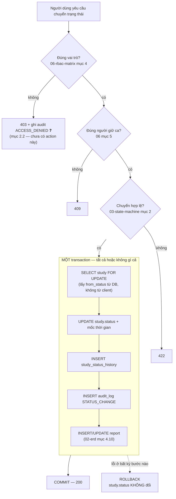

# VR-RIS PACS — Bảo mật và toàn vẹn dữ liệu

| | |
|---|---|
| **Mục đích** | Gom các quyết định bảo mật và toàn vẹn dữ liệu đang rải rác ở `02-erd.md`, `06-rbac-matrix.md`, `07-pacs-dicom.md` về một chỗ, để backend viết theo. Trả lời: ai được vào, hành vi nào bị ghi lại, và dữ liệu không được sai ở những chỗ nào |
| **Thuộc mục README** | **6D (Bảo mật & tuân thủ)**. Liên quan `6A` (RBAC), `6B` (ConfigMap/Secret trong manifest k8s) |
| **Hạng mục scope** | **IN-13** (xác thực), **IN-14** (RBAC), **IN-15** (audit log) — `01-scope.md` mục 3.4 |
| **Phiên bản** | **0.1 — nháp, chưa được nhóm xác nhận** |
| **Ngày** | 2026-11-05 |
| **Phụ thuộc** | `02-erd.md` (bảng `audit_log`, `app_user`, mục 4.1, 4.5–4.11) · `06-rbac-matrix.md` (**nguồn duy nhất của ma trận quyền** — file này không chép lại) · `07-pacs-dicom.md` mục 6.3 (kiểm soát deep-link) · `03-state-machine.md` (điều kiện chuyển) · `api/openapi.yaml` (`bearerAuth`) |
| **Trạng thái** | Mọi điểm gắn **❓** là **đề xuất của tài liệu, chờ nhóm xác nhận** — chưa phải quyết định. Đồ án môn học, không triển khai lâm sàng |

> **Không nhân bản ma trận quyền.** Ai được gọi endpoint nào, ai được chuyển trạng thái nào → **`06-rbac-matrix.md`**. File này chỉ nói về *cơ chế* (chặn ở đâu, ghi lại thế nào), không về *danh sách quyền*.

---

## 1. Xác thực

Cơ chế đã chốt ở README mục 8.2: **Spring Security + JWT** (💡 gợi ý, đủ cho đồ án, không SSO/LDAP). OpenAPI khai `bearerAuth` (`type: http`, `scheme: bearer`, `bearerFormat: JWT`).

### 1.1. Token

| Hạng mục | Đề xuất | Trạng thái |
|---|---|---|
| **Access token** | JWT, thời hạn **15 phút** | ❓ đề xuất |
| **Refresh token** | Thời hạn **8 giờ** (một buổi làm việc), dùng một lần rồi cấp lại (rotation) | ❓ đề xuất |
| **Nội dung access token** | `sub` = `app_user.id`, `username`, `roles[]` (mã vai trò), `iat`, `exp`. **Không** để tên bệnh nhân, `patient_id` hay bất kỳ dữ liệu bệnh nhân nào trong token | ❓ đề xuất |
| **Thuật toán** | HS256 với secret dài ≥ 32 byte, lấy từ **k8s Secret** (mục 5) | ❓ đề xuất |
| **Thu hồi** | Không có danh sách đen trong 8 tuần. Access token hết hạn tự nhiên; đổi secret là thu hồi toàn bộ | ❓ đề xuất |

**Vì sao 15 phút + refresh thay vì một token dài:** JWT không thu hồi được. Token sống 8 giờ mà bị lộ thì kẻ lấy được dùng đủ 8 giờ. Access token ngắn giới hạn thiệt hại; refresh token nằm ở chỗ khó lấy hơn (xem 1.2).

### 1.2. Nơi lưu token ở frontend ❓

| Cách | Ưu | Nhược |
|---|---|---|
| **`localStorage`** | Đơn giản nhất, sống qua reload tab | **Đọc được bằng JavaScript** → một lỗi XSS là mất token |
| Cookie `HttpOnly` + `Secure` + `SameSite=Strict` | JavaScript không đọc được → XSS không lấy được token | Cần backend set cookie; phải chống CSRF; phức tạp hơn khi FE và BE khác origin |
| Access token trong **biến JS (memory)** + refresh token trong cookie `HttpOnly` | An toàn nhất trong ba cách | Mất đăng nhập khi reload tab cho tới khi refresh xong |

**Đề xuất ❓:** cách thứ ba. **Chưa chốt** — Frontend hiện chưa nối API nên chưa có code nào lưu token (`01-scope.md` mục 11). Quyết định trước khi làm IN-13 (tuần 3).

> ⚠️ Nếu nhóm chọn `localStorage` vì nhanh, **phải ghi vào nợ kỹ thuật tuần 8** kèm câu: trong hệ thống thật có dữ liệu bệnh nhân, đây không phải lựa chọn chấp nhận được.

### 1.3. Băm mật khẩu

**Đã có trong schema:** `app_user.password_hash VARCHAR(100)`, comment ở `V2__security.sql` ghi rõ *"BCrypt, không bao giờ lưu mật khẩu thô"*.

| Hạng mục | Quyết định |
|---|---|
| Thuật toán | **BCrypt** (có sẵn trong Spring Security: `BCryptPasswordEncoder`) |
| Cost factor | **10** (mặc định Spring Security) ❓ |
| Độ dài cột | `VARCHAR(100)` — hash BCrypt là 60 ký tự, dư chỗ |
| Mật khẩu demo | Xem `12-seed-data-va-kich-ban-demo.md` (chưa viết). **Không** commit mật khẩu thật vào repo |

### 1.4. Khóa tài khoản khi đăng nhập sai nhiều lần ❓

**Toàn bộ mục này là giả định — chưa có bảng nào trong ERD để lưu.**

| Hạng mục | Đề xuất |
|---|---|
| Ngưỡng | **5 lần sai liên tiếp** → khóa **15 phút** |
| Lưu ở đâu | ❓ **Chưa có chỗ.** `app_user` không có `failed_login_count` / `locked_until`. Hai hướng: (a) thêm 2 cột → **migration V8+**; (b) đếm trong bộ nhớ ứng dụng, mất khi pod restart |
| Thông báo lỗi | Luôn trả cùng một câu ("Tên đăng nhập hoặc mật khẩu không đúng") kể cả khi tài khoản không tồn tại — **không** để kẻ tấn công biết username nào có thật |
| Audit | Mỗi lần đăng nhập sai ghi `audit_log` với `action = 'LOGIN'` và kết quả thất bại — xem 2.2 ❓ |

**Đề xuất cho 8 tuần:** cách (b), đếm trong bộ nhớ, và **ghi vào nợ kỹ thuật**. Lý do: thêm cột vào `app_user` cần migration mới và nhóm chưa xác nhận ERD v0.9; mất bộ đếm khi restart pod là thiệt hại chấp nhận được trong đồ án.

---

## 2. Đặc tả audit log

**Nguyên tắc bất biến (README mục 0):** *"Mọi hành vi đọc/sửa/duyệt dữ liệu bệnh nhân đều phải ghi audit log."* Đây là hạng mục **IN-15**, làm ở tuần 3, **không làm sau**.

Bảng `audit_log` đã có trong `02-erd.md`. File này đặc tả **khi nào ghi** và **ghi gì**.

### 2.1. Trường bắt buộc

Lấy đúng tên cột ở `02-erd.md`:

| Cột | Bắt buộc | Ghi chú |
|---|---|---|
| `actor_user_id` | Có, trừ hành vi của hệ thống | `NULL` = hệ thống (ví dụ job tự động) |
| `actor_username` | **Luôn luôn** | Snapshot, không join — xem `02-erd.md` mục 4.8 |
| `action` | **Luôn luôn** | Danh sách ở 2.2 |
| `entity_type` | **Luôn luôn** | `PATIENT` / `IMAGING_ORDER` / `STUDY` / `REPORT` / `IDENTITY_CONFLICT` / `APP_USER` ❓ |
| `entity_id` | Có, trừ `LOGIN` | |
| `patient_id` | **Có bất cứ khi nào hành vi liên quan một bệnh nhân** | Cột truy vết quan trọng nhất — xem 2.4 |
| `before_value` / `after_value` | Chỉ với hành vi sửa | JSON. **Không** đưa `password_hash` vào |
| `ip_address` | Có | |
| `occurred_at` | **Luôn luôn** | UTC (`02-erd.md` mục 4.7) |

### 2.2. Danh sách sự kiện bắt buộc ghi

`audit_log.action` hiện có 9 giá trị (`02-erd.md`, `diagrams/02-erd.mmd`):

| `action` | Khi nào ghi | `patient_id` | Ghi chú |
|---|---|---|---|
| `LOGIN` | Đăng nhập **thành công và thất bại** ❓ | `NULL` | Cột `action` không phân biệt thành/thất bại → ❓ **chưa có chỗ lưu kết quả.** Hai hướng: thêm `action = 'LOGIN_FAILED'`, hoặc ghi vào `after_value`. **Chưa chốt** |
| `READ` | Mở bản ghi bệnh nhân / chỉ định / ca chụp / báo cáo | Có | ⚠️ Xem 2.3 — đây là loại ghi nhiều nhất và dễ sai nhất |
| `VIEW_IMAGE` | **Mở viewer cho một study** (cả hai cửa vào ở README 2.7) | Có | Đặc tả đầy đủ: `02-erd.md` mục **4.11**. PACS không ghi được giúp — xem `07-pacs-dicom.md` mục 6.3 |
| `CREATE` | Tạo bệnh nhân / chỉ định / ca chụp / báo cáo | Có | `after_value` = bản ghi mới |
| `UPDATE` | Sửa bất kỳ trường nào | Có | `before_value` **và** `after_value`. Sửa trường định danh bệnh nhân là trường hợp quan trọng nhất (`06-rbac-matrix.md` mục 5, ❓ D24) |
| `DELETE` | — | — | **Không dùng cho dữ liệu nghiệp vụ** (`02-erd.md` mục 4.6: không xóa cứng). Giữ giá trị này cho dữ liệu tham chiếu/người dùng ❓ |
| `STATUS_CHANGE` | Mỗi lần chuyển trạng thái ca chụp (T1–T10) | Có | **Ghi song song với `study_status_history`**, không thay thế — xem 3.1 |
| `PRINT` | In báo cáo / in danh sách | Có | In là mang dữ liệu bệnh nhân ra khỏi hệ thống |
| `EXPORT` | Tải danh sách, xuất file | Có nếu một bệnh nhân; `NULL` nếu nhiều | |

**Thêm vào danh sách ❓:** mỗi lần bị **từ chối vì sai quyền** (`403`) phải ghi audit — yêu cầu này đã có ở `06-rbac-matrix.md` mục 1 điểm 5 và RBAC-14. Nhưng **không có `action` nào ứng với nó**. ❓ Đề xuất thêm `ACCESS_DENIED`. Cần nhóm xác nhận (và đổi comment cột, xem 2.6).

### 2.3. ⚠️ Vấn đề chưa giải quyết: ghi `READ` cho mỗi lần xem worklist?

Worklist trả về **hàng trăm hàng**, mỗi hàng là một bệnh nhân. Nếu ghi một dòng `READ` cho mỗi bệnh nhân trong mỗi lần tải worklist thì bảng `audit_log` phình rất nhanh và không còn đọc được.

| Hướng | Đánh giá |
|---|---|
| (a) Ghi `READ` **chỉ khi mở chi tiết một bệnh nhân / một ca**, không ghi khi xem danh sách | Giữ audit đọc được. Nhưng danh sách worklist **cũng** hiển thị tên, ngày sinh, chẩn đoán → vẫn là đọc dữ liệu bệnh nhân |
| (b) Ghi một dòng `READ` cho **cả truy vấn**, `entity_type = 'WORKLIST_QUERY'`, `patient_id = NULL`, `after_value` = tham số lọc + số kết quả | Truy vết được "ai đã xem danh sách nào lúc nào", không phình bảng. Nhưng **không truy vết được theo `patient_id`** — mất đúng cái mục 2.4 cần |
| (c) Cả hai: (b) cho danh sách + (a) cho chi tiết | Đề xuất của tài liệu |

❓ **Chưa chốt — phải chốt trước khi code IN-15 (tuần 3).** Đây là quyết định định hình toàn bộ cách ghi audit, sửa muộn thì phải viết lại.

### 2.4. Truy vết theo `patient_id`

Câu hỏi phải trả lời được: **"ai đã xem/sửa dữ liệu của bệnh nhân này, lúc nào?"**

- Index đã có: `IDX(patient_id, occurred_at)` (`02-erd.md` mục 6).
- `patient_id` là **cột rời, không phải khóa ngoại dẫn qua `entity_id`**: hành vi trên `report` hay `study` vẫn phải điền `patient_id` của bệnh nhân tương ứng. Nếu để `NULL` vì "entity là report chứ không phải patient" thì truy vết hỏng.
- Giao diện xem audit log là **[HOÃN]** cho vai Admin? — Không: `01-scope.md` mục 6 bước 8 yêu cầu **Admin mở được audit log trong demo**. Frontend chưa có màn này (`01-scope.md` mục 11) ❓.

### 2.5. Append-only: cách bảo đảm

`02-erd.md` ghi `audit_log` là **append-only, không UPDATE/DELETE**. Cơ chế bảo đảm, theo thứ tự chắc chắn giảm dần:

| Lớp | Cơ chế | Trạng thái |
|---|---|---|
| **1. Quyền DB** | Backend kết nối MySQL bằng user chỉ có `INSERT`, `SELECT` trên `audit_log` (**không** `UPDATE`, `DELETE`). Cần **user DB thứ hai** vì user chính phải `UPDATE` được các bảng khác | ❓ đề xuất — **chưa có trong migration nào**, và cần hai datasource trong Spring |
| **2. Trigger** | `BEFORE UPDATE` / `BEFORE DELETE` trên `audit_log` gọi `SIGNAL SQLSTATE` để chặn | ❓ đề xuất — đơn giản hơn lớp 1, chỉ cần một file migration |
| **3. Tầng ứng dụng** | Entity JPA không có setter; repository chỉ có `save()` mới và `find*` | Yếu nhất — ai viết SQL thẳng là bỏ qua được |
| **4. Không có endpoint** | OpenAPI không có `PUT`/`PATCH`/`DELETE` nào cho `/audit-logs` | Cần kiểm tra lại `openapi.yaml` ❓ |

**Đề xuất cho 8 tuần ❓:** lớp **2 + 3 + 4**. Lớp 1 (hai user DB) đúng hơn nhưng tốn cấu hình và dễ làm vỡ vòng dev hằng ngày; ghi vào nợ kỹ thuật.

### 2.6. Thời gian lưu và dung lượng

| Hạng mục | Đề xuất | Trạng thái |
|---|---|---|
| Thời gian lưu trong đồ án | **Không xóa gì** — dữ liệu giả, 8 tuần, dung lượng không đáng kể | ✅ hợp lý cho đồ án |
| Thời gian lưu trong hệ thống thật | ❓ **Không kết luận.** Thuộc pháp lý VN về hồ sơ bệnh án điện tử — **[NGOÀI PHẠM VI]** (README 6D), chỉ nêu trong báo cáo | ❓ |
| Xóa/nén bản ghi cũ | Không làm. Mâu thuẫn trực tiếp với append-only; nếu cần thì phải là *archive sang bảng khác*, không phải `DELETE` | — |

> ⚠️ **Một việc còn vướng:** thêm `ACCESS_DENIED` (2.2) hay `LOGIN_FAILED` vào `action` là **đổi comment cột** trong `V5__audit_and_conflict.sql`. `02-erd.md` mục 7 cấm sửa V1–V7 đã vào `main` → cần V8+, hoặc để comment lệch và coi tài liệu là chuẩn. Cùng vấn đề đã ghi cho `VIEW_IMAGE` ở `02-erd.md` mục 4.11. ❓ **Nên gộp làm một lần**, không mỗi lần một migration.

---

## 3. Toàn vẹn dữ liệu

### 3.1. Đổi trạng thái và ghi lịch sử phải trong **cùng một transaction**

`02-erd.md` giữ trạng thái ở **hai chỗ**: `study.status` (để lọc/đếm nhanh) và `study_status_history` (lịch sử append-only). Hai chỗ này **phải không bao giờ lệch nhau**.

Một lần chuyển trạng thái gồm **3–4 việc ghi**, tất cả trong một transaction:

```text
BEGIN
  1. Kiểm điều kiện chuyển (03-state-machine.md mục 2) + quyền (06-rbac-matrix.md mục 4)
  2. UPDATE study SET status = <to_status>, (started_at | completed_at | reading_user_id …)
  3. INSERT study_status_history (study_id, from_status, to_status, changed_by_user_id, changed_at, reason)
  4. INSERT audit_log (action = 'STATUS_CHANGE', patient_id, before_value, after_value)
  5. (nếu chuyển kéo theo báo cáo) INSERT/UPDATE report theo 02-erd.md mục 4.10
COMMIT
```



- **Nếu bước 3 lỗi mà bước 2 đã commit:** `study.status` đã đổi nhưng không ai biết ai đổi → mất audit, vi phạm nguyên tắc bất biến.
- **`@Transactional` ở tầng service**, không ở controller, và **không** gọi API ngoài (PACS, HIS) ở trong transaction.
- `from_status` phải đọc trong transaction (`SELECT … FOR UPDATE` trên `study`) chứ không lấy từ request của client — xem 3.2.

### 3.2. Hai người sửa cùng một thứ

**Hai tình huống khác nhau, hai cơ chế khác nhau.**

**(a) Hai người sửa cùng một `report` → khóa lạc quan (optimistic lock)**

- `report` đã có cột `version` với `UK(study_id, version)` (`02-erd.md` mục 4.10). ⚠️ **Nhưng `version` đó là *version nghiệp vụ*** (tăng khi trả lại / mở lại ca), **không phải** số đếm cho khóa lạc quan.
- ❓ **Dùng chung một cột cho hai việc là sai.** Hai lượt sửa trong cùng một lần đọc không được tăng `version` nghiệp vụ. Cần **cột thứ hai** (ví dụ `row_version` cho `@Version` của JPA) → **migration V8+**, hoặc dùng `updated_at` làm điều kiện `WHERE`.
- Hành vi mong đợi: người thứ hai lưu thì nhận **`409 Conflict`** kèm thông báo "báo cáo đã bị người khác sửa, tải lại", **không** ghi đè âm thầm.

**(b) Hai người cùng mở một ca để đọc → khóa theo người giữ ca**

- `06-rbac-matrix.md` mục 5 đã có quy tắc: chỉ người đang giữ ca (`reading_user_id`) được lưu báo cáo (❓ D20, gọi là "khóa mềm").
- Cơ chế: khi `UNREAD → READING`, set `reading_user_id` **có điều kiện**: `UPDATE study SET reading_user_id = :me WHERE id = :id AND reading_user_id IS NULL`. Nếu `0 rows affected` → ca đã có người giữ → trả `409`.
- ❓ **Chưa chốt:** ai giải phóng khóa khi bác sĩ đóng tab mà không lưu. `06-rbac-matrix.md` mục 1 điểm 2 giao việc "giải phóng khóa" cho `ADMIN` (❓ D15). Không có cơ chế hết hạn tự động.

### 3.3. Ràng buộc ở tầng DB, không chỉ ở tầng code

Nguyên tắc: **dữ liệu sai không vào được DB kể cả khi code sai.** Migration V1–V7 đã có 23 khóa ngoại (`database/README.md`).

| Loại | Chỗ áp dụng | Trạng thái |
|---|---|---|
| **FK** | 23 khóa ngoại, đã chạy thử trên MySQL 8.4.9 | ✅ đã có |
| **UNIQUE** | `patient.patient_code`, `imaging_order.order_code`, `study.accession_number`, `study.study_instance_uid`, `report(study_id, version)`, `app_user.username`, `role.code` | ✅ đã có |
| **NOT NULL** | Theo ERD | ✅ đã có |
| **CHECK cho `status`** | ❌ **Không dùng.** `02-erd.md` mục 4.5 chọn `VARCHAR(20)` chứ không `ENUM`/`CHECK` để thêm giá trị được bằng migration. Hệ quả: **tầng ứng dụng phải validate** — DB sẽ nhận `status = 'ABC'` | ⚠️ Đánh đổi có chủ ý, cần biết |
| **Không xóa cứng** | `02-erd.md` mục 4.6 | ✅ quy ước |

⚠️ **Rủi ro đã biết, liên quan `02-erd.md` mục 9:** `UK(study_instance_uid)` sẽ **vỡ** nếu một study DICOM chứa nhiều dịch vụ (một `study_instance_uid` cho 2 hàng `study`). Ô này **chưa được nhóm xác nhận** và cần chốt trước tuần 7.

### 3.4. Idempotency khi nhận lại message HL7

Vấn đề: HIS gửi lại cùng một `ORM^O01` (vì không nhận được ACK, hoặc retry). **Không được tạo hai chỉ định.**

| Hạng mục | Đề xuất | Trạng thái |
|---|---|---|
| Khóa chống trùng | **`MSH-10` (Message Control ID)** — định danh duy nhất của một message HL7 | ❓ đề xuất |
| Lưu ở đâu | `his_message_log` (lưu `MSH-10`, raw message, ACK, số lần retry) — `02-erd.md` mục 4.9 ghi bảng này thuộc **H-03, ngoài 8 tuần** | ⚠️ **Bảng chưa tồn tại** |
| Lớp chống trùng thứ hai | `UNIQUE(his_order_id)` trên `imaging_order` — `his_order_id` là ORC-2 Placer Order Number, do HIS đặt | ❓ **ERD hiện KHÔNG có UNIQUE trên cột này** (mục 6 chỉ có `UK(order_code)`) → cần migration nếu chốt |
| Hành vi khi gặp lại message đã xử lý | Trả **ACK thành công** và **không ghi gì** — không trả lỗi, vì với HIS thì message đó *đã* được nhận | ❓ đề xuất |

**Trong 8 tuần:** không có parser HL7 thật, chỉ có interface `HisGateway` + bản giả lập đọc file JSON (`01-scope.md` mục 4.1). Nên **idempotency chưa thực thi được** — nhưng phải thiết kế trước, vì nó quyết định có cần `UNIQUE(his_order_id)` hay không, và thêm UNIQUE sau khi đã có dữ liệu trùng thì không thêm được. Chi tiết message: `08-hl7-message-spec.md` (chưa viết).

### 3.5. Bảo vệ quy tắc "không lưu cột tuổi"

`02-erd.md` mục 4.1: **không có cột `age`**, tuổi luôn tính từ `date_of_birth` lúc hiển thị. Đây là nguyên nhân trực tiếp của lỗi "Tuổi 0" ở README 2.5 — quy tắc này bị phá là lỗi quay lại.

| Lớp bảo vệ | Cơ chế | Trạng thái |
|---|---|---|
| **DB** | Không có cột `age` trong `V3__patient_order_study.sql` | ✅ đã có |
| **API request** | Schema `Patient` trong request **không có** `age`; chỉ có `date_of_birth` + `dob_precision` | ✅ đã ghi trong `openapi.yaml` |
| **API response** | `age` là **read-only**, kèm cờ `age_approximate`; `age = null` khi chưa có ngày sinh — **không bao giờ là 0 vì thiếu dữ liệu** | ✅ đã ghi trong `openapi.yaml` |
| **Test** | `01-scope.md` mục 6 **bước 10**: không ca nào ra "Tuổi 0", kể cả bệnh nhân chỉ có năm sinh | ✅ là tiêu chí nghiệm thu |
| **Frontend** | ⚠️ `calcAge` trong `format.ts` hiện trả tuổi như số chính xác kể cả khi `dob_precision = 'YEAR'` — **chưa sửa** (`02-erd.md` mục 10) | ⚠️ còn nợ |
| **DICOM** | ⚠️ Lỗi này **quay lại ở phía ảnh**: tag `PatientBirthDate` (0010,0030) là kiểu DA đủ ngày, không biểu diễn được "chỉ biết năm" — `07-pacs-dicom.md` mục 4.2, câu hỏi **P-04** ❓ | ❓ chưa chốt |

---

## 4. Quyền truy cập dữ liệu

**Nguồn duy nhất: `06-rbac-matrix.md`.** Ở đây chỉ nhắc hai nguyên tắc về *cơ chế*:

1. **Chặn ở tầng API, không chỉ ẩn nút.** IN-14 nói rõ. Frontend **không phải lớp bảo vệ** (`01-scope.md` mục 11) — bỏ Frontend đi thì backend vẫn phải trả `403` đúng. Mặc định là **từ chối**: endpoint không có trong bảng của `06` thì chỉ `ADMIN` gọi được (`06-rbac-matrix.md` mục 1 điểm 4).
2. **Giới hạn theo dòng dữ liệu (row-level)** là một lớp riêng, sau khi đã qua kiểm tra vai trò: `CLINICIAN` chỉ xem bệnh nhân mình chỉ định; chỉ người giữ ca được lưu báo cáo; người duyệt ≠ người đọc. Toàn bộ các ô này **còn ❓** và một ô **chưa dùng được** — `ordering_doctor_name` là tên tự do, không phải khóa tới `app_user` (`06-rbac-matrix.md` mục 5, ❓ D34; `02-erd.md` mục 9).

> Nghĩa là: trong 8 tuần, **lớp vai trò hoạt động, lớp row-level thì chưa**. Phải nêu rõ trong báo cáo, không trình bày như đã có.

---

## 5. Bảo vệ dữ liệu và cấu hình

### 5.1. ConfigMap vs Secret

README 2.6 đã chốt: cấu hình qua **ConfigMap + Secret**, **không hard-code trong image**.

| Vào **ConfigMap** (không bí mật) | Vào **Secret** (bí mật) |
|---|---|
| JDBC URL, tên database | Mật khẩu MySQL (user ứng dụng và user root) |
| Timezone (`02-erd.md` mục 4.7 — MySQL và backend phải cùng timezone) | **JWT secret** (mục 1.1) |
| **Base URL của OHIF** (`07-pacs-dicom.md` mục 6.1, `01-scope.md` IN-19 điểm 2) | Mật khẩu Orthanc, nếu bật `RegisteredUsers` (`07-pacs-dicom.md` ❓ P-02) |
| AE Title, host, port DICOM (`07-pacs-dicom.md` mục 3.1) | Mật khẩu người dùng demo — **không commit vào repo** |
| Mức log, số trang mặc định | |

⚠️ **k8s Secret chỉ là base64, không phải mã hóa.** Ai đọc được object `Secret` trong namespace là đọc được giá trị. Trong đồ án chấp nhận được (cụm local, dữ liệu giả); trong hệ thống thật cần Sealed Secrets / Vault / KMS. **Ghi vào báo cáo, không trình bày Secret như một lớp mã hóa.**

❓ **Chưa chốt:** có commit file `Secret` mẫu (giá trị giả) vào repo để `kubectl apply -k` chạy được một lệnh không. Nếu có thì **phải** có comment rõ "giá trị giả, đổi trước khi dùng thật". Thuộc `14-devops-trien-khai.md` (chưa viết).

### 5.2. OHIF và Orthanc không mở công khai

**Nguyên tắc bất biến (README mục 0).** Cơ chế và ba phương án chặn: **`07-pacs-dicom.md` mục 6.3** — không chép lại ở đây.

Điểm cần nhớ: deep-link `…/viewer?StudyInstanceUIDs=<uid>` **không chứa thông tin xác thực**. Ai có UID và tới được OHIF là xem được ảnh; và mở URL dán tay (không qua RIS) thì **không để lại dòng `VIEW_IMAGE` nào**. ❓ Cách chặn **chưa chốt** (P-09).

### 5.3. Mã hóa truyền tải (TLS) ❓

| Chặng | Trong đồ án | Ghi chú |
|---|---|---|
| Trình duyệt → Ingress | ❓ **Chưa chốt.** Đề xuất: HTTP trong cụm local, ghi rõ là nợ kỹ thuật | Cần TLS thật thì phải sinh cert tự ký và cấu hình Ingress; tốn thời gian, không thuộc tiêu chí nghiệm thu nào |
| Backend → MySQL | HTTP/plain trong namespace | |
| OHIF → Orthanc (DICOMweb) | HTTP trong namespace | |
| Máy chụp → Orthanc (DICOM) | **DICOM thuần, không TLS** | DICOM có TLS nhưng cấu hình phức tạp; `07-pacs-dicom.md` mục 3.1 ghi đây là socket thuần không qua Ingress |

**Đề xuất ❓:** không làm TLS trong 8 tuần, **ghi vào báo cáo như một hạn chế có ý thức** (không phải bỏ sót). Lý do nêu được: cụm local, dữ liệu giả, và không có chặng nào đi qua mạng không tin cậy.

---

## 6. Dữ liệu demo và ảnh tham chiếu

### 6.1. Chỉ dữ liệu giả

Nguyên tắc bất biến + `01-scope.md` R-03: **không dữ liệu bệnh nhân thật ở bất kỳ đâu** — seed data, test, ảnh demo, slide. Ảnh DICOM chỉ dùng bộ công khai đã ẩn danh (TCIA). Chi tiết: `12-seed-data-va-kich-ban-demo.md` (chưa viết).

### 6.2. Quy trình che thông tin trong ảnh chụp màn hình tham chiếu

Nguyên tắc bất biến (README mục 0) yêu cầu che **trước** khi đưa vào repo/Figma/slide. Quy trình đề xuất:

| Bước | Việc |
|---|---|
| 1 | Xác định các trường phải che: **tên bệnh nhân, mã bệnh nhân, mã hồ sơ (LSVV), `StudyInstanceUID`**, và mọi mã định danh khác xuất hiện trên màn hình |
| 2 | Che bằng **khối màu đặc** (không phải blur, không phải pixelate). Blur và pixelate có thể đảo ngược được ở mức đủ để đọc lại chữ |
| 3 | **Xuất ra ảnh phẳng** (PNG) — không giữ file nguồn có layer che riêng, vì xóa layer là hiện lại |
| 4 | Xóa **metadata EXIF** nếu ảnh có |
| 5 | Che **trước khi commit**. Một ảnh chưa che đã vào git history thì xóa file ở commit sau **không xóa được khỏi history** |

⚠️ **Đã xảy ra một lần trong dự án này:** README mục 2.5 từng chứa tên và mã bệnh nhân thật, đã được ẩn ngày 2026-10-31 (xem mục 11 lịch sử thay đổi). ❓ **Chưa kiểm tra** git history còn giữ bản cũ hay không — nếu còn thì ẩn ở bản mới **chưa đủ**. Cần nhóm kiểm tra.

---

## 7. Ánh xạ "yêu cầu → cơ chế → nơi kiểm thử"

| Yêu cầu | Cơ chế | Mục | Nơi kiểm thử |
|---|---|---|---|
| Chỉ người đã đăng nhập mới vào được | JWT `bearerAuth`, access 15′ ❓ | 1.1 | SEC-01 |
| Không lưu mật khẩu thô | BCrypt, `password_hash` | 1.3 | SEC-02 |
| Chống dò mật khẩu | Khóa 5 lần sai ❓ (chưa có chỗ lưu) | 1.4 | SEC-03 |
| Mọi hành vi đọc/sửa/duyệt dữ liệu bệnh nhân có audit | 9 giá trị `action` | 2.2 | SEC-04…07 |
| Biết ai đã **xem ảnh** của ai | `VIEW_IMAGE` ghi ở RIS | 2.2, `02-erd` 4.11 | SEC-06 |
| Audit không sửa được | Trigger + không có endpoint ❓ | 2.5 | SEC-08 |
| Truy vết theo bệnh nhân | `patient_id` + `IDX(patient_id, occurred_at)` | 2.4 | SEC-09 |
| `study.status` không lệch `study_status_history` | Một transaction | 3.1 | SEC-10 |
| Hai người không ghi đè báo cáo của nhau | Khóa lạc quan ❓ (thiếu cột) | 3.2(a) | SEC-11 |
| Hai người không cùng đọc một ca | `reading_user_id` có điều kiện ❓ | 3.2(b) | SEC-12 |
| HIS gửi lại message không tạo trùng | `MSH-10` + `UNIQUE(his_order_id)` ❓ | 3.4 | SEC-13 (sau 8 tuần) |
| Không bao giờ ra "Tuổi 0" | Không có cột `age`, `age` read-only | 3.5 | `01-scope.md` mục 6 **bước 10** |
| Chặn quyền ở API, không chỉ ẩn nút | `06-rbac-matrix.md` | 4 | `06-rbac-matrix.md` mục 8 |
| Không hard-code mật khẩu | ConfigMap + Secret | 5.1 | SEC-14 |
| OHIF không truy cập được từ ngoài | ❓ chưa chốt | 5.2, `07` 6.3 | SEC-15 |

### 7.1. Test case bảo mật tối thiểu

Quyền (`403`) đã có bộ riêng ở `06-rbac-matrix.md` mục 8 — **không lặp lại**. Dưới đây là phần thuộc file này:

| # | Test | Kết quả mong đợi |
|---|---|---|
| SEC-01 | Gọi endpoint bất kỳ không kèm token / token hết hạn / token sửa chữ ký | `401`, **không** `500`, và không lộ thông tin trong body |
| SEC-02 | Đọc trực tiếp `app_user` trong DB | `password_hash` là hash BCrypt (`$2a$…`), không thấy mật khẩu thô ở bất kỳ cột nào |
| SEC-03 | Đăng nhập sai 6 lần liên tiếp | Lần 6 bị khóa; thông báo **không** tiết lộ username có tồn tại hay không ❓ |
| SEC-04 | Mở chi tiết một bệnh nhân | Có dòng `audit_log` `action='READ'`, đúng `patient_id`, đúng `actor_username` |
| SEC-05 | Sửa ngày sinh một bệnh nhân | Có dòng `UPDATE` với `before_value` **và** `after_value` chứa giá trị cũ/mới |
| SEC-06 | Bấm "Xem ảnh" ở worklist, rồi ở tab 3 modal lâm sàng | **Hai** dòng `VIEW_IMAGE`, đúng `entity_id = study.id`, đúng `patient_id` |
| SEC-07 | Chuyển một ca qua đủ 6 trạng thái | 6 dòng `STATUS_CHANGE` **và** 6 dòng `study_status_history`, khớp nhau từng cặp |
| SEC-08 | `UPDATE audit_log SET …` và `DELETE FROM audit_log` bằng SQL thẳng | Bị chặn (lỗi từ trigger hoặc từ quyền DB) ❓ |
| SEC-09 | Truy vấn audit theo một `patient_id` | Ra đủ mọi hành vi trên bệnh nhân đó, kể cả hành vi trên `study` và `report` của họ |
| SEC-10 | Giả lập lỗi ở bước `INSERT study_status_history` | Transaction rollback: `study.status` **không** đổi |
| SEC-11 | Hai phiên cùng mở một báo cáo, cùng sửa, lần lượt lưu | Người thứ hai nhận `409`, bản của người thứ nhất **không** bị ghi đè ❓ |
| SEC-12 | Hai bác sĩ CĐHA cùng mở một ca `UNREAD` | Chỉ người đầu giữ ca; người thứ hai nhận `409` ❓ |
| SEC-14 | `grep` toàn repo tìm mật khẩu / JWT secret | Không có giá trị thật nào trong image, Dockerfile, hay file cấu hình đã commit |
| SEC-15 | Gọi OHIF và Orthanc từ ngoài cụm | Không truy cập được ❓ (phụ thuộc cách chặn được chọn) |

> SEC-13 thuộc **H-03** (sau 8 tuần). SEC-03, 08, 11, 12, 15 phụ thuộc các ô ❓ ở trên — **chưa viết được test cho tới khi chốt cơ chế**.

---

## 8. Đối chiếu với README mục 0 — từng nguyên tắc bất biến

| Nguyên tắc bất biến | Cơ chế bảo đảm | Mục | Đủ chưa |
|---|---|---|---|
| RIS **không** lưu/xử lý ảnh DICOM | Không endpoint nào trả ảnh (`openapi.yaml`); `01-scope.md` R-02; RIS chỉ giữ `study_instance_uid` | 5.2 | ✅ |
| Máy chụp gửi ảnh **thẳng vào PACS** | Kiến trúc: không có đường máy chụp → RIS cho ảnh | `07` mục 1 | ✅ |
| AI **không** tự trả kết quả chính thức | `report.origin` phân biệt `MANUAL / AI_DRAFT / AI_DRAFT_EDITED`; chỉ bản `APPROVED` gửi về HIS (`02-erd.md` 4.10) | — | ⚠️ Cơ chế đã có trong ERD; đặc tả đầy đủ ở `11-ai-design.md` **chưa viết** |
| **Mọi** hành vi đọc/sửa/duyệt dữ liệu bệnh nhân có audit | 9 giá trị `action`, `patient_id` truy vết | 2 | ⚠️ **Chưa đủ**: (a) cách ghi `READ` cho worklist chưa chốt (2.3); (b) không có `action` cho `403` (2.2); (c) không có chỗ ghi đăng nhập thất bại (2.2) |
| Tích hợp dùng **chuẩn mở** (DICOM/HL7/FHIR) | DICOM ở `07`, HL7 v2 ở `08` (chưa viết) | — | ✅ |
| **Không** dữ liệu bệnh nhân thật ở bất kỳ đâu | R-03; TCIA cho ảnh; quy trình che ảnh tham chiếu | 6 | ⚠️ **Chưa kiểm tra git history** (6.2) |
| Ảnh chụp màn hình phải che danh tính trước khi vào repo | Quy trình 5 bước | 6.2 | ⚠️ Như trên |
| OHIF/Orthanc **không** mở công khai | 3 phương án, chưa chọn | 5.2, `07` 6.3 | ❓ **Chưa chốt** |
| Stack đã chốt không đổi | — | — | ✅ (ngoài phạm vi file này) |

**Kết luận mục 8:** trong 9 nguyên tắc bất biến, **4 nguyên tắc chưa được bảo đảm đầy đủ** bởi thiết kế hiện tại — audit log (3 lỗ hổng), không-dữ-liệu-thật (git history), OHIF không công khai (chưa chọn cơ chế), và AI human-in-the-loop (tài liệu chưa viết). Đây là danh sách phải xử lý, không phải ghi chú.

---

## 9. Câu hỏi mở

| # | Câu hỏi | Mục | Chặn việc gì |
|---|---|---|---|
| S-01 | Thời hạn access/refresh token; thuật toán; nội dung claim | 1.1 | IN-13 (tuần 3) |
| S-02 | Lưu token ở đâu trong frontend (`localStorage` / cookie `HttpOnly` / memory) | 1.2 | IN-13 + code Frontend |
| S-03 | BCrypt cost factor | 1.3 | IN-13 |
| S-04 | Khóa tài khoản: có làm không; nếu có thì lưu đếm ở cột DB (**migration V8+**) hay bộ nhớ | 1.4 | IN-13 |
| S-05 | **Ghi `READ` thế nào cho worklist** — không ghi / ghi một dòng cho cả truy vấn / cả hai | **2.3** | **IN-15 (tuần 3) — quyết định định hình toàn bộ cách ghi audit** |
| S-06 | Có thêm `action = 'ACCESS_DENIED'` (cho `403`) và cách ghi đăng nhập thất bại | 2.2 | IN-15; `06-rbac-matrix.md` RBAC-14 |
| S-07 | Cơ chế append-only: quyền DB (2 user) / trigger / chỉ tầng ứng dụng | 2.5 | IN-15 |
| S-08 | Danh sách giá trị `entity_type` | 2.1 | IN-15 |
| S-09 | **Cột riêng cho khóa lạc quan** trên `report` (`version` nghiệp vụ không dùng được cho việc này) | **3.2(a)** | **Cần migration V8+ nếu chốt là có** |
| S-10 | Ai/làm sao giải phóng khóa khi bác sĩ đóng tab mà không lưu | 3.2(b) | IN-10, IN-14 |
| S-11 | Có thêm `UNIQUE(his_order_id)` trên `imaging_order` không | 3.4 | **Thêm muộn thì không thêm được** nếu đã có dữ liệu trùng |
| S-12 | Có commit file k8s `Secret` mẫu (giá trị giả) vào repo không | 5.1 | `14-devops-trien-khai.md` |
| S-13 | Có làm TLS trong 8 tuần không | 5.3 | IN-17 |
| S-14 | Git history có còn giữ tên/mã bệnh nhân thật ở bản README cũ không | 6.2 | **Nguyên tắc bất biến** — cần kiểm tra ngay |
| S-15 | Thời gian lưu audit log trong hệ thống thật | 2.6 | Không chặn (ngoài phạm vi, nêu trong báo cáo) |

**Ba câu phải chốt sớm nhất:** **S-05** (chặn IN-15 tuần 3, sửa muộn phải viết lại cách ghi audit), **S-14** (nguyên tắc bất biến, kiểm tra được ngay hôm nay), **S-11** (thêm UNIQUE muộn thì không thêm được).

## 10. Cần xác nhận

Không ô nào dưới đây đã được nhóm xác nhận.

| Điểm | Đề xuất của tài liệu | Ảnh hưởng nếu đổi |
|---|---|---|
| Access 15′ + refresh 8h, rotation | Mục 1.1 | Chỉ code, không đổi schema |
| Access token trong memory + refresh trong cookie `HttpOnly` | Mục 1.2 | Code Frontend + endpoint refresh |
| Đếm đăng nhập sai trong bộ nhớ, ghi nợ kỹ thuật | Mục 1.4 | Nếu chọn cột DB → **migration V8+** |
| Ghi `READ` cho cả truy vấn worklist **và** cho từng lần mở chi tiết | Mục 2.3 | Định hình toàn bộ cách ghi audit |
| Append-only bằng trigger + không có endpoint (không dùng 2 user DB) | Mục 2.5 | Cần một file migration cho trigger |
| Thêm cột `row_version` cho khóa lạc quan trên `report` | Mục 3.2(a) | **Migration V8+**; `02-erd.md` mục 4.10 phải nói rõ hai loại version |
| `MSH-10` làm khóa idempotency + `UNIQUE(his_order_id)` | Mục 3.4 | **Migration**; `08-hl7-message-spec.md` phải bám theo |
| Không làm TLS trong 8 tuần, ghi là hạn chế có ý thức | Mục 5.3 | Nếu làm → thêm việc cho IN-17 |
| Gộp mọi thay đổi comment cột `audit_log.action` vào **một** migration V8 | Mục 2.6 | Cùng vấn đề với `VIEW_IMAGE` ở `02-erd.md` 4.11 |

> **Ghi chú về phạm vi:** file này **không thêm hạng mục IN mới**. Mọi nội dung thuộc IN-13, IN-14, IN-15 đã có trong `01-scope.md` mục 3.4. Những chỗ cần **migration V8+** (S-04, S-09, S-11, S-06) là *thay đổi schema*, không phải thêm phạm vi chức năng — nhưng vẫn cần nhóm xác nhận ERD trước, theo `01-scope.md` mục 9.
