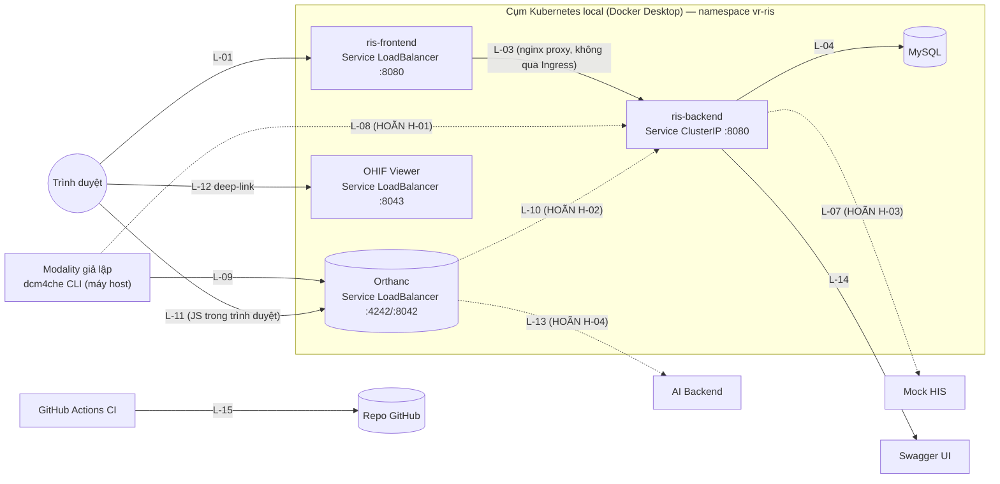

# VR-RIS PACS — Danh mục liên kết hệ thống

Tài liệu con của `README.md`, mục 6B ([T3–T4] Danh mục mọi liên kết giữa thành phần + bảng khóa nối + ma trận "khi liên kết hỏng"). Gộp hai nhánh tích hợp đã viết riêng — `07-pacs-dicom.md` (cạnh DICOM) và `08-hl7-message-spec.md` (cạnh HL7) — cộng mọi liên kết hạ tầng khác (DB, CI, Swagger) vào **một chỗ duy nhất**, để không ai phải tự ghép lại bức tranh toàn hệ thống từ nhiều file.

| Phiên bản | **0.1 — NHÁP, đề xuất chờ nhóm xác nhận** |
|---|---|
| Ngày | 2026-11-05 |
| Trạng thái | Bản khung đầy đủ bảng liên kết + khóa nối + ma trận sự cố. Mọi cột "trạng thái ❓" thừa hưởng nguyên trạng từ `07-pacs-dicom.md` và `08-hl7-message-spec.md` — **không tự chốt thêm gì mới** ở hai cạnh đó, chỉ gộp lại. Phần hạ tầng (DB, CI, Swagger, Ingress) là nội dung mới của tài liệu này |
| Tài liệu liên quan | `README.md` mục 2.2, 2.3, 2.6, 2.7 · `01-scope.md` mục 2, 4 · `02-erd.md` (khóa ngoại, mục 4.9) · `06-rbac-matrix.md` (vai trò ↔ quyền) · `07-pacs-dicom.md` (**nguồn của mọi liên kết DICOM, không chép lại chi tiết**) · `08-hl7-message-spec.md` (**nguồn của mọi liên kết HL7, không chép lại chi tiết**) · `09-bao-mat-toan-ven-du-lieu.md` mục 5 (ConfigMap/Secret) · `15-kien-truc-backend.md` · `.github/workflows/backend-ci.yml` |

> **Quy tắc tránh nhân bản:** với mỗi liên kết thuộc cạnh DICOM hoặc HL7, bảng dưới chỉ ghi tóm tắt (giao thức, chiều, trạng thái) và trỏ sang mục/trang cụ thể ở `07-pacs-dicom.md` / `08-hl7-message-spec.md` để biết chi tiết (tag, field, ví dụ message). Không lặp lại bảng mapping hay ví dụ ở hai file đó.

---

## 1. Danh sách thành phần

| Thành phần | Vai trò | Trạng thái | Nguồn đặc tả |
|---|---|---|---|
| **Frontend** (`Frontend/Frontend/`) | React 19 + Vite, worklist/bộ lọc/modal/báo cáo | ✅ Đã có (prototype dữ liệu giả, **chưa nối API**) | `Frontend/README.md` |
| **Backend RIS** (`Frontend/Backend/`) | Spring Boot 3, nghiệp vụ worklist/trạng thái/báo cáo | 🟡 Đã có (skeleton kiến trúc phân tầng R-05, 3 endpoint `reference-data`; patient/order/study/report **chưa viết**) | `15-kien-truc-backend.md`, `Backend/README.md` |
| **MySQL** (`database/`) | Lưu trữ nghiệp vụ RIS (14 bảng) | ✅ Đã có (Docker Compose + Flyway, dev) | `database/README.md`, `02-erd.md` |
| **Mock HIS / `HisGateway`** | Nguồn chỉ định + nơi nhận kết quả | 🟡 Interface + bản giả lập `JsonFileHisGateway` đã có code (khung, chưa đọc file JSON thật); **Mock HIS thật (HL7 v2 qua MLLP) là [HOÃN] H-03** | `08-hl7-message-spec.md`, `01-scope.md` mục 4.1 |
| **Orthanc** (PACS) | Lưu trữ ảnh DICOM, phục vụ DICOMweb | ⬜ Sẽ có **tuần 7** (IN-19) | `07-pacs-dicom.md` mục 1, 3 |
| **OHIF Viewer + AI Panel** | Xem ảnh; AI Panel chỉ là thiết kế | ⬜ OHIF sẽ có tuần 7 (IN-19); **AI Panel = [HOÃN] H-04**, chỉ wireframe (IN-21) | `07-pacs-dicom.md` mục 6, `01-scope.md` mục 3.5 |
| **Modality giả lập** (dcm4che CLI: `storescu`/`findscu`/`echoscu`) | Đóng vai máy chụp | ⬜ Sẽ dùng **tuần 7**, thao tác tay | `07-pacs-dicom.md` mục 5 |
| **AI Backend** | Pipeline AI (segmentation, report nháp) | ⛔ **[HOÃN] hoàn toàn H-04** — chỉ thiết kế tài liệu (`11-ai-design.md`, chưa viết) | `03-state-machine.md` mục 2.6, README mục 2.1 |
| **Flyway** | Quản lý migration schema | ✅ Đã có, chạy qua `database/docker-compose.yml`; backend đặt `flyway.enabled=false` | `database/README.md`, `15-kien-truc-backend.md` mục 3 |
| **Swagger UI / springdoc-openapi** | Tài liệu API trực tiếp từ code | ✅ Đã có (`config/OpenApiConfig.java`, phục vụ ở `/api/v1/swagger-ui.html`) | `Backend/README.md` |
| **Ingress** | ~~Định tuyến HTTP vào frontend/backend trong cụm~~ | ⛔ **Không dùng** — quyết định ở `14-devops-trien-khai.md` mục 4 (2026-11-05): `ris-frontend` (nginx) tự proxy `/api/**` sang `ris-backend` nội bộ cụm, trình duyệt chỉ gọi một địa chỉ (`ris-frontend`, `type: LoadBalancer`). Backend không có đường vào trực tiếp nào từ ngoài. Xem sửa lại L-01/L-02/L-03 ở mục 2 | `14-devops-trien-khai.md` mục 4, 8 (Phát hiện mâu thuẫn và đã sửa) |
| **CI GitHub Actions** (`backend-ci.yml`) | Chạy `mvn verify` (ArchUnit + Testcontainers) khi đụng `Backend/**` | 🟡 File đã có; **chưa chạy thật trên GitHub** vì `Backend/` chưa commit vào git | README mục 7.2, `.github/workflows/backend-ci.yml` |

---

## 2. Bảng liên kết

Cột **Trạng thái**: `IN` (tuần nào) = làm trong 8 tuần theo `01-scope.md`; `HOÃN` (mã H-xx) = ngoài 8 tuần theo cùng file. Cột **Xác thực** ghi "—" khi liên kết không dùng JWT (khác cơ chế, hoặc nội bộ không qua Ingress).

| Mã | Từ → Đến | Giao thức / cổng | Chiều | Đồng bộ? | Dữ liệu mang theo | Xác thực / phân quyền | Trạng thái | Nguồn |
|---|---|---|---|---|---|---|---|---|
| **L-01** | Trình duyệt → `ris-frontend` | HTTP, `Service type: LoadBalancer` (`localhost:8080` trên Docker Desktop — xem `14-devops-trien-khai.md` mục 4) | Một chiều (request) | Đồng bộ | HTML/JS tĩnh + gọi API | — (JWT áp dụng ở tầng API) | IN (tuần 3, IN-17) | `14-devops-trien-khai.md` mục 4 |
| **L-02** | *(đã gộp vào L-01 — không còn Ingress, xem mục 8)* | — | — | — | — | — | — | — |
| **L-03** | `ris-frontend` (nginx, phía server) → `ris-backend` | HTTP **nội bộ cụm** (`Service type: ClusterIP`), proxy `/api/**`, port 8080 — **không phải Ingress** (sửa lại, xem mục 8) | Hai chiều (request/response) | Đồng bộ | REST JSON (`doc/api/openapi.yaml`) | **JWT `bearerAuth`**, trừ `POST /auth/login` công khai | IN (3 endpoint đã có; còn lại đang code) | `14-devops-trien-khai.md` mục 3–4, `openapi.yaml` |
| **L-04** | `ris-backend` → MySQL | JDBC, port 3306 trong cụm (dev: `localhost:3307` qua Docker Compose) | Hai chiều | Đồng bộ | SQL (CRUD 14 bảng) | User/mật khẩu từ ConfigMap + Secret | IN (đã có, kiểm bằng Testcontainers) | README mục 2.6, `database/README.md`, `09-…` mục 5.1 |
| **L-05** | Dev: Flyway (container riêng) → MySQL. **k8s: `ris-backend` tự chạy Flyway lúc khởi động** (profile `k8s`, không có container Flyway riêng) → MySQL | JDBC | Một chiều (áp migration lúc khởi tạo) | Đồng bộ, chạy một lần mỗi lần pod khởi động (Flyway tự bỏ qua nếu đã ở version mới nhất) | DDL + seed (V1–V8) | User `root`/`ris` | IN — **đã giải quyết K10-06** (`14-devops-trien-khai.md` mục 5, đã build + chạy thử thật bằng Docker, xem mục 8) | `database/README.md`, `02-erd.md` mục 7, `14-devops-trien-khai.md` mục 5 |
| **L-06** | `ris-backend` (service.impl) → `JsonFileHisGateway` | Đọc file JSON trong classpath (không phải mạng) | Một chiều (đọc) | Đồng bộ | Snapshot chỉ định HIS giả lập | Không áp dụng (nội bộ process) | IN (interface + khung code đã có; **chưa đọc file JSON thật**) | `08-hl7-message-spec.md` mục 8–9 |
| **L-07** | `ris-backend` (`Hl7HisGateway`, tương lai) ↔ Mock HIS | HL7 v2 qua **MLLP** (socket thuần), port ❓ chưa chọn | Hai chiều (`ORM`/`ORU` + `ACK`/`NACK`) | Đồng bộ theo từng message (chờ ACK ngay) | Message HL7 v2 (`ORM^O01`, `ORU^R01`) | ❓ Chưa chốt (không phải JWT — giao thức khác HTTP) | **HOÃN (H-03)** | `08-hl7-message-spec.md` (toàn bộ mục 1–10), `01-scope.md` mục 4.1 |
| **L-08** | Modality (dcm4che `findscu`) → `ris-backend` (MWL) | DICOM C-FIND, port RIS MWL provider ❓ chưa chọn (gợi ý `11112`) | Một chiều (truy vấn) | Đồng bộ | Danh sách ca cần chụp (PatientID, tên, DOB, AccessionNumber, Modality…) | AE Title whitelist ❓ chưa chốt (P-01, P-02) | **HOÃN (H-01)** | `07-pacs-dicom.md` mục 3, 4 |
| **L-09** | Modality (dcm4che `storescu`, **chạy trên máy host**) → Orthanc | DICOM C-STORE, port `4242` qua `Service orthanc` (`type: LoadBalancer`, bind `localhost:4242` trên Docker Desktop — `14-devops-trien-khai.md` mục 4) | Một chiều (gửi ảnh) | Đồng bộ | Ảnh DICOM (pixel data + header) | Không bật whitelist AE Title — chọn phương án "chỉ dựa vào mạng nội bộ" (P-02, xem `14-devops-trien-khai.md` mục 4) | IN (**tuần 7**, thao tác tay, IN-19) | `07-pacs-dicom.md` mục 5, `14-devops-trien-khai.md` mục 4 |
| **L-10** | Orthanc → `ris-backend` | Webhook REST (Lua `OnStoredInstance`) **hoặc** `ris-backend` poll QIDO-RS theo chu kỳ — ❓ chưa chọn | Một chiều (thông báo) | Bất đồng bộ | `StudyInstanceUID` + `AccessionNumber` | ❓ chưa chốt | **HOÃN (H-02)** | `07-pacs-dicom.md` mục 2.2, `openapi.yaml` operation `receivePacsStudyNotification` (giữ chỗ, trả `501`) |
| **L-11** | OHIF (chạy **trong trình duyệt**, không phải server) → Orthanc | **DICOMweb** (QIDO-RS / WADO-RS / STOW-RS) trực tiếp từ JavaScript phía trình duyệt, port `8042` qua `Service orthanc` (`type: LoadBalancer`, `localhost:8042`) | Hai chiều | Đồng bộ | Metadata study + pixel data ảnh | Không bật `RegisteredUsers` của Orthanc — cùng quyết định P-02 ở L-09. ⚠️ Trên k8s cloud thật, `LoadBalancer` có IP công khai và lựa chọn này **vi phạm** nguyên tắc "không mở công khai" — chỉ đúng cho Docker Desktop local (xem `14-devops-trien-khai.md` mục 4) | IN (**tuần 7**, IN-19) | `07-pacs-dicom.md` mục 1, 6.3, `14-devops-trien-khai.md` mục 4 |
| **L-12** | `ris-backend` (sinh URL) → trình duyệt → OHIF | Deep-link: `GET <OHIF_BASE_URL>/viewer?StudyInstanceUIDs=<uid>`, `OHIF_BASE_URL = http://localhost:8043` (`Service ohif-viewer`, `type: LoadBalancer` — `14-devops-trien-khai.md` mục 4, 6) — **không phải lời gọi server-to-server**, là redirect trình duyệt | Một chiều | Đồng bộ (điều hướng) | `study_instance_uid` trên query string | **Không có** thông tin xác thực trong URL — đây chính là điểm bảo mật đã nêu ở `07-pacs-dicom.md` mục 6.3 (và lý do phải ghi `audit_log` `VIEW_IMAGE` **trước** khi trả URL). Cách chặn cho **môi trường Docker Desktop local** đã có câu trả lời cụ thể (mạng nội bộ/`localhost`, xem L-09/L-11); **production thật vẫn là ❓ P-09** | IN (**tuần 6–7**, IN-23, hai cửa vào — README mục 2.7) | README mục 2.7, `07-pacs-dicom.md` mục 6, `14-devops-trien-khai.md` mục 4, 6 |
| **L-13** | Orthanc ↔ AI Backend | DICOMweb + webhook/queue báo study mới — ❓ chưa thiết kế | Hai chiều | Bất đồng bộ | Ảnh gốc, DICOM SEG, đặc trưng, report nháp | ❓ chưa thiết kế | **HOÃN hoàn toàn (H-04)** — ngoài phạm vi code, chỉ nêu trong báo cáo (IN-22) | README mục 2.1, 2.2; `01-scope.md` mục 4 (H-04) |
| **L-14** | `ris-backend` (springdoc) → Swagger UI (trình duyệt) | HTTP, cùng port 8080, path `/api/v1/swagger-ui.html` | Một chiều | Đồng bộ | OpenAPI spec + giao diện thử API | ❓ Chưa ghi rõ có bị chặn JWT hay mở công khai trong cụm | IN (đã có) | `Backend/README.md` |
| **L-15** | GitHub Actions (`backend-ci.yml`) ↔ GitHub repo | HTTPS (trigger khi push/PR đụng `Backend/**`), chạy `mvn verify` trên runner `ubuntu-latest` | Một chiều (CI đọc code, ghi lại kết quả job) | Bất đồng bộ (job nền) | Mã nguồn, log test, kết quả build | GitHub Actions token mặc định | IN (file đã có; **chưa chạy thật** — `Backend/` chưa commit) | README mục 7.2, `.github/workflows/backend-ci.yml` |
| **L-16** | Máy dev → database (Docker Compose) | TCP MySQL, `localhost:3307` | Hai chiều | Đồng bộ | SQL | User `ris`/`ris_dev_pw` (seed, không phải mật khẩu thật) | IN (đã có) | `database/README.md` |

**Liên kết [HOÃN] nằm cùng bảng trên** (L-07, L-08, L-10, L-13), đánh dấu rõ ở cột Trạng thái — không tách bảng riêng, theo đúng yêu cầu.

**Cập nhật 2026-11-05 (`14-devops-trien-khai.md`, Agent 2):** CI cho Frontend (`frontend-ci.yml`) và workflow build Docker image **đã có** — không còn "chưa thiết kế đủ". Cơ chế chặn OHIF/Orthanc **đã có câu trả lời cho môi trường Docker Desktop local** (L-09, L-11, L-12 ở trên) — không còn là một ô ❓ chưa có hướng, dù vẫn chưa phải câu trả lời cho production thật (P-09 ở `07-pacs-dicom.md` giữ nguyên cho trường hợp đó).

**Vẫn chưa có trong bảng:** job build/push Docker image lên registry (không áp dụng — `14-devops-trien-khai.md` mục 8 dùng image local của Docker Desktop, không có registry nào trong 8 tuần).

---

## 3. Bảng khóa nối

`accession_number` / `study_instance_uid` / mã bệnh nhân (`patient_code`, HL7 `PID-3`) là **khóa nối trung tâm** của toàn hệ thống — mô tả đầy đủ không chép lại: `07-pacs-dicom.md` mục 7.4 (sơ đồ ba chiều HIS ↔ RIS ↔ PACS) và `08-hl7-message-spec.md` mục 6. Bảng dưới đây là **mọi khóa nối khác** tìm thấy trong repo, kể cả các khóa ngoại thông thường của ERD mà không file nào đã gộp lại từ góc nhìn "nối hệ thống nào với hệ thống nào".

| Khóa | Bên nào sinh ra | Truyền qua liên kết nào | Lưu ở đâu | Điều gì hỏng nếu khóa sai |
|---|---|---|---|---|
| `patient_code` ↔ HL7 `PID-3` (loại `PI`) ↔ DICOM `PatientID` (0010,0020) | RIS (bệnh nhân mới nhập tay) hoặc HIS (bệnh nhân đã có ở HIS) | L-07 (HL7), L-08 (MWL, tương lai) | `patient.patient_code` | **Gán nhầm bệnh nhân** — known issue README mục 2.5; quy tắc chặn: `04-his-ris-reconciliation.md` |
| `accession_number` ↔ HL7 `OBR-18`/`OBR-4` (xem ❓ H8-04 ở `08-…`) ↔ DICOM `AccessionNumber` (0008,0050) | RIS, sinh ngay khi tạo `study` (`02-erd.md` mục 4.3) | L-07, L-08, L-09 | `study.accession_number` | PACS không khớp được ảnh về đúng `study` trong RIS — H-02 (L-10) không hoạt động được |
| `study_instance_uid` ↔ DICOM `StudyInstanceUID` (0020,000D) | **Máy chụp** (không phải RIS) | L-09 (ghi vào ảnh), L-10 (PACS báo về RIS, tương lai), L-11 (OHIF dùng để truy vấn), L-12 (đặt trên query string deep-link) | `study.study_instance_uid` (nullable, UNIQUE) | Nút "Xem ảnh" (L-12) không có gì để mở — ẩn/disable theo đúng thiết kế (IN-23), không phải lỗi |
| `his_order_id` (HL7 `ORC-2`, Placer Order Number) ↔ `order_code` (HL7 `ORC-3`, Filler Order Number) | HIS sinh `his_order_id`; RIS sinh `order_code` | L-07 | `imaging_order.his_order_id` / `imaging_order.order_code` | Không khớp được chỉ định khi HIS gửi lại (`ORM` lặp) — nguy cơ tạo trùng chỉ định; xem idempotency ở `08-…` mục 10.2 |
| `order_id` (FK) ↔ `study_id` | RIS, lúc tạo `study` dưới một `imaging_order` | Nội bộ RIS (không phải liên kết mạng — khóa ngoại DB) | `study.order_id` → `imaging_order.id` | Một `study` không truy được về đúng chỉ định/bệnh nhân gốc — vỡ toàn bộ worklist và báo cáo của ca đó |
| `visit_code` (mã LSVV) ↔ HL7 `PV1-19` (đề xuất, `08-…` mục 3.3) | HIS | L-07 | `imaging_order.visit_code` | Nhầm lẫn giữa hai lần vào viện của cùng một bệnh nhân khi tra cứu theo "mã hồ sơ" (README mục 3.2) — khác hẳn nhầm bệnh nhân (đó là lỗi của `patient_code`) |
| `actor_user_id` + `actor_username` (snapshot) trong `audit_log` | RIS, tại thời điểm ghi log | Nội bộ RIS (qua L-03, người dùng đã đăng nhập) | `audit_log.actor_user_id` (FK, nullable) + `actor_username` (snapshot, không join — `02-erd.md` mục 4.8) | Nếu chỉ dựa vào `actor_user_id` (không có snapshot): đổi tên/xóa `app_user` làm audit log cũ **mất ý nghĩa truy vết** — đây là lý do ERD cố ý lưu cả hai |
| `device.ae_title` ↔ DICOM AE Title của modality | RIS (cấu hình cho từng máy, `device.ae_title`) | L-08, L-09 | `device.ae_title` (nullable trong 8 tuần, điền khi làm H-01) | Modality không kết nối được tới PACS/RIS (DICOM yêu cầu khai AE Title hai chiều trước khi "nói chuyện" — `07-pacs-dicom.md` mục 3) |
| `service_item.code` ↔ HL7 `OBR-4` ↔ DICOM `RequestedProcedureDescription`/`Modality` (0032,1060)/(0008,0060) | RIS (danh mục dịch vụ, seed ở `V1__ref_data.sql`) | L-07, L-08 | `service_item.code` | HIS/máy chụp gửi mã dịch vụ không khớp danh mục RIS → không tạo được `study` hoặc gán sai modality |
| `role.code` (`ADMIN`/`CLINICIAN`/…) ↔ JWT claim `roles[]` ↔ `@PreAuthorize` | RIS, lúc đăng nhập (JWT sinh ra từ `app_user` + `user_role` + `role`) | L-01, L-03 (mọi request có token) | `role.code`, token JWT (không lưu DB) | Người dùng được cấp nhầm quyền hoặc bị từ chối sai — RBAC (`06-rbac-matrix.md`) vỡ hoàn toàn |
| `message_control_id` (HL7 `MSH-10`) | Bên gửi (RIS khi gửi `ORU`, HIS khi gửi `ORM`) | L-07 | Chưa có chỗ lưu trong 8 tuần — tương lai: `his_message_log.message_control_id` (`08-…` mục 10.3) | Không chống được message trùng khi HIS/RIS gửi lại — nguy cơ tạo trùng chỉ định hoặc gửi trùng kết quả |
| **Orthanc ID nội bộ** (hash, do Orthanc tự sinh) | Orthanc | — (cố ý **không** truyền ra khỏi Orthanc) | **Không lưu ở đâu trong RIS** | Đây là một khóa **cố ý không dùng** (`07-pacs-dicom.md` mục 5.2, đề xuất): nếu lỡ lưu vào RIS thì đổi PACS server sau này sẽ phải sửa dữ liệu — ghi vào bảng này để người sau không vô tình thêm cột lưu nó |

---

## 4. Ma trận "khi liên kết hỏng"

Chỉ liệt kê các liên kết **có trong 8 tuần (IN)** hoặc **có endpoint/giao diện giữ chỗ** — liên kết `[HOÃN]` hoàn toàn (L-07, L-08, L-10, L-13) chưa có gì để "hỏng" nên chỉ ghi ngắn gọn ở cuối bảng.

| Mã | Triệu chứng | Cách phát hiện | Hành vi trên UI | Dữ liệu có nguy cơ mất/sai | Khắc phục tạm | Ghi `audit_log`? |
|---|---|---|---|---|---|---|
| L-01/L-02 | Trang trắng, không tải được Frontend | Không có health check riêng ❓ — người dùng tự báo | Trình duyệt báo lỗi kết nối chuẩn (không phải lỗi do RIS tạo ra) | Không — chỉ là không vào được, không có thao tác nào đang dở bị mất (Frontend không giữ state chưa lưu quan trọng) | Kiểm tra pod `ris-frontend`/Ingress bằng `kubectl` | Không |
| L-03 | Frontend gọi API nhận lỗi mạng (không phải lỗi nghiệp vụ `4xx`) | Log backend không thấy request tới; Frontend thấy timeout/`502`/`503` | Thông báo lỗi chung ("Không kết nối được máy chủ"), **không được hiển thị như lỗi nghiệp vụ** (ví dụ không được nói "sai dữ liệu") | Thao tác đang nhập dở (form thêm/sửa ca chụp) có thể mất nếu Frontend không tự lưu nháp — ❓ chưa thiết kế lưu nháp | Thử lại; kiểm tra pod `ris-backend` | Không (request chưa tới được backend nên không có gì để ghi) |
| L-04 | Backend không đọc/ghi được MySQL | Spring Boot health check (`/actuator/health` ❓ chưa xác nhận có bật) báo `DOWN`; exception kết nối trong log | Toàn bộ API trả lỗi 5xx | **Nguy cơ cao nếu hỏng giữa một transaction** (`09-…` mục 3.1) — nhưng cơ chế transaction đã thiết kế để rollback, không ghi nửa chừng | Kiểm tra pod MySQL, `PersistentVolumeClaim` còn đủ dung lượng không | Không (lỗi hạ tầng, không phải hành vi người dùng) |
| L-05 | Flyway chạy migration lỗi lúc khởi tạo cụm | `docker compose logs flyway` không ra "Successfully applied N migrations" (dev); tương lai cần log tương đương trong k8s ❓ | Backend không khởi động được nếu schema thiếu bảng | Không mất dữ liệu đã có — chỉ chặn khởi tạo mới | `docker compose down -v && docker compose up -d` (dev, mất dữ liệu demo — chấp nhận được); k8s: chưa thiết kế ❓ | Không |
| L-06 | `JsonFileHisGateway` không tìm thấy file hoặc file sai cú pháp JSON | ❓ Hiện tại code **không phân biệt** "không tìm thấy bản ghi" với "lỗi đọc file" (cả hai đều trả `Optional.empty()` — xem `08-…` mục 8.4, cần sửa) | `findOrder()` trả rỗng — nghiệp vụ coi như "không có chỉ định này từ HIS", có thể gây hiểu nhầm | Không mất dữ liệu RIS đã có; chỉ không đối chiếu được với HIS giả lập | Sửa code để phân biệt hai trường hợp (việc code, ghi ở `08-…` mục 12) | ❓ Chưa thiết kế — nên ghi khi là lỗi đọc file, không nên ghi khi là "không tìm thấy" (hành vi hệ thống, không phải hành vi người dùng) |
| L-09 | `storescu` báo lỗi kết nối hoặc Orthanc từ chối (AE Title chưa whitelist) | `echoscu` (C-ECHO) thất bại trước khi thử gửi thật — `07-pacs-dicom.md` mục 5.1 khuyên làm bước này trước | Không có UI — thao tác dòng lệnh của KTV lúc demo | Ảnh không vào được PACS; `study` vẫn `SCHEDULED`, không tự chuyển `UNREAD` (đúng thiết kế — bước 5 làm tay, README mục 2.3) | Kiểm tra AE Title/whitelist (`07-pacs-dicom.md` mục 3.1), thử lại `storescu` | Không (ngoài RIS, RIS không biết việc này xảy ra) |
| L-11 | OHIF không tải được ảnh từ Orthanc (CORS, Orthanc down, hoặc `StudyInstanceUID` không tồn tại trong Orthanc) | Lỗi hiển thị ngay trong OHIF (sản phẩm có sẵn, RIS không kiểm soát được thông báo lỗi của OHIF) | Màn OHIF báo lỗi theo giao diện riêng của nó — RIS không chặn được hay thay thế thông báo này | Không mất dữ liệu RIS; chỉ là không xem được ảnh | Kiểm tra Orthanc còn chạy không; kiểm tra `study_instance_uid` đã nhập đúng (bước 5 ở `07-pacs-dicom.md` mục 2.1) | Có — `VIEW_IMAGE` đã ghi **trước khi** mở OHIF (tại L-12), nên dù OHIF lỗi, audit vẫn phản ánh đúng "có người cố xem ảnh study này lúc nào" |
| L-12 | Bấm "Xem ảnh" nhưng không mở được gì (URL sai, `OHIF_BASE_URL` chưa cấu hình đúng trong ConfigMap) | Nút vẫn hiện nhưng dẫn tới URL hỏng — khác với trường hợp **cố ý ẩn/disable** khi `study_instance_uid = NULL` (IN-23, không phải sự cố) | Tab mới mở ra lỗi 404/không tải được, không phải lỗi do RIS hiển thị | Không mất dữ liệu | Kiểm tra `ConfigMap` chứa `OHIF_BASE_URL` (`02-erd.md` mục 4.4, `01-scope.md` IN-19 điểm 2) | **Có** — `audit_log` `VIEW_IMAGE` đã được ghi ở bước sinh URL, **trước khi** biết URL có mở được hay không; đây là điểm cần lưu ý khi đọc audit log: một dòng `VIEW_IMAGE` không đảm bảo người dùng *thực sự* xem được ảnh, chỉ đảm bảo *có yêu cầu mở* |
| L-14 | Swagger UI không tải được | Truy cập `/api/v1/swagger-ui.html` lỗi | Không ảnh hưởng nghiệp vụ, chỉ ảnh hưởng người code tra API | Không | Khởi động lại backend | Không |
| L-15 | CI thất bại (`mvn verify` đỏ) | GitHub Actions hiện đỏ trên PR/commit | Không phải UI người dùng cuối — chỉ nhóm phát triển thấy | Không có dữ liệu nghiệp vụ nào liên quan | Đọc log CI, sửa code, đẩy lại | Không |
| L-16 | Không kết nối được MySQL dev từ máy cá nhân | Lệnh `docker compose exec mysql …` hoặc kết nối DBeaver thất bại | Không phải UI RIS | Không | `docker compose up -d` lại; kiểm tra Docker Desktop đang chạy | Không |

**Liên kết [HOÃN] (L-07, L-08, L-10, L-13):** chưa có gì để "hỏng" vì chưa code — nhưng mỗi liên kết đã có hành vi dự kiến khi lỗi, mô tả tại nguồn: L-07 xem `08-hl7-message-spec.md` mục 1 (bảng `ORC-1`/`NACK`) và mục 10 (retry khi mất kết nối, đã có sơ đồ đầy đủ ở `05-luong-ngoai-le.md` mục 4); L-08/L-10 xem `07-pacs-dicom.md` mục 2.2 (ghi "❓ chưa chốt" cho cơ chế thông báo); L-13 chưa thiết kế gì (ngoài phạm vi hoàn toàn).

---

## 5. Sơ đồ

Nguồn: `diagrams/10-lien-ket-he-thong.mmd`. Nhãn cạnh là mã liên kết `L-xx` ở mục 2; nét đứt = **[HOÃN]**. **Mọi nhãn cạnh đều bọc trong dấu ngoặc kép** — README mục 11 đã ghi nhận lỗi hiển thị xảy ra một lần ở `01-ranh-gioi-he-thong.mmd` vì thiếu bước này (dấu `-` trong nhãn như `C-STORE` bị Mermaid đọc nhầm thành cú pháp cạnh).

> **Sửa 2026-11-05 (xem mục 8):** bỏ "Ingress / NodePort" — `14-devops-trien-khai.md` mục 4 quyết định không dùng Ingress trên Docker Desktop Kubernetes; `ris-frontend` (nginx) tự proxy sang `ris-backend`. `BR` (trình duyệt) vì vậy có **hai** mũi tên trực tiếp vào cụm: một vào `ris-frontend` (dùng RIS bình thường) và một vào `OHIF`/`Orthanc` (mở ảnh — hai `Service LoadBalancer` khác, không qua `ris-frontend`).
>
> ⚠️ **`diagrams/10-lien-ket-he-thong.png` đang LỆCH nguồn `.mmd` này** — sửa xong `.mmd` thì không xuất lại `.png` được: lệnh `npx @mermaid-js/mermaid-cli` chạy được ở một việc trước đó cùng ngày (ghi ở `AGENTS.md` mục 5) nhưng bị từ chối quyền khi Agent 2 thử lại (không phải lỗi cú pháp lệnh) — không lách qua từ chối đó. Ảnh `.png` hiện tại vẫn là bản **có Ingress** (cũ). Người có quyền chạy `npx` trên máy mình xin xuất lại bằng đúng lệnh ở `doc/02-erd.md` mục 0.

> **Không vẽ trong sơ đồ** (chỉ ở bảng mục 2): L-05 (Flyway → MySQL, cùng một thành phần hạ tầng với L-04, vẽ thêm sẽ rối sơ đồ không cần thiết), L-06 (đọc file JSON trong process, không phải liên kết mạng), L-16 (chỉ dùng khi dev, không có trong cụm k8s).

---

## 6. Điều kiện hoàn thành

- [x] Đối chiếu 16 liên kết ở mục 2 với `14-devops-trien-khai.md` — **đã làm (Agent 2, 2026-11-05)**: sửa L-01/L-02/L-03 (bỏ Ingress), L-05 (Flyway tự chạy ở backend), L-09/L-11/L-12 (LoadBalancer Docker Desktop); readiness/liveness probe **có dùng** nhưng không thêm dòng liên kết riêng (thuộc nội bộ `ris-backend`/`mysql`/`orthanc`, không phải liên kết giữa hai thành phần khác nhau) — xem `14-devops-trien-khai.md` mục 4. Nhóm vẫn cần xác nhận các quyết định này (🟡, chưa phải quyết định nhóm).
- [ ] Nhóm xác nhận bảng khóa nối mục 3, đặc biệt dòng `visit_code ↔ PV1-19` (kế thừa đề xuất từ `08-hl7-message-spec.md`, chưa được xác nhận ở đó).
- [ ] Quyết định cơ chế chặn L-11/L-12 (OHIF/Orthanc không mở công khai) — vẫn là P-09 ở `07-pacs-dicom.md`, tài liệu này không tự chốt thêm.
- [ ] Thiết kế cơ chế lưu nháp form khi mất kết nối L-03 (nếu cần) — hiện ghi là ❓ ở mục 4, chưa có trong bất kỳ tài liệu nào khác.
- [ ] Xuất `diagrams/10-lien-ket-he-thong.png` khớp `.mmd` (mục 5).

## 7. Câu hỏi còn mở

| # | Câu hỏi | Mục | Chặn việc gì |
|---|---|---|---|
| K10-01 | ~~Có bật health check cho `ris-backend` không~~ | 4 | ✅ **Có** — `/api/v1/actuator/health` (+ group `readiness`/`liveness`), thêm `spring-boot-starter-actuator` 2026-11-05. `14-devops-trien-khai.md` mục 4 |
| K10-02 | Swagger UI (L-14) có cần chặn JWT/chỉ cho phép trong cụm hay để mở cho tiện phát triển | 2 | Bảo mật (`09-…` mục 4), không chặn 8 tuần — **chưa trả lời ở `14-devops-trien-khai.md`, vẫn mở** |
| K10-03 | Có cơ chế lưu nháp (draft) ở Frontend khi mất kết nối L-03 giữa chừng form đang nhập không | 4 | Trải nghiệm người dùng, không chặn nghiệm thu tuần 8 |
| K10-04 | `JsonFileHisGateway` cần phân biệt "không tìm thấy" và "lỗi đọc file" (L-06) thế nào — ném exception loại nào | 4 | Việc code — xem `08-hl7-message-spec.md` mục 8.2 (cập nhật 2026-11-05): vẫn **chưa** phân biệt, ghi log + trả rỗng, để nguyên như khung cũ |
| K10-05 | ~~Có cần CI riêng cho Frontend không~~ | 1 | ✅ **Có** — `.github/workflows/frontend-ci.yml` (2026-11-05, `14-devops-trien-khai.md` mục 7) — **chưa chạy thật trên GitHub**, chỉ đúng cú pháp + chạy local |
| K10-06 | ~~Job Flyway trong k8s chạy dưới dạng gì~~ | 2 | ✅ **Để `ris-backend` tự chạy Flyway** (profile `k8s`, không có Job/initContainer riêng) — **không mâu thuẫn** với "một nguồn migration duy nhất": `database/migrations/` vẫn là nguồn duy nhất, chỉ được *đóng gói* (không chép tay) vào classpath lúc build. Đã build + chạy thử thật. `14-devops-trien-khai.md` mục 5 |

## 8. Phát hiện mâu thuẫn và đã sửa

Không phát hiện mâu thuẫn giữa các file đã có — toàn bộ nội dung cạnh DICOM (L-08, L-09, L-10, L-11, L-12, L-13) và cạnh HL7 (L-06, L-07) chỉ tóm tắt lại đúng những gì `07-pacs-dicom.md` và `08-hl7-message-spec.md` đã chốt, không thêm quyết định mới ở hai cạnh đó. Hai điểm là **bổ sung mới** (thành phần/liên kết chưa từng được liệt kê rõ ràng ở file nào, không phải sửa chỗ nói sai):

- Chưa file nào từng liệt kê **Flyway**, **Swagger UI/springdoc** và **CI GitHub Actions** như một "thành phần hệ thống" có liên kết riêng (L-05, L-14, L-15) — trước đây các thứ này chỉ được nhắc rải rác ở `database/README.md`, `Backend/README.md`, README mục 7.2. Tài liệu này là chỗ đầu tiên gộp chúng vào danh mục liên kết.

**Cập nhật 2026-11-05 (Agent 2, khi viết `doc/14-devops-trien-khai.md`) — một mâu thuẫn thật, đã sửa:**

Tài liệu này (viết trước `14-devops-trien-khai.md`) giả định kiến trúc có **Ingress**, định tuyến riêng `/` → `ris-frontend` và `/api/v1/**` → `ris-backend` (thành phần "Ingress" ở mục 1; L-01, L-02, L-03 ở mục 2; sơ đồ mục 5) — đúng với sơ đồ gốc ở README mục 2.6 ("Ingress / NodePort"). Khi thiết kế manifest k8s thật cho Docker Desktop (`14-devops-trien-khai.md` mục 4), quyết định **không dùng Ingress**: `ris-frontend` (nginx) tự proxy `/api/**` sang `ris-backend` nội bộ cụm; trình duyệt chỉ gọi một `Service LoadBalancer` duy nhất cho RIS. Lý do: Docker Desktop Kubernetes không có sẵn Ingress controller (phải cài thêm), còn mẫu "SPA + nginx proxy" giải quyết đúng vấn đề (một địa chỉ cho trình duyệt, CORS không còn là vấn đề) mà không cần thêm thành phần. Đã sửa trực tiếp: thành phần "Ingress" (mục 1), L-01/L-02/L-03 (mục 2), sơ đồ (mục 5), mục 6 và mục 7 (K10-01, K10-05, K10-06) ở tài liệu này. README mục 2.6 (sơ đồ gốc) **chưa sửa** trong lần này — vẫn ghi "Ingress / NodePort" như một trong hai lựa chọn, không sai hẳn (NodePort cũng là một lựa chọn hợp lệ) nhưng nên đối chiếu lại khi nhóm xác nhận `14-devops-trien-khai.md`; ghi ở README mục 11.
- Khóa nối "Orthanc ID nội bộ" (mục 3, dòng cuối) trước đây chỉ là một đề xuất "không nên lưu" nằm trong văn xuôi ở `07-pacs-dicom.md` mục 5.2 — tài liệu này đưa nó vào bảng khóa nối như một **khóa cố ý không dùng**, để quyết định đó không bị quên khi có người mới đọc sau này.
