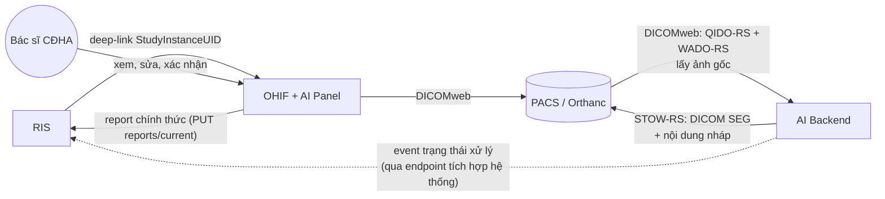
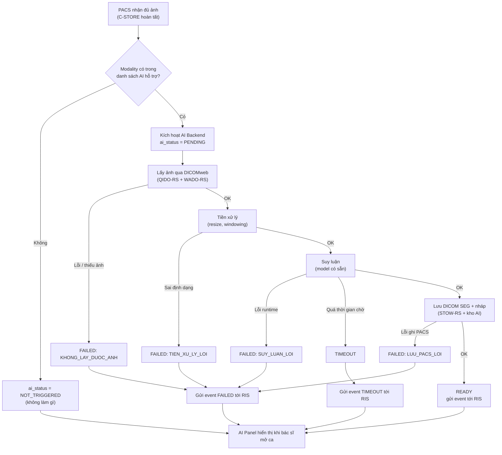

# VR-RIS PACS — Thiết kế AI (không code)

Tài liệu con của `README.md`, mục 6E: [T3→T8] `doc/11-ai-design.md`. Deliverable **IN-21** (nền cho wireframe AI Panel trong Figma) và **IN-22** (chương AI trong báo cáo đồ án). Đây là thiết kế ở **mức tài liệu** — không code AI, không huấn luyện model, không viết API contract PACS ↔ AI thật (những việc đó là **H-04**, xem `01-scope.md` mục 4).

| Phiên bản | 0.1 (nháp — chưa được nhóm xác nhận) |
|---|---|
| Ngày | 2026-11-05 |
| Trạng thái tài liệu | Mọi điểm gắn ❓ là **đề xuất, chờ nhóm xác nhận**. Ba quyết định ở mục 0 đã được nhóm chốt trước khi viết file này — các mục còn lại **thiết kế theo đúng ba quyết định đó**, không mở lại |
| Nguồn | README mục 0, 2.1, 2.2, 2.7, Phần 9 (câu 11–13) · `01-scope.md` IN-21, IN-22, H-04 · `02-erd.md` mục 2 (`report.origin`), mục 4.10, mục 8 · `03-state-machine.md` mục 2.2, 2.5, 2.6 (sửa trong lần này — xem mục 11 dưới) · `06-rbac-matrix.md` · `09-bao-mat-toan-ven-du-lieu.md` mục 2 · `07-pacs-dicom.md` mục 1, 6 · `api/openapi.yaml` (`Report`, `ReportWrite`, `/integration/pacs/study-notifications`) |
| Không đọc được độc lập | Tài liệu này **đọc được độc lập** (README mục 6.0): không hạng mục nào chặn nó, và nó không chặn hạng mục nào ngoài chính nó (IN-21, IN-22) |

---

## 0. Ba quyết định đã chốt — thiết kế dưới đây bám theo, không mở lại

Trả lời cho README Phần 9 câu 11–13. Cách viết: gạch ngang câu hỏi cũ + ✅ quyết định, đúng quy ước đang dùng ở README Phần 9.

1. ~~Model đã có sẵn hay cần huấn luyện?~~ → ✅ **Dùng model có sẵn (pretrained), không huấn luyện trong phạm vi đồ án.** Không có mục "dữ liệu huấn luyện" trong file này. Thay vào đó, mục 1.2 nêu **tiêu chí chọn model có sẵn** và **giả định đầu vào/đầu ra** mà pipeline phải tuân theo bất kể chọn model nào.
2. ~~AI có được phép hiển thị gợi ý chẩn đoán cho bác sĩ không, hay chỉ highlight vùng bất thường?~~ → ✅ **Cả hai**: AI **highlight vùng bất thường** (mask, DICOM SEG — mục 3) **và** đưa **gợi ý chẩn đoán** bằng văn bản nháp (nhãn + mô tả ngắn, mục 3 và 5) cho bác sĩ CĐHA. AI không tự quyết — mọi gợi ý đều đi qua nguyên tắc human-in-the-loop ở mục 4.
3. **AI có làm thay đổi state machine hay không — và làm thay đổi thế nào.** → ✅ **Có, nhưng chỉ ở một trường phụ, không chạm vào 7 trạng thái chính của `study.status`.** Đề xuất cụ thể: thêm cột phụ **`study.ai_status`** (độc lập với `study.status`), mô tả đầy đủ ở mục 2 và 2.6-mới của `03-state-machine.md`. Đây là **thay đổi lớn** cần nhóm xác nhận và cần migration mới (V8+) nếu được chấp nhận — **chưa đưa vào `02-erd.md`**, chỉ là đề xuất ở đây và ở `03-state-machine.md`.

Còn mở (README Phần 9 câu 11, phần "loại ảnh"): xem mục 1.3.

---

## 1. Vị trí AI trong kiến trúc

### 1.1. AI Backend là module thứ 4, không phải phần của RIS hay PACS

Theo README mục 2.1, bốn module là RIS / PACS / OHIF + AI Panel / **AI Backend**. Vị trí tương đối:

| Quan hệ | Đúng | Sai (không được làm) |
|---|---|---|
| AI ↔ ảnh gốc | AI lấy ảnh **từ PACS** qua DICOMweb (QIDO-RS tìm, WADO-RS lấy pixel) — giống cách OHIF lấy ảnh | AI **không** lấy ảnh từ RIS. RIS không lưu, không xử lý ảnh DICOM (nguyên tắc bất biến, README mục 0, ràng buộc R-02) |
| AI ↔ kết quả ảnh (mask) | AI ghi **DICOM SEG** ngược lại **PACS** qua STOW-RS, gắn vào cùng study (mục 3) | AI không gửi ảnh/mask cho RIS, RIS không có chỗ lưu file ảnh |
| AI ↔ RIS (phi ảnh) | AI **không ghi trực tiếp vào bảng của RIS**. Mọi thông tin phi ảnh (điểm tin cậy, nhãn, trạng thái xử lý) đến RIS **qua một endpoint tích hợp hệ thống của RIS** (giống cách `POST /integration/pacs/study-notifications` đã có trong `api/openapi.yaml`), không bao giờ qua ghi DB trực tiếp — xem mục 2 bước 5 và mục 6 | AI không có kết nối thẳng tới MySQL của RIS, không gọi API người dùng (JWT bác sĩ) |
| AI ↔ OHIF | OHIF đọc SEG + nội dung nháp của AI (mục 3) trực tiếp từ nơi AI lưu, hiển thị trong **AI Panel** (mục 5) | AI không gọi OHIF, không "đẩy" gì cho OHIF — OHIF luôn là bên **kéo** dữ liệu khi bác sĩ mở ca |
| AI ↔ bác sĩ | Một chiều: AI đưa gợi ý, bác sĩ xác nhận/sửa/bác bỏ trong OHIF (mục 4) | AI không bao giờ tự lưu báo cáo chính thức vào RIS |

Sơ đồ này cụ thể hoá README mục 2.2 (đã có "PACS -- báo study mới --> AI" và "AI -- DICOM SEG + report nháp --> PACS") — không mâu thuẫn, chỉ thêm chi tiết giao thức (DICOMweb, STOW-RS) và làm rõ đường AI → RIS là một **event trạng thái**, không phải nội dung báo cáo.

### 1.2. Tiêu chí chọn model có sẵn (không huấn luyện)

Vì quyết định 1 ở mục 0 là dùng model có sẵn, tài liệu này không có mục "dữ liệu huấn luyện". Thay vào đó, bất kỳ model nào được chọn (ở giai đoạn sau đồ án, nếu H-04 được làm) phải thoả các tiêu chí sau:

| Tiêu chí | Yêu cầu | Lý do |
|---|---|---|
| Nguồn gốc | Model pretrained công khai (ví dụ các model phân đoạn/phân loại ảnh y tế mở trên MONAI Model Zoo, Grand Challenge, hoặc baseline của bộ dữ liệu công khai đang dùng — TCIA) | Đồ án không huấn luyện; không có hạ tầng GPU/nhãn y tế để train |
| Giấy phép | Cho phép dùng cho mục đích học thuật/nghiên cứu, không thương mại hoá | Đồ án môn học |
| Định dạng đầu vào giả định | Ảnh DICOM một series, grayscale, đã chuẩn hoá kích thước/windowing theo tiền xử lý chuẩn của model (mục 2 bước 3) | Để pipeline tiền xử lý (bước 3) có một mục tiêu rõ ràng, không phụ thuộc model cụ thể |
| Định dạng đầu ra giả định | (a) **mask** theo từng pixel/voxel, có thể đóng gói thành DICOM SEG; (b) **nhãn phân loại** kèm **điểm tin cậy dạng xác suất [0,1]** cho mỗi nhãn | Khớp với mục 3 (DICOM SEG cho mask) và mục 5 (AI Panel hiển thị điểm tin cậy) |
| Suy luận | Chỉ **inference** (forward pass), không fine-tune trong đồ án | Khớp quyết định 1 |
| Thời gian chạy | Chấp nhận được trên CPU của máy demo (không có GPU chuyên dụng trong cụm k8s local) — ❓ ngưỡng cụ thể chưa đo được vì chưa chọn model, xem mục 2 bước 4 |

### 1.3. Loại ảnh AI xử lý (README Phần 9 câu 11 — chưa chốt)

| Phương án | Ưu | Nhược |
|---|---|---|
| **CR (X-quang ngực)** | Ảnh 2D, nhẹ, nhiều model phân loại/phát hiện bất thường ngực có sẵn và phổ biến trong học thuật | Không chứng minh được AI xử lý được series nhiều lát |
| **CT sọ não** | Thường gắn với bài toán phân đoạn (segmentation) rõ ràng hơn, hợp với việc minh hoạ DICOM SEG | Nặng hơn, cần model 3D hoặc xử lý theo lát, khó chạy trên CPU trong thời gian hợp lý |
| **Cả hai** | Minh hoạ pipeline tổng quát (không phụ thuộc modality) | Tốn công thiết kế gấp đôi cho một hạng mục chỉ cần **trình bày** (IN-21, IN-22) |

**Đề xuất (❓ chưa chốt):** chọn theo đúng modality demo của `07-pacs-dicom.md` mục 9 — **CR + CT** (đã đề xuất, cũng chưa chốt) — để pipeline AI không cần một quyết định modality riêng. Vì AI là tài liệu, không code, việc này **không chặn** gì khác; chỉ cần nêu là câu hỏi mở trong báo cáo (01-scope.md mục 3.5).

---

## 2. Pipeline

Từng bước từ lúc ảnh vào PACS đến lúc bác sĩ thấy kết quả. "Hỏng thì sao" ở mỗi bước đều phải không làm treo hoặc sai luồng nghiệp vụ chính của RIS (nguyên tắc: AI là lớp phụ trợ, không phải đường găng).

| # | Bước | Đầu vào | Đầu ra | Thời gian ước tính | Hỏng thì sao |
|---|---|---|---|---|---|
| 1 | **Kích hoạt** | PACS nhận đủ ảnh của một study (C-STORE hoàn tất) có `modality` thuộc danh sách AI hỗ trợ (mục 1.3) | Yêu cầu xử lý được xếp hàng ở AI Backend, có `StudyInstanceUID` | Tức thời (< 1s) | Nếu AI Backend không nhận được yêu cầu (service down) → không event nào được gửi đi; RIS giữ `ai_status = NOT_TRIGGERED` mãi (an toàn: bác sĩ đọc như không có AI) |
| 2 | **Lấy ảnh** | `StudyInstanceUID` | Pixel data + header DICOM của mọi instance trong study (qua QIDO-RS tìm, WADO-RS lấy) | Vài giây (CR) đến vài chục giây (CT nhiều lát) | Orthanc không phản hồi, hoặc ảnh lỗi/thiếu lát → AI gửi event `ai_status = FAILED`, lý do `KHONG_LAY_DUOC_ANH` |
| 3 | **Tiền xử lý** | Pixel data thô | Tensor đã chuẩn hoá (resize, windowing theo modality — mục 1.2) | Vài giây | Ảnh không đúng định dạng/kích thước tối thiểu (ví dụ CT thiếu lát) → `FAILED`, lý do `TIEN_XU_LY_LOI` |
| 4 | **Suy luận** | Tensor chuẩn hoá | Mask (segmentation) + danh sách nhãn kèm điểm tin cậy | ❓ Chưa đo được vì chưa chọn model; đề xuất ngưỡng timeout mặc định **5 phút**/study trên hạ tầng CPU của đồ án, chờ xác nhận | Lỗi runtime (hết bộ nhớ, exception) → `FAILED`, lý do `SUY_LUAN_LOI`. Quá ngưỡng thời gian → `TIMEOUT` (tách riêng khỏi `FAILED` để phân biệt nguyên nhân — xem mục 2.6 mới ở `03-state-machine.md`) |
| 5 | **Lưu kết quả** | Mask + nhãn + điểm tin cậy | (a) DICOM SEG ghi vào PACS qua STOW-RS; (b) nội dung phi ảnh ghi vào kho riêng của AI Backend (mục 3); (c) **một event trạng thái** gửi tới RIS qua endpoint tích hợp hệ thống | Vài giây | Ghi SEG vào PACS lỗi → `FAILED`, lý do `LUU_PACS_LOI`. **Event tới RIS phải được gửi trong mọi trường hợp**, kể cả khi bước 2–4 lỗi — nếu không, RIS kẹt ở `PENDING`. Đề xuất thêm cơ chế phía RIS: nếu `ai_status = PENDING` quá một ngưỡng (❓ ví dụ 10 phút) mà không nhận event nào, RIS tự chuyển `PENDING → TIMEOUT` để không treo UI (không phụ thuộc hoàn toàn vào AI Backend báo đúng) |
| 6 | **Thông báo / hiển thị** | `StudyInstanceUID`, `ai_status` | AI Panel trong OHIF hiển thị theo trạng thái khi bác sĩ mở ca (mục 5) | — | Không có "hỏng" riêng ngoài lỗi mạng chung khi OHIF gọi AI Backend/PACS để lấy nội dung — xử lý như trạng thái lỗi tải (mục 5) |

Nguồn: `doc/diagrams/11-ai-pipeline.mmd`.

---

## 3. Định dạng kết quả

### 3.1. Ảnh — DICOM SEG, lưu ở PACS

- **Mask phân vùng đóng gói thành DICOM SEG** (SOP Class *Segmentation Storage*), ghi vào **PACS** (Orthanc) qua STOW-RS — **không phải RIS** (nguyên tắc bất biến README mục 0, ràng buộc R-02 ở `01-scope.md`).
- **Nối với study gốc:** DICOM SEG tham chiếu `StudyInstanceUID` của study nguồn và `ReferencedSeriesSequence` / `ReferencedInstanceSequence` tới các SOP Instance mà nó phân vùng — đây là cơ chế liên kết chuẩn của DICOM SEG, không cần RIS tham gia.
- **OHIF hiển thị:** OHIF có sẵn khả năng đọc và vẽ overlay cho SOP Class Segmentation (tính năng có sẵn của viewer, **không phải việc nhóm code**) — nhóm chỉ cần: (a) đảm bảo Orthanc trả đúng SEG qua DICOMweb cho OHIF query, (b) thêm **AI Panel** làm nơi bật/tắt overlay và đọc thông tin kèm theo (mục 5). Không vẽ lại viewer OHIF (README mục 6E).
- **RIS lưu gì:** **Chỉ metadata và tham chiếu**, không lưu file ảnh hay mask. Cụ thể (❓ đề xuất, xem mục 0 quyết định 3): cột phụ `study.ai_status` (trạng thái xử lý) — không lưu `SOPInstanceUID` của SEG trong RIS; OHIF tự tìm SEG của một study qua DICOMweb khi mở ca, giống cách nó tìm ảnh gốc. Giữ đúng nguyên tắc "RIS không lưu URL/tham chiếu ảnh thành cột" đã áp dụng cho `study_instance_uid` (`02-erd.md` mục 4.4).

### 3.2. Dữ liệu phi ảnh — điểm tin cậy, nhãn gợi ý, văn bản nháp

Đây là phần **không phải DICOM** (không có chỗ chuẩn trong PACS, trừ khi đóng gói thêm thành DICOM SR — Structured Report, nặng hơn cho một AI Backend tự viết) và **không được phép** nằm trong schema của RIS (`02-erd.md` mục 8 liệt kê rõ "toàn bộ bảng cho AI (mask, feature, report nháp)" là **ngoài phạm vi ERD**).

**Đề xuất (❓ chưa chốt, không tự thêm vào `02-erd.md`):** một kho dữ liệu nhỏ riêng của **AI Backend** (schema/CSDL riêng, không phải MySQL của RIS), với hai bảng ở mức thiết kế:

| Bảng đề xuất | Cột chính | Vai trò |
|---|---|---|
| `ai_analysis` | `id`, `study_instance_uid`, `model_name`, `model_version`, `triggered_at`, `completed_at`, `status` (`PENDING\|READY\|FAILED\|TIMEOUT`), `error_reason` | Một lượt xử lý AI cho một study |
| `ai_finding` | `id`, `analysis_id` (FK), `label`, `confidence` (0–1), `seg_sop_instance_uid` (tham chiếu DICOM SEG tương ứng trong PACS), `draft_technique`, `draft_findings`, `draft_diagnosis`, `draft_conclusion`, `draft_recommendation` | Từng phát hiện/gợi ý cụ thể — nội dung nháp cho 5 trường báo cáo (khớp `report.*`, `02-erd.md`) |

- **OHIF AI Panel** đọc trực tiếp từ kho này (API đọc riêng của AI Backend, theo `StudyInstanceUID`) — không qua RIS.
- **Phương án thay thế đã xét:** đóng gói nội dung nháp vào DICOM SR, lưu cùng PACS. Chuẩn hơn về mặt DICOM nhưng nặng hơn để tự viết (AI Backend phải là một DICOM SR writer). Đề xuất của tài liệu này nghiêng về kho riêng ở trên vì đơn giản hơn cho một pipeline tự viết trong đồ án; ❓ **chưa chốt**, có thể đổi khi chọn model/thư viện AI cụ thể.

### 3.3. ⚠️ Khoảng hở phát hiện khi viết mục này — xem mục 11

`api/openapi.yaml` hiện tại (`ReportWrite`, endpoint `PUT /studies/{studyId}/reports/current`) **không có chỗ** cho OHIF khai báo "nội dung này lấy từ gợi ý AI nào". Nếu không có chỗ đó, backend không thể tự xác định `report.origin` là `AI_DRAFT` hay `AI_DRAFT_EDITED` một cách đáng tin (không thể để client tự khai báo origin — đó là dữ liệu cần kiểm chứng được, không phải tự xưng). Đề xuất và chi tiết: mục 4 và mục 11.

---

## 4. Human-in-the-loop

**Nguyên tắc bất biến (README mục 0):** AI không tự động trả kết quả chính thức. Luôn phải có bác sĩ CĐHA xác nhận.

### 4.1. AI không có chỗ trong chuỗi ký duyệt

- `report.created_by_user_id` và `report.approved_by_user_id` (`02-erd.md`) **luôn luôn là tài khoản người dùng** (`app_user`), không bao giờ là "AI" hay một tài khoản hệ thống. AI không "tạo" báo cáo theo nghĩa ghi vào RIS — AI chỉ chuẩn bị **nội dung nháp nằm ngoài RIS** (mục 3.2); bản ghi `report` trong RIS chỉ xuất hiện khi **bác sĩ đang đọc (`reading_user_id`) lưu nó** qua `PUT /studies/{studyId}/reports/current` — đúng cơ chế đã có, không cần endpoint mới cho AI viết vào `report`.
- Vì vậy: **không có khái niệm "bác sĩ duyệt gợi ý AI"** — bác sĩ duyệt (`APPROVER`) vẫn duyệt **báo cáo của bác sĩ CĐHA**, dù nội dung đó có gốc từ AI hay không. Quy trình duyệt (T6, T7 ở `03-state-machine.md`) **không đổi**.

### 4.2. Bác sĩ làm gì với gợi ý AI — ba lựa chọn, đều tường minh

| Hành động của bác sĩ trong AI Panel | Hệ quả khi lưu báo cáo | `report.origin` |
|---|---|---|
| **Dùng gợi ý này** — chép nguyên nội dung nháp của AI vào form báo cáo, không sửa gì, rồi lưu | Nội dung lưu **khớp hoàn toàn** với nội dung nháp AI đã sinh | `AI_DRAFT` |
| **Sửa trước khi dùng** — mở form đã điền sẵn từ gợi ý AI, sửa ít nhất một trường, rồi lưu | Nội dung lưu **khác** nội dung nháp AI (dù chỉ một ký tự) | `AI_DRAFT_EDITED` |
| **Bỏ qua gợi ý** — đóng khối gợi ý, tự viết từ đầu (form trống), rồi lưu | Không tham chiếu nháp AI nào khi lưu | `MANUAL` |

- **Nút xác nhận là nút "Lưu báo cáo" đã có (IN-10), không có nút "duyệt AI" riêng.** Việc bác sĩ chuyển `READING → READ` (T5, `03-state-machine.md`) **là** hành động xác nhận: có tên người (`reading_user_id`), có audit (`STATUS_CHANGE` + các action AI ở mục 6), không bao giờ tự động.
- **Kết quả chính thức luôn do bác sĩ CĐHA ký** (lưu báo cáo → `FINAL`) và **bác sĩ duyệt ký lần hai** (T7 → `APPROVED`) — không đổi gì ở hai bước này so với luồng không có AI.
- **Dấu vết AI để lại trong báo cáo cuối cùng:** cột `report.origin` (`02-erd.md` đã có 3 giá trị `MANUAL | AI_DRAFT | AI_DRAFT_EDITED`) được giữ **vĩnh viễn trên từng version** — kể cả khi báo cáo bị trả lại hoặc ca được mở lại (`02-erd.md` mục 4.10: mỗi version là một bản ghi riêng, version cũ không bị sửa). Nghĩa là: nhìn vào lịch sử version của một ca, biết được **version nào từng có AI tham gia và mức độ nào** (dùng nguyên hay có sửa).
- **Ai chịu trách nhiệm:** người ký (`created_by_user_id` của version `FINAL`, `approved_by_user_id`) chịu trách nhiệm nghiệp vụ như một báo cáo không có AI — `origin = AI_DRAFT` **không** làm giảm trách nhiệm của bác sĩ đã lưu nó. Đây là lý do pháp lý/đạo đức cần nêu ở mục 8.

---

## 5. AI Panel — mô tả cho Figma (không vẽ lại viewer OHIF)

> Chỉ vẽ: **AI Panel**. Nút "Xem ảnh" và trạng thái "chưa có ảnh" đã mô tả ở README mục 2.7 / 6E, không lặp lại ở đây.

### 5.1. Vị trí

Panel đặt ở **cạnh phải của OHIF**, dạng panel đóng/mở được (tương tự vị trí panel công cụ đo đạc/segmentation có sẵn của OHIF) — **không** che vùng xem ảnh chính. Có thể thu gọn thành một dải hẹp (icon + badge trạng thái) khi bác sĩ muốn xem ảnh toàn màn hình.

### 5.2. Khối thông tin (từ trên xuống)

1. **Tiêu đề + badge trạng thái** — "AI Panel" kèm một chấm màu + nhãn theo `ai_status` (mục 0 quyết định 3, chi tiết ở `03-state-machine.md` mục mới):

   | `ai_status` | Màu đề xuất | Nhãn hiển thị |
   |---|---|---|
   | `NOT_TRIGGERED` | Xám | "Chưa xử lý" |
   | `PENDING` | Vàng, có icon xoay | "Đang phân tích…" |
   | `READY` | Xanh | "Có gợi ý AI" |
   | `FAILED` | Đỏ | "AI lỗi" |
   | `TIMEOUT` | Đỏ nhạt | "AI không phản hồi" |

   Kèm dòng phụ nhỏ: tên + phiên bản model, thời điểm chạy xong (chỉ hiện khi `READY`/`FAILED`/`TIMEOUT`).

2. **Trạng thái rỗng** (`NOT_TRIGGERED`) — dòng chữ: "Chưa có kết quả AI cho ca này." + một dòng lý do ngắn (ví dụ "Loại ảnh này chưa được AI hỗ trợ" khi modality không thuộc danh sách mục 1.3). Không có nút hành động nào khác ngoài việc đọc ảnh như bình thường.

3. **Trạng thái đang chạy** (`PENDING`) — spinner + "Đang phân tích ảnh (ước tính còn vài phút)" + nút phụ "Làm mới" (gọi lại trạng thái, không tự động poll liên tục để tránh phức tạp).

4. **Trạng thái lỗi** (`FAILED` / `TIMEOUT`) — dòng chữ: "AI không trả được kết quả cho ca này." (không hiện mã lỗi kỹ thuật cho bác sĩ) + gợi ý: "Vui lòng đọc ảnh như bình thường." **Không có nút "thử lại" tự động** trong 8 tuần — đây là thiết kế tài liệu, không có AI Backend thật để gọi lại.

5. **Trạng thái sẵn sàng** (`READY`) — bốn khối con, theo đúng thứ tự:

   a. **Khối overlay ảnh**
      - Một công tắc (toggle) **"Hiện vùng AI đánh dấu"** — **mặc định TẮT** (lý do: mục 7, chống tin tưởng mù overlay).
      - Khi bật: hiện mask (DICOM SEG) chồng lên ảnh gốc trong vùng xem chính (OHIF tự vẽ, nhóm không code phần này).
      - Thanh trượt độ trong suốt (0–100%) và chú giải màu theo nhãn, chỉ hiện khi công tắc đang bật.

   b. **Khối gợi ý chẩn đoán**
      - Danh sách các nhãn AI đề xuất, mỗi nhãn kèm **điểm tin cậy hiển thị dạng mức** (Thấp / Trung bình / Cao — không hiện số thập phân thô, ❓ đề xuất, tránh gây cảm giác chính xác giả — xem mục 7) và một thanh mức trực quan.
      - Văn bản nháp cho các trường báo cáo tương ứng (kỹ thuật, mô tả, chẩn đoán, kết luận, khuyến nghị) hiển thị dạng xem trước (không phải ô nhập — ô nhập là form báo cáo chính, không thuộc AI Panel).

   c. **Dòng cảnh báo cố định (không thể ẩn)**
      - *"Đây là gợi ý do AI sinh ra, không phải chẩn đoán chính thức. AI chỉ đánh dấu một số vùng nghi ngờ, không thay thế việc đọc toàn bộ ảnh. Bác sĩ chịu trách nhiệm xác nhận."*

   d. **Khối hành động** — ba nút, đúng ba lựa chọn ở mục 4.2:
      - **"Dùng gợi ý này"** → chép nguyên nội dung nháp vào form báo cáo chính (chưa lưu).
      - **"Sửa trước khi dùng"** → mở form báo cáo đã điền sẵn, con trỏ ở ô đầu tiên.
      - **"Bỏ qua gợi ý"** → đóng khối b và c, giữ form báo cáo trống; ghi lại là một lựa chọn tường minh (mục 6), không phải im lặng bỏ qua.
      - **Không có nút "Lưu" trong AI Panel.** Lưu luôn là hành động trên form báo cáo chính (màn hình đã có — `ReportModal`), để `report.origin` được tính đúng lúc lưu (mục 4.2, mục 11).

6. **Mở từ đâu:** khi bác sĩ bấm "Xem ảnh" (IN-23) và `ai_status = READY`, AI Panel **tự mở ở trạng thái thu gọn, hiện badge trạng thái** nhưng khối gợi ý chẩn đoán (5.b) **không tự bung ra** — bác sĩ phải bấm mở khối đó. Đây khác với bật overlay (5.a, mặc định tắt): panel có thể hiện "có gợi ý" ngay, nhưng nội dung gợi ý cụ thể cần một thao tác chủ động để xem (mục 7).

### 5.3. Trạng thái khi mở lại ca đã duyệt (T9)

Khi ca được mở lại (`APPROVED → READING`, tạo version báo cáo mới — `02-erd.md` mục 4.10), AI Panel **mặc định không tự hiện lại gợi ý AI của lượt trước** (ảnh không đổi nên kết quả AI cũ vẫn hợp lệ, nhưng tự động hiện lại dễ khiến bác sĩ chỉ nhìn lại gợi ý cũ mà không đọc lại ảnh — mục 7). Thay vào đó hiện một dòng: *"Ca này đã có gợi ý AI từ lượt đọc trước"* + nút **"Xem lại gợi ý AI"** (phải bấm mới hiện).

---

## 6. Audit log cho thao tác AI

Dùng lại đúng cấu trúc `audit_log` đã có ở `02-erd.md` và đặc tả ở `09-bao-mat-toan-ven-du-lieu.md` mục 2 — **không đặt kiểu log riêng cho AI**.

### 6.1. Giá trị `action` mới cần thêm (❓ đề xuất)

| `action` | Khi nào ghi | `actor_user_id` | `patient_id` | `after_value` gợi ý |
|---|---|---|---|---|
| `AI_TRIGGERED` | RIS nhận event "AI bắt đầu xử lý" cho một study | `NULL` (hệ thống) | Có (bệnh nhân của study) | `{study_instance_uid, model_name, model_version}` |
| `AI_RESULT_READY` | RIS nhận event `ai_status → READY` | `NULL` | Có | `{study_instance_uid, model_version, so_nhan_de_xuat}` |
| `AI_RESULT_FAILED` | RIS nhận event `ai_status → FAILED` hoặc `TIMEOUT`, hoặc RIS tự chuyển `TIMEOUT` do không nhận event (mục 2 bước 5) | `NULL` | Có | `{study_instance_uid, ai_status, error_reason}` |
| `AI_SUGGESTION_VIEWED` | Bác sĩ mở khối gợi ý chẩn đoán (5.b) trong AI Panel | Bác sĩ đang đọc | Có | `{study_instance_uid}` |
| `AI_SUGGESTION_ACCEPTED` | Bác sĩ lưu báo cáo với `origin = AI_DRAFT` (mục 4.2) | Bác sĩ đang đọc | Có | `{study_instance_uid, report_id, version}` |
| `AI_SUGGESTION_EDITED` | Bác sĩ lưu báo cáo với `origin = AI_DRAFT_EDITED` | Bác sĩ đang đọc | Có | Như trên |
| `AI_SUGGESTION_REJECTED` | Bác sĩ bấm "Bỏ qua gợi ý" (5.d) rồi lưu báo cáo với `origin = MANUAL` **trong khi `ai_status = READY`** (phân biệt với ca không có AI chạy, vốn không cần ghi gì vì không có gợi ý nào để bác bỏ) | Bác sĩ đang đọc | Có | `{study_instance_uid, report_id, version}` |

### 6.2. Ghi chú đi kèm — cùng vướng mắc đã biết

- Đây là **thêm giá trị `action`**, cùng dạng vướng mắc đã ghi ở `02-erd.md` mục 4.11 (`VIEW_IMAGE`) và `09-bao-mat-toan-ven-du-lieu.md` mục 2.2/2.6: cột `audit_log.action` không có `CHECK`/`ENUM`, chỉ là `VARCHAR(20)` có **comment**; thêm giá trị mới là **sửa comment**, không phải sửa kiểu dữ liệu — nhưng vẫn cần một migration mới (V8+) nếu nhóm muốn comment khớp thực tế, hoặc chấp nhận coi tài liệu là chuẩn và comment DB lệch tạm thời. `09-…` mục 2.6 đã đề xuất **gộp mọi lần thêm giá trị `action` vào một migration**, nên 7 giá trị AI ở trên nên gộp cùng `ACCESS_DENIED` và `VIEW_IMAGE` nếu chưa làm, không tách lẻ.
- `AI_TRIGGERED` / `AI_RESULT_READY` / `AI_RESULT_FAILED` có `actor_user_id = NULL` — đúng quy ước "hệ thống" đã dùng cho các hành vi tự động khác (`02-erd.md` mục 2.1 bảng trường bắt buộc; liên hệ câu hỏi "tài khoản `system`" ở `03-state-machine.md` mục 2.7 điểm 3).
- **Không ghi `before_value`/`after_value` chứa nội dung nháp đầy đủ của AI** (mô tả/chẩn đoán) vào `audit_log` — chỉ ghi tham chiếu (`study_instance_uid`, số lượng nhãn, phiên bản model). Nội dung nháp đầy đủ nằm ở kho riêng của AI Backend (mục 3.2); khi bác sĩ **lưu** báo cáo, nội dung đầy đủ đã nằm trong `report.*` và được ghi vào `audit_log` theo đúng action `CREATE`/`UPDATE` sẵn có — không trùng lặp.

---

## 7. Rủi ro automation bias

| Rủi ro | Biểu hiện | Biện pháp giảm (giao diện / quy trình) |
|---|---|---|
| **Tin AI quá mức** — bác sĩ chấp nhận gợi ý mà không tự đọc kỹ ảnh | Tỷ lệ `AI_SUGGESTION_ACCEPTED` cao bất thường, thời gian mở ca tới lúc lưu báo cáo rất ngắn | (1) Overlay mask **mặc định tắt** (mục 5.2.5.a) — bác sĩ phải tự bật, buộc phải nhìn ảnh gốc "sạch" trước. (2) Khối gợi ý chẩn đoán **không tự bung** khi mở ca (mục 5.3) — phải bấm mới thấy. (3) Câu chữ dùng "**gợi ý**", không dùng "chẩn đoán AI" hay "kết quả AI" ở bất cứ đâu trong panel (tránh ngôn ngữ quyết đoán). (4) ❓ **Đề xuất mạnh, cần bác sĩ CĐHA góp ý trước khi chốt:** ẩn khối gợi ý chẩn đoán cho tới khi bác sĩ đã tương tác với ảnh gốc (cuộn/zoom tối thiểu, hoặc bấm "Tôi đã xem ảnh gốc") — có thể làm chậm luồng đọc nếu áp dụng cứng, nên cân nhắc mức độ |
| **Bỏ qua vùng AI không đánh dấu** — bác sĩ coi "AI không đánh dấu gì" nghĩa là "không có bất thường" | Case có tổn thương ở vùng ngoài mask AI bị đọc sót | Dòng cảnh báo cố định không thể ẩn (mục 5.2.5.c) nói rõ: *"AI chỉ đánh dấu một số vùng nghi ngờ, không thay thế việc đọc toàn bộ ảnh."* Không dùng overlay để "tô xám" hoặc làm mờ phần còn lại của ảnh — mask chỉ highlight, không bao giờ che hoặc làm nổi bật kiểu loại trừ phần khác |
| **Kém tập trung khi đọc lại** — ở lượt đọc thứ hai (ca bị trả lại, hoặc mở lại sau duyệt), bác sĩ chỉ nhìn lại gợi ý AI cũ thay vì đọc lại ảnh | Version báo cáo mới giữ gần như nguyên văn version cũ dù đã có yêu cầu sửa | Khi trả lại (T8) hoặc mở lại (T9), AI Panel **không tự hiện gợi ý cũ** (mục 5.3) — phải bấm "Xem lại gợi ý AI" một cách chủ động. Lý do trả lại (`study_status_history.reason`, bắt buộc ở T8/T9) hiển thị nổi bật cạnh form báo cáo mới để bác sĩ biết chỗ cần đọc lại kỹ |
| **Điểm tin cậy gây cảm giác chính xác giả** | Một số thập phân (ví dụ "87.3%") khiến bác sĩ coi là số đo khách quan, trong khi model không được đánh giá/hiệu chỉnh trong đồ án | Hiển thị theo **mức** (Thấp/Trung bình/Cao), không hiện số thập phân thô (mục 5.2.5.b) — ❓ đề xuất, đổi được nếu nhóm muốn minh bạch số thật kèm chú thích rõ "chưa được hiệu chỉnh/đánh giá" |

---

## 8. Pháp lý và đạo đức — chỉ nêu vấn đề

> Theo `01-scope.md` mục 5 (OUT) và README Phần 9 câu 19: pháp lý/kiểm định thiết bị y tế **ngoài phạm vi đồ án**. Mục này chỉ **nêu câu hỏi**, không kết luận, để đưa vào chương AI của báo cáo (IN-22).

- **Thiết bị y tế phải kiểm định.** Nhiều khung pháp lý (ví dụ FDA SaMD — Software as a Medical Device ở Mỹ, EU MDR ở châu Âu) coi phần mềm hỗ trợ chẩn đoán bằng AI là thiết bị y tế cần kiểm định trước khi dùng trên bệnh nhân thật. Việt Nam cũng đang xây dựng khung quản lý cho phần mềm/AI y tế — ❓ chưa có căn cứ cụ thể để trích dẫn trong tài liệu này; nêu như hướng cần tìm hiểu nếu dự án đi tiếp.
- **Trách nhiệm khi AI sai.** Nếu một gợi ý AI sai và bác sĩ chấp nhận theo (`AI_SUGGESTION_ACCEPTED`) dẫn tới chẩn đoán sai, câu hỏi "ai chịu trách nhiệm — bác sĩ ký tên, đơn vị vận hành AI, hay đơn vị cung cấp model" không có câu trả lời thiết kế được — đây là câu hỏi pháp lý/đạo đức, không phải câu hỏi kỹ thuật. Thiết kế ở mục 4 chỉ đảm bảo **có dấu vết** (`report.origin`, audit log) để truy vết được, không đảm bảo **phân định trách nhiệm**.
- **Dữ liệu bệnh nhân rời khỏi bệnh viện hay không.** Trong thiết kế này, AI Backend chạy **trong cùng cụm Kubernetes local**, không gửi ảnh ra ngoài (khớp nguyên tắc bất biến README mục 0: OHIF/Orthanc không mở công khai). Nếu dự án đi tiếp và dùng dịch vụ AI chạy ngoài (cloud), câu hỏi này trở nên nghiêm trọng hơn — ❓ ngoài phạm vi thiết kế hiện tại.
- **Minh bạch với bệnh nhân.** Bệnh nhân có được biết báo cáo của mình có phần do AI hỗ trợ không? Thiết kế hiện tại lưu được thông tin này (`report.origin`) nhưng **không có** màn hình nào hiển thị điều đó cho bệnh nhân — đồ án không có cổng bệnh nhân. ❓ Nêu như câu hỏi mở, không giải quyết.

---

## 9. Đánh giá chất lượng — chỉ số dự kiến, không đo được trong đồ án

Vì quyết định 1 (mục 0) là không huấn luyện và không có ground truth y tế đã gán nhãn, **không đo được** các chỉ số dưới đây trong 8 tuần. Liệt kê để dùng nếu dự án đi tiếp (H-04):

| Chỉ số | Đo gì | Áp dụng cho |
|---|---|---|
| Độ nhạy (Sensitivity/Recall) | Tỷ lệ ca có bất thường thật được AI phát hiện đúng | Phân loại/phát hiện bất thường |
| Độ đặc hiệu (Specificity) | Tỷ lệ ca không có bất thường được AI báo đúng là "không có" | Phân loại/phát hiện bất thường |
| Precision | Trong các ca AI báo "có bất thường", bao nhiêu đúng | Phân loại/phát hiện bất thường |
| Dice score / IoU | Mức trùng khớp giữa mask AI và mask bác sĩ vẽ tay (ground truth) | Phân đoạn (DICOM SEG) |
| FROC (Free-Response ROC) | Số lượng/độ chính xác vị trí phát hiện trên mỗi ảnh, đánh đổi với số báo động giả | Phát hiện tổn thương theo vị trí |
| AUC-ROC | Khả năng phân biệt có/không bất thường tổng thể | Phân loại |
| Hệ số đồng thuận (ví dụ Cohen's kappa) giữa AI và bác sĩ theo thời gian | Theo dõi mức độ bác sĩ đồng ý/sửa/bác bỏ gợi ý AI (dùng chính dữ liệu `report.origin` + audit log AI ở mục 6 nếu hệ thống chạy thật) | Theo dõi automation bias dài hạn, không phải chất lượng model |
| Hiệu chỉnh (calibration) | Điểm tin cậy AI báo có khớp tần suất đúng thực tế không (ví dụ nhãn "tin cậy cao" có thật sự đúng nhiều hơn nhãn "tin cậy thấp") | Toàn bộ điểm tin cậy hiển thị ở AI Panel (mục 5) |

**Trong đồ án:** không đo được vì (a) không huấn luyện/đánh giá model, (b) không có bộ dữ liệu đã gán nhãn y tế đáng tin, (c) không có đủ lượt sử dụng thật để tính hệ số đồng thuận. Ghi vào báo cáo (IN-22) như hướng phát triển, không phải kết quả đã đo.

---

## 10. Hai sơ đồ

| File | Nội dung | Nguồn |
|---|---|---|
| `doc/diagrams/11-ai-pipeline.mmd` | Pipeline 6 bước (mục 2), có nhánh lỗi (`FAILED`/`TIMEOUT`) hội tụ về AI Panel | Nhúng ở mục 2 trên |
| `doc/diagrams/11-ai-state-machine.mmd` | State machine `study.status` (không đổi) đặt cạnh state machine phụ `study.ai_status` (đề xuất mới), phân biệt rõ bằng ghi chú "đã có — không đổi" / "AI thêm vào — H-04" | Mô tả ở `03-state-machine.md` mục 2.6 (sửa trong lần này — xem mục 11 dưới) |

Cả hai đã xuất `.png` cùng tên — xem báo cáo cuối của phiên làm việc này (README mục 11).

---

## 11. Điều kiện hoàn thành

- [ ] Nhóm xác nhận ba quyết định ở mục 0 vẫn đúng ý (tài liệu này chỉ triển khai theo, không tự đặt ra).
- [ ] Nhóm xác nhận đề xuất `study.ai_status` (mục 0 quyết định 3) — nếu đồng ý, cần migration V8+ ở `02-erd.md`/`database/migrations/` (ngoài phạm vi file này) và cập nhật `03-state-machine.md` chính thức (đã sửa nháp trong lần này).
- [ ] Nhóm xác nhận loại ảnh AI xử lý (mục 1.3) — hiện để ❓, đề xuất CR + CT theo `07-pacs-dicom.md`.
- [ ] Nhóm xác nhận kho dữ liệu phi ảnh của AI (mục 3.2) là bảng riêng của AI Backend, không đưa vào `02-erd.md`.
- [ ] Nhóm xác nhận cần thêm trường tham chiếu AI vào `ReportWrite`/`PUT /studies/{studyId}/reports/current` (mục 11, lỗ hổng phát hiện ở mục 3.3) — việc sửa `api/openapi.yaml` thuộc người phụ trách file đó, không sửa trong lần này.
- [ ] Wireframe Figma AI Panel dựng từ mục 5 (IN-21) — chưa làm, thuộc công việc Figma (README mục 6E).
- [ ] Chương AI trong báo cáo (IN-22, tuần 8) tổng hợp từ toàn bộ file này.

## 12. Câu hỏi còn mở

1. Loại ảnh AI xử lý (mục 1.3) — README Phần 9 câu 11.
2. Phương án lưu dữ liệu phi ảnh của AI: kho riêng (đề xuất) hay DICOM SR (mục 3.2) — ❓.
3. Ngưỡng timeout của bước suy luận (mục 2 bước 4) — đề xuất 5 phút, chưa đo được vì chưa chọn model.
4. Ngưỡng RIS tự chuyển `PENDING → TIMEOUT` khi không nhận được event (mục 2 bước 5) — đề xuất 10 phút, chưa chốt.
5. Có hiện điểm tin cậy dạng số thập phân hay chỉ dạng mức (mục 5.2.5.b, mục 7) — ❓.
6. Có bắt bác sĩ tương tác với ảnh gốc trước khi mở khối gợi ý chẩn đoán không (mục 7, đề xuất mạnh nhưng có đánh đổi UX) — ❓, cần ý kiến bác sĩ CĐHA.
7. Trường tham chiếu AI trong `ReportWrite` (mục 3.3, mục 11) — tên trường, cơ chế server so khớp nội dung để tự xác định `origin` — ❓, thuộc phạm vi sửa `api/openapi.yaml`, không sửa trong lần này.
8. Mọi câu hỏi pháp lý/đạo đức ở mục 8 — nêu, không giải quyết, đúng phạm vi đồ án.

## 13. Phát hiện mâu thuẫn và đã sửa

1. **`03-state-machine.md` mục 2.6 (bản trước khi sửa) tự mâu thuẫn.** Câu "AI Backend không ghi trực tiếp vào RIS... nháp đi qua PACS/OHIF" đứng ngay sau câu "AI chỉ tạo báo cáo nháp (`report.origin = AI_DRAFT`, `status = DRAFT`)" — câu sau đọc như thể AI **tự ghi** một bản ghi `report` (bảng của RIS) với `origin = AI_DRAFT`, trái với chính nguyên tắc "không ghi trực tiếp vào RIS" nêu trước đó một dòng. **Đã sửa** (xem `03-state-machine.md` mục 2.6 mới): làm rõ rằng bản ghi `report` trong RIS **chỉ được tạo khi bác sĩ lưu** (qua `PUT /studies/{studyId}/reports/current` đã có), và `origin` được server tính tại thời điểm lưu dựa trên việc nội dung có khớp nguyên văn gợi ý AI hay không (mục 4.2 ở file này) — không phải AI tự đặt giá trị `origin`.
2. **`api/openapi.yaml` thiếu chỗ cho nguồn gốc nội dung AI.** `ReportWrite` (body của `PUT /studies/{studyId}/reports/current`) không có trường nào để OHIF khai báo nội dung lấy từ gợi ý AI nào, trong khi `Report` (response) đã có `origin`. Không có trường này, backend không có cách đáng tin để phân biệt `AI_DRAFT` / `AI_DRAFT_EDITED` / `MANUAL`. **Chưa sửa** `api/openapi.yaml` trong lần này (ngoài phạm vi file được giao ở nhiệm vụ này) — ghi vào mục 12 câu 7 và báo cho người phụ trách `api/openapi.yaml`.
3. **`02-erd.md` mục 8 và README mục 6E đã có chủ đích loại AI ra khỏi ERD** ("toàn bộ bảng cho AI (mask, feature, report nháp)" ngoài phạm vi ERD) — tài liệu này **tuân theo đúng ranh giới đó**: mọi bảng AI ở mục 3.2 là **đề xuất ở mức thiết kế**, không thêm vào `02-erd.md`.
