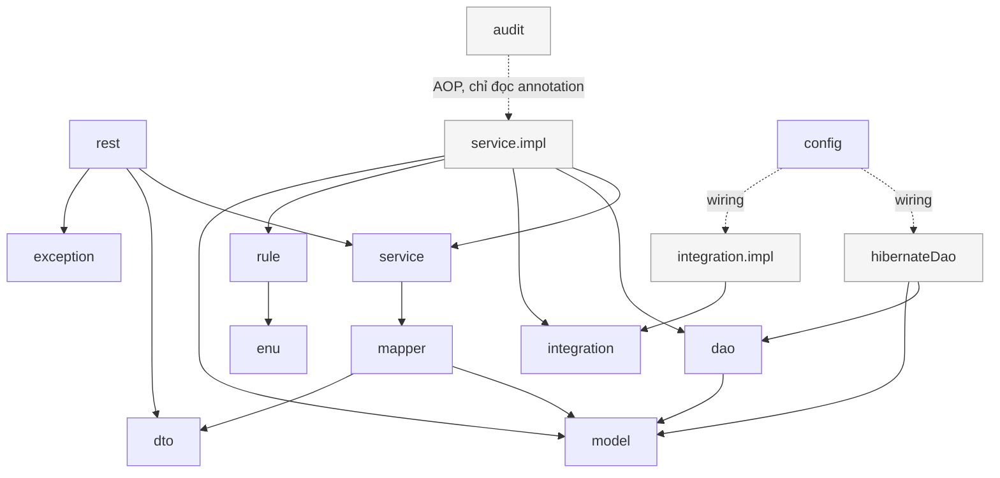

# VR-RIS PACS — Kiến trúc phân tầng backend (R-05)

Tài liệu con của README.md, mục 6B. Trả lời ràng buộc **R-05** (`01-scope.md` mục 7): backend theo kiến trúc phân tầng, package-by-layer, hướng phụ thuộc một chiều, kiểm tra tự động bằng ArchUnit — vi phạm làm build đỏ.

| Phiên bản | 0.1 (nháp — chờ nhóm xác nhận) |
|---|---|
| Ngày | 2026-11-05 |
| Tài liệu liên quan | `01-scope.md` (R-05, IN-24), `02-erd.md` (tên bảng/cột — nguồn duy nhất cho schema), README mục 0 (nguyên tắc bất biến), mục 6B, mục 7, mục 8 |
| Điều kiện lên v1.0 | Nhóm xác nhận các ô ❓/💡 ở mục 12 và kế hoạch refactor code hiện có ở mục 1 |

> **Quy ước:** tài liệu này là **nguồn duy nhất** cho kiến trúc backend (cây package, luật tầng, quy ước đặt tên). File khác chỉ tham chiếu, không chép lại — khớp "Quy tắc tránh nhân bản" ở README mục 6.0.

---

## 0. Vì sao có tài liệu này

README mục 7.2 (tuần 3) đã có việc "Khởi tạo Spring Boot + React + MySQL". Tài liệu này trả lời **backend tổ chức code theo quy tắc nào** trước khi viết tính năng đầu tiên, để không phải dọn lại giữa tuần 5–6 khi số lượng entity tăng lên (patient, imaging_order, study, report…).

---

## 1. ✅ Hiện trạng code (sau refactor 2026-11-05)

`Backend/` đã được refactor sang kiến trúc ở tài liệu này, theo đúng cây package mục 3. Vẫn **chưa commit vào git** (working tree) — xem README mục 11 để biết lúc nào commit.

- 3 endpoint `GET /departments`, `GET /devices`, `GET /service-items` (tag `reference-data`) đã chuyển tu package-by-feature cu sang package-by-layer: `rest/`, `service/`, `service/impl/`, `dao/`, `hibernateDao/`, `model/`, `dto/response/`, `mapper/`, `enu/`, `exception/` (đổi tên từ `common/`).
- DAO tu viet bang EntityManager + JPA Criteria API (`BaseDao`/`AbstractHibernateDao`), **khong** con Spring Data JPA repository nao (`DepartmentRepository`/`DeviceRepository`/`ServiceItemRepository` cu da xoa) — kiem boi ArchUnit L9 (muc 5).
- Them moi (chua co tinh nang nghiep vu nao dung toi, la khung cho Pha sau): `rule/` (`AgeCalculator`, `StudyStateMachine` + unit test), `integration/` + `integration/impl/` (`HisGateway`, `JsonFileHisGateway`), `audit/` (`Audited`, `AuditLogAspect` — dong bo, xem muc 10), `security/` (JWT khung + `SecurityConfig`), `model/AuditLog` + `dao/AuditLogDao` + `hibernateDao/AuditLogDaoImpl`.
- `pom.xml` them: ArchUnit (test), MapStruct (+ `mapstruct-processor` qua `annotationProcessorPaths`), Testcontainers MySQL + JUnit 5 (test), Flyway (test, tro vao `database/migrations` qua `filesystem:` location, chi chay toi V6 — khong seed V7 trong test), Spring Security + `spring-boot-starter-aop`, `jjwt` 0.11.5. **Bo H2.**
- **`mvn verify` XANH: 35/35 test, BUILD SUCCESS** (12 ArchUnit + 2 DAO/Testcontainers + 9 API/MockMvc + 12 unit test `rule/`). 3 vấn đề gặp phải lúc chạy và cách sửa — xem lịch sử thay đổi mục 13: (1) ArchUnit API dùng sai ở L6 (`@Transactional` là annotation cấp METHOD, phải dùng `methods()` không phải `classes()`); (2) Testcontainers 1.20.1 không nhận Docker Desktop 29.x (`BadRequestException` khi gọi `/info` qua named pipe) — nâng `testcontainers-bom` lên 1.21.4; (3) dùng `@Container`/`@Testcontainers` khiến container MySQL bị **dừng sau mỗi test class** (JUnit5 extension không biết các class khác đang dùng chung field `static`) → đổi sang mẫu "singleton container" chính thức của Testcontainers (tự `start()` trong static block, không `stop()`); (4) `@PreAuthorize` ném `AuthorizationDeniedException` bị `@RestControllerAdvice` (tầng MVC) bắt trước khi tới được `ExceptionTranslationFilter`/`RestAccessDeniedHandler` (tầng Security filter) → thêm `@ExceptionHandler(AccessDeniedException.class)` ngay trong `GlobalExceptionHandler`.
- Base package: **`com.vrris.pacs`** (khong doi).

**Chua lam trong lan refactor nay** (ghi lai de khong lam trung o Pha sau): dung `ProblemDetail` thay `ApiError` (muc 12 — van giu `ApiError` de khong pha `doc/api/openapi.yaml`); patient/imaging_order/study/report (chua co tinh nang nao dung `rule/`, `integration/`, `audit/` — moi thu moi la khung); RBAC day du tra DB `app_user/role/user_role` (JWT hien chi doc claim `roles` tho trong token).

---

## 2. Mô hình tầng

```
HTTP request
   │
   ▼
rest/            (Controller — nhận request, gọi service, trả DTO)
   │  dto/request, dto/response (đi qua, không chứa logic)
   ▼
service/         (interface — khai báo nghiệp vụ)
service/impl/    (triển khai — điều phối dao + integration + rule, @Transactional)
   │
   ├──▶ rule/          (logic nghiệp vụ thuần Java, không phụ thuộc framework)
   ├──▶ integration/   (interface gọi hệ thống ngoài: HIS)
   │
   ▼
dao/             (interface — CRUD + truy vấn)
hibernateDao/    (triển khai bằng Hibernate, Criteria API)
   │
   ▼
model/           (JPA entity)
   │
   ▼
MySQL (qua Flyway migration — database/migrations/)
```

`mapper/` cắt ngang giữa `rest` và `service`: chuyển `model` (lấy từ `service`) sang `dto` để `rest` trả về, và ngược lại khi nhận request. `rest` không bao giờ thấy `model` trực tiếp.

---

## 3. Cây package

```
src/main/java/com/vrris/pacs/
  config/          Cấu hình Spring, @ConfigurationProperties, OpenAPI, CORS
  security/        JWT filter, UserDetailsService, cấu hình RBAC (IN-13, IN-14)
  rest/            XxxController
  dto/request/     XxxRequest
  dto/response/    XxxResponse
  mapper/          XxxMapper (MapStruct): model <-> dto
  service/         Interface XxxService
  service/impl/    XxxServiceImpl — nơi DUY NHẤT đặt @Transactional
  dao/             Interface XxxDao (+ BaseDao<T,ID>)
  hibernateDao/    XxxDaoImpl (+ AbstractHibernateDao<T,ID>)
  model/           JPA entity
  enu/             Enum (StudyStatus, DobPrecision, Modality, ...)
  exception/       Exception nghiệp vụ + @RestControllerAdvice (ProblemDetail RFC 7807)
  rule/            Logic nghiệp vụ thuần Java: StudyStateMachine, AgeCalculator, IdentityReconciler
  audit/           AOP ghi audit_log — xem mục 10 (vị trí đề xuất, chưa chốt)
  integration/     Interface HisGateway, PacsGateway
  integration/impl/ JsonFileHisGateway (giả lập đọc file JSON); sau này Hl7HisGateway (H-03)
  RisBackendApplication.java
src/main/resources/db/migration/   (không commit — Flyway migration thật nằm ở database/migrations/.
                                     Dev local: backend chạy với flyway.enabled=false (application.yml
                                     hiện có), database/docker-compose.yml chạy migration. Từ 2026-11-05,
                                     thêm profile "k8s" (application-k8s.yml) cho triển khai k8s — nơi
                                     KHÔNG có container flyway riêng như docker-compose: backend tự chạy
                                     Flyway, đọc đúng thư mục này nhưng được maven-resources-plugin COPY
                                     vào target/classes/db/migration lúc build (không tạo file tĩnh trong
                                     src/), vẫn giữ database/migrations/ là nguồn duy nhất. Xem
                                     doc/14-devops-trien-khai.md mục 5)
```

> **Khác với yêu cầu gốc:** cây package gốc chỉ liệt kê `rule/` và `integration/` là 2 package mới. Tài liệu này thêm **`audit/`** làm nơi đặt AOP ghi audit log (mục 10) — đây là **đề xuất** (💡), chưa phải quyết định đã duyệt, cần nhóm xác nhận (mục 12).
>
> **Khác với Flyway thật:** `database/migrations/V1…V7` đã tồn tại và được README/02-erd.md xác nhận là migration thật, chạy qua `database/docker-compose.yml`. `application.yml` hiện có đặt `spring.flyway.enabled=false` để tránh chạy trùng. Mục "Skeleton" ở Pha 2 **không** tạo `src/main/resources/db/migration/V1` mới — chỉ map JPA entity vào bảng đã có, đúng như `Department.java` hiện tại đang làm (`@Table(name = "department")`, comment "KHÔNG đổi tên cột/thêm cột ở đây").

Ghi chú `rule/`: không import Spring, Hibernate, `model`, `dao`, `service`; nhận đầu vào là kiểu nguyên thủy hoặc record định nghĩa riêng trong `rule/`, `service` chịu trách nhiệm map từ `model` sang. Đây là chỗ chặn lỗi "Tuổi 0" (README 2.5) và kiểm soát chuyển trạng thái (README Phần 4).

---

## 4. Sơ đồ hướng phụ thuộc

Sơ đồ nguồn: `diagrams/15-kien-truc-backend.mmd`.



**Đọc sơ đồ:** mũi tên liền = phụ thuộc bình thường (import). Mũi tên đứt = wiring/AOP (Spring tự nối lúc runtime, không phải import trực tiếp trong code nghiệp vụ). Không có mũi tên đi ngược từ `model`/`dao`/`hibernateDao` lên `service`/`rest` — đây là luật ArchUnit kiểm tra (mục 5).

---

## 5. Luật ArchUnit (mỗi dòng = một test)

| # | Luật |
|---|---|
| L1 | `rest` chỉ phụ thuộc `service`, `dto`, `exception`; không import `dao`, `hibernateDao`, `model` |
| L2 | `dto` không import `model` |
| L3 | `service` (kể cả `service.impl`) chỉ dùng **interface** của `dao`/`integration`; không import `hibernateDao`, `integration.impl` |
| L4 | Không package nào ngoài `hibernateDao` (và wiring trong `config`) phụ thuộc `hibernateDao` |
| L5 | `rule` chỉ được phụ thuộc `enu` và JDK — không Spring, không Hibernate, không `model`/`dao`/`service` |
| L6 | `@Transactional` chỉ xuất hiện trong `service.impl` |
| L7 | Không có cycle giữa các package |
| L8 | Tên lớp đúng quy ước: `Controller` nằm trong `rest`; `*ServiceImpl` nằm trong `service.impl`; `*DaoImpl` nằm trong `hibernateDao` (mục 6) |
| L9 | Không class nào implement interface `org.springframework.data.repository.Repository` — tức không dùng Spring Data JPA (R-05 quyết định 2). Thêm khi code hoá, không có trong 8 luật được duyệt ban đầu |

Test ArchUnit đặt ở `src/test/java/.../architecture/LayeredArchitectureTest.java`, chạy cùng `mvn verify` (không tách profile riêng) — vi phạm làm `mvn verify` đỏ, đúng yêu cầu R-05. L6 kiểm ở **method** (`@Transactional` của Spring luôn đặt trên method, không đặt trên class) — dùng `ArchRuleDefinition.methods()`, không dùng `classes()`.

---

## 6. Quy ước đặt tên

| Thành phần | Quy ước |
|---|---|
| Controller | `<Feature>REST`, trong `rest/` |
| Request DTO | `<Feature>Request`, trong `dto/request/` |
| Response DTO | `<Feature>Response`, trong `dto/response/` |
| Mapper | `<Feature>Mapper` (interface MapStruct), trong `mapper/` |
| Service interface | `<Feature>Service`, trong `service/` |
| Service impl | `<Feature>ServiceImpl`, trong `service/impl/` |
| DAO interface | `<Feature>Dao`, trong `dao/` |
| DAO impl | `<Feature>DaoImpl`, trong `hibernateDao/` |
| Entity | `<Feature>` (không hậu tố), trong `model/` |
| Exception nghiệp vụ | `<Ý nghĩa>Exception`, trong `exception/` |

---

## 7. Quy ước khác

1. Không lộ entity ra REST; dùng DTO + MapStruct.
2. Validation hai lớp: Bean Validation ở `rest` (định dạng), quy tắc nghiệp vụ ở `rule`/`service` (ví dụ chặn chuyển `READ` → `UNREAD`).
3. Lỗi thống nhất: `@RestControllerAdvice` + `ProblemDetail` (RFC 7807); exception nghiệp vụ riêng, không ném `RuntimeException` chung. *(Backend hiện có đã có `GlobalExceptionHandler` + `ApiError` theo schema "Error" của `doc/api/openapi.yaml`, **không** dùng `ProblemDetail` — xem mục 1 và mục 12 để chốt giữ cái nào.)*
4. RBAC chặn ở tầng API/service bằng `@PreAuthorize`, không chỉ ẩn nút bên React.
5. Audit log ghi ở tầng service (AOP), không rải trong controller — vị trí đề xuất ở mục 10.
6. Cấu hình qua `@ConfigurationProperties`, không rải `@Value`.
7. Frontend tách tầng (**chỉ ghi nhận ở đây, chưa dựng skeleton trong lần này**): `src/features/<ten>/{api,hooks,components,pages}` và `src/shared`; component không gọi Axios/`fetch` trực tiếp, chỉ qua hook; kiểu DTO sinh từ OpenAPI (`doc/api/openapi.yaml`).

---

## 8. Định nghĩa "xong" cho một tính năng backend

- Có đủ các tầng `rest → service → dao → model` (và `dto`/`mapper` nếu có input/output riêng khỏi entity).
- ArchUnit xanh.
- Có unit test cho phần logic đặt ở `rule` (nếu tính năng có).
- Có test API (MockMvc) cho trường hợp thành công **và** bị chặn quyền (401/403).
- Có trong OpenAPI (`doc/api/openapi.yaml`).
- Làm theo **lát dọc** (rest → service → dao → model → DB) cho từng tính năng, không làm "toàn bộ entity trước, toàn bộ controller sau" (R-05).

---

## 9. Lát dọc mẫu: `Department`

Dùng lại nghiệp vụ đã có (3 endpoint reference-data), đổi sang cấu trúc tầng mới.

| Tầng | Lớp | Trách nhiệm |
|---|---|---|
| model | `Department` | JPA entity ánh xạ bảng `department` (`database/migrations/V1__ref_data.sql`) — giữ nguyên các field hiện có (`id`, `code`, `name`, `parentId`, `type`, `sortOrder`, `isActive`) |
| dao | `DepartmentDao extends BaseDao<Department, Long>` | Khai báo `findActiveOrderedByTree()` — thay cho `findByIsActiveTrueOrderByParentIdAscSortOrderAscIdAsc()` của Spring Data hiện tại |
| hibernateDao | `DepartmentDaoImpl extends AbstractHibernateDao<Department, Long> implements DepartmentDao` | Triển khai `findActiveOrderedByTree()` bằng Criteria API (lọc `isActive = true`, sắp `parentId` NULL trước, `sortOrder`, `id`) |
| dto/response | `DepartmentResponse` | Giữ hình dạng hiện có (`DepartmentResponse.from(...)` hoặc đổi sang do `DepartmentMapper` sinh) |
| mapper | `DepartmentMapper` | MapStruct: `Department` → `DepartmentResponse` (danh sách) |
| service | `DepartmentService` | Khai báo `listDepartments(): List<DepartmentResponse>` |
| service.impl | `DepartmentServiceImpl` | Gọi `DepartmentDao.findActiveOrderedByTree()`, map qua `DepartmentMapper`; `@Transactional(readOnly = true)` |
| rest | `DepartmentController` | `GET /departments` → `DepartmentService.listDepartments()` — giữ đúng path hiện có trong `doc/api/openapi.yaml` |

`DeviceController`/`ServiceItemController` đi theo đúng mẫu trên (tách khỏi `ReferenceDataController` gộp hiện tại — xem kế hoạch refactor Pha 2).

> Không cần `DepartmentRequest`: 3 endpoint reference-data hiện tại đều chỉ đọc (`GET`). Nếu sau này có CRUD khoa/máy cho Admin thì thêm `DepartmentRequest` theo đúng quy ước mục 6, không tạo trước khi cần.

---

## 10. Vị trí AOP ghi audit log — ✅ đã chốt (2026-11-05)

- Package `audit/`, hai lớp (đã có code ở `Backend/src/main/java/com/vrris/pacs/audit/`):
  - `audit/Audited.java` — annotation đặt trên method của `*ServiceImpl` (tham số: `action` kiểu `enu.AuditAction` theo `audit_log.action` ở `02-erd.md` 4.11 — `READ|VIEW_IMAGE|CREATE|UPDATE|DELETE|STATUS_CHANGE|LOGIN|PRINT|EXPORT`, `entityType`).
  - `audit/AuditLogAspect.java` — `@Aspect @Component`, `@Around("@annotation(audited)")`: lấy user hiện tại từ `SecurityContext`, gọi `AuditLogDao` (qua `dao/`, không gọi trực tiếp Hibernate) để ghi một dòng `audit_log`.
- Vì sao AOP, không gọi tay trong `service.impl`: tránh quên gọi ở một trong nhiều chỗ đọc/sửa dữ liệu bệnh nhân (README nguyên tắc bất biến "mọi hành vi đọc/sửa/duyệt dữ liệu bệnh nhân đều phải ghi audit log") — annotation là cách duy nhất để ArchUnit (hoặc review) kiểm được "đã đánh dấu audit chưa" bằng cách grep `@Audited`, thay vì phải đọc từng dòng code.
- `audit/` chỉ phụ thuộc `dao` (interface), `model`, `enu` và Spring AOP; không phụ thuộc `rest`/`hibernateDao` — giữ đúng hướng phụ thuộc một chiều ở mục 4.
- **✅ Ghi đồng bộ** (trong cùng thread/transaction với hành vi chính, trước khi request trả về) — xác nhận 2026-11-05, không chuyển bất đồng bộ trong 8 tuần (khối lượng nhỏ, không cần hàng đợi).
- **Nợ kỹ thuật còn lại:** chưa có method nghiệp vụ nào gắn `@Audited` (3 endpoint reference-data là danh mục, không phải dữ liệu bệnh nhân → không audit theo đúng quy tắc). `entity_id`/`patient_id`/`before_value`/`after_value` chưa được trích từ tham số/kết quả method — làm khi có tính năng patient/study đầu tiên gắn `@Audited`.

---

## 11. Điểm yếu và cách giảm

| Điểm yếu | Cách giảm |
|---|---|
| Nhiều file dồn vào cùng package khi số tính năng tăng (`service/` sẽ có `DepartmentService`, `PatientService`, `StudyService`, …) | Đặt tên file theo tiền tố tính năng (mục 6) để IDE/tìm kiếm vẫn nhanh; không tách submodule Maven trong 8 tuần — quá tốn thời gian so với lợi ích |
| Đụng file chung khi nhiều người cùng sửa `config/`, `exception/`, `security/` | Mỗi PR **chỉ thêm**, không sửa lại khối người khác viết trừ khi bắt buộc; file lớn (`SecurityConfig`, `GlobalExceptionHandler`) chia theo khối có comment ranh giới rõ; PR đụng các file này cần người kia review |
| `rule/` lẫn phụ thuộc Spring/Hibernate do IDE tự import | ArchUnit L5 chặn ngay ở build, không cần nhớ bằng tay |
| Quên đặt `@Transactional` đúng chỗ, hoặc đặt nhầm ở `rest`/`dao` | ArchUnit L6 chặn **vị trí sai** (build đỏ nếu `@Transactional` ở ngoài `service.impl`); **không** chặn được *thiếu* `@Transactional` ở nơi cần — vẫn cần review |
| DAO tự viết (không Spring Data) tốn thời gian hơn lúc đầu | Có `BaseDao`/`AbstractHibernateDao` dùng chung CRUD; chỉ viết tay phần truy vấn động (Criteria) |
| Refactor 3 vertical slice hiện có sang cấu trúc mới có thể làm gãy test đang chạy | Lập danh sách file di chuyển/đổi tên trước (Pha 2), chạy `mvn verify` trước và sau refactor để so sánh |

---

## 12. Cần xác nhận

| Câu hỏi | Đề xuất | Trạng thái |
|---|---|---|
| Vị trí & cách ghi audit log (đồng bộ/bất đồng bộ) | Mục 10 | ✅ đã chốt 2026-11-05 (đồng bộ) |
| Giữ `ApiError`/`GlobalExceptionHandler` hiện có hay đổi sang `ProblemDetail` (RFC 7807) như R-05 yêu cầu | Refactor 2026-11-05 **giữ `ApiError`** (không đổi) để không phá `doc/api/openapi.yaml` đang có — đổi sang `ProblemDetail` để lại là nợ kỹ thuật, chưa làm | ❓ chờ nhóm xác nhận — giữ nguyên hiện trạng cho tới khi có quyết định |
| Thứ tự refactor 3 slice hiện có (department/device/service-item) | Đã làm **cả 3 cùng lúc** trong 1 lần refactor (2026-11-05) — vì `ReferenceDataController`/`ReferenceDataService` cũ gộp chung cả 3, không tách lẻ được mà vẫn build chạy | ✅ đã xong |
| `src/main/resources/db/migration/` có cần tồn tại trong backend không, hay chỉ dùng `database/migrations/` | Không tạo (không commit) — giữ một nguồn migration duy nhất ở `database/migrations/` (đã chốt ở `application.yml` hiện có, `flyway.enabled=false`). Test dùng Flyway riêng trỏ `filesystem:../database/migrations`, target V6 (không seed V7). **Cập nhật 2026-11-05 (`doc/14-devops-trien-khai.md` mục 5):** thêm profile `k8s` để backend tự chạy Flyway khi triển khai k8s (không có container flyway riêng như docker-compose); thư mục này vẫn không commit — `maven-resources-plugin` copy từ `database/migrations/` vào `target/classes/db/migration` lúc build, giữ đúng nguyên tắc "tham chiếu, không chép" | ✅ theo hiện trạng (dev local không đổi); ❓ phần profile `k8s` là đề xuất mới, chờ nhóm xác nhận |
| ArchUnit L9 (chặn Spring Data JPA) không có trong 8 luật được duyệt ban đầu | Thêm khi code hoá vì pom.xml dùng `spring-boot-starter-data-jpa` cho EntityManager/Hibernate — nếu không có luật này, không gì ngăn ai đó quay lại viết `JpaRepository` | 💡 đã thêm, báo lại để xác nhận giữ |

---

## 13. Lịch sử thay đổi

| Ngày | Nội dung | Người/Agent |
|---|---|---|
| 2026-11-05 | Khởi tạo tài liệu (R-05). Đổi số file từ `03-architecture.md` (theo yêu cầu gốc) sang `15-kien-truc-backend.md` vì `03` đã dùng cho `03-state-machine.md` — xem báo cáo Pha 1. Ghi nhận Backend hiện có (chưa commit) khác cấu trúc này — mục 1 | Claude Code |
| 2026-11-05 | **Refactor `Backend/`** sang kiến trúc ở tài liệu này (mục 1, 10, 12 cập nhật theo trạng thái sau refactor). Xác nhận: audit log ghi **đồng bộ** (mục 10); đổi tên `03-architecture.md` → `15-kien-truc-backend.md` giữ nguyên. Thêm luật ArchUnit **L9** (chặn Spring Data JPA, mục 5). `mvn verify` xanh sau khi sửa 4 vấn đề: (1) ArchUnit L6 dùng `classes()` thay vì `methods()` cho annotation cấp method; (2) Testcontainers 1.20.1 không tương thích Docker Desktop 29.x, nâng `testcontainers-bom` → 1.21.4; (3) `@Container`/`@Testcontainers` làm container MySQL bị dừng giữa các test class — đổi sang mẫu "singleton container" (tự `start()`, không `@Container`); (4) `@PreAuthorize` bị `@RestControllerAdvice` bắt trước `ExceptionTranslationFilter` nên trả 500 thay vì 403 — thêm `@ExceptionHandler(AccessDeniedException.class)` vào `GlobalExceptionHandler`. Kết quả cuối: **35/35 test, BUILD SUCCESS** | Claude Code |
